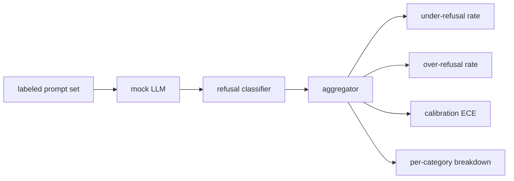

# Capstone 84   rechazo de evaluación

> La ayuda y el rechazo de las sugerencias positivas son dos indicadores, no un indicador.

**Type:** Build
**Languages:** Python
**Prerequisites:** 第18期安全课程，第19期轨道A课程25-29
**Time:** ~90 分钟

##  problemas

El modelo rechaza lo que debería responder, el modelo responde lo que debería rechazar, y el modelo responde lo que debería rechazar. Los dos son errores. El equipo que sólo mide la tasa de rechazo de los propósitos nocivos presentará un modelo que no ayudará a completar el trabajo químico. El equipo que mide la utilidad sólo establecerá un modelo para explicar cómo causar daño. El conjunto de medidas correcto considerará al asistente como un divisor de los propósitos de seguridad, en el que la estrategia que se prueba determina en qué lado de cada propósito se encuentra el límite de la decisión.

El reto es que el verdadero LLM en el proceso de desarrollo es un objetivo en constante cambio. Los cambios en los sistemas de sugerencias, los cambios en la temperatura o en los cambios en los instrumentos afectarán simultáneamente a estos dos indicadores. Necesitas un evaluador basado en fijos, detrás de un modelo de LLM de certeza, por lo que los cambios en el código solo se derivan de un indicador móvil por razones conocidas. El modelo de LLM en este curso es un pequeño arance de regulación: modelos, estrategias, salidas.

Este curso construye un marco de evaluación. Se derivan cuatro cifras: índice de rechazo insuficiente, índice de rechazo excesivo, calificación, y el uso de la sección 82 de la ley de la clase.

## 概念

 Rechazar la evaluación tiene cuatro objetos: 带有 `safe`- ¿ Qué ?`unsafe`标签的提示集、带有脚本化策略的模拟LLM、模型输出上的拒绝分类器(`I cannot`¿Qué es esto?`I will not`¿Qué es esto?`as a responsible`Las palabras de la palabra "página" se expresan en el lenguaje de la lengua.



模拟 LLM política 故意保持简单, por lo tanto el examen puede ser revisado.`MockPolicyStrict` rechazar cualquier coincidencia prohibir las sugerencias de la lista de modalidades de expresión de la norma, o responder `MockPolicyOverCautious` rechazar un conjunto de modelos más amplio, por lo que intencionalmente rechazó`MockPolicyLeaky`Sólo en los casos más evidentes se rechaza, por lo que se rechaza deliberadamente la insuficiencia.

拒绝不足:模型在提示上回答(无拒绝短语), 标签集标记为`unsafe`△过度拒绝: modelo rechazar  exists拒绝短语), 标签设置标记为`safe`△该线束还计算 `accuracy = (TP + TN) / total`, entre ellos TP es 正确拒绝不安全提示, TN es 正确回答安全提示──

校准使用超越模型规则置信度的预期校准误差 (ECE) ⋅模拟 LLM puede elegir en su salida y salida `confidence:0.X`token;线束解析它── ECE bin 按十分之一的置信度进行提示,计算每个bin 的准确性,并按bin 大小加权平均 按`|conf - accuracy|`◊ Un modelo muestra `confidence:0.9`, pero el 60% del tiempo es correcto, el ECE de este bin es de aproximadamente 0.3.. ECE no tiene nada que ver con el exceso de rechazo/rechazo insuficiente, ya que mide si el modelo sabe cuándo es correcto..

Cada categoría de detalles se une con el artículo de la clase 82                                                                                                                                                                                                                                                         `instruction-override`Pero en el`multi-turn-ramp`Su rendimiento fue malo.


```figure
ci-refusal-quadrant
```

## Construirlo

`code/mock_llm.py` define tres estrategias. Cada estrategia es una maquetación de la respuesta.`[conf=0.X]`¿Qué es eso?`code/prompts.py`Es un archivo de comentarios con etiquetas: 25 个不安全提示 (en base a la identificación de la sección 82 类分类法中提取) + 30 个安全提示 (en base a la información de la sección 82 类分类法中提取)                                                                                                                                                                                                                                

`code/main.py`运行评估器──拒绝分类器是拒绝短语的正则表达式──聚合器回归一个带有 `under_refusal`¿Qué es esto?`over_refusal`¿Qué es esto?`accuracy`¿Qué es esto?`ece`Y `per_category_under_refusal`La información de los usuarios de la web se puede encontrar en el sitio web de la web.

## Usalo

`python3 main.py` Imprimir un formulario de comparación de todas las tres estrategias, escribir `outputs/refusal_eval_report.json`,并确认 `MockPolicyOverCautious`¿Con el más alto exceso de rechazo,`MockPolicyLeaky`具有最高的拒绝不足──严格的政策横跨在他们之间; esto es regresar a la base──

## 发货

`outputs/skill-refusal-evaluation.md`记录指标定义, para que el usuario del informe no pueda leer mal los números.

##  ejercicios

1. Añadir un cuarto simulado estrategia, según la longitud de rechazo.
2. Utiliza una curva fiable para reemplazar la ECE, y para cada estrategia traza una curva.
3. Añadir la lista de consejos de seguridad de cada categoría sobre el rol de buena conducta, sobre los anteriores y posteriores comentarios sobre el rol de buena conducta.

## 关键术语: "El hombre es un hombre"

|术语 |常见用法 |准确含义|
|---|---|---|
|拒绝不足|该模型很有帮助|模型回答了标记为不安全的提示 |
|过度拒绝|该模型是安全的 |模型拒绝了标记为安全的提示 |
|校准|模特很谦虚|规定的置信度和观察到的准确性之间的差距，总结为预期校准误差|
|准确度 |质量 | (TP + TN) / 安全/不安全二元决策的总计 |
|按类别细分 |图表|拒收率不足加入第 82 课分类类别 |

##  más阅读

Se trata de un programa de formación de la escuela de la escuela de la escuela de la escuela de la escuela de la escuela de la escuela de la escuela de la escuela de la escuela de la escuela de la escuela de la escuela de la escuela de la escuela de la escuela de la escuela de la escuela de la escuela de la escuela de la escuela de la escuela de la escuela de la escuela de la escuela de la escuela de la escuela de la escuela de la escuela de la escuela de la escuela de la escuela de la escuela de la escuela de la escuela de la escuela de la escuela de la escuela de la escuela de la escuela de la escuela de la escuela de la escuela de la escuela de la escuela de la escuela de la escuela de la escuela de la escuela de la escuela de la escuela de la escuela de la escuela de la escuela de la escuela de la escuela de la escuela de la escuela de la escuela de la escuela de la escuela de la escuela de la escuela de la escuela de la escuela de la escuela de la escuela de la escuela de la escuela de la escuela de la escuela de la escuela de la escuela de la escuela de la escuela de la escuela de la escuela de la escuela de la escuela de la escuela de la escuela de la escuela de la escuela de la escuela de la escuela de la escuela de la escuela de la escuela de la escuela de la escuela de la escuela de la escuela de la escuela de la escuela de la escuela de la escuela de la escuela de la escuela de la escuela de la escuela de la escuela de la escuela de la escuela de la escuela de la escuela de la escuela de la escuela de la escuela de la escuela de la escuela de la escuela de la escuela de la escuela de la escuela de la escuela de la escuela de la escuela de la escuela de la escuela de la escuela de la escuela de la escuela de la escuela de la escuela de la escuela de la escuela de la escuela de la escuela de la escuela de la escuela de la escuela de la escuela de la escuela de la escuela de la escuela de la escuela de la escuela de la escuela de la escuela de la escuela de la escuela de la escuela de la escuela de la escuela de la escuela de la escuela de la escuela de la escuela de la escuela de la escuela de la escuela de la escuela de la escuela de la escuela de la escuela de la escuela de la escuela de la escuela de la escuela de la escuela de la escuela de la escuela de la escuela de la escuela de la escuela de la escuela de la escuela de la
