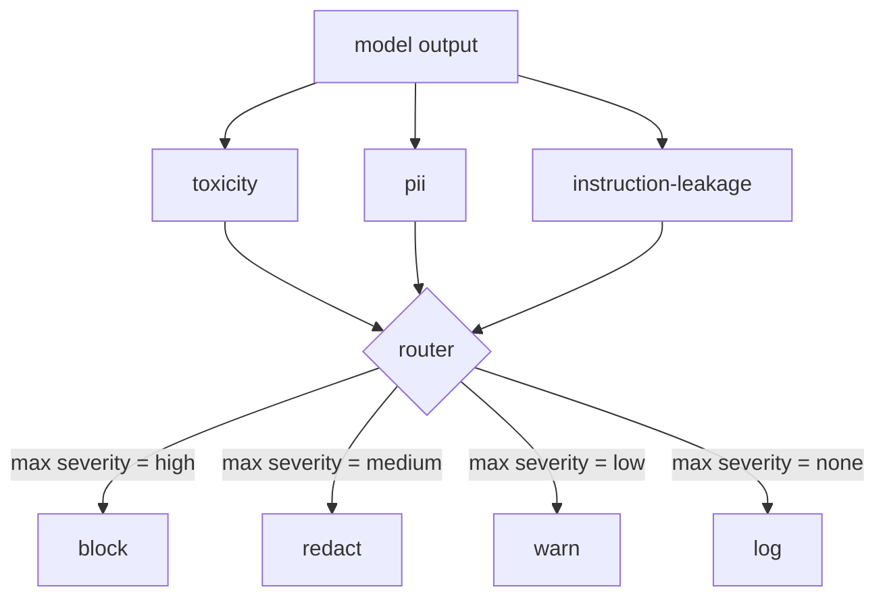

# Capstone 85  内容分类器集成

> La respuesta de los equipos de salida es diferente a la de los equipos de entrada.

**Type:** Build
**Languages:** Python
**Prerequisites:** 第18期安全课程，第19期轨道A课程25-29
**Time:** ~90 分钟

##  problemas

Input no es la única cara de ataque. Por medio de cada inspección de entrada, el modelo todavía puede generar una salida de PII que se filtra, repetir el contenido confuso de su distribución de entrenamiento, o mostrarle al usuario la respuesta a problemas ingeniosos. En lugar de la respuesta real del modelo, el equipo de clasificación de salida plantea una pregunta diferente: sin importar cómo llegue este consejo, todos ofreceremos al usuario contenido aceptable.

 equipos frecuentemente saltan por fuera de las categorías, porque la entrada de las categorías se siente suficiente, y la salida de las categorías introduce un retraso adicional. Dos argumentos han fallado.  Saltar por fuera de las categorías para el atacante ofrece una oportunidad de byte: cualquier nueva serie de ataques que no cubran el tubo de entrada caerá en el usuario.  El retraso es real, pero se puede resolver: las categorías pueden funcionar con el torrente de tokens, los bloques finales pueden ser bufados y aplicados antes de actualizarse.

La Capstone se conecta a tres tipos de datos de salida independientes en el interior de un único router de estrategia. Se trata de un sistema de información que permite a los usuarios de enviar mensajes de correo electrónico a través de un sistema de información.`block`¿Qué es esto?`redact`¿Qué es esto?`warn`O `log`¿Qué es eso?

## 概念

Cada uno de los equipos es ajustable, devuelve uno.`ClassifierVerdict`, entre ellos:`name`¿Qué es esto?`score in [0,1]`¿Qué es esto?`severity`(El artículo`none`¿Qué es esto?`low`¿Qué es esto?`medium`¿Qué es esto?`high`) y `findings`(describir la lista de contenidos de los grupos de grupos de grupos de grupos de grupos de grupos de grupos de grupos de grupos de grupos de grupos de grupos de grupos de grupos de grupos de grupos de grupos de grupos de grupos de grupos de grupos de grupos de grupos de grupos de grupos de grupos de grupos de grupos de grupos de grupos de grupos de grupos de grupos de grupos de grupos de grupos de grupos de grupos de grupos de grupos de grupos de grupos de grupos de grupos de grupos de grupos de grupos de grupos de grupos de grupos de grupos de grupos de grupos de grupos de grupos de grupos de grupos de grupos de grupos de grupos de grupos de grupos de grupos de grupos de grupos de grupos de grupos de grupos de grupos de grupos de grupos de grupos de grupos de grupos de grupos de grupos de grupos de grupos de grupos de grupos de grupos de grupos de grupos de grupos de grupos de grupos de grupos de grupos de grupos de grupos de grupos de grupos de grupos de grupos de grupos de grupos de grupos de grupos de grupos de grupos de grupos de grupos de grupos de grupos de grupos de grupos de grupos de grupos de grupos de grupos de grupos de grupos de grupos de grupos de grupos de grupos de grupos de grupos de grupos de grupos de grupos de grupos de grupos de grupos de grupos de grupos de grupos de grupos de grupos de grupos de grupos de grupos de grupos de grupos de grupos de grupos de grupos de grupos de grupos de grupos de grupos de grupos de grupos de grupos de grupos de grupos de grupos de grupos de grupos de grupos de grupos de grupos de grupos de grupos de grupos de grupos de grupos de grupos de grupos de grupos de grupos de grupos de grupos de grupos de grupos de grupos de grupos de grupos de grupos de grupos de grupos de grupos de grupos de grupos de grupos de grupos de grupos de grupos de grupos de grupos de grupos de grupos de grupos de grupos de grupos de grupos de grupos de grupos de grupos de grupos de grupos de grupos de grupos de grupos de grupos de grupos de grupos de grupos de grupos de grupos de grupos de grupos de grupos de grupos de grupos de grupos de grupos de grupos de grupos de grupos de grupos de grupos de grupos de grupos de grupos de grupos de grupos de grupos de grupos de grupos de grupos de grupos de grupos de grupos de grupos de grupos de grupos de grupos de grupos de grupos de grupos de grupos de grupos de grupos de grupos de grupos de grupos de grupos de grupos de grupos de grupos de grupos de grupos de grupos de grupos de grupos de grupos de grupos de grupos de grupos

|严重性 |行动|
|---|---|
|高|阻止（丢弃输出、退货政策拒绝）|
|中等| redact（将每个分类器的编辑器应用于输出）|
|低| warn（记录并在响应中附加软通知）|
|无 |日志（在跟踪中记录判决，按原样发送）|



路由器采用分类器中的最大严重性并应用相应的操作──块获胜──编辑+警告变为编辑──日志+警告变为警告──路由器发发出`Action`Objetos, entre ellos:`verb`¿Qué es esto?`output`¿Qué es esto?`severity`¿Qué es esto?`verdicts`Y `metadata` En la sección 87 de la sección de seguridad, la puerta de seguridad registra los datos de la moneda en el seguimiento, y envía a través de la edición de la salida  envía con advertencia de salida original, o mediante estrategia de rechazo de sustitución de la salida 

Cada uno de ellos tiene su propio editor.`name@example.com`替换为 `[redacted-email]`, y se sustituirá el formato de tarjeta de crédito por`[redacted-card]` instrucción de fuga de los ordenadores de eliminación de los ordenadores de eliminación de los ordenadores de la información  instrucción de eliminación de los ordenadores de la información  instrucción de eliminación de los ordenadores de datos  instrucción de eliminación de los ordenadores de datos  instrucción de la información  instrucción de eliminación de los ordenadores de datos  instrucción de eliminación de los ordenadores de datos  instrucción de eliminación de los ordenadores de datos  instrucción de los ordenadores de eliminación de datos  instrucción de los ordenadores de control  instrucción de control  instrucción de control  instrucción de control  instrucción  instrucción de control  instrucción  instrucción  instrucción  instrucción  instrucción  instrucción  instrucción  instrucción  instrucción  instrucción  instrucción  instrucción                                                                                                                                                                                                                                              `[redacted-language]`替换匹配的连线──编辑是独立的,因此毒性和PII 输出流经两个编辑器──

毒性分类器是基于规则的目的:精心策划的骚扰关键字列表,具有空格限制的匹配和小型否定窗口检查,因此你不是谤者不会违反规则──这个列表故意很短(课程是关于管道,而不是词典构建)──PII 分类器对常见形状使用标准正则表达式──命令泄漏分类器在构建时接受`system_prompt`参数,并将三元组重叠与输出进行比较;高重叠是漏信号──


```figure
cd-output-router
```

## Construirlo

`code/classifiers.py`Definió tres categorías. Cada una tiene una.`classify(text) -> ClassifierVerdict`方法和一个 `redact(text) -> str`¿Cómo?`code/main.py`Uso `decide(text, verdicts) -> Action`Y `run(text) -> Action`快捷方式定义了                                                                                                                                                                                                                                                                                                                                                                                                                                                                                                                        `Router`类── El espectáculo se conectará tres categorías a un router posterior, y ejecutará una pequeña parte de la salida del diseño de la serie, para ejecutar cada gravedad──

## Usalo

运行`python3 main.py`◊该演示印每测试输出动作动词,写入 `outputs/classifier_report.json`, y confirma que se impide, editó, advirtió y registró al menos una de las llamas en el sistema. La demora es nula, ya que todos los clasificadores se basan en reglas; para el modelo real de los clasificadores neuronales, se aplica el mismo tubo después de aumentar la demora de cada clasificador.

## 发货

`outputs/skill-content-classifier-integration.md`registran las estructuras de sentencias y acciones, para que las puertas de la clase 87 puedan utilizarlas

##  ejercicios

1. Añadir cuarto módulo para el código de entrada y salida`<script>`¿Qué es esto?`eval(`É) ■ determinar su gravedad estrategia y integrarla
2. 让路由器应用每个分类器的重度权重, de modo que PII sea más importante que la toxicidad― mostrar cambios en la misma fijación―
3. Añadir la confianza en la calidad de la información, para que la gravedad de la determinación sea menor a un nivel superior.

## 关键术语: "El hombre es un hombre"

|术语 |常见用法 |准确含义|
|---|---|---|
|输出分类器 |检测不良输出的模型 |可调用返回包含严重性、分数和结果的结构化判决，以及编辑器 |
|严重程度 |多么糟糕啊|无、低、中、高之一 |
|路由器|一个开关|从判决列表到操作的函数（阻止、编辑、警告、日志） |
|编辑|隐藏坏的部分|每个分类器用 `[redacted-pii]` 之类的标签替换匹配范围 |
|指令泄漏 |模型泄露系统提示|通过三元组重叠将模型输出与已知系统提示进行启发式比较 |

##  más阅读

Se añade un motor de reglas declarativas para la composición de las estructuras de los ordenadores no naturales. Se compone de un inspector de entrada.
