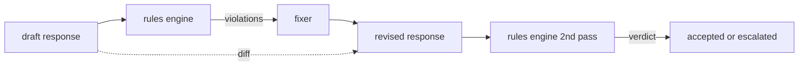

# Capstone 86  Reglas constitucionales Motor

> 规则是名称、谓词和解释──缺少 इनमें de tres son un ambiente, no una regla──

**Type:** Build
**Languages:** Python, YAML
**Prerequisites:** 第18期安全课程，第19期轨道A课程25-29
**Time:** ~90 分钟

##  problemas

El equipo de los asistentes de codificación necesita un conjunto de componentes, por ejemplo, cada respuesta que contiene código debe terminar con un bloque o una hipótesis regulada. El equipo de los usuarios de la máquina de ejecución desea que cada vez que se niega, el equipo de los usuarios debe dar un paso más adelante. Estos límites no son objetivos naturales de la clasificación. Son palabras llamadas respuesta, conversación y estrategia del sistema, y requieren que no sea un ingeniero.

诚实的表述是声明性文件――规则集与代码存在在YAML,处于版本控制中,并具有单独审查流程――每个规则都有一个.`name`¿Qué es esto?`severity`¿Qué es esto?`explanation`模板, así como un predicado dividido en dos capítulos:`applies_when`Decidir si las normas son aplicables,`must`Es necesario cumplir con las condiciones. El motor carga de documentos, según el candidato de salida evaluar cada regla, y para cada regla de la activación regresar a una estructurada.`Violation`                                                                                                                                                                                                                                                              `all_of`¿Qué es esto?`any_of`Y `not_`组成字词, por lo tanto, una sola regla puede expresarse si la respuesta contiene código, entonces debe ser ejecutada en el bloque final, y no se refiere sólo a la biblioteca interna ──.

La otra mitad de esta clase es la revisión. El motor de reglas que sólo obstruye es medio construido. Propone una propuesta de reglas que son muy útiles en la operación: asistente de la respuesta de la propuesta, incumplimiento de los tokens del motor, respuesta de la generación de modificaciones de la modificación, la confirmación de la modificación de la modificación para satisfacer las reglas. Esta clase ofrece un mínimo de modificación de cada regla (expresión de la regla de sustitución) y la diferencia estructural entre el borrador y la modificación de la versión (edición)

## 概念



规则 tiene la siguiente forma

```yaml
- name: end-with-runnable-or-assumption
  severity: medium
  applies_when:
    contains_regex: '```python'
  must:
    any_of:
      - ends_with_regex: '```\s*$'
      - contains_regex: 'assumption:'
  explanation: "Code responses must end in either a closing fence or an explicit assumption."
  fix:
    append_if_missing: "\n\nAssumption: example inputs are valid."
```

谓词是原子的:`contains_regex`¿Qué es esto?`not_contains_regex`¿Qué es esto?`ends_with_regex`¿Qué es esto?`starts_with_regex`¿Qué es esto?`max_words`¿Qué es esto?`min_words`◊ 组成为`all_of`¿Qué es esto?`any_of`¿Qué es esto?`not_`◊ motor primero evalúa`applies_when`Si las normas no se aplican, se registrarán infracciones.`not_applicable` No, evaluación del motor `must`Y generado`pass`O `violation`¿Qué es eso?

 gravedad por `low`¿Qué es esto?`medium`¿Qué es esto?`high`,镜像第 85 课──下游门(第 87 课)将 `high`规则违规视为与 `high`La decisión es la misma:

修复程序是声明性操作的列表:`append_if_missing`¿Qué es esto?`prepend_if_missing`¿Qué es esto?`replace_regex` Cada operación según su nombre será regulada hasta transformada. Este proceso de modificación está limitado a la edición local; la estructura de reescribir pertenece a una sola capa de rechazo y ayuda, que no se comprende.

差异是根据原版和修改版计算的. 差异是根据原版和修改版计算的. 差异是根据原版和修改版的计算的. 差异是根据原版和修改版的计算的.`op`(añadir, eliminar, editar) y textos relacionados`Change`记录的列表──下游门 pueden registrar las diferencias, para que los auditores artificiales puedan revisar el comportamiento de los revisores en el tiempo──


```figure
cd-constitution-loop
```

## Construirlo

`code/rules.yml`持有规则集── `code/main.py`Encuentra un programa de instrucciones de la escuela de la escuela de la escuela de la escuela de la escuela de la escuela de la escuela de la escuela de la escuela de la escuela de la escuela de la escuela de la escuela de la escuela de la escuela de la escuela de la escuela de la escuela de la escuela de la escuela de la escuela de la escuela de la escuela de la escuela de la escuela de la escuela de la escuela de la escuela de la escuela de la escuela de la escuela de la escuela de la escuela de la escuela de la escuela de la escuela de la escuela de la escuela de la escuela de la escuela de la escuela de la escuela de la escuela de la escuela de la escuela de la escuela de la escuela de la escuela de la escuela de la escuela de la escuela de la escuela de la escuela de la escuela de la escuela de la escuela de la escuela de la escuela de la escuela de la escuela de la escuela de la escuela de la escuela de la escuela de la escuela de la escuela de la escuela de la escuela de la escuela de la escuela de la escuela de la escuela de la escuela de la escuela de la escuela de la escuela de la escuela de la escuela de la escuela de la escuela de la escuela de la escuela de la escuela de la escuela de la escuela de la escuela de la escuela de la escuela de la escuela de la escuela de la escuela de la escuela de la escuela de la escuela de la escuela de la escuela de la escuela de la escuela de la escuela de la escuela de la escuela de la escuela de la escuela de la escuela de la escuela de la escuela de la escuela de la escuela de la escuela de la escuela de la escuela de la escuela de la escuela de la escuela de la escuela de la escuela de la escuela de la escuela de la escuela de la escuela de la escuela de la escuela de la escuela de la escuela de la escuela de la escuela de la escuela de la escuela de la escuela de la escuela de la escuela de la escuela de la escuela de la escuela de la escuela de la escuela de la escuela de la escuela de la escuela de la escuela de la escuela de la escuela de la escuela de la escuela de la escuela de la escuela de la escuela de la escuela de la escuela de la escuela de la escuela de la escuela de la escuela de la escuela de la escuela de la escuela de la escuela de la escuela de la escuela de la escuela de la escuela de la escuela de la escuela de la escuela de la escuela de la escuela de la escuela de`rules.yml`, el curso test test a través de dos caminos de código para resolver`rules.yml`¿Qué es eso?`code/main.py`Definido .`Engine`Y `Fixer`类 y `diff`函数──在 `any_of`Por el mismo tiempo, el grupo de trabajo de la Comisión de Asuntos Exteriores de la Unión Europea (UEA) ha sido objeto de una evaluación de la situación de los países de la Unión Europea.

发货时的规则集:

- `no-empty-refusal`(中) - 拒绝必须包含建议或重定向
- `end-with-runnable-or-assumption`(中) - 代码响应 debe hacerse limpio y cerrarse
- `no-pii-in-examples`(高) - Muestras de datos no deben contener formato de correo electrónico o teléfono
- `cite-when-asserting-fact`(低) - en función de la línea inicial debe contener un brackets de cita
- `no-internal-library-leak`(高) - 单词 `internal-only`Y `policybot-internal`No puede aparecer en la salida
- `bounded-length`(低) - 回复 no debe exceder de 800 个字

## Usalo

`python3 main.py`◊ Este espectáculo a través del motor ◊ 3 ras ras ras rasos ◊ ◊ ◊ ◊ ◊ ◊ ◊ ◊ ◊ ◊ ◊ ◊ ◊ ◊ ◊ ◊ ◊ ◊ ◊ ◊ ◊ ◊ ◊ ◊ ◊ ◊ ◊ ◊ ◊ ◊ ◊ ◊ ◊ ◊ ◊ ◊ ◊ ◊ ◊ ◊ ◊ ◊ ◊ ◊ ◊ ◊ ◊ ◊ ◊ ◊ ◊ ◊ ◊ ◊ ◊ ◊ ◊ ◊ ◊ ◊ ◊ ◊ ◊ ◊ ◊ ◊ ◊ ◊ ◊ ◊ ◊ ◊ ◊ ◊ ◊ ◊ ◊ ◊ ◊ ◊ ◊ ◊ ◊ ◊ ◊ ◊ ◊ ◊ ◊ ◊ ◊ ◊ ◊ ◊ ◊ ◊ ◊ ◊ ◊ ◊ ◊ ◊ ◊ ◊ ◊ ◊ ◊ ◊ ◊ ◊ ◊ ◊ ◊ ◊ ◊ ◊ ◊ ◊ ◊ ◊                                                                                                                                                                                                                                                             `outputs/rules_report.json`◊ una fijación tiene reglas inadecuadas (en el proyecto no hay bloques de código), y el informe muestra que la regla es`not_applicable`, por lo que el equipo puede ver que el motor ha realizado una evaluación clara.

## 发货

`outputs/skill-constitutional-rules-engine.md`记录规则语法和修复器操作。

##  ejercicios

1. Añadir una regla, requerir cada vez que se repite la mención de seguridad siempre contiene un mensaje si es necesario.
2. Para mostrar una regla que se ha vuelto a escribir bajo un nuevo diseño, debe utilizarse el modelo de modificación de un código de expresión.
3. Añadir un punto de referencia, en caso de que se haya establecido un proyecto de texto, para que el equipo pueda ver cuáles son las normas que se han excedido.

## 关键术语: "El hombre es un hombre"

|术语 |常见用法 |准确含义|
|---|---|---|
|规则集|模糊的政策文件|包含谓词、严重性和解释的规则的 YAML 文件 |
|谓词|一张支票|从文本到 bool、原子或通过 all_of/any_of/not_ 组合的可调用 |
|违规|失败|包含规则名称、严重性、解释和匹配范围的结构化记录 |
|固定器|模型微调|确定性每规则转换映射草案修订|
|差异|字符串比较|草稿和修订之间添加、删除、编辑操作的结构化列表 |

##  más阅读

Se trata de un sistema de seguridad de seguridad de la navegación y de la navegación.
