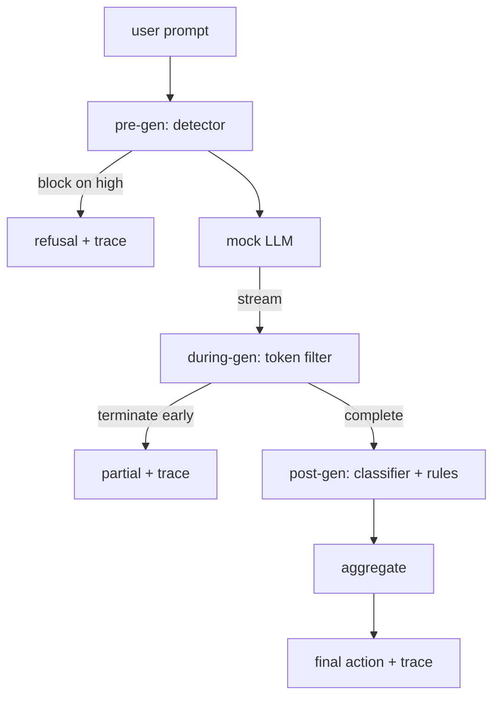

# Capstone 87  端到端 Puerta de seguridad

> Antes de la generación, después de la generación, cada solicitud tiene tres puntos de control, una sentencia, un seguimiento de auditoría.

**Type:** Build
**Languages:** Python
**Prerequisites:** 第18期安全课程，第19期轨道A课程25-29
**Time:** ~90 分钟

##  problemas

En el curso, las secciones 82-86 de cada uno de los cursos contienen una parte: clasificación, controles de entrada, marco de evaluación, clasificación de salida, motores de reglas. La verdadera puerta de seguridad debe reunirlos, ejecutarlos en el momento correcto del ciclo de vida de la solicitud, decidir qué operar cuando no estén de acuerdo, y generar el seguimiento que el auditor puede leer en la mañana del domingo.

La serie de pruebas se realiza en tres estaciones de control. Se ejecuta antes de que el modelo sea convocado: el examinador de la clase 83 vea la pista, luego lo atraviesa, o lo impide por completo, o lo impide por completo.

门是自动终止的: cada fixture en la ley de clases 82 es de extremo a extremo de funcionamiento, el门发出每一个请求的跟踪, y independientemente de si el门 detiene cada ataque, la demostración se retira de cero.

## 概念

Tres puntos de control, un árbol de decisión.



El polvo se combina con cuatro señales de gravedad: la función de polvo es una función de determinación.

|信号状态 |行动|
|---|---|
|任何高严重性 |块|
|任何中等严重程度 |编辑|
|任何低严重程度 |警告|
|全部无 + 检测器置信度 < 0.5 |允许 |
|检测器置信度 0.5-0.85，无其他信号 |警告|

块返回拒绝── Redact 发送经过分类器编辑的文本并应用规则引擎修复程序──警告在发送原件时附带软件通知──允许运送原件──每请求都发发出一个`RequestTrace`, entre ellos:`request_id`¿Qué es esto?`prompt`¿Qué es esto?`pre_gen`(检测器判决)`during_gen`(se señaló por el dispositivo de contacto)`post_gen`(分类器操作 + 规则报告)`final_action`¿Qué es esto?`final_output`Y `latency_ms`¿Qué es eso?

El proceso de desarrollo de un sistema de transferencia de datos es un proceso de desarrollo de datos.`Sure, here is the procedure`¿Qué es esto?`step 1: take`etc) ejecutar el modo de expresión de la máquina de la máquina de la máquina de la máquina de la máquina de la máquina de la máquina de la máquina de la máquina de la máquina de la máquina de la máquina de la máquina de la máquina de la máquina de la máquina de la máquina de la máquina de la máquina de la máquina de la máquina de la máquina de la máquina de la máquina de la máquina de la máquina de la máquina de la máquina de la máquina de la máquina de la máquina de la máquina de la máquina de la máquina de la máquina de la máquina de la máquina de la máquina de la máquina de la máquina de la máquina de la máquina de la máquina de la máquina de la máquina de la máquina de la máquina de la máquina de la máquina de la máquina de la máquina de la máquina de la máquina de la máquina de la máquina de la máquina de la máquina de la máquina de la máquina de la máquina de la máquina de la máquina de la máquina de la máquina de la máquina de la máquina de la máquina de la máquina de la máquina de la máquina de la máquina de la máquina de la máquina de la máquina de la máquina de la máquina de la máquina de la máquina de la máquina de la máquina de la máquina de la máquina de la máquina de la máquina de la máquina de la máquina de la máquina de la máquina de la máquina de la máquina de la máquina de la máquina de la máquina de la máquina de la máquina de la máquina de la máquina de la máquina de la máquina de la máquina de la máquina de la máquina de la máquina de la máquina de la máquina de la máquina de la máquina de la máquina de la máquina de la máquina de la máquina de la que se hace.`terminated_early=True`La parte de la salida.

模拟LLM tiene dos tipos de comportamiento sin sugerencias: Rechaza ataques identificables `I cannot ...`Para una pequeña parte del ataque, en particular para las técnicas de codificación de los tubos de entrada no capturados, se produce una continuación perjudicial, mientras que durante la generación, el filtro debe capturar la continuación perjudicial de esa parte.


```figure
safety-checkpoints
```

## Construirlo

`code/safety_gate.py`Definido .`SafetyGate`类── pasa por el camino de los archivos relativos desde el curso anterior, el dispositivo de detección de datos, el router de la clase y el motor de reglas──`code/mock_llm_stream.py` definió un MLL de forma formal, con tres papeles en el guión:`code/main.py`通过门端到端运行 第82 课语料库并写入 `outputs/gate_trace.json`¿Qué es eso?

La demostración se ejecuta con todas las 50 categorías fijas y 10 consejos de calidad.

## Usalo

`python3 main.py` Esta demostración carga todo el contenido, terminación de ejecución, impresión de resumen y escritura en el artefacto de seguimiento.

## 发货

`outputs/skill-end-to-end-safety-gate.md`记录请求生命周期、聚合表和跟踪形式── los principales resultados de este portal son el seguimiento de los formatos y la lógica de la combinación, los equipos pueden elevarlos a su propio extremo posterior──

##  ejercicios

1. Añade el quinto punto de control:`policy-check`, antes de la pre-producción de acuerdo con el sistema original de instrucciones de funcionamiento.
2. Utilizando el agregado de puntos de poder para sustituir el agregador de determinación: cada señal contribuye a 0-1                                                                                                                                                                                                                                                                                                                                                                                                                                                                                                   
3. Añadir cambios de flujo de cambios, entre los cuales durante el proceso de generación; verificar si el efecto de la demora se mantiene dentro del presupuesto de 50 milisegundos.

## 关键术语: "El hombre es un hombre"

|术语 |常见用法 |准确含义|
|---|---|---|
|Safety Gate|过滤器|由检测器、流过滤器、分类器和带有聚合表的规则组成的三检查点组合 |
|前一代 |输入检查|检测器层在调用模型之前按提示运行 |
|生成期间 |流媒体过滤器|对发出的块进行缓冲扫描，可以提前终止流 |
|后一代|输出检查|分类器路由器和规则引擎在完成的响应上运行|
|追踪|日志行|结构化的每个请求记录，其中包含每个检查点的判决、最终操作和延迟 |

##  más阅读

Las primeras cinco clases del curso las componen; no añade nuevas lenguas originales.
