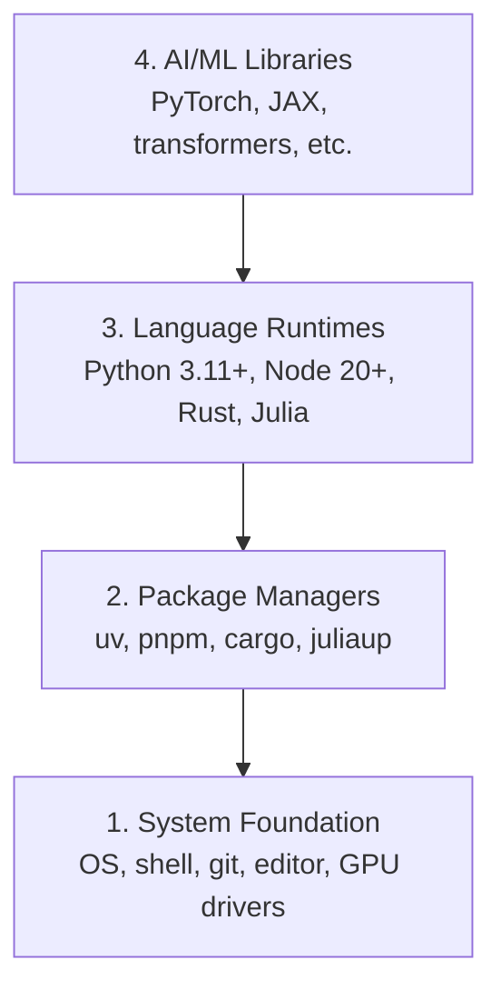

# Environnement de développement

> Vos outils vont façonner votre façon de penser. Une fois, une fois, une fois.

**Type:** Build
**Languages:** Python, Node.js, Rust
**Prerequisites:** None
**Time:** ~45 分钟

## Objectif de l'apprentissage
- Depuis zéro, nous avons mis en place Python 3.11+、Node.js 20+ 和 Rust toolchains
-  Configurer des environnements virtuels et des gestionnaires de paquets, afin de réaliser des constructions réalisables
- Utilisation de l'accès à la GPU CUDA/MPS 验证,并运行一个测试 Tensor operation
- Comprendre les quatre niveaux de stack: systèmes, paquets, temps d'exécution, bibliothèques d'IA

##  problématique
Vous allez utiliser Python, TypeScript, Rust et Julia pour apprendre 500+ sections d'ingénierie AI. Si votre environnement est défectueux, chaque section de la classe deviendra un outil de lutte, et non un outil d'apprentissage.

La plupart des gens sautent la configuration de l'environnement. Ensuite, ils passent quelques heures à déboguer les erreurs d'importation, les conflits de version et l'absence de pilotes CUDA.

## 概念
Un environnement d'ingénierie AI a quatre niveaux:



Nous sommes installés en bas. Chaque étage dépend de la couche inférieure.


```figure
s0-env-stack
```

## - Je le construis.
### 步骤 1: Fondation du système

Check votre système et installer les composants de base.

```bash
# macOS
xcode-select --install
brew install git curl wget

# Ubuntu/Debian
sudo apt update && sudo apt install -y build-essential git curl wget unzip

# Windows (use WSL2)
wsl --install -d Ubuntu-24.04
```

### 步骤 2: Python avec uv

Nous utilisons`uv`Il est 10 à 100 fois plus rapide que le pip et traite automatiquement les environnements virtuels.

```bash
curl -LsSf https://astral.sh/uv/install.sh | sh

uv python install 3.12

uv venv
source .venv/bin/activate  # or .venv\Scripts\activate on Windows

uv pip install numpy matplotlib jupyter
```

验证:

```python
import sys
print(f"Python {sys.version}")

import numpy as np
print(f"NumPy {np.__version__}")
a = np.array([1, 2, 3])
print(f"Vector: {a}, dot product with itself: {np.dot(a, a)}")
```

### 步骤 3: Node.js avec pnpm

Utilisé par TypeScript  cours ]]> agents, serveurs MCP, applications web)

```bash
curl -fsSL https://fnm.vercel.app/install | bash
fnm install 22
fnm use 22

npm install -g pnpm

node -e "console.log('Node', process.version)"
```

Fnm Installation du processus`unzip`, la défaillance des temps`Not installing fnm due to missing dependencies.`退出: dans Linux, il doit débrancher un zip 归档, dans macOS 通过 Homebrew安装──macOS自带 `unzip`Ubuntu、Debian 和 WSL2 会通过步骤 1 的 apt 命令安装它(si vous avez sauté cette étape, fonctionne `sudo apt install -y unzip`)。

**macOS / Apple Silicon（M1/M2/M3/M4）：**Si l' installation est nécessaire`Error: Cannot install under Rosetta 2 in ARM default prefix (/opt/homebrew)`Arrêtez, expliquez votre terminal fonctionne à Rosetta 2`arch`                                                                                                                                                                                                                                                                                                                                                                                                                                                                                                                             `i386`), alors que Homebrew est un constructeur de l'arm64 original.`fnm install 22`开始重新运行:

```bash
arch -arm64 brew install fnm
echo 'eval "$(fnm env --use-on-cd)"' >> ~/.zshrc
source ~/.zshrc
```

### 步骤 4: Rust

Il s'agit d'une approche de la formation et de la formation.

```bash
curl --proto '=https' --tlsv1.2 -sSf https://sh.rustup.rs | sh

rustc --version
cargo --version
```

### 步骤 5: Julia (optionnelle)

Pour Julia, c'est un bon cours de maths.

```bash
curl -fsSL https://install.julialang.org | sh

julia -e 'println("Julia ", VERSION)'
```

### 步骤 6:GPU 设置( si vous avez)

**NVIDIA（Linux / Windows）：**

```bash
nvidia-smi

# Install PyTorch with CUDA
uv pip install torch torchvision torchaudio --index-url https://download.pytorch.org/whl/cu124
```

**macOS / Apple Silicon（M1/M2/M3/M4）：**C'est une situation prévue, pas un problème.**不要**- Je suis là .`--index-url .../cuXXX`(ces roues ne sont applicables qu'à Linux/Windows, installerie failuse)

```bash
uv pip install torch torchvision torchaudio
```

验证( s'applique à toute plateforme):

```python
import torch
print(f"CUDA available: {torch.cuda.is_available()}")           # False on macOS — expected
print(f"MPS available:  {torch.backends.mps.is_available()}")   # True on Apple Silicon
if torch.cuda.is_available():
    print(f"GPU: {torch.cuda.get_device_name(0)}")
```

没有 GPU?没有问题──大多数课程可在CPU上运行──对于训练重的课程,使用Google Colab或云GPU──

### Étape 7: Vérifiez la route que vous voulez commencer

Chaque commande de cette classe est tirée du répertoire de stockage, c'est-à-dire contenue.`README.md`et `phases/`Il est donc possible de voir une conclusion claire, et non une mise en garde.

开始完整的入门序列:

```bash
python3 phases/00-setup-and-tooling/01-dev-environment/code/verify.py --route beginner
```

Ou bien, regardez le chemin que vous voulez parcourir.

```bash
python3 phases/00-setup-and-tooling/01-dev-environment/code/verify.py --route ml-foundations
python3 phases/00-setup-and-tooling/01-dev-environment/code/verify.py --route llm-engineering
python3 phases/00-setup-and-tooling/01-dev-environment/code/verify.py --route agents
python3 phases/00-setup-and-tooling/01-dev-environment/code/verify.py --route mcp
python3 phases/00-setup-and-tooling/01-dev-environment/code/verify.py --route agent-skills
python3 phases/00-setup-and-tooling/01-dev-environment/code/verify.py --route certification
```

Si vous voulez faire en sorte que le même pré-examen et le suivi des cours utilisés pour les outils et dépendances, en plus `--show-later` la carence de l'outil de suivi ne peut jamais empêcher la route choisie

Chaque inspection indispensable échouée fournit un chemin ou une erreur d'importation vérifiée, ainsi qu'une ordonnance de réparation définitive. Les compétences et la certification des agents 路线 路线 路线 路线 路线 路线 路线 路线 路线 路线 路线 路线 路线 路线 路线 路线 路线 路线 路线 路线 路线 路线 路线 路线 路线 路 路线 路线 路线 路线 路线 路线 路线 路线 路线 路线 路线 路线 路线 路 路线 路线 路 路线 路 路线 路 路线 路 路线 路 路线 路 路线 路 路线 路 路线 路 路线 路 路 路 路 路 路 路 路 路 路 路 路 路 路 路 路 路 路 路 路 路 路 路 路 路 路 路 路 路 路 路 路 路 路 路 路 路 路 路 路 路 路 路 路 路 路 路 路 路 路 路 路 路 路 路 路 路 路 路 路 路 路 路 路 路 路 路 路 路 路 路 路 路 路 路 路 路 路 路 路 路 路 路 路 路 路 路 路 路 路 路 路 路 路 路 路 路 路 路 路 路 路 路 路 路 路 路 路 路 路 路 路 路 路 路 路 路 路 路 路 路 路 路 路 路 路 路 路 路 路 路 路 路 路 路 路 路 路 路 路 路 路 路 路 路 路 路 

Lors de l'entrée, l'inspection effectuée imprime les premiers ordres de cours:

```text
Ready to start Beginner course.
Next: python3 phases/01-math-foundations/01-linear-algebra-intuition/code/vectors.py
```

## Utilisez-le
Votre environnement peut déjà commencer à vous inspectant. Les cours suivants, tels que les outils, doivent être réinstallés, ne laissez pas toute une série de techniques vous bloquer.

| Language | Used In | Package Manager |
|----------|---------|-----------------|
| Python | Phases 1-12 (ML, DL, NLP, Vision, Audio, LLMs) | uv |
| TypeScript | Phases 13-17 (Tools, Agents, Swarms, Infra) | pnpm |
| Rust | Phases 12, 15-17 (Performance-critical systems) | cargo |
| Julia | Phase 1 (Math foundations) | Pkg |

## Je le livre.
Ce cours a été créé pour un ouvrage de test que tout le monde peut utiliser pour vérifier sa propre configuration.

Regardez !`outputs/prompt-env-check.md`, dont une aide rapide, à l'aide des assistants d'IA  diagnostiquer les problèmes environnementaux 

## 练习
1. 运行验证脚本并修复 tout échec
2. Pour ce cours, créer un environnement virtuel Python, et installer PyTorch
3. Avec toutes les quatre langues, j'écris un "bonjour au monde", et je fais un tour à tour.

### 提示

**练习 1。**Dans le catalogue des magasins`python3 phases/00-setup-and-tooling/01-dev-environment/code/verify.py --route beginner`, d'abord réparer le premier échec, revoir le suivant, refaire le script, passer tous les contrôles nécessaires, et terminer le processus.

**练习 2。**Dans le répertoire de stockage`uv venv` Créer un environnement et activer, réutiliser étape 6                                                                                                                                                                                                                                                                                                                                                                                                                                                                                                             `python -c "import torch; print(torch.__version__)"`;输出版本号就表示安装成功。

**练习 3。**Utilisation  concept partie de la technique dans les quatre modes de fonctionnement: Python  fonctionne sur le typeScript de Node.js  Rust 和 Julia 分别编写一个小文件,用 `python3`- Je suis là.`npx tsx`(Node.js 不能直接运行 `.ts`文件) 、`cargo run`Ou `rustc`- Je suis là.`julia`Chaque fois que tu fais ça, tu dois imprimer ton message et le faire sortir.
