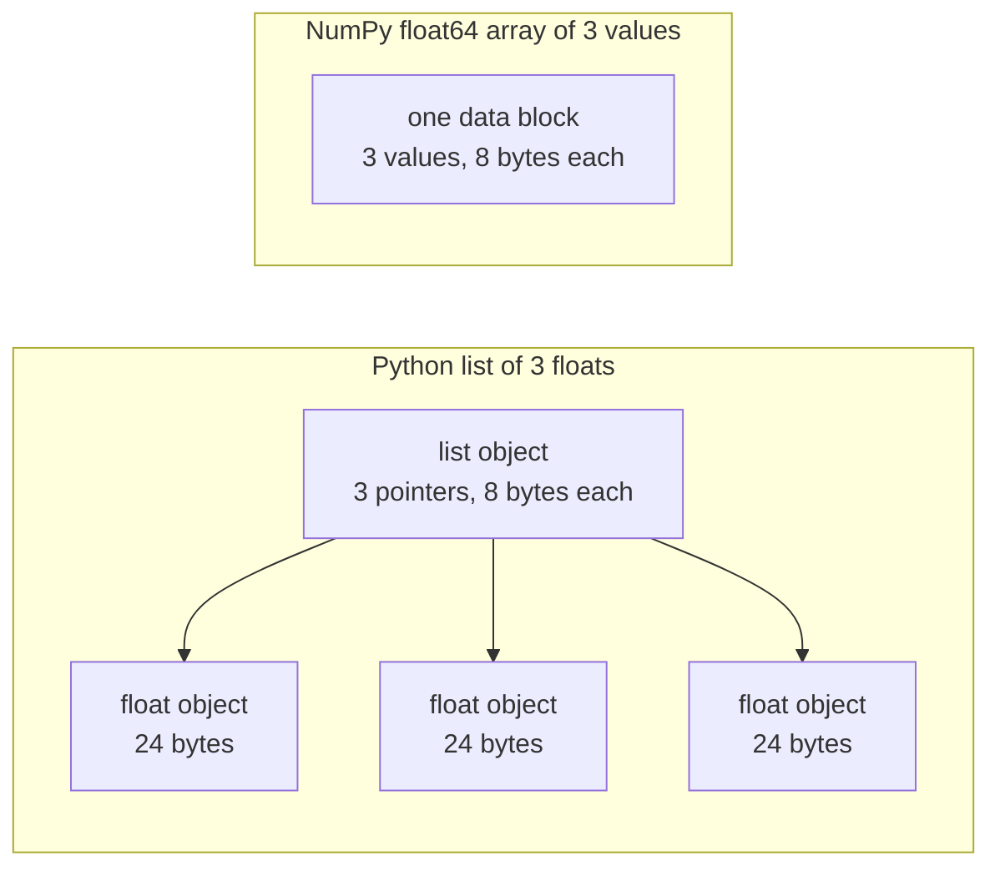

# 面向 AI 工程的Python

> La plupart des codes de ce cours utilisent le même groupe de Python. Avant que les cours de mathématiques et de modèles suivants ne dépendent d'eux, il faut les maîtriser ici.

**Type:** Build
**Languages:** Python
**Prerequisites:** 开发环境、Python 环境
**Time:** ~120 分钟

## Objectif de l'apprentissage

- Le code de lecture est le plus courant, de la décomposition et des caractères à la classification et à la présentation.
-  Trouver trois types de Python qui ne signalent pas d'erreur mais génèrent des résultats erronés : liste de partage ∞ valeur par défaut variable et générateur épuisé ∞
-  utiliser uniquement des bases de données, construire des CSV et des chargeurs JSON  avec des distributeurs de données de graines, ainsi que des petits générateurs de lots
- En Python, il est utilisé pour calculer les points de calcul, la moyenne et la différence de valeur, et mesurer la vitesse et la consommation de stockage.
- Expliquer pourquoi le cycle pur Python de la valeur numérique est plus lent, ainsi que comment NumPy 广播 va déplacer le cycle dans le code de compilation.

##  problématique

Dans le cadre de cette phase, les cours suivants utilisent Python ordinaire pour réaliser des calculs et des modèles mathématiques.`dataclasses`187 文件调用 `random.seed`Ou créer`random.Random`Si vous ne connaissez pas ces habitudes, vous êtes occupé à comprendre le langage quand vous voulez comprendre les mathématiques.

Python a aussi des paramètres qui ne donnent pas d'erreurs, mais conduisent à des erreurs de résultats. Deux noms peuvent se référer à la même liste, donc en modifiant une liste de noms, ils changent également le contenu d'un autre nom. Les paramètres par défaut conservent leur valeur entre plusieurs appels.

Le dernier problème est la vitesse. Sur notre ordinateur de test, le cycle pur Python pour calculer un million de points de float prend environ 30 millisecondes.

## 概念

### 课程代码 utiliser quelles sont les méthodes d'écriture

Nous utilisons`ast`- Je suis désolé.`phases/*/*/code/`Le nombre total de 541 fichiers Python 文件──下表统计至少曾经使用过相应结构文件的数量──统计来自编写本课当天,会随着新课程加入而变化──

| 结构 | 文件数 | 占比 |
|-----------|-------|-------|
| 函数定义 | 541 | 100% |
| `if __name__ == "__main__":` | 529 | 98% |
| f 字符串 | 517 | 96% |
| 元组解包 | 448 | 83% |
| 类 | 379 | 70% |
| 列表推导式 | 375 | 69% |
| 函数类型标注 | 342 | 63% |
| 生成器表达式 | 326 | 60% |
| 切片 | 314 | 58% |
| `lambda` | 175 | 32% |
| `try` 与 `except` | 120 | 22% |
| `with` 语句 | 96 | 18% |
| 字典推导式 | 93 | 17% |
| 使用 `yield` 的生成器函数 | 14 | 3% |

La situation de l'importation reflète les modules de normes les plus importants.`from __future__ import annotations`- Je suis en train de vous dire.`dataclasses`Il y a une autre.`math`- Je suis là.`random`et `json`Les modules sont actuellement disponibles dans 187 、175 、 126 个文件.`collections`Il est apparu dans 70 dossiers.`itertools`Il n'y a que quatre documents.

没有课程调用 `map()`Ou `filter()`Ces travaux ont été réalisés par des formateurs de recherche et de recherche; plus de 140 documents ont été utilisés.`sorted`- Je suis là.`min`- Je suis là.`max`Ou `.sort`时使用了 `key=`函数── Cette classe passera le plus de temps à se classer sur ces listes en fonction des habitudes utilisées précédemment──

### 名称引用对象

Dans Python, la variation est le nom d'un objet. La valeur est liée à l'objet, et ne reproduit pas l'objet. Lorsque deux noms citent la même liste, les modifications apportées au nom de Python sont visibles.

### Liste de la valeur de conservation

La liste Python ne contient pas de valeur numérique de stockage directe, mais d'indices de stockage, chaque indice citant un objet Python complet.`float`Les données de l'objet sont de 24 caractères.`float64`Le nombre de caractères sera conservé dans un bloc de mémoire.



L'explicateur exécute l'ordre de code de caractères par étape. Pour chaque élément, il indique qu'il trouve un objet, vérifie le type de chaque opérateur, réutilise le code de floating point multiplication, et crée un Python floating point object pour enregistrer les résultats.

NumPy pour une opération de calcul de valeur initiale, complète le même calcul. Il ne fait que vérifier un type de données pour l'ensemble de l'ensemble de l'ensemble de l'ensemble, ne créera pas de code quantifié pour chaque élément Python objet.`(x - mean) / std`, reby-koku execution cycle;. La fonction de météorologie de cette classe suit également ce principe: chaque fonction ne fait qu'une seule opération numérique, puis peut être remplacée par une seule numérotation 调用。

### Liste de conservation de tous les éléments, générateur par conservation

La liste de présentation doit construire tous les éléments avant la première ligne de l'exécution. Le générateur doit construire un élément à chaque requête du référent. La quantité de stockage de la liste augmente avec le nombre d'éléments; peu importe le nombre d'éléments, la quantité de stockage du générateur est presque inchangée.

Le générateur ne peut passer qu'une seule fois. Après le dernier élément, chaque requête est touchée.`StopIteration`Il y a donc une seconde traversée.`for`Le cycle ne contient aucun élément. Chaque cycle reçoit un ensemble de données, il faut donc créer un nouveau générateur pour chaque cycle.

Les fonctions génératrices apparaissent rarement dans le code de cours, mais les chargeurs de données utilisés dans les cours d'apprentissage en profondeur sont des objets qui peuvent être fournis en série, de sorte que cette idée existe dans chaque cycle de formation.

```figure
s0-list-vs-generator
```

## Tu dois maîtriser les habitudes d'utilisation

Chaque bloc de code de ce chapitre peut être utilisé indépendamment.`python3`运行──代码块需要Python 3.11或更新版本, c'est aussi la version que nous avons installée dans le cours de développement environnemental──

### 1. ≈ valeur du contenant

Python a quatre types de contenants.

| 类型 | 示例 | 有序 | 可变 | 在课程中的典型用途 |
|------|---------|---------|------------|---------------------------|
| `list` | `[0.5, 1.2]` | 是 | 是 | 样本、损失、权重 |
| `tuple` | `(32, 784)` | 是 | 否 | 形状、固定记录、字典键 |
| `dict` | `{"lr": 0.01}` | 按插入顺序 | 是 | 配置、词表、JSON 行 |
| `set` | `{"cat", "dog"}` | 否 | 是 | 唯一 token、重叠检查 |

Le code ci-dessous montre que la liste de valeur attribuée ne sera pas copiée.

```python
weights = [0.5, -1.2, 3.0]
alias = weights
alias[0] = 99.0
print(weights)

independent = list(weights)
independent[1] = 0.0
print(weights, independent)

grid = [[0] * 3] * 2
grid[0][0] = 1
print(grid)

grid = [[0] * 3 for _ in range(2)]
grid[0][0] = 1
print(grid)
```

```text
[99.0, -1.2, 3.0]
[99.0, -1.2, 3.0] [99.0, 0.0, 3.0]
[[1, 0, 0], [1, 0, 0]]
[[1, 0, 0], [0, 0, 0]]
```

Expression `[[0] * 3] * 2` Créer une liste de niveau extérieur, dont deux citations sont indiquées vers la même liste de niveau intérieur.  La formule de présentation est utilisée pour chaque ligne de création de nouvelle liste de niveau intérieur.

解包在一行中将序列元素赋予多个名称──带星号的名称收集剩余元素──f 字符串将表达的值嵌入字符串,也可以在冒号之后指定格式──

```python
shape = (32, 784)
batch_size, n_features = shape
first, *middle, last = [1, 2, 3, 4, 5]
x, y = 1.0, 3.0
x, y = y, x

config = {"lr": 0.01, "epochs": 5}
config["seed"] = 7
tokens = ["the", "cat", "sat", "on", "the", "mat"]
vocab = set(tokens)

print(batch_size, n_features, first, middle, last, x, y)
print(config.get("momentum", 0.9), "cat" in vocab, len(vocab))
print(f"lr={config['lr']:.0e} loss={0.123456:.3f} n={60_000:,} {batch_size=}")
```

```text
32 784 1 [2, 3, 4] 5 3.0 1.0
0.9 True 5
lr=1e-02 loss=0.123 n=60,000 batch_size=32
```

键不存在时,`dict.get`返回默认值── peu importe la taille du groupe, le groupe est en train de se démarquer.`in`Le temps de vérification est le même.`{batch_size=}`形式 simultané imprimer nom et valeur, aidant à调试──

切片 `a[start:stop:step]`包含 `start`, ne contient pas`stop` Les pièces de la liste sont une nouvelle liste, donc toutes les indications dans le champ de la liste sont réparties pour les pièces de la liste.

```python
tokens = ["<s>", "the", "cat", "sat", "on", "the", "mat", "</s>"]
print(tokens[1:-1])
print(tokens[:3], tokens[-3:])
print(tokens[::2])
print(tokens[::-1][:2])
windows = [tokens[i:i + 3] for i in range(len(tokens) - 2)]
print(len(windows), windows[0])
```

```text
['the', 'cat', 'sat', 'on', 'the', 'mat']
['<s>', 'the', 'cat'] ['the', 'mat', '</s>']
['<s>', 'cat', 'on', 'mat']
['</s>', 'mat']
6 ['<s>', 'the', 'cat']
```

### 2. 推导式

推导式通过一个表达式,从可代对象构建列表、字典或集合──它的读法接近其描述的数学运算──

```python
scores = [0.91, 0.42, 0.77, 0.15, 0.66]
labels = [1 if s >= 0.5 else 0 for s in scores]
high = [s for s in scores if s > 0.6]
squares = {i: i * i for i in range(4)}
lengths = {len(word) for word in ["a", "bb", "cc", "ddd"]}
sum_sq = sum(s * s for s in scores)

matrix = [[1, 2, 3], [4, 5, 6]]
transposed = [list(column) for column in zip(*matrix)]
flat = [v for row in matrix for v in row]

print(labels, high, squares, lengths, round(sum_sq, 4))
print(transposed, flat)
```

```text
[1, 0, 1, 0, 1] [0.91, 0.77, 0.66] {0: 0, 1: 1, 2: 4, 3: 9} {1, 2, 3} 2.0555
[[1, 4], [2, 5], [3, 6]] [1, 2, 3, 4, 5, 6]
```

Le dernier`if`Restez en partie.`for`L'expression de la première partie peut être une expression conditionnelle, à savoir:`a if condition else b`Deux.`for`Conférence de fonctionnement, avec deux cycles de mise en place identiques.

圆括号创建生成器表达式──在 `sum(s * s for s in scores)`Dans le milieu,`sum`Chaque fois que vous lisez une valeur carrée, Python ne construit pas de liste.`zip(*matrix)`Chaque ligne est un élément indépendant.`zip`Les éléments de la même position sont en phase avec les autres.

### 3. 函数、参数与闭包

默认值让参数变为可选. 关键字实参在调用时明确指定形参名称. 参数列表中单独的. 默认值让参数变为可选. 默认值`*`, les paramètres suivants seront définis uniquement par le biais de la clé.

```python
def clip(value, low=0.0, high=1.0):
    return max(low, min(high, value))


def train(data, *, lr=0.01, epochs=3):
    return f"{len(data)} samples, lr={lr}, epochs={epochs}"


def make_scaler(factor):
    def scale(values):
        return [v * factor for v in values]
    return scale


print(clip(1.7), clip(-3.0, low=-1.0), clip(0.4, high=0.3))
print(train([1, 2, 3], lr=0.1))
to_percent = make_scaler(100)
print(to_percent([0.25, 0.5]))
```

```text
1.0 -1.0 0.3
3 samples, lr=0.1, epochs=3
[25.0, 50.0]
```

Utilisez seulement les paramètres des mots clés,`train(data, 0.1, 3)`C'est comme ça que tu t'en fais.`TypeError`◊调用者 doit écrire`lr=0.1`, donc deux valeurs ne seront pas affectées par le changement de position.

内部函数 `scale`Utiliser pour créer sa fonction`factor`- Si tu veux.`scale`Il existe toujours, Python est resté.`factor` conserver la fonction de la variable créateur est appelée closed.

`lambda`Il n'y a pas de nom, il contient seulement une fonction expressive.`key=`函数,第 8 部分会介绍这种用法──

Python en exécution`def`语句时, calculer seulement une seule valeur par défaut.

```python
def add_bad(item, bucket=[]):
    bucket.append(item)
    return bucket


def add_good(item, bucket=None):
    if bucket is None:
        bucket = []
    bucket.append(item)
    return bucket


add_bad("a")
print(add_bad("b"))
add_good("a")
print(add_good("b"))
```

```text
['a', 'b']
['b']
```

列表、字典或集合的默认值应使用 `None`, et créer de nouveaux objets à l'intérieur de la fonction.

### 4. 类与数据类

`@dataclass`装饰器根据带类型标注的字段, généré `__init__`- Je suis là.`__repr__`et `__eq__`◊ la mise en place `frozen=True`后, objet créé 后不可修改, peut être utilisé comme un code ou mettre dans un ensemble.

```python
from dataclasses import dataclass, field


@dataclass(frozen=True)
class Example:
    features: tuple[float, ...]
    label: int


@dataclass
class TrainConfig:
    lr: float = 0.01
    epochs: int = 5
    hidden: list[int] = field(default_factory=lambda: [64, 32])

    def describe(self):
        return f"lr={self.lr} epochs={self.epochs} hidden={self.hidden}"


ex = Example((1.5, 2.0), 1)
print(ex)
print(ex == Example((1.5, 2.0), 1), len({ex, Example((1.5, 2.0), 1)}))
print(TrainConfig(epochs=10).describe())
try:
    ex.label = 0
except AttributeError as err:
    print(type(err).__name__)
```

```text
Example(features=(1.5, 2.0), label=1)
True 1
lr=0.01 epochs=10 hidden=[64, 32]
FrozenInstanceError
```

`field(default_factory=...)`Pour chaque cas, une nouvelle liste est fournie. Elle résout des problèmes de partage de valeurs par défaut similaires à ceux de la section 3 de la classe de données.

特殊方法将类与Python 语法连接起来──`len(ds)`调用 `__len__`- Je suis désolé .`ds[2]`调用 `__getitem__`Il y a une autre.

```python
class SquaresDataset:
    def __init__(self, n):
        self.n = n

    def __len__(self):
        return self.n

    def __getitem__(self, index):
        if not 0 <= index < self.n:
            raise IndexError(index)
        return index, index * index


ds = SquaresDataset(4)
print(len(ds), ds[2])
print(list(ds))
```

```text
4 (2, 4)
[(0, 0), (1, 1), (2, 4), (3, 9)]
```

Même pas de`__iter__`- Je ne sais pas.`list(ds)` interne `for`循环也能工作──Python suivant 0、1、2 等索引调用 `__getitem__`jusqu' à ce que je le reçoive .`IndexError` Le tableau de données de PyTorch utilise également les mêmes deux méthodes:`__len__`et `__getitem__`Il y a une autre.

### 5. 代器与生成器

Un objet est tout ce qui peut être.`for`Les objets de cycle accepté`iter()`À partir de l'obtention de générateurs,`next()`À l'époque où le générateur ne possède pas d'éléments, il se met à toucher.`StopIteration`Il y a une autre.`for`循环替你调用 `next()`, et rencontré .`StopIteration`Il s'arrête.

```python
numbers = [10, 20, 30]
it = iter(numbers)
print(next(it), next(it), next(it))
try:
    next(it)
except StopIteration:
    print("no more items")


def countdown(n):
    while n > 0:
        yield n
        n -= 1


gen = countdown(3)
print(type(gen).__name__)
print(list(gen))
print(list(gen))
```

```text
10 20 30
no more items
generator
[3, 2, 1]
[]
```

函数体中包含 `yield`La fonction est une fonction de générateur. Elle n'exécute pas n'importe quel code du corps de la fonction, mais elle retourne à un objet de générateur.`next()`La ville va fonctionner jusqu'à la prochaine.`yield`, et il s'arrêta là-bas.`list(gen)`Pour la première fois, le générateur est épuisé.

Les appareils peuvent être lus individuellement.

```python
import os
import tempfile


def read_rows(path):
    with open(path, encoding="utf-8") as fh:
        header = fh.readline().rstrip("\n").split(",")
        for line in fh:
            yield dict(zip(header, line.rstrip("\n").split(",")))


with tempfile.TemporaryDirectory() as tmp:
    path = os.path.join(tmp, "rows.csv")
    with open(path, "w", encoding="utf-8") as fh:
        fh.write("x,label\n")
        fh.writelines(f"{i * 0.5},{i % 2}\n" for i in range(5))
    rows = read_rows(path)
    print(next(rows))
    print(sum(1 for _ in rows))
```

```text
{'x': '0.0', 'label': '0'}
4
```

`read_rows`Chaque fois que je garde un seul fichier dans l'enregistrement, c'est dans le tableau.`read_rows`Pour simplifier l'exemple, ici directement cliquez sur le commentaire de la section.`csv`Il y a une autre partie.

```python
import sys

as_list = [i * i for i in range(1_000_000)]
as_generator = (i * i for i in range(1_000_000))
print(sys.getsizeof(as_list), sys.getsizeof(as_generator))
print(sum(as_list) == sum(as_generator))
```

Dans 64 sites de CPython, le rapport de liste est d'environ 8 Mo, le générateur est d'environ 200 caractères.`sys.getsizeof`Il n'y a que les indicateurs de la liste elle-même, le nombre total d'objets occupant également une part de stock supplémentaire.`tracemalloc`Œuvre de mesure de la valeur maximale réelle, nous l'avons déjà utilisée dans les cours de test et d'analyse des performances ⋅

### 6. 上下文 gestionnaire et les anomalies

`with`语句先执行准备代码,再运行语句体,最后执行清理代码──即使语句体抛出异常,清理也会执行──`open()`L'objet du fichier retourné est un gestionnaire de texte responsable de la clôture du fichier.

Dans le cours d'analyse des performances, nous avons écrit un bandeau.`__enter__`et `__exit__``Timer`类──`contextlib.contextmanager`Le décorateur peut créer des objets de ce type à partir du générateur.`yield`之前的代码负责准备,`finally`Il est responsable du nettoyage.

```python
import time
from contextlib import contextmanager


@contextmanager
def timer(label):
    start = time.perf_counter()
    try:
        yield
    finally:
        print(f"{label}: {(time.perf_counter() - start) * 1000:.1f} ms")


def parse_label(text):
    try:
        return int(text)
    except ValueError:
        raise ValueError(f"label must be an integer, got {text!r}") from None


with timer("sum of squares"):
    total = sum(i * i for i in range(200_000))

print(parse_label("3"))
try:
    parse_label("cat")
except ValueError as err:
    print("rejected:", err)
```

```text
sum of squares: 9.4 ms
3
rejected: label must be an integer, got 'cat'
```

Le temps que vous mesurerez sur votre appareil sera différent.`except`                                                                                                                                                                                                                                                              `ValueError`Ou `KeyError` non spécifiée de type`except:`Je vais aussi être capturé .`KeyboardInterrupt`, Ctrl+C peut donc ne pas arrêter de contenir son cycle. Lorsque l'entrée est erronée, il faut le laisser avec des anomalies de message clairs. Si votre message a remplacé l'information de retour originale, alors ajouter`from None`Il y a une autre.

### 7. type de marque 模块与主程序保护

类标签告诉读者函数接受什么、返回什么──Python 运行代码时不会检查这些标签──mypy 等类标签器会在代码运行前读取它们──

```python
from __future__ import annotations

from collections.abc import Iterable, Sequence


def mean(values: Sequence[float]) -> float:
    if not values:
        raise ValueError("mean() needs at least one value")
    return sum(values) / len(values)


def count_tokens(docs: Iterable[str]) -> int:
    return sum(len(doc.split()) for doc in docs)


def main() -> None:
    print(mean([1.0, 2.0, 4.0]))
    print(count_tokens(["the cat sat", "on the mat"]))
    print(mean.__annotations__)


if __name__ == "__main__":
    main()
```

```text
2.3333333333333335
6
{'values': 'Sequence[float]', 'return': 'float'}
```

Utilisation `from __future__ import annotations`时,Python sauvegarde chaque marque pour les caractères, comme le montre la dernière ligne.`Sequence`Je vous en supplie .`len()`et des objets de l'indice, par exemple des listes ou des groupes;`Iterable`Indiquer tout ce qui peut être `for`Les objectifs de la formation sont les suivants:`typing`导入这些相同名称,也同样有效──

Chaque .`.py`Les documents sont un bloc.`python3 file.py`运行文件时,Python le généralise `__name__`设置为 `"__main__"`Un autre document est introduit dans le document.`__name__`则是模块名称──保护条件只在第一种调用`main()` Donc,`code/tests/`Les tests peuvent être importés`main.py`, sans démarrer la présentation.

### 8. 文件、JSON、CSV et la répartition

`pathlib.Path`- Je veux le faire .`/`拼接路径,并能通过一次调用读取或写入整个文件──请始终指定 `encoding="utf-8"`, parce que le code par défaut dépend du système d'exploitation.

```python
import csv
import json
import tempfile
from pathlib import Path

rows = [
    {"text": "great movie", "label": 1, "score": 0.93},
    {"text": "boring plot", "label": 0, "score": 0.12},
    {"text": "fine acting", "label": 1, "score": 0.58},
]

with tempfile.TemporaryDirectory() as tmp:
    json_path = Path(tmp) / "reviews.json"
    json_path.write_text(json.dumps(rows, indent=2), encoding="utf-8")
    from_json = json.loads(json_path.read_text(encoding="utf-8"))

    csv_path = Path(tmp) / "reviews.csv"
    with csv_path.open("w", newline="", encoding="utf-8") as fh:
        writer = csv.DictWriter(fh, fieldnames=["text", "label", "score"])
        writer.writeheader()
        writer.writerows(rows)
    with csv_path.open(newline="", encoding="utf-8") as fh:
        from_csv = list(csv.DictReader(fh))

print(from_json == rows)
print(from_csv[0])

by_score = sorted(rows, key=lambda r: r["score"], reverse=True)
print([r["text"] for r in by_score])
print(max(rows, key=lambda r: r["score"])["text"])
print([r["text"] for r in sorted(rows, key=lambda r: (-r["label"], r["text"]))])
```

```text
True
{'text': 'great movie', 'label': '1', 'score': '0.93'}
['great movie', 'fine acting', 'boring plot']
great movie
['fine acting', 'great movie', 'boring plot']
```

JSON va conserver la valeur numérique en valeur numérique. Chaque élément de CSV retourné est un caractère, donc vous devez transformer chaque élément.`csv`文档的要求,打开 CSV文件时应指定 `newline=""`Il y a une autre.

`key=`Fonction retourner Python avec la comparaison de la valeur de chaque élément.`sorted`- Je suis là.`min`et `max`Toutes les fonctions acceptent une telle répartition. Les éléments de la première répartition sont donc stables et conservent leur ordre d'origine.

### 9. 计数、分组与代工具

Ces deux modules fournissent des listes ordinaires et des outils de génération de données sans dictionnaire.

```python
from collections import Counter, defaultdict, deque
from itertools import chain, islice, product

labels = ["cat", "dog", "cat", "bird", "cat", "dog"]
counts = Counter(labels)
print(counts.most_common(2))

positions = defaultdict(list)
for i, label in enumerate(labels):
    positions[label].append(i)
print(dict(positions))

recent = deque(maxlen=3)
for loss in [2.0, 1.5, 1.2, 1.1, 0.9]:
    recent.append(loss)
print(list(recent), round(sum(recent) / len(recent), 3))

print(list(product([0.1, 0.01], [16, 32])))
print(list(chain([1, 2], [3], [4, 5])))
print(list(islice(range(100), 5, 10)))
```

```text
[('cat', 3), ('dog', 2)]
{'cat': [0, 2, 4], 'dog': [1, 5], 'bird': [3]}
[1.2, 1.1, 0.9] 1.067
[(0.1, 16), (0.1, 32), (0.01, 16), (0.01, 32)]
[1, 2, 3, 4, 5]
[5, 6, 7, 8, 9]
```

`Counter`统计标签、代码等可哈希元素──`defaultdict(list)`La liste de création de l'équipe est donc sans besoin de vérifier l'existence de la clé.`deque(maxlen=3)`Lorsqu'on ajoute le quatrième élément, il enlève l'ancien, formant ainsi une fenêtre de glissement pour conserver la valeur de la perte la plus récente.`enumerate`Pour chaque élément fournir des indices.

`product`L'ensemble des composés de l'entrée est le réseau de superparamètres.`chain`Je vais pouvoir changer l'objet.`islice`On peut utiliser un petit générateur de masse de toute partie de la construction.`islice`Il y a une autre.

### 10. Pourquoi le cycle de valeurs est lent ?

`dis`模块打印解释器 exécuter une fonction lorsqu'elle est en cours de fonctionnement.

```python
import dis


def dot(a, b):
    total = 0.0
    for x, y in zip(a, b):
        total += x * y
    return total


dis.dis(dot)
```

De `FOR_ITER`Pour sa reprise, chaque élément sera exécuté une fois. Pour chaque multiplication et augmentation, environ 10 instructions sont nécessaires.

Le cycle est plus court, le rythme est plus rapide.`sum`- Je suis là.`map`et `zip`L'utilisation de la fonction intégrée en C 编写──动手构建部分会在纯Python中测量这种效果; l'utilisation de la partie de l'outil déjà en place transférera l'ensemble du cycle dans NumPy──

## 动手构建

La version complète se trouve à l'intérieur.`code/main.py`, par`code/tests/test_main.py`测试──下方 chaque code bloc peut être utilisé indépendamment──

### 1ère étape: type de dossier et chargeur de données

Le chargeur va lire le CSV ou JSON 文件为同类结构:浮点特征元组,加一个整数标签.

```python
import csv
import json
import tempfile
from dataclasses import dataclass
from pathlib import Path


@dataclass(frozen=True)
class Record:
    features: tuple[float, ...]
    label: int


def row_to_record(row, names, label_field="label"):
    if label_field not in row:
        raise ValueError(f"row has no {label_field!r} field: {row}")
    if set(row) != {*names, label_field}:
        raise ValueError(f"row fields {list(row)} do not match {[*names, label_field]}")
    return Record(tuple(float(row[name]) for name in names), int(row[label_field]))


def load_records(path, label_field="label"):
    path = Path(path)
    if path.suffix == ".json":
        rows = json.loads(path.read_text(encoding="utf-8"))
    elif path.suffix == ".csv":
        with path.open(newline="", encoding="utf-8") as fh:
            rows = list(csv.DictReader(fh))
    else:
        raise ValueError(f"unsupported file type: {path.suffix!r}")
    if not rows:
        return []
    names = [key for key in rows[0] if key != label_field]
    return [row_to_record(row, names, label_field) for row in rows]


with tempfile.TemporaryDirectory() as tmp:
    csv_path = Path(tmp) / "data.csv"
    csv_path.write_text("x1,x2,label\n1.5,60,1\n1.8,82.5,0\n", encoding="utf-8")
    json_path = Path(tmp) / "data.json"
    json_path.write_text('[{"x1": 1.5, "x2": 60, "label": 1}]', encoding="utf-8")
    print(load_records(csv_path))
    print(load_records(json_path))
```

```text
[Record(features=(1.5, 60.0), label=1), Record(features=(1.8, 82.5), label=0)]
[Record(features=(1.5, 60.0), label=1)]
```

La première ligne détermine le nom et l'ordre des caractéristiques.`DictReader`et `json.loads`Le JSON standard ne définit pas l'ordre de l'objet, donc `row_to_record` selon l'ordre déterminé de la première ligne, selon le nom de chaque ligne                                                                                                                                                                                                                                                      `ValueError`, faire bloquer le traitement ultérieur des fichiers inefficaces au début de leur fonctionnement.`main.py`Il y a aussi`save_records`, pour écrire les mêmes deux formes.

### Deuxième étape: répartition des séries d'entraînement et de test

```python
import random


def train_test_split(items, test_fraction=0.2, seed=0):
    if not 0.0 < test_fraction < 1.0:
        raise ValueError(f"test_fraction must be between 0 and 1, got {test_fraction}")
    if len(items) < 2:
        raise ValueError(f"need at least 2 items to split, got {len(items)}")
    order = list(range(len(items)))
    random.Random(seed).shuffle(order)
    n_test = min(max(1, round(len(items) * test_fraction)), len(items) - 1)
    test = [items[i] for i in order[:n_test]]
    train = [items[i] for i in order[n_test:]]
    return train, test


items = list(range(10))
print(train_test_split(items, seed=1))
print(train_test_split(items, seed=1) == train_test_split(items, seed=1))
print(train_test_split(items, seed=2)[1])
print(items)
```

```text
([9, 7, 5, 3, 0, 4, 1, 2], [6, 8])
True
[5, 9]
[0, 1, 2, 3, 4, 5, 6, 7, 8, 9]
```

`random.Random(seed)`Créer un générateur de nombres aléatoires.`random.seed(seed)`Remplacez tous les modules partagés par le générateur de l'ensemble, donc une seule modification dans les autres bibliothèques peut changer votre séquence.`random.seed`,96 个  Création`random.Random`◊ 新代码中应使用私有生成器──

函数打乱 est une liste d'index, donc la liste d'entrée reste inchangée.`ValueError` Avant toute étape d'apprentissage des données, comme la normalisation, on doit d'abord séparer les données.

### Section 3 - Générateur de petite quantité

```python
from itertools import islice


def batches(items, batch_size, drop_last=False):
    if batch_size < 1:
        raise ValueError(f"batch_size must be at least 1, got {batch_size}")
    return _batch_iter(iter(items), batch_size, drop_last)


def _batch_iter(iterator, batch_size, drop_last):
    while True:
        batch = list(islice(iterator, batch_size))
        if not batch or (drop_last and len(batch) < batch_size):
            return
        yield batch


print(list(batches(range(10), 4)))
print(list(batches(range(10), 4, drop_last=True)))
squares = (i * i for i in range(7))
print([len(b) for b in batches(squares, 3)])

for epoch in range(2):
    sizes = [len(b) for b in batches(range(10), 4)]
    print(f"epoch {epoch}: {sizes}")
```

```text
[[0, 1, 2, 3], [4, 5, 6, 7], [8, 9]]
[[0, 1, 2, 3], [4, 5, 6, 7]]
[3, 3, 1]
epoch 0: [4, 4, 2]
epoch 1: [4, 4, 2]
```

`islice`Le plus de temps possible`batch_size`Il y a des éléments.`batches`Je n' ai besoin que de toi.`iter()`, accepter les listes, les documents et autres générateurs, lorsque la longueur totale n'est pas le nombre entier de la grandeur du lot, le dernier lot sera plus petit, pour les modèles qui ont besoin de forme de lot fixe,`drop_last=True`Il a été déménagé.

Cela va travailler en deux fonctions, parce que la fonction générateur est la première fois.`next()`之前不会执行任何代码. Si vous mettez le contrôle à l'intérieur du générateur,`batches(data, 0)`Il n'y a pas de rapport d'erreur de retour, l'erreur doit être dans le cycle de formation à l'intérieur de l'intérieur.`batches()`, parce que le générateur ne fournit qu'un seul élément.

### Section 4 - Les calculs et les normes

```python
import math


def dot(a, b):
    return sum(x * y for x, y in zip(a, b, strict=True))


def mean(values):
    if not values:
        raise ValueError("mean() needs at least one value")
    return sum(values) / len(values)


def std(values):
    mu = mean(values)
    return math.sqrt(sum((v - mu) ** 2 for v in values) / len(values))


def make_standardizer(rows):
    columns = list(zip(*rows))
    means = [mean(c) for c in columns]
    scales = [s if s > 0 else 1.0 for s in (std(c) for c in columns)]

    def standardize(row):
        return [(v - m) / s for v, m, s in zip(row, means, scales, strict=True)]

    return standardize


print(dot([1.0, 2.0, 3.0], [4.0, 5.0, 6.0]))
values = [2.0, 4.0, 4.0, 4.0, 5.0, 5.0, 7.0, 9.0]
print(mean(values), std(values))

train_rows = [(1.0, 100.0), (2.0, 300.0), (3.0, 500.0)]
standardize = make_standardizer(train_rows)
print([[round(v, 3) for v in standardize(r)] for r in train_rows])
print([round(v, 3) for v in standardize((4.0, 700.0))])
```

```text
32.0
5.0 2.0
[[-1.225, -1.225], [0.0, 0.0], [1.225, 1.225]]
[2.449, 2.449]
```

 mise en place `strict=True`后, 两向量长度不同时,`zip`Je vais sortir .`ValueError`Il n'y a pas de quoi.`zip`Il s'arrête à la fin de l'entrée, et il ne revient pas sans réponse.`strict`参数 nécessite Python 3.10 ou une version mise à jour.

`std`À l' exception de`n`, a donc donné un standard général de différence, avec`statistics.pstdev`Une approche                                                                                                                                                                                                                                                              `n - 1`Il y a une autre.

`make_standardizer`Il ne fait que calculer une fois la valeur moyenne et la différence de niveau, à partir de l'entraînement.`standardize`保存这些统计量──将同函数应用于测试行,测试数据就不会影响统计量──常量列的标准差为0,因此标准化器对它使用1作为缩小因子──

### 第5 步:完整运行

`code/main.py`Il a généré 400 articles de données à partir de deux, les a sauvegardés en CSV et JSON, puis a rechargé deux fichiers.

Recent Quality classification conserve la moyenne des caractéristiques de chaque catégorie et prévoit la moyenne de la distance entre les catégories les plus proches.`fit_centroids`Il n'y a donc pas besoin de mettre en mémoire l'ensemble de l'entraînement.`predict`Utilisation `key=`函数 de `min()`Je suis en train de trouver le dernier.

```bash
python3 phases/00-setup-and-tooling/13-python-for-ai-engineering/code/main.py
```

```text
Python for AI engineering: a standard-library toolkit
data     400 records, CSV and JSON load back unchanged: True
split    320 train, 80 test, records in both: 0
batches  size 48: [48, 48, 48, 48, 48, 48, 32]
scale    train feature means after standardizing: [0.0, 0.0]
model    nearest-centroid test accuracy: raw 0.86, standardized 0.89
speed    dot product of 200,000 floats, best of 5:
           index loop         6.60 ms
           zip generator      5.93 ms
           map + mul          2.89 ms
memory   peak bytes to sum 100,000 squares:
           list              4,000,616
           generator               472
```

La différence de taille entre les deux caractéristiques est grande. La différence de dispersion entre les deux caractéristiques est dix fois supérieure à la première, ce qui conduit à une distance initiale, ce qui réduit le taux d'exactitude de la norme.

### Section 6 étape: mesure de la vitesse et de l'inventaire

```python
import operator
import random
import time
import tracemalloc


def dot_index_loop(a, b):
    total = 0.0
    for i in range(len(a)):
        total += a[i] * b[i]
    return total


def dot_zip(a, b):
    return sum(x * y for x, y in zip(a, b, strict=True))


def dot_map(a, b):
    return sum(map(operator.mul, a, b))


def best_time(fn, *args, repeat=5):
    times = []
    for _ in range(repeat):
        start = time.perf_counter()
        fn(*args)
        times.append(time.perf_counter() - start)
    return min(times)


def peak_bytes(fn):
    tracemalloc.start()
    try:
        fn()
        return tracemalloc.get_traced_memory()[1]
    finally:
        tracemalloc.stop()


rng = random.Random(0)
a = [rng.random() for _ in range(1_000_000)]
b = [rng.random() for _ in range(1_000_000)]
for fn in (dot_index_loop, dot_zip, dot_map):
    print(f"{fn.__name__:15} {best_time(fn, a, b) * 1000:7.2f} ms")

print(peak_bytes(lambda: sum([i * i for i in range(100_000)])))
print(peak_bytes(lambda: sum(i * i for i in range(100_000))))
```

`best_time`报告多次运行中最快一次――其他程序在机器上只会增加耗时,因此最小值最接近实际成本――`timeit`Le module de documentation a également donné les mêmes suggestions.

Dans le test Python 3.11 installé sur ordinateur portable, le cycle d'indexation prend environ 33 ms, la version zip est d'environ 30 ms,`map`版本 environ 14 ms──三者完成相同运算──`map`版本更快, est parce `map`et `operator.mul`Utilisation C 编写, chaque élément exécuté de l'ordre en caractères moins.

## Utilisation de l'outil

### 标准库版本

La plupart des composants que vous avez construits ont été testés dans la bibliothèque de normes.

| 自己构建的组件 | 标准库 | 说明 |
|-----------|------------------|------|
| `mean`、`std` | `statistics.fmean`、`statistics.pstdev` | 测试会与这些函数比较 |
| `dot` | `math.sumprod` | Python 3.12 或更新版本 |
| `batches` | `itertools.batched` | Python 3.12 或更新版本，返回元组 |
| `best_time` | `timeit.repeat` | 运行期间还会关闭垃圾回收 |
| `peak_bytes` | `tracemalloc` | 相同模块，支持快照和逐行统计 |

```python
import statistics
import sys

values = [2.0, 4.0, 4.0, 4.0, 5.0, 5.0, 7.0, 9.0]
print(statistics.fmean(values), statistics.pstdev(values))

if sys.version_info >= (3, 12):
    import math
    from itertools import batched

    print(math.sumprod([1.0, 2.0, 3.0], [4.0, 5.0, 6.0]))
    print(list(batched(range(10), 4)))
```

```text
5.0 2.0
32.0
[(0, 1, 2, 3), (4, 5, 6, 7), (8, 9)]
```

课程支持 Python 3.11, donc `main.py`Utilisez votre propre réalisation `dot`et `batches`Dans Python 3.11 , ce bloc de code n'imprime que la première ligne.

### Utiliser le même calcul mathématique

Installez NumPy dans un environnement virtuel créé dans les cours Python  environnement, par exemple en utilisant `uv pip install numpy`◊ cours code et test ne le nécessitent pas.

```python
import time

import numpy as np

n = 1_000_000
rng = np.random.default_rng(0)
a = rng.random(n)
b = rng.random(n)
a_list, b_list = a.tolist(), b.tolist()

start = time.perf_counter()
slow = sum(x * y for x, y in zip(a_list, b_list))
python_ms = (time.perf_counter() - start) * 1000

start = time.perf_counter()
fast = float(a @ b)
numpy_ms = (time.perf_counter() - start) * 1000

print(f"pure Python {python_ms:8.2f} ms")
print(f"NumPy       {numpy_ms:8.2f} ms")
print(f"difference  {abs(slow - fast):.1e}")
print(a.dtype, a.itemsize, a.nbytes)
```

Dans les ordinateurs de test, le nombre de bits est utilisé à moins de 1 ms, la version pure Python est d'environ 30 ms. Les deux résultats diffèrent en nombre, car les deux versions sont multipliées par ordre différent.

Il y a trois raisons:

- Numéro de groupe`float64`La valeur est maintenue dans le même bloc de mémoire, chaque valeur est de 8 caractères. Chaque valeur de la liste des points de référence nécessite un point de référence de 8 caractères et un objet de 24 caractères.
- 循环在编译后的代码中运行――NumPy est utilisé uniquement pour la vérification d'un seul type de données par tout l'ensemble de l'ensemble de l'ensemble de l'ensemble du groupe, et non pour chaque élément créant un objet Python――
- Une instruction de traitement de plusieurs valeurs.

Pour un très petit nombre, une fois NumPy 调用 固定开销可能超过一个简短的Python 循环──练习 4 会找到 NumPy 调用一次 NumPy 调用 固定开销可能超过一个简短的Python 循环──练习 4 会找到 NumPy 调用一次 NumPy 调用一次 调用一次的定销量可能超过一个简短的Python 循环──练习 4 会找到 NumPy 调用一个更快的数据规模在你的机器上──

### 广播

广播让 NumPy 能够组合不同形状数组, sans avoir besoin d'écrire un cycle dans votre code.`make_standardizer`C'est comme ça.

```python
import numpy as np

X = np.array([[1.0, 100.0], [2.0, 300.0], [3.0, 500.0]])
mu = X.mean(axis=0)
sigma = X.std(axis=0)
Z = (X - mu) / sigma
print(X.shape, mu.shape, Z.shape)
print(Z.round(3))

norms = np.sqrt((X ** 2).sum(axis=1, keepdims=True))
print(norms.shape, (X / norms).shape)
```

```text
(3, 2) (2,) (3, 2)
[[-1.225 -1.225]
 [ 0.     0.   ]
 [ 1.225  1.225]]
(3, 1) (3, 2)
```

NumPy comparer deux formes de la dernière dimension vers l'avant. Deux dimensions de la même taille, ou une de celle-ci de 1 heure, sont compatibles.

| `X` 的形状 | 另一个数组的形状 | 结果 |
|--------------|--------------------------|--------|
| `(3, 2)` | `(2,)`，各列均值 | `(3, 2)` |
| `(3, 2)` | `(3, 1)`，使用 `keepdims=True` 的各行范数 | `(3, 2)` |
| `(3, 2)` | `(3,)`，未使用 `keepdims` 的各行范数 | `ValueError` |

La dernière ligne est une erreur courante. Le nombre de fois par rapport à la dernière ligne 2 et 3, et les deux ne sont pas 1 .`keepdims=True` Régulation est la définition d'un axis qui définit plusieurs valeurs pour un total de valeurs inférieures, par exemple, à la demande et au calcul de la valeur.

## Je le livre.

本课产 出 `outputs/prompt-python-review.md`Il est orienté vers l'IA et les projets de données Python. Il fournit des documents ou des différences, il examine les habitudes d'utilisation et les erreurs de silence de cette introduction:

- Partage de référence avec paramètres par défaut
- Deuxième série de générateurs épuisés
- N'ayant pas été mis en place, ou n'utilisant que le nombre aléatoire de semences de la totalité
- Statistique du groupe de tests
- Pure Python cycle de grandes quantités de valeur

Il fournit un rapport de position de chaque problème découvert, des explications et des méthodes de réparation.

## 练习

1. 运行  référencement`main.py`Le centre`run_demo(seed=8)`◊ trouver quelles sont les modifications de sortie ◊ quelles sont les changements de sortie ◊ quelles sont les changements de sortie ◊ quelles sont les changements de sortie ◊ quelles sont les changements de sortie ◊ quelles sont les changements de sortie ◊ quelles sont les changements de sortie ◊ quelles sont les changements de sortie ◊ quelles sont les changements de sortie ◊ quelles sont les changements de sortie ◊ quelles sont les changements de sortie ◊ quelles sont les changements de sortie ◊ quelles sont les changements de sortie ◊ quelles sont les changements de sortie ◊ quelles sont les changements de sortie ◊ quelles sont les changements de sortie ◊
2. Utilisation pure Python`median(values)` Utilisation de listes de longueur et de longueur occasionnelles, avec`statistics.median`Pour le contrôle.
3. 编写 `stream_records(path)`, en tant que générateur de CSV  fichiers pour chaque sortie`Record`Créer un dossier contenant 200 000 pages, en utilisant`tracemalloc`Comparer`stream_records`et `load_records`Le prix de la production est de 5%.
4. Répondre à Python et NumPy`matvec(matrix, vector)` utilisation `best_time`∆ Mesurer la taille de 4 ̊64 et 1024  2 évolutions, trouver NumPy sur votre machine pour commencer à une taille plus rapide 
5. 编写概念部分所述的语法结构扫描机──对 `phases/*/*/code/*.py`Le centre de chaque document utilisé`ast.parse`et `ast.walk`, statistique`ast.ListComp`- Je suis là.`ast.Yield`et `ast.With`Le nombre de dossiers,并与表格比较──

### 提示

**练习 1。**De `code/main.py`导入 `run_demo`,分別使用 `seed=7`et `seed=8`调用, encore une fois `format_report`imprimer deux résultats  provenant de variables de valeur des données; la taille du partage dépend uniquement de `n`et `test_fraction`, donc garder le même.

**练习 2。**Deuxièmement, la valeur moyenne des deux éléments est utilisée.`[3, 1, 2]`- Je suis là.`[4, 1, 3, 2]`Liste et`statistics.median`En comparaison, les deux doivent donner la même valeur numérique.

**练习 3。**阅读 `code/main.py`Le centre`load_records`Restez à l'écoute, mais ne vous inquiétez pas.`Record`追加到列表,而是使用 `yield`Il est en train de sortir.`make_dataset(200_000)` coup de coeur `save_records`创建文件,再比较 `peak_bytes(lambda: load_records(path))`et `peak_bytes(lambda: sum(1 for _ in your_generator(path)))` doit être utilisé dans le générateur de consommation interne de l'objet transmissible, sinon `peak_bytes`≈ la mesure est simplement la création du générateur ≈ la version du générateur ≈ la valeur maximale de la mesure ≈

**练习 4。** Pure Python  version à`dot`Pour le modèle, pour chaque ligne, une fois; NumPy  version usage `np.array(matrix) @ np.array(vector)`Il est utilisé.`best_time`Pour chaque taille, une ligne de tableau est imprimée. Avant la comparaison, les deux résultats doivent être égaux.

**练习 5。**- Je veux le faire .`Path.read_text`读取每个文件,通过 `ast.parse`解析, reuse `any(isinstance(node, ast.ListComp) for node in ast.walk(tree))`检测一种结构── chaque document ne compte qu'une seule fois, car le modèle de la partie conceptuelle est le nombre de documents──

## 关键术语

| 术语 | 人们常说 | 含义 |
|------|----------------|----------------------|
| 可迭代对象 | “可以循环遍历的东西” | `iter()` 接受的对象，例如列表、文件或生成器 |
| 迭代器 | “游标” | `__next__` 方法每次调用返回一个元素，并在结束时抛出 `StopIteration` 的对象 |
| 生成器 | “惰性列表” | 来自 `yield` 函数或生成器表达式的迭代器，按需生成每个元素，且只能遍历一次 |
| 推导式 | “单行循环” | 从可迭代对象构建列表、字典或集合的表达式，可以附带筛选条件 |
| 闭包 | “函数里的函数” | 保留创建它的函数中变量的函数 |
| 数据类 | “结构体” | Python 根据带类型标注的字段，生成 `__init__`、`__repr__` 和 `__eq__` 方法的类 |
| 上下文管理器 | “with 块” | 在 `with` 块开始时运行准备代码、结束时运行清理代码的对象，即使发生异常也会清理 |
| 种子 | “随机数” | 伪随机生成器的起始值；相同种子产生相同序列 |
| 向量化代码 | “快速代码” | 将一个操作应用于整个数组，由编译后的代码执行循环的代码 |
| 广播 | “自动形状匹配” | NumPy 通过重复使用大小为 1 的维度、无需复制数据，来组合不同形状数组的规则 |

## 延伸阅读

- [Python 教程：数据结构](https://docs.python.org/3/tutorial/datastructures.html)Les résultats de la recherche ont été obtenus en 1er janvier.
- [Python 教程：类](https://docs.python.org/3/tutorial/classes.html): rôle de domaine 类 代器与生成器
- [dataclasses](https://docs.python.org/3/library/dataclasses.html): Tous les choix des décorateurs, y compris `frozen`et `field`Il y a une autre.
- [collections](https://docs.python.org/3/library/collections.html)- Le numéro de la liste:`Counter`- Je suis là.`defaultdict`- Je suis là.`deque`及其他容器类型──
- [itertools](https://docs.python.org/3/library/itertools.html)- Le numéro de la liste:`islice`- Je suis là.`chain`- Je suis là.`product`- Je suis là.`batched`, ainsi que la composition de ces composants.
- [排序技巧](https://docs.python.org/3/howto/sorting.html): fonction clé, répartition stable et répartition multiple.
- [timeit](https://docs.python.org/3/library/timeit.html)Comment mesurer le code et pourquoi il faut le rapporter en valeur minimale ?
- [random](https://docs.python.org/3/library/random.html): l'ensemble des générateurs`random.Random`e.g. avec la réactivité
- [PEP 255：简单生成器](https://peps.python.org/pep-0255/): introduction `yield`La proposition et les motifs de sa conception.
- [NumPy：广播](https://numpy.org/doc/stable/user/basics.broadcasting.html): règles et diagrammes de forme complète
- [Harris 等，Array programming with NumPy，Nature 585，2020](https://doi.org/10.1038/s41586-020-2649-2):Le nombre de nombres et la raison de leur accélération
