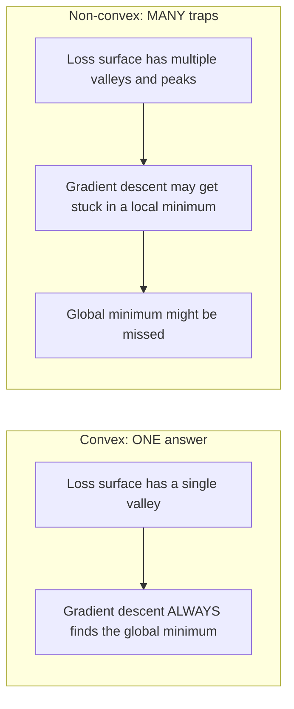
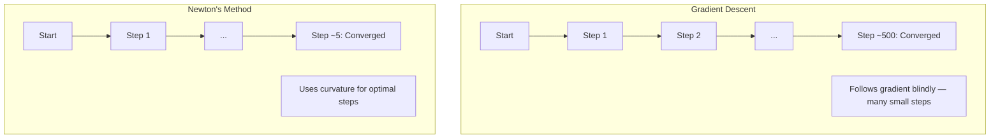
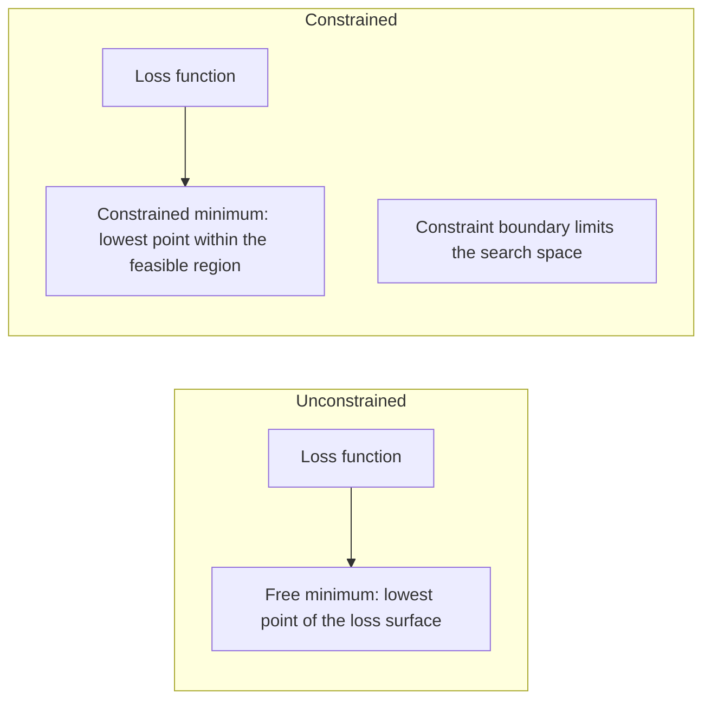
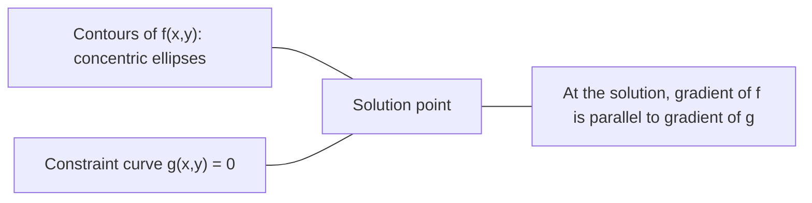

# 凸优化

> Il n'y a qu'un seul problème. Il y a des millions de réseaux neuraux.

**类型：**Construction
**语言：**Python
**前置要求：**Phase 1, leçons 04 ((Calcul pour le ML)
**时间：**À environ 90 minutes.

## Objectif de l'apprentissage

- Utilisation définition、二阶导数和 Hessian 判据测试
-  réaliser la méthode de Newton, et comparer sa seconde vitesse de réception avec la descente gradiente 
- Utiliser des multiplicateurs de lagrange 求解带约束的优化问题,并解释 KKT conditions
- Le paysage de la perte de réseau neural n'est pas confortable, mais la SGD peut toujours trouver une bonne solution.

##  problématique

Leçon 08 Vous avez appris la descente graduelle, le momentum et Adam. Ces optimisateurs peuvent se déplacer à n'importe quelle surface, mais ils ne sont pas garanties. La descente graduelle peut être une mauvaise valeur locale, car elle se trouve au point de saddle, ou toujours en mouvement.

Mais de nombreux problèmes du ML sont de la ronde. La régression linéaire, la régression logistique, les SVM, les LASSO, la régression des ronds. Pour ces problèmes, il existe des outils plus forts: avec une optimisation mathématique assurée. La ronde n'est qu'à un seul fond.

Comprendre la connotation a trois valeurs. Premièrement, elle vous dit quand le problème est simple, quand il est difficile, quand il est non connoté. Deuxièmement, elle fournit des outils plus rapides, comme la méthode de Newton. Troisièmement, elle explique le concept de régularisation dans le ML: la dualité entre les SVM, ainsi que pourquoi l'apprentissage en profondeur peut toujours fonctionner dans le cadre de la bonne nature de tout ce qui est offert par la connotation.

## 概念

### 凸集

Si pour les collections$S$Le point de séparation entre les deux points est également parfaitement situé.$S$中,则集合 $S$C'est une bonne idée.

| 凸集 | 非凸 |
|---|---|
| **矩形**：内部任意两点都可以用一条仍在内部的线段连接 | **星形/月牙形**：两个内部点之间的线段可能穿过集合外部 |
| **三角形**：对所有内部点都满足相同性质 | **甜甜圈/环形**：中间的孔意味着某些线段会离开集合 |
| 任意两点之间的线段都留在集合内 | 某些点对之间的线段会离开集合 |

形式化测试: Pour$S$      $x, y$, ainsi que l' arbitre$t \in [0, 1]$Je suis là .$tx + (1-t)y$Je suis aussi$S$Dans le centre.

凸集 exemple:
- Une ligne droite, un plan, tout le monde.$\mathbb{R}^n$
- Une boule (ou une boule)
- Une moitié de l'espace:$\lbrace x : a^T x \le b \rbrace$
- L'interaction de l'ensemble

Exemple non conjugué:
- Une petite boîte à outils
- 两个不相交交的并集
- Tout ensemble de pièges ou de trous

### 凸函数

Si fonction $f$Le domaine de définition est un ensemble de points, et pour chaque point de son domaine de définition.$x, y$, ainsi que l' arbitre$t \in [0, 1]$- Le numéro de la liste:

```math
f(tx + (1-t)y) \le t f(x) + (1-t) f(y)
```

几何上看: la ligne entre les deux points de l'image se trouve au-dessus de l'image ou sur l'image.

| 属性 | 凸函数 | 非凸函数 |
|---|---|---|
| **线段测试** | 图像上任意两点之间的线段位于曲线**之上或之上** | 图像上某些点之间的线段会下探到曲线**之下** |
| **形状** | 单个向上弯曲的碗/谷底 | 多个峰和谷，曲率混合 |
| **局部最小值** | 每个局部最小值都是全局最小值 | 可能存在多个高度不同的局部最小值 |

常见凸函数:
- $f(x) = x^2$(Payeur de choses)
- $f(x) = \lvert x \rvert$(Value absolue)
- $f(x) = e^x$(indice)
- $f(x) = \max(0, x)$(RELU, malgré le fait qu'il est séparé)
- $f(x) = -\log(x)$pour $x > 0$( négatif)
- 任意线性函数 $f(x) = a^T x + b$(à la fois conique et conique)

### 测试凸性

Trois tests pratiques, du plus facile au plus strict.

**测试 1：二阶导数测试（1D）。**Si à tout$x$Il y a des villes .$f''(x) \ge 0$, $f$C'est une fonction de coupe.

- $f(x) = x^2$- Le numéro de la liste:$f''(x) = 2 \ge 0$Je suis en train de faire une fête.
- $f(x) = x^3$- Le numéro de la liste:$f''(x) = 6x$Il y a une autre.$x < 0$Il est un peu plus fort que moi.
- $f(x) = e^x$- Le numéro de la liste:$f''(x) = e^x > 0$Je suis en train de faire une fête.

**测试 2：Hessian 测试（多变量）。**Si la Matrice Hessienne $H(x)$Pour tout .$x$C'est une demi-définition positive.$f$est une matrice composée de deux phases de la fonction Hessian.

**测试 3：定义测试。**直接检查不等式 $f(tx + (1-t)y) \le t f(x) + (1-t) f(y)$◊ Appliqué à des fonctions de calcul difficiles à calculer

### Pourquoi est-ce important ?

Le concept central de l'optimisation:

**对于凸函数，每个局部最小值都是全局最小值。**

Cela signifie que la descente graduelle ne sera pas piégée. Tout chemin vers le bas va vers la même réponse.



结果:
- Pas besoin de refaire
- Ne nécessite pas de régulation complexe du taux d'apprentissage
- La fréquence dépend de la nature de la fonction)
- 解是唯一的 (à l'extérieur de la région)

### Les couches et les couches non couches

| 问题 | 凸？ | 原因 |
|---------|---------|-----|
| Linear regression (MSE) | 是 | Loss 关于权重是二次的 |
| Logistic regression | 是 | Log-loss 关于权重是凸的 |
| SVM (hinge loss) | 是 | 线性函数的最大值 |
| LASSO (L1 regression) | 是 | 凸函数之和是凸的 |
| Ridge regression (L2) | 是 | 二次 + 二次 = 凸 |
| Neural Network（任意 Loss） | 否 | 非线性 activations 会产生非凸 landscape |
| k-means clustering | 否 | 离散分配步骤 |
| Matrix factorization | 否 | 未知量的乘积 |

Le modèle de la perte de la camouflage est de la camouflage. Une fois que l'on s'est joint à la couche cachée de l'activation de la camouflage, la camouflage est détruite.

### Matrice hessienne

函数 $f: \mathbb{R}^n \to \mathbb{R}$                   $H$est composé de deux niveaux de direction.$n \times n$Matrice.

```math
H_{ij} = \frac{\partial^2 f}{\partial x_i \, \partial x_j}
```

Pour le$f(x, y) = x^2 + 3xy + y^2$- Le numéro de la liste:

```math
\begin{gathered}
\begin{aligned}
\frac{\partial f}{\partial x} &= 2x + 3y & \frac{\partial^2 f}{\partial x^2} &= 2 & \frac{\partial^2 f}{\partial x \, \partial y} &= 3 \\
\frac{\partial f}{\partial y} &= 3x + 2y & \frac{\partial^2 f}{\partial y \, \partial x} &= 3 & \frac{\partial^2 f}{\partial y^2} &= 2
\end{aligned} \\[8pt]
H = \begin{bmatrix} 2 & 3 \\ 3 & 2 \end{bmatrix}
\end{gathered}
```

Hessian 告诉你曲率信息:
- Value propre: fonction dans chaque direction sur tout le dessus
- Value propre, valeur maximale de chaque direction
- 符号混合: point de selle ((certains directions à l'en haut, d'autres directions à l'en bas))
- 零 propre valeur: cette direction est plate de

Pour la conjonctivité, Hessian doit être à toutes les positions positives semi-définie.$\ge 0$), et non seulement à un certain point.

### La méthode de Newton

Gradient Descendance Utilisation d'une phase information (Gradient) ――Métode de Newton Utilisation de la phase information (Hessian) ― Il est en cours de préparation à un second approximation, puis saute directement à la valeur minimale de cette seconde fonction.

```math
\begin{aligned}
\text{更新规则：} \quad & x_{\text{new}} = x - H^{-1} \cdot \text{gradient} \\
\text{与 gradient descent 比较：} \quad & x_{\text{new}} = x - \text{lr} \cdot \text{gradient}
\end{aligned}
```

La méthode de Newton utilise le taux d'apprentissage de la méthode hessienne.



优点:
- 接近最小值时二次收(每一步误差平方级下降)
- Il n'y a pas besoin de modifier le taux d'apprentissage
- La taille ne change pas (je peux travailler sur la taille)

缺点:
- 计算 Hessian 需要 $O(n^2)$Je veux dire, je veux dire, je veux dire, je veux dire, je veux dire, je veux dire, je veux dire, je veux dire, je veux dire, je veux dire, je veux dire, je veux dire, je veux dire, je veux dire, je veux dire, je veux dire, je veux dire, je veux dire, je veux dire, je veux dire, je veux dire, je veux dire, je veux dire, je veux dire, je veux dire, je veux, je veux, je veux, je veux, je veux, je veux, je veux, je veux, je veux, je veux, je veux, je veux, je veux, je veux, je veux, je veux, je veux, je veux, je veux, je veux, je veux, je veux, je veux, je veux, je veux, je veux, je veux, je veux, je veux, je veux, je veux, je veux, je veux, je veux, je veux, je veux, je veux, je veux, je veux, je veux, je veux, je veux, je veux, je veux, je veux, je veux, je veux, je veux, je veux, je veux, je veux, je veux, je veux, je veux,$O(n^3)$
- Pour un réseau neural de 1 million de pouvoirs, ça signifie$10^{12}$个条目和 $10^{18}$Suivant
- Pour l'apprentissage en profondeur non pratique

### 约束优化

无约束优化: dans tout $x$À la réduction de la quantité$f(x)$Il y a une autre.
Optimisation de la liaison: dans la condition de liaison minimale$f(x)$Il y a une autre.

̇ vous voulez minimiser les coûts, mais le budget est limité ̇ vous voulez minimiser les erreurs, mais la complexité du modèle est limitée ̇



### Multiplicateurs de lagrange

Les multiplicateurs de la lagrange 方法把束问题转换为无束问题──

问题: dans $g(x) = 0$De la limitation à la minimisation$f(x)$Il y a une autre.

解法: introduire un nouveau changement $\lambda$),并求解无约束问题:

```math
L(x, \lambda) = f(x) + \lambda g(x)
```

Dans le détail,$L$Le degré n°:

```math
\begin{aligned}
\frac{\partial L}{\partial x} &= \frac{\partial f}{\partial x} + \lambda \frac{\partial g}{\partial x} = 0 \\
\frac{\partial L}{\partial \lambda} &= g(x) = 0
\end{aligned}
```

几何直觉: dans le groupe de la valeur minimale,$f$Le degré doit être lié à la condition$g$Si elles ne sont pas égales, vous pouvez vous déplacer le long de la ligne de coupe et la réduire encore.$f$Il y a une autre.



Exemple: dans$x + y = 1$De la limitation à la minimisation$f(x,y) = x^2 + y^2$Il y a une autre.

```math
\begin{aligned}
L &= x^2 + y^2 + \lambda(x + y - 1) \\[4pt]
\frac{\partial L}{\partial x} &= 2x + \lambda = 0 \implies x = -\lambda/2 \\
\frac{\partial L}{\partial y} &= 2y + \lambda = 0 \implies y = -\lambda/2 \\
\frac{\partial L}{\partial \lambda} &= x + y - 1 = 0 \\[4pt]
&\text{由前两个方程得：} x = y \\
&\text{代入得：} 2x = 1, \text{因此 } x = y = 0.5, \ \lambda = -1
\end{aligned}
```

Directement$x + y = 1$Le point le plus proche est le point le plus proche.$(0.5, 0.5)$Il y a une autre.

### Conditions de la TCC

Les conditions de Karush-Kuhn-Tucker vont augmenter les multiplicateurs de Lagrange à une certaine échelle.

问题: dans $g_i(x) \le 0$- Je suis désolé .$i = 1, \ldots, m$De la limitation à la minimisation$f(x)$Il y a une autre.

Conditions de la TCC:

```math
\begin{aligned}
&\text{1. 驻点条件：} && \frac{\partial f}{\partial x} + \sum_i \lambda_i \frac{\partial g_i}{\partial x} = 0 \\
&\text{2. 原始可行性：} && g_i(x) \le 0 \quad \text{对于所有 } i \\
&\text{3. 对偶可行性：} && \lambda_i \ge 0 \quad \text{对于所有 } i \\
&\text{4. 互补松弛：} && \lambda_i \, g_i(x) = 0 \quad \text{对于所有 } i
\end{aligned}
```

La paresse complémentaire est un facteur clé.$g_i = 0$, solution située sur la frontière), soit le multiplicateur pour zéro (pour lequel le lien ne fonctionne pas)$\lambda = 0$Il y a une autre.

Les conditions KKT sont au cœur des SVM. Les vecteurs de support sont à l'ordre du jour des points de données actifs.$\lambda > 0$)¬ tous les autres points de données $\lambda = 0$, ne pas affecter les limites de décision;;

### Régularisation  作为约束优化

La régularisation de L1 et L2 n'est pas une technique aléatoire.

**L2 regularization (Ridge)：**

```math
\begin{aligned}
&\text{最小化 } \text{Loss}(w) \text{，约束为 } \lVert w \rVert^2 \le t \\[4pt]
&\text{等价的无约束形式：} \\
&\text{最小化 } \text{Loss}(w) + \lambda \lVert w \rVert^2
\end{aligned}
```

Je suis un homme.$\lVert w \rVert^2 \le t$定义一个球(2D 中是圆,3D 中是球面)。解位于 Loss 等高线第一次接触这个球的位置──

**L1 regularization (LASSO)：**

```math
\begin{aligned}
&\text{最小化 } \text{Loss}(w) \text{，约束为 } \lVert w \rVert_1 \le t \\[4pt]
&\text{等价的无约束形式：} \\
&\text{最小化 } \text{Loss}(w) + \lambda \lVert w \rVert_1
\end{aligned}
```

Je suis un homme.$\lVert w \rVert_1 \le t$定义一个形(2D 中旋转的正方形)

| 属性 | L2 约束（圆） | L1 约束（菱形） |
|---|---|---|
| **约束形状** | 圆（更高维中是球面） | 菱形（2D 中旋转的正方形） |
| **Loss 等高线接触的位置** | 光滑边界：圆上的任意点 | 角点：与某个轴对齐 |
| **解的行为** | 权重较小但非零 | 某些权重恰好为零（稀疏） |
| **结果** | 权重收缩 | 特征选择 |

Cela explique pourquoi L1 produirait un modèle rare (la sélection des caractéristiques), tandis que L2 ne fait que réduire le poids.

### La dualité

Chaque problème de résolution de la différence est un problème de résolution de différence.

La fonction de Lagrange est double:

```math
\begin{aligned}
&\text{原始问题：} && \text{最小化 } f(x) \text{，约束为 } g(x) \le 0 \\
&\text{拉格朗日函数：} && L(x, \lambda) = f(x) + \lambda g(x) \\
&\text{对偶函数：} && d(\lambda) = \min_x L(x, \lambda) \\
&\text{对偶问题：} && \text{最大化 } d(\lambda) \text{，约束为 } \lambda \ge 0
\end{aligned}
```

Pourquoi la dualité est importante:
- Le problème double est parfois plus facile à résoudre que le problème primaire
- SVM à double forme 求解, dont le problème dépend des produits dot entre les données points (en utilisant le truc du noyau)
- double  fournir un primaire optimal de la limite inférieure, utilisable pour vérifier la qualité

 concrètement aux SVM:

```
Primal: find w, b that maximize the margin 2/||w|| subject to
        y_i(w^T x_i + b) >= 1 for all i

Dual:   maximize sum(alpha_i) - 0.5 * sum_ij(alpha_i * alpha_j * y_i * y_j * x_i^T x_j)
        subject to alpha_i >= 0 and sum(alpha_i * y_i) = 0

The dual only involves dot products x_i^T x_j.
Replace x_i^T x_j with K(x_i, x_j) to get the kernel trick.
```

### Pourquoi l'apprentissage en profondeur peut-il fonctionner malgré le manque de formation ?

La fonction de perte de réseau neural 极其非凸── selon chaque norme classique, l'optimisation de ces derniers devrait échouer── cependant, la dérive du gradient stochastique peut trouver une bonne solution.

**大多数局部最小值已经足够好。**Dans l'espace élevé, les points critiques de chaque point sont des points de selle, et non des valeurs minimales locales. La probabilité de perte de la valeur minimale de la zone minimale est très faible.

**真正的障碍是 saddle points，而不是局部最小值。**Dans un seul.$n$个参数的函数中,addle point 同时具有正曲率和负曲率方向──对高维中的随机关键点,所有 $n$个 eigenvalues 都为正 (%) 局部最小值) 的概率大约是$2^{-n}$La plupart des points critiques sont des points de selle.

**Overparameterization 会平滑 landscape。**Le nombre de paramètres est plus élevé que le nombre de réseaux d'échantillons d'entraînement ayant des surfaces de perte plus plates, plus connectées.

**Loss landscape 结构：**

| 属性 | 低维空间 | 高维空间 |
|---|---|---|
| **Landscape** | 许多孤立的峰和谷 | 平滑连通的谷 |
| **最小值** | 许多孤立局部最小值 | 很少有糟糕局部最小值；大多数接近最优 |
| **导航** | 难以找到全局最小值 | 许多路径通向好的解 |
| **Critical points** | 局部最小值和 saddle points 混合 | 压倒性地是 saddle points，而非局部最小值 |

**随机噪声充当隐式 regularization。**Les SGD mini-partie  introduire le bruit, empêcher la chute dans des minima netts ⋅ Les minima netts ⋅ facilement adaptés ⋅ les minima plats ⋅ généralement améliorés ⋅ Le bruit va optimiser la direction du paysage plat de la perte ⋅

###  pratique dans la pratique

La méthode de Newton pour un grand modèle n'est pas pratique.

**L-BFGS (Limited-memory BFGS)：**À propos de la première$m$个 Gradient 差分近似逆 Hessian──需要 $O(mn)$Je ne suis pas là.$O(n^2)$ Appliqué aux questions de 10 000 paramètres, mais pas à l'apprentissage en profondeur.

**Natural gradient：**Utiliser la matrice d'information Fisher (en anglais: Fisher Information Matrix) et non pas la norme Hessian. Ceci met en considération la probabilité de la distribution de la structure géologique.

**Hessian-free optimization：**Utilisation de gradient conjugué 求解 $Hx = g$, sans apparence$H$ Il suffit de produits vectoriels hessiens, ce qui peut être fait par différenciation automatique.$O(n)$Le temps est compté.

**Diagonal approximations：**Le second moment d'Adam est la proximité hessienne à l'angle de la ligne. AdaHessian a élargi ce point à travers l'estimatrice de Hutchinson en utilisant des éléments diagonales hessiennes réels.

| 方法 | 内存 | 每步成本 | 何时使用 |
|--------|--------|--------------|-------------|
| Gradient Descent | $O(n)$ | $O(n)$ | Baseline，大模型 |
| Newton's method | $O(n^2)$ | $O(n^3)$ | 小型凸问题 |
| L-BFGS | $O(mn)$ | $O(mn)$ | 中型凸问题 |
| Adam | $O(n)$ | $O(n)$ | Deep Learning 默认选择 |
| K-FAC | $O(n)$ | 每层 $O(n)$ | 研究、大 batch training |


```figure
convex-vs-nonconvex
```

## - Je le construis.

### 步骤 1: vérificateur de couleur

Construire une fonction, en utilisant des échantillons et en examinant la définition de la fonction.

```python
import random
import math

def check_convexity(f, dim, bounds=(-5, 5), samples=1000):
    violations = 0
    for _ in range(samples):
        x = [random.uniform(*bounds) for _ in range(dim)]
        y = [random.uniform(*bounds) for _ in range(dim)]
        t = random.uniform(0, 1)
        mid = [t * xi + (1 - t) * yi for xi, yi in zip(x, y)]
        lhs = f(mid)
        rhs = t * f(x) + (1 - t) * f(y)
        if lhs > rhs + 1e-10:
            violations += 1
    return violations == 0, violations
```

### Étape 2: Utiliser la méthode de Newton en 2D

Utilisation apparente Hessian 实现 la méthode de Newton 将收速度与渐进下降比较

```python
def newtons_method(f, grad_f, hessian_f, x0, steps=50, tol=1e-12):
    x = list(x0)
    history = [x[:]]
    for _ in range(steps):
        g = grad_f(x)
        H = hessian_f(x)
        det = H[0][0] * H[1][1] - H[0][1] * H[1][0]
        if abs(det) < 1e-15:
            break
        H_inv = [
            [H[1][1] / det, -H[0][1] / det],
            [-H[1][0] / det, H[0][0] / det],
        ]
        dx = [
            H_inv[0][0] * g[0] + H_inv[0][1] * g[1],
            H_inv[1][0] * g[0] + H_inv[1][1] * g[1],
        ]
        x = [x[0] - dx[0], x[1] - dx[1]]
        history.append(x[:])
        if sum(gi ** 2 for gi in g) < tol:
            break
    return history
```

### 步骤 3: Multiplicateur de grandeur 求解器

通過在拉格兰吉上执行 Gradient Descent 求解约束优化──

```python
def lagrange_solve(f_grad, g_val, g_grad, x0, lr=0.01,
                   lr_lambda=0.01, steps=5000):
    x = list(x0)
    lam = 0.0
    history = []
    for _ in range(steps):
        fg = f_grad(x)
        gv = g_val(x)
        gg = g_grad(x)
        x = [
            xi - lr * (fgi + lam * ggi)
            for xi, fgi, ggi in zip(x, fg, gg)
        ]
        lam = lam + lr_lambda * gv
        history.append((x[:], lam, gv))
    return history
```

### 步骤 4: Comparer une phase avec une seconde phase

Dans la même fonction secondaire, fonctionne la méthode de déclin gradient et de Newton.

```python
def quadratic(x):
    return 5 * x[0] ** 2 + x[1] ** 2

def quadratic_grad(x):
    return [10 * x[0], 2 * x[1]]

def quadratic_hessian(x):
    return [[10, 0], [0, 2]]
```

La méthode de Newton se déroule en 1 étape. La descente de gradient nécessite des centaines de étapes, car les valeurs propres d'Hessian se différencient 5 fois, formant une vallée de longueur.

## Utilisez-le

Lors du choix de l'analyse de l'analyse de l'analyse de l'analyse de l'analyse de l'analyse de l'analyse de l'analyse de l'analyse de l'analyse de l'analyse de l'analyse de l'analyse de l'analyse de l'analyse de l'analyse de l'analyse de l'analyse de l'analyse de l'analyse de l'analyse de l'analyse de l'analyse de l'analyse de l'analyse de l'analyse de l'analyse de l'analyse de l'analyse de l'analyse de l'analyse de l'analyse de l'analyse de l'analyse de l'analyse de l'analyse de l'analyse de l'analyse de l'analyse de l'analyse de l'analyse de l'analyse de l'analyse de l'analyse de l'analyse de l'analyse de l'analyse de l'analyse de l'analyse de l'analyse de l'analyse de l'analyse de l'analyse de l'analyse de l'analyse de l'analyse de l'analyse de l'analyse de l'analyse de l'analyse de l'analyse de l'analyse de l'analyse de l'analyse de l'analyse de l'analyse.

对于凸问题(régrésion logistique、SVMs、LASSO):
- Utilisation de solvaire spécial (liblinear, CVXPY, scipy, optimiser, minimiser avec la méthode)
-  prévue obtenir la seule solution globale
- Deuxième étape: pratique et rapide

对于非凸问题:
- Utilisez une méthode de sélection
-  acceptation de la dépendance à la préliminaire et au hasard
- Utilisation de la surparamétrisation, du bruit et du taux d'apprentissage comme régularisation de l'apparence
- Ne perdez pas de temps à chercher le minimum de la situation.

```python
from scipy.optimize import minimize

result = minimize(
    fun=lambda w: sum((y - X @ w) ** 2) + 0.1 * sum(w ** 2),
    x0=np.zeros(d),
    method='L-BFGS-B',
    jac=lambda w: -2 * X.T @ (y - X @ w) + 0.2 * w,
)
```

Pour les SVM, la double formulation vous permet d'utiliser le truc du noyau:

```python
from sklearn.svm import SVC

svm = SVC(kernel='rbf', C=1.0)
svm.fit(X_train, y_train)
print(f"Support vectors: {svm.n_support_}")
```

## 练习

1. **凸性画廊。**Utilisation de ces fonctions:$f(x) = x^4$- Je suis là.$f(x) = \sin(x)$- Je suis là.$f(x,y) = x^2 + y^2$- Je suis là.$f(x,y) = xy$- Je suis là.$f(x) = \max(x, 0)$ Expliquer pourquoi chaque résultat est raisonnable

2. **Newton vs Gradient Descent 竞赛。**Depuis le début$(10, 10)$Je suis là.$f(x,y) = 50x^2 + y^2$上运行两种方法──每种方法需要多少步骤才能达到损失 < 1e-10?当条件数(最大Hessian eigenvalue与最小Hessian eigenvalue的比值) 增加时,Gradient Descent会发生什么?

3. **Lagrange multiplier 几何。**Dans le cadre$x + 2y = 4$La réduction$f(x,y) = (x-3)^2 + (y-3)^2$ À travers la vérification$f$de la Gradient avec$g$Le niveau de la formation est de 5 à 10 degrés.

4. **Regularization 约束。**实现 L1 optimisation restreinte:$\lvert x \rvert + \lvert y \rvert \le 1$De la limitation à la minimisation$(x-3)^2 + (y-2)^2$◊ montrer une solution à un sit-sequence égal à z:

5. **Hessian eigenvalue 分析。** calculer la fonction Rosenbrock dans (1,1) et (-1,1) 处 Hessian。 calculer les valeurs propres de deux points。 Les valeurs propres  vous disent quelles sont les différences entre la courbe de la valeur minimale proche et la courbe de la valeur minimale éloignée ?

### 提示

**练习 1。**运行  référencement`check_convexity`Avant, avant de prévoir chaque résultat:$f''(x)$Les valeurs propres de Hessian sont observées.$f(x,y) = xy$,Les valeurs propres d'Hessian sont 1 et -1, donc le contrôleur doit rapporter cette fonction non comme une fonction de bouton.

**练习 2。**Utilisation $f$调用                                                                                                                                                                                                                                                                                                                                                                                                                                                                                                                           `optimize_gd`Avec `newtons_method`La méthode de Newton ne nécessite qu'un pas pour résoudre la fonction quadratique.$50x^2$Le taux d'apprentissage doit être inférieur à$2/100$, donc $y$La direction se déplace très lentement.$100x^2$后重复实验, encore une fois statistiques

**练习 3。**Utilisation $g(x,y) = x + 2y - 4$调用 `lagrange_solve` Dans le cadre de la demande, vérifier si elle est satisfaite $x + 2y = 4$, ainsi que $\nabla f = (2(x-3), 2(y-3))$Oui ou non$\nabla g = (1, 2)$Le nombre de fois.

**练习 4。**Le minimum non restreint (3, 2) 位于 à l'extérieur de la forme, donc l'idée est de prévoir la descente du gradient:$\lvert x \rvert + \lvert y \rvert \le 1$◊ Les résultats de l'examen sont-ils satisfaits au moment de l'obtention de la même quantité, et sont-ils`demo_regularization_geometry`Comparé à...

**练习 5。**Dans chaque point de réglage `rosenbrock_hessian`, et les résultats seront transmis`hessian_eigenvalues_2d` Dans le (1, 1) position, deux valeurs propres sont correctes, et leur proportion est très grande, de sorte que la vallée est très étroite dans une direction, et très plate dans l'autre direction.

## 关键术语

| 术语 | 含义 |
|------|---------------|
| 凸集 | 集合中任意两点之间的线段仍留在集合内部的集合 |
| 凸函数 | 图像上任意两点之间的线段位于图像之上或图像上的函数。等价地，Hessian 在所有位置都是 positive semidefinite |
| 局部最小值 | 比所有邻近点都低的点。对于凸函数，每个局部最小值都是全局最小值 |
| 全局最小值 | 函数在其整个定义域上的最低点 |
| Hessian Matrix | 所有二阶偏导数组成的 Matrix。编码曲率信息 |
| Positive semidefinite | Eigenvalues 全部非负的 Matrix。是“二阶导数 >= 0”的多维类比 |
| Condition number | Hessian 的最大 eigenvalue 与最小 eigenvalue 的比值。高 condition number 意味着拉长的谷和缓慢的 Gradient Descent |
| Newton's method | 使用逆 Hessian 确定步进方向和大小的二阶 Optimizer。接近最小值时二次收敛 |
| Lagrange multiplier | 为了将约束优化问题转换为无约束问题而引入的变量 |
| KKT conditions | 不等式约束下最优性的必要条件。推广了 Lagrange multipliers |
| Complementary slackness | 在解处，约束要么是 active 的，要么其 multiplier 为零。二者不会同时非零 |
| Duality | 每个约束问题都有一个伴随的 dual problem。对于凸问题，二者具有相同的最优值 |
| Strong duality | Primal 和 dual 的最优值相等。对满足 Slater's condition 的凸问题成立 |
| L-BFGS | 近似二阶方法，存储最近 $m$ 个 Gradient 差分，而不是完整 Hessian |
| Saddle point | Gradient 为零，但在某些方向上是最小值、在另一些方向上是最大值的点 |
| Overparameterization | 使用比训练样本更多的参数。会平滑 Loss landscape 并减少糟糕局部最小值 |

## 延伸阅读

- [Boyd & Vandenberghe: Convex Optimization](https://web.stanford.edu/~boyd/cvxbook/)- Les cours sont gratuits en ligne
- [Bottou, Curtis, Nocedal: Optimization Methods for Large-Scale Machine Learning (2018)](https://arxiv.org/abs/1606.04838)- 连接凸优化理论与深度学习 实践
- [Choromanska et al.: The Loss Surfaces of Multilayer Networks (2015)](https://arxiv.org/abs/1412.0233)- Pourquoi les paysages de réseaux neuraux non confortables ne ressemblent pas à ça ?
- [Nocedal & Wright: Numerical Optimization](https://link.springer.com/book/10.1007/978-0-387-40065-5)- La méthode de Newton, L-BFGS et l'optimisation des
