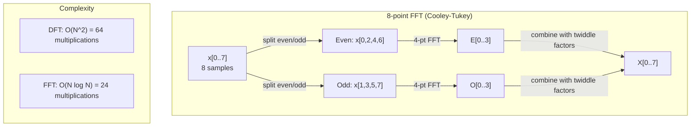
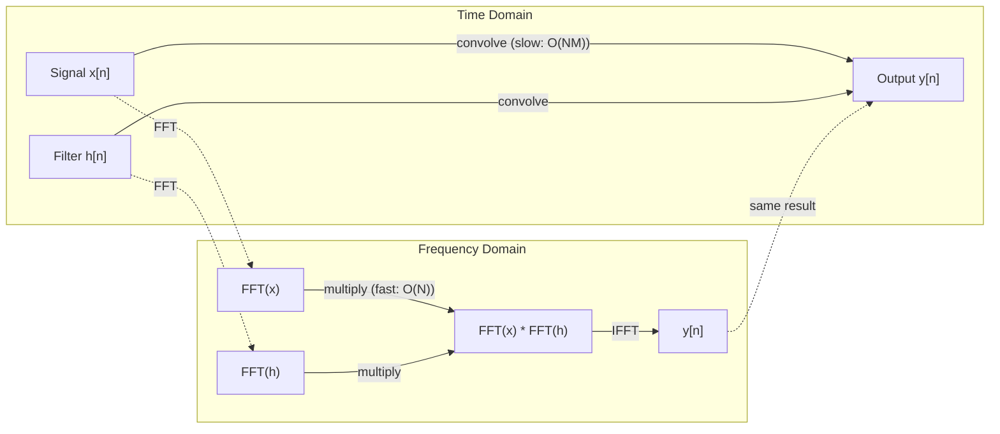

# Transformation de Fourier

> Chaque signal est une superposition d'ondes sinusoïdes. La transformation de Fourier vous dira quelles sont les autres.

**Type:** Build
**Language:**Python
**Prerequisites:** Phase 1, Lessons 01-04, 19 (complex numbers)
**Time:** ~90 分钟

## Objectif de l'apprentissage
- De la réalisation de la FDT,并用 $O(N \log N)$Le FFT Cooley-Tukey l'a confirmé
- Comprendre les coefficients de fréquence: de signal à amplitude, phase et spectre de puissance
-  appliquer le théorème de la convulsion, par la multiplication FFT  exécuter la convulsion
- La décomposition de la fréquence Fourier avec les encodements positionnels du transformateur et les couches de convection de la CNN  connectez-vous

##  problématique
Une image est une série de valeurs de mesure de la pression qui changent avec le temps. Une image est une série de valeurs de la densité des pixels dans l'espace.

Mais de nombreux modèles sont invisibles dans le domaine temporel. Ce signal audio est un ton pur ou un accord.

La transformation de Fourier transformera les données du domaine temporel  transformées en domaine de fréquences― elle reçoit un signal, et le décompose en ondes sinusoïdes de différentes fréquences― chaque onde sinusoïde a une amplitude (intensité) et une phase (situation de départ)― la transformation de Fourier vous en dira les deux en même temps―

Ceci est important pour le ML, car la pensée du domaine de fréquence est partout à voir. Les réseaux neuraux de convulsion exécutent une convulsion, tandis que la convulsion dans le domaine de fréquence est une multiplication.

## 概念
### La définition de la DFT

- Je suis sûr .$N$个 échantillons $x[0], x[1], \ldots, x[N-1]$, Transformateur Fourier discrète$N$个 coefficients de fréquence $X[0], X[1], \ldots, X[N-1]$- Le numéro de la liste:

```math
X[k] = \sum_{n=0}^{N-1} x[n] \, e^{-2\pi i k n/N} \qquad \text{其中 } k = 0, 1, \ldots, N-1
```

Chaque .$X[k]$C'est un nombre complexe.$\lvert X[k] \rvert$Indiquer la fréquence $k$De l'amplitude.$\angle X[k]$Indiquer le décalage de phase de cette fréquence.

关键洞见:$e^{-2\pi i k n/N}$C' est une fréquence.$k$Le phasor de rotation du DFT est calculé par le signal et le$N$个等间隔频率 中每一个的相关性.$k$Il contient de l'énergie, la corrélation est très grande.

### Le sens de chaque facteur

**$X[0]$: DC component。**Ceci est la somme de tous les échantillons, avec la moyenne de la proportion. Il représente la constante du signal à fréquence zéro.

```math
X[0] = \sum_{n=0}^{N-1} x[n] \, e^0 = \text{全部 samples 之和}
```

**$X[k]$ for $1 \le k \le N/2$: positive frequencies。** $X[k]$Indiquer chaque $N$个 échantillons 中 $k$La fréquence des cycles$k$La fréquence est plus élevée.

**$X[N/2]$: Nyquist frequency。**C' est ça .$N$个样本 能表示的最高频率──超越这个频率,就会出现别名,也就是高频率──伪装成低频率──

**$X[k]$ for $N/2 < k < N$: negative frequencies。**pour les signaux de valeur réelle,$X[N-k] = \overline{X[k]}$Les fréquences négatives sont l'image des fréquences positives.$N/2 + 1$个 coefficients 中。

### DFT inversé

Révélation de la fréquence de la DFT inverse

```math
x[n] = \frac{1}{N} \sum_{k=0}^{N-1} X[k] \, e^{2\pi i k n/N} \qquad \text{其中 } n = 0, 1, \ldots, N-1
```

Il est différent du DFT à l'avant seulement par: le symbole de l'exponent moyen est correct (non négatif), et il y a un$1/N$Facteur de normalisation:

Le DFT inverse est une reconstruction parfaite. Il ne perdra aucun message. Vous pouvez passer du domaine temporel au domaine fréquenté, revenir sans produire aucune erreur.

### Le FFT: le rendre rapide

Comme le définit ci-dessus, le DFT est$O(N^2)$Pour le$N$个 coefficients de sortie de l'intermédiaire de chacun, tous par rapport $N$个 échantillons d'entrée 求和──当 $N$= 1 million, c'est ça.$10^{12}$Les opérations suivantes:

La transformation rapide de Fourier (FFT)$O(N \log N)$計算同样结果──当 $N$= 1 million de fois, c'est environ 2 millions d'opérations, et non 1 milliard de fois.

L'algorithme Cooley-Tukey (le plus courant de FFT) utilise le divisé et conquérir:

1. Le signal sera divisé en échantillons indiqués par et par.
2. Retour à la moitié du DFT.
3. Utilisation de "facteurs jumeaux" $e^{-2\pi i k/N}$合并两个 DFT de taille moyenne

```math
\begin{aligned}
X[k] &= E[k] + e^{-2\pi i k/N} \, O[k] && \text{其中 } k = 0, \ldots, N/2 - 1 \\
X[k + N/2] &= E[k] - e^{-2\pi i k/N} \, O[k] && \text{其中 } k = 0, \ldots, N/2 - 1 \\[6pt]
\text{其中 } E &= \text{偶数索引 samples 的 DFT} \\
O &= \text{奇数索引 samples 的 DFT}
\end{aligned}
```

Cette symétrie signifie que chaque étape de la récurrence est exécutée.$O(N)$Il y a aussi du travail.$\log_2(N)$La couche:$O(N \log N)$Il y a une autre.



FFT  exige la longueur du signal est de 2 ── en pratique, les signaux vont généralement à zéro jusqu'à la prochaine 2 ──

### Analyse spectrale

**power spectrum**Oui $\lvert X[k] \rvert^2$, c'est la magnitude carrée de chaque coefficient de fréquence.

**phase spectrum**Oui $\angle X[k]$, y'a une phase de compensation de chaque fréquence. Pour la plupart des tâches d'analyse, vous vous souciez du spectre de puissance, et vous négligez la phase.

```math
\begin{aligned}
\text{频率 } k \text{ 处的 Power：} \quad P[k] &= |X[k]|^2 = \mathop{\mathrm{Re}}(X[k])^2 + \mathop{\mathrm{Im}}(X[k])^2 \\
\text{频率 } k \text{ 处的 Phase：} \quad \phi[k] &= \mathop{\mathrm{atan2}}(\mathop{\mathrm{Im}}(X[k]), \mathop{\mathrm{Re}}(X[k]))
\end{aligned}
```

### Résolution de fréquence

Résolution de fréquence du DFT  dépend des échantillons $N$et taux d'échantillonnage $f_s$Il y a une autre.

```math
\begin{aligned}
\text{bin } k \text{ 对应的频率：} \quad & f_k = k \cdot f_s / N \\
\text{频率分辨率：} \quad & \Delta f = f_s / N \\
\text{最高频率：} \quad & f_{\max} = f_s / 2 \quad \text{(Nyquist)}
\end{aligned}
```

Pour distinguer deux fréquences très proches, vous avez besoin de plus d'échantillons. Pour capturer des fréquences élevées, vous avez besoin d'un taux d'échantillonnage plus élevé.

### Le théorème de la convolutions

C'est l'un des résultats les plus importants du traitement des signaux et il est directement lié aux CNN.

**time domain 中的 convolution 等于 frequency domain 中的 pointwise multiplication。**

```math
\begin{aligned}
& x * h = \text{IFFT}(\text{FFT}(x) \cdot \text{FFT}(h)) \\[4pt]
& \text{其中 } * \text{ 表示 convolution，} \cdot \text{ 表示 element-wise multiplication}
\end{aligned}
```

Pourquoi c' est important ?

- 两个长度为 $N$et $M$ direct convolutions  besoin $O(NM)$Les opérations
-  Basé sur FFT  besoin de convulsion $O(N \log N)$:transform 两者、multiplic 、transform back。
- Pour les grands noyaux, la convulsion FFT sera rapide.
- C'est exactement ce qui se passe dans les couches convolutives de grands champs réceptifs.

Attention:DFT  calcul est une convolutions circulaires(signal 会 wrap around) ・・・ Pour la convolutions linéaires( sans enveloppe), veuillez calculer dans le pré-voir deux signaux zéro-pad jusqu'à la longueur $N + M - 1$Il y a une autre.



### Les fenêtres

Le signal DFT est périodique, c'est-à-dire$N$个样本 视为一个无限重复信号的周期――如果信号的起点和终点不是相同的值,就会在边界产生不连续性,并表现为虚假的高频内容――这称为光谱泄漏――

Le système de fenêtre se comporte en fonction du DFT avant de signaler que les deux extrémités sont en train de diminuer à zéro, ce qui réduit les fuites.

常见 fenêtres:

| Window | Shape | Main lobe width | Side lobe level | Use case |
|--------|-------|----------------|-----------------|----------|
| Rectangular | 平坦（无 window） | 最窄 | 最高 (-13 dB) | 当 signal 在 N 个 samples 中正好 periodic 时 |
| Hann | Raised cosine | 中等 | 低 (-31 dB) | 通用 spectral analysis |
| Hamming | Modified cosine | 中等 | 更低 (-42 dB) | Audio processing、speech analysis |
| Blackman | Triple cosine | 宽 | 非常低 (-58 dB) | 当 side lobe suppression 至关重要时 |

```math
\begin{aligned}
\text{Hann window：} \quad & w[n] = 0.5 \left(1 - \cos\frac{2\pi n}{N-1}\right) \\
\text{Hamming window：} \quad & w[n] = 0.54 - 0.46 \cos\frac{2\pi n}{N-1}
\end{aligned}
```

Avant DFT, la fenêtre sera utilisée pour la multiplication par élément avec le signal:`X = DFT(x * w)`Il y a une autre.

### Propriétés de DFT

| Property | Time Domain | Frequency Domain |
|----------|-------------|-----------------|
| Linearity | $ax + by$ | $aX + bY$ |
| Time shift | $x[n - k]$ | $X[f] e^{-2\pi i f k/N}$ |
| Frequency shift | $x[n] e^{2\pi i f_0 n/N}$ | $X[f - f_0]$ |
| Convolution | $x * h$ | $X \cdot H$ (pointwise) |
| Multiplication | $x \cdot h$ (pointwise) | $X * H$ (circular convolution, scaled by $1/N$) |
| Parseval's theorem | $\sum \lvert x[n] \rvert^2$ | $\frac{1}{N} \sum \lvert X[k] \rvert^2$ |
| Conjugate symmetry (real input) | $x[n]$ real | $X[k] = \overline{X[N-k]}$ |

Le théorème de Parseval exprime l'énergie totale dans deux domaines identiques.

### Contact avec les codage positionnel

Origini Transformer Utilisation de codage positionnel sinusoïdale:

```math
\begin{aligned}
PE(pos, 2i) &= \sin\left(pos / 10000^{2i/d_{\text{model}}}\right) \\
PE(pos, 2i+1) &= \cos\left(pos / 10000^{2i/d_{\text{model}}}\right)
\end{aligned}
```

Chaque dimension$(2i, 2i+1)$Les fréquences varient selon les fréquences. Les fréquences varient de haute (dimension 0,1) à bas (dimension finale) selon l'espacement géométrique.

Il fournit des propriétés clés:

- **Uniqueness:**Les deux positions ne seront pas encodées de la même façon.
- **Bounded values:**Le péché et le péché$[-1, 1]$Je suis là.
- **Relative position:**position $p+k$La codage peut être représentée par position $p$处 codification de la fonction linéaire;; modèle peut apprendre à se concentrer sur les positions relatives;;

### Connexion à la CNN

La couche de convection 通过在信号或图像 上滑动一个学习过器 (en anglais: convection layer) ), sera appliquée à l'entrée.

Selon le théorème de la convolutions, ce qui est le même:
1. Pour l'entrée  exécution FFT
2. Pour le noyau  exécuter FFT
3. Multipliez dans le domaine de fréquence
4. Pour les résultats de l'exécution de la FIFT

标准 CNN 实现使用直接卷积 (conversion directe) 对小型3x3 kernels 更快) . Mais pour les grands kernels ou la卷积全球, les méthodes basées sur FFT seront nettement plus rapides.$O(N \log N)$Il n'y a pas de$O(N^2)$La complexité, la précision et la compétitivité sont les principales caractéristiques de la compétitivité.

### Les spectrogrammes et la transformation Fourier à court terme

单次 FFT fournira le contenu de la fréquence de l'ensemble du signal, mais ne peut pas vous dire ces fréquences qu'elles apparaissent à quel moment. chirp 频率 随着时间的增加信号) 和弦 (所有频率同时存在) 可能具有相同的 magnitudes谱──

La transformation Fourier à court temps (STFT) 通过在信号的重叠窗户上计算 FFT 来解决这个问题──结果是光谱:一种 représentation 2D, dont un axe est le temps, un autre axe est la fréquence── chaque point indique l'intensité du temps sur cette fréquence──

```
STFT procedure:
1. Choose a window size (e.g., 1024 samples)
2. Choose a hop size (e.g., 256 samples -- 75% overlap)
3. For each window position:
   a. Extract the windowed segment
   b. Apply a Hann/Hamming window
   c. Compute FFT
   d. Store the magnitude spectrum as one column of the spectrogram
```

Les spectrogrammes sont la représentation standard des modèles audio ML. Les modèles de reconnaissance de la parole (Shisper, DeepSpeech) traitent les spectrogrammes de mélange, c'est-à-dire que les fréquences sont 映射到 mel scale des spectrogrammes, ce qui correspond davantage à la perception du pitch humain.

### Le nom de l'alias

Si le signal est élevé$f_s/2$Les fréquences (fréquences Nyquist) sont à un rythme$f_s$Le prélèvement d'échantillons produira des copies alias. Un signal de 90 Hz de prélèvement d'échantillons à 100 Hz ressemble à un signal de 10 Hz.

```
Example:
  True signal: 90 Hz sine wave
  Sampling rate: 100 Hz
  Apparent frequency: 100 - 90 = 10 Hz

  The samples from the 90 Hz signal at 100 Hz sampling rate
  are identical to the samples from a 10 Hz signal.
  No amount of math can recover the original 90 Hz.
```

C'est pourquoi les convertisseurs analogiques en numérique contiendront des filtres anti-aliasing, avant de déplacer les fréquences de Nyquist.

### Le rembourrage zéro n' améliorera pas la résolution

Un malentendu commun est: lors du FFT avant le signal  effectuer un rembourrage à zéro 会提升频分辨率──它不会──零 rembourrage 只是插在现有频段之间,让光谱看起来更平滑──但它无法揭露原始样品中不存在的频率细节──

La résolution de la fréquence dépend du temps d' observation .$T = N / f_s$Il faut faire la différence.$\Delta f$Les deux fréquences, vous avez besoin au moins $T = 1 / \Delta f$Quoi que soit le nombre de fois où vous faites des clics, vous ne pouvez pas changer cette limite fondamentale.


```figure
fourier-synthesis
```

## - Je le construis.
### 步骤 1: DFT à partir de zéro

$O(N^2)$DFT est directement défini.

```python
import math

class Complex:
    ...

def dft(x):
    N = len(x)
    result = []
    for k in range(N):
        total = Complex(0, 0)
        for n in range(N):
            angle = -2 * math.pi * k * n / N
            w = Complex(math.cos(angle), math.sin(angle))
            xn = x[n] if isinstance(x[n], Complex) else Complex(x[n])
            total = total + xn * w
        result.append(total)
    return result
```

### 步骤 2: DFT inversé

结构 est la même, l'exponent n'est pas correct, et il est exclu$N$Il y a une autre.

```python
def idft(X):
    N = len(X)
    result = []
    for n in range(N):
        total = Complex(0, 0)
        for k in range(N):
            angle = 2 * math.pi * k * n / N
            w = Complex(math.cos(angle), math.sin(angle))
            total = total + X[k] * w
        result.append(Complex(total.real / N, total.imag / N))
    return result
```

### 步骤 3: FFT (Cooley-Tukey)

La FFT récursive 要求长度为 2 的──拆分为 even 和 odd,递归, puis avec des facteurs de double 合并──

```python
def fft(x):
    N = len(x)
    if N <= 1:
        return [x[0] if isinstance(x[0], Complex) else Complex(x[0])]
    if N % 2 != 0:
        return dft(x)

    even = fft([x[i] for i in range(0, N, 2)])
    odd = fft([x[i] for i in range(1, N, 2)])

    result = [Complex(0)] * N
    for k in range(N // 2):
        angle = -2 * math.pi * k / N
        twiddle = Complex(math.cos(angle), math.sin(angle))
        t = twiddle * odd[k]
        result[k] = even[k] + t
        result[k + N // 2] = even[k] - t
    return result
```

### 步骤 4: Aideurs à l'analyse spectrale

```python
def power_spectrum(X):
    return [xk.real ** 2 + xk.imag ** 2 for xk in X]

def convolve_fft(x, h):
    N = len(x) + len(h) - 1
    padded_N = 1
    while padded_N < N:
        padded_N *= 2

    x_padded = x + [0.0] * (padded_N - len(x))
    h_padded = h + [0.0] * (padded_N - len(h))

    X = fft(x_padded)
    H = fft(h_padded)

    Y = [xk * hk for xk, hk in zip(X, H)]

    y = idft(Y)
    return [y[n].real for n in range(N)]
```

## Utilisez-le
Dans le travail réel, en utilisant FFT numpy, il est soutenu par des bibliothèques C hautement optimisées.

```python
import numpy as np

signal = np.sin(2 * np.pi * 5 * np.arange(256) / 256)
spectrum = np.fft.fft(signal)
freqs = np.fft.fftfreq(256, d=1/256)

power = np.abs(spectrum) ** 2

positive_freqs = freqs[:len(freqs)//2]
positive_power = power[:len(power)//2]
```

Pour l'analyse spectrale de fenêtres et plus haut niveau:

```python
from scipy.signal import windows, stft

window = windows.hann(256)
windowed = signal * window
spectrum = np.fft.fft(windowed)
```

 Pour la convulsion:

```python
from scipy.signal import fftconvolve

result = fftconvolve(signal, kernel, mode='full')
```

pour les spectrogrammes:

```python
from scipy.signal import stft

frequencies, times, Zxx = stft(signal, fs=sample_rate, nperseg=256)
spectrogram = np.abs(Zxx) ** 2
```

Le spectrogramme Matrix est la forme de (n_frequences, n_time_frames) ⋅ chaque rangée est un spectre de puissance de la fenêtre de temps supérieure ⋅ c'est le modèle audio ML ⋅ comme entrée ⋅ consommer ⋅ contenu

## Je le livre.
运行  référencement`code/fourier.py`                  `outputs/prompt-spectral-analyzer.md`Il y a une autre.

## 练习
1. **Pure tone identification。**创建一个信号,其中包含一个未知频率(1到50 Hz 之间) 的单个阴影波,以128 Hz采样1秒――使用你的DFT 识别频率――验证答案是否匹配――现在加入标准偏差为0.5的高斯噪音,并重复――噪音 如何影响光谱?

2. **FFT vs DFT verification。**Il est un signal aléatoire de 64 degrés.$O(N^2){}$) et FFT。 vérifier tous les coefficients dans 1e-10 et correspondre à l'intérieur── dans la longueur des signaux de 256、512、1024 et 2048

3. **Convolution theorem proof by example。**创建信号 x = [1, 2, 3, 4, 0, 0, 0, 0] 和 filter h = [1, 1, 1, 0, 0, 0, 0, 0]──直接计算它们的圆圈卷积 (圆圈)──然后通过FFT 计算(转变、乘变、逆转变)──验证结果匹配──现在通过适当的零执行线路卷积──

4. **Windowing effects。** Créer un signal, c'est 10 Hz et 12 Hz (très proche) de deux ondes sinusoïdes 和──以 128 Hz échantillonnage 1 seconde──分别在无窗、汉窗 和汉窗 下计算功率谱──哪个窗是最容易区分两个峰?为什么?

5. **Positional encoding analysis。**Pour d_modèle = 128 和 max_pos = 512 生成 sinusoïdale positionnalisations codes ⋅对每一对位置 ⋅$(p_1, p_2)$, calculent leurs codes de produit de point.$\lvert p_1 - p_2 \rvert$Avec l'augmentation de la distance, le produit de point, que se passe-t-il ?

### 提示

**练习 1。**En une seconde, 128 fois.$k$Pour la$k$Hz, donc pour la fréquence du nombre entier, les bins 1 à 63 sont indiqués par la fréquence. Choisissez une fréquence du nombre entier Hz.`generate_signal`et `magnitude_spectrum` Après avoir ajouté le bruit, la valeur de pointe de la vérification est toujours située dans le même coffre, tandis que la valeur des autres coffres augmente considérablement.

**练习 2。**Utilisez 2 de la longueur, parce que`fft`L'analyse des coefficients est une analyse de la valeur de l'élément.`max(abs(a - b))`◊ Le temps de travail doit être considérablement réduit$N / \log_2 N$- Je suis en train de me faire plaisir.

**练习 3。**Pour une convolutions circulaires, calculer$n$= 0 、1 、2 时的$y[n] = \sum_k h[k] x[(n-k) \bmod 8]$,并比较 `convolve_direct`et `convolve_fft`La longueur de la convoltion linéaire est de 4 + 3 - 1 = 6, donc vérifiez d'abord la longueur 8 si elle est suffisante.

**练习 4。**Utilisation `hann_window`- Je suis là.`hamming_window`- Je suis là.`apply_window`et `power_spectrum`Il est estimé que les pics de 10 Hz et 12 Hz sont différents entre 9 et 13 Hz. Les pics de 10 Hz et 12 Hz sont bien différents en 1 seconde, donc sans augmenter la fenêtre, cela peut sembler le mieux.

**练习 5。**Utilisation `positional_encoding(pos, 128)`計算每個編碼──比较位置 (0, 10) 的點數和位置 (100, 110) 的點數: la différence entre les deux doit être d'environ 1e-10 以内──然后固定一个 $p_1$, dessiner des produits$\lvert p_1 - p_2 \rvert$La déformation des étoiles

## 关键术语
| Term | What it means |
|------|---------------|
| DFT (Discrete Fourier Transform) | 将 $N$ 个 time-domain samples 转换为 $N$ 个 frequency-domain coefficients。每个 coefficient 都是与该 frequency 上 complex sinusoid 的 correlation |
| FFT (Fast Fourier Transform) | 用于计算 DFT 的 $O(N \log N)$ algorithm。Cooley-Tukey algorithm 递归拆分 even/odd indices |
| Inverse DFT | 从 frequency coefficients 重建 time-domain signal。公式与 DFT 相同，但 exponent sign 相反，并带有 $1/N$ scaling |
| Frequency bin | DFT output 中的每个 index $k$ 表示 frequency $k f_s/N$ Hz。"bin" 是离散的 frequency slot |
| DC component | $X[0]$，zero-frequency coefficient。与 signal mean 成比例 |
| Nyquist frequency | $f_s/2$，在 sampling rate $f_s$ 下可表示的最大 frequency。高于它的 frequencies 会 alias |
| Power spectrum | $\lvert X[k] \rvert^2$，每个 frequency coefficient 的 squared magnitude。显示 energy 在 frequencies 上的分布 |
| Phase spectrum | $\angle X[k]$，每个 frequency component 的 phase offset。在 analysis 中通常会忽略 |
| Spectral leakage | 将 non-periodic signal 当作 periodic 处理导致的虚假 frequency content。可通过 windowing 减少 |
| Window function | 在 DFT 前应用的 tapering function（Hann、Hamming、Blackman），用于减少 spectral leakage |
| Twiddle factor | FFT butterfly computation 中用于合并 sub-DFTs 的 complex exponential $e^{-2\pi i k/N}$ |
| Convolution theorem | time domain 中的 convolution 等于 frequency domain 中的 pointwise multiplication。它是 signal processing 和 CNNs 的基础 |
| Circular convolution | signal 会 wrap around 的 convolution。这是 DFT 自然计算的内容 |
| Linear convolution | 没有 wraparound 的标准 convolution。通过在 DFT 前 zero-padding 实现 |
| Parseval's theorem | 总 energy 在 Fourier transform 中保持不变。$\sum \lvert x[n] \rvert^2 = \frac{1}{N} \sum \lvert X[k] \rvert^2$ |
| Aliasing | 当 sampling rate 不足时，高于 Nyquist 的 frequencies 表现为较低 frequencies |

## 延伸阅读
- [Cooley & Tukey: An Algorithm for the Machine Calculation of Complex Fourier Series (1965)](https://www.ams.org/journals/mcom/1965-19-090/S0025-5718-1965-0178586-1/)- 改变 computing 的原始 FFT 论文
- [3Blue1Brown: But what is the Fourier Transform?](https://www.youtube.com/watch?v=spUNpyF58BY)-                                                                                                                                                                                                                                                                                                                                                                                                                                                                                                                             
- [Lee-Thorp et al.: FNet: Mixing Tokens with Fourier Transforms (2021)](https://arxiv.org/abs/2105.03824)- Dans les transformateurs en utilisant FFT  substituant l' auto-attention
- [Smith: The Scientist and Engineer's Guide to Digital Signal Processing](http://www.dspguide.com/)- 免费在线教材, en profondeur couvrant la FFT, la fenêtre et l'analyse spectrale
- [Vaswani et al.: Attention Is All You Need (2017)](https://arxiv.org/abs/1706.03762)- Des codage positionnels sinusoïdes de décomposition de fréquence Fourier
- [Radford et al.: Whisper (2022)](https://arxiv.org/abs/2212.04356)- Utilisation de mé-spectrogrammes  comme représentation de l'entrée de la reconnaissance de la parole
