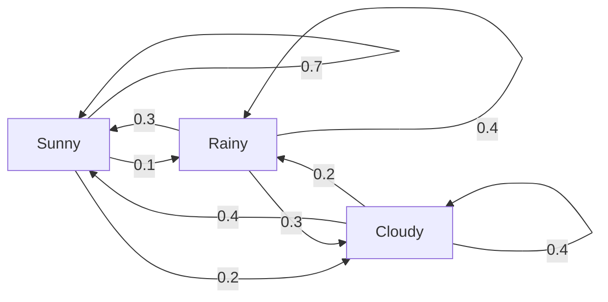
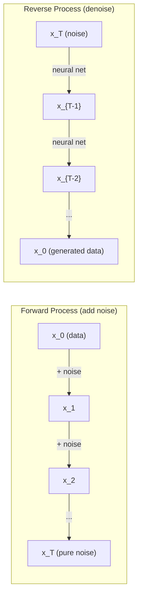

# Procédures stochastiques

> 具有结构的随机性──random walks、Markov chains 和 diffusion modèles 背后的数学──

**Type:** Learn
**Language:**Python
**Prerequisites:** Phase 1, Lessons 06-07（probability, Bayes）
**Time:** ~75 分钟

## Objectif de l'apprentissage
- 模拟 1D 和 2D marche aléatoire,并验证位移的 $\sqrt{n}$缩放规律
- Construire la chaîne Markov 模拟器,并通过自己的组合 计算其静止分布
- réaliser la dynamique MCMC et Langevin de Metropolis-Hastings, utilisée à partir de la distribution cible
- Pour établir un lien avec le mouvement brownien, expliquer le processus inverse

##  problématique
De nombreux systèmes d'IA sont liés au hasard de l'évolution au fil du temps.

Les modèles de langage une fois génèrent un jeton. Chaque jeton dépend du contexte de l'avant. Le modèle produit une distribution de probabilité, de l'extrait, puis continue.

Les modèles de diffusion étape par étape vers l'image ajoutent du bruit, jusqu'à ce qu'il devienne un bruit purement statique ⋅ puis ils reversent ce processus, dénonçant progressivement, jusqu'à ce qu'il apparaisse un nouveau image ⋅ processus à l'avant est une chaîne de Markov ⋅ processus inverse est une chaîne de Markov apprise à fonctionner à l'envers ⋅

Les agents d'apprentissage renforcé prennent des actions dans l'environnement. Chaque action conduit à un nouvel état.

Le prélèvement MCMC est le pilier de l'inférence bayésienne, il constitue une chaîne de Markov, sa distribution stationnaire est la suivante:

Tout cela est fondé sur quatre idées fondamentales:
1. Marches aléatoires  Le processus stochastique le plus simple
2. Chaînes de Markov  带有过渡矩阵的结构化随机性
3. Dynamique de Langevin  带噪音 de déclin graduel
4. Metropolis-Hastings                                                                                                                                                                                                                                                            

## 概念
### Des promenades aléatoires

De la position 0 开始── chaque étape, lancer une égale pièce de monnaie──正面:向右移动(+1)──反面:向左移动(-1)──

- Je suis passé .$n$Après, ta position est$n$Je suis là.$\pm 1$值的总和──期望位置是0(这个行程是无偏的)──但距离原点的期望距离按 $\sqrt{n}$- Je suis en train de me faire plaisir.

Cette marche est juste, les deux directions ne dérivent pas, mais au fil du temps, elle s'éloigne de son point de départ et de son point de départ.$n$步后的标准偏差是 $\sqrt{n}$Il y a une autre.

```
Step 0:  Position = 0
Step 1:  Position = +1 or -1
Step 2:  Position = +2, 0, or -2
...
Step 100: Expected distance from origin ~ 10 (sqrt(100))
Step 10000: Expected distance from origin ~ 100 (sqrt(10000))
```

**在 2D 中**,marcher à la même fréquence de la marche vers le haut, vers le bas, vers la gauche ou vers la droite.$\sqrt{n}$缩放规律──路径会描绘出类似的分离的模式──

**为什么是 $\sqrt{n}$？**Chaque étape est de probabilité de +1 ou -1$n$步后, position $S_n = X_1 + X_2 + \cdots + X_n$, chacun d' eux .$X_i$La ville est$\pm 1$ La variance de chaque étape est 1, et chaque étape est indépendante de l'autre, donc $\mathop{\mathrm{Var}}(S_n) = n$ Déviation standard = $\sqrt{n}$Selon le théorème de la limite centrale,$S_n / \sqrt{n}$收到 une distribution normale standard

Cette sorte de$\sqrt{n}$缩放在 ML 中随处可见──SGD 噪音按1/sqrt(batch_size) 缩放──Embedding 维度按 $\sqrt{d}$La racine carrée est un signe indépendant de l'accumulation.

**与 Brownian motion 的联系。**Prenez une taille de l'étape$1/\sqrt{n}$、 chaque heure $n$Une promenade aléatoire.$n$À la fin de la journée, cette marche sera suivie par le mouvement brownien.$B(t)$Un processus continu en temps, parmi lesquels$B(t)$服从平均值为 0 变量 为 $t$La répartition normale de la population.

Le mouvement brownien est la base mathématique de la diffusion. Il décrit le mouvement de la fluctuation des particules dans le corps, ainsi que le processus de bruit dans les modèles de diffusion.

**Gambler's ruin。**Un randonneur de la position .$k$開始,在 0 和 $N$Il y a des barrières d'absorption.$N$Quelle est la probabilité d'atteindre 0 ?$P(\text{到达 } N) = k/N$                                                                                                                                                                                                                                                              

### Chaînes de Markov

La chaîne de Markov est un système qui se transforme selon la probabilité fixe entre les États.

```math
P(X_{t+1} = j \mid X_t = i, X_{t-1} = \ldots) = P(X_{t+1} = j \mid X_t = i)
```

C'est la propriété de Markov. Ça signifie que vous pouvez utiliser une matrice de transition.$P$décrire toute la dynamique:

```math
P[i][j] = \text{从状态 } i \text{ 转移到状态 } j \text{ 的概率}
```

$P$Tu dois aller quelque part.

**示例 —— Weather：**

```
States: Sunny (0), Rainy (1), Cloudy (2)

P = [[0.7, 0.1, 0.2],    (if sunny: 70% sunny, 10% rainy, 20% cloudy)
     [0.3, 0.4, 0.3],    (if rainy: 30% sunny, 40% rainy, 30% cloudy)
     [0.4, 0.2, 0.4]]    (if cloudy: 40% sunny, 20% rainy, 40% cloudy)
```

De l'état de l'État à l'état de l'État, la répartition des États est répandue en phase fixe.$\pi$, parmi lesquels $\pi P = \pi$C'est ça.$P$La valeur propre de n'est pas le vecteur propre gauche de n'est.

Pour la chaîne météo, la distribution stationnaire est [0,53, 0,18, 0,29]  长期来看, peu importe l'état de départ, soit quoi, 53% du temps est ensoleillé.



**计算 stationary distribution。**Il y a deux façons:

1. **Power method**: sera une répartition initiale arbitraire$P$Après avoir fait assez d'itérations, il va se faire.
2. **Eigenvalue method**: trouver $P$La valeur propre de la valeur propre propre de la valeur propre de la valeur propre de la valeur propre de la valeur propre de la valeur propre de la valeur propre de la valeur propre de la valeur propre de la valeur propre de la valeur propre de la valeur propre de la valeur propre de la valeur propre de la valeur propre de la valeur propre de la valeur propre de la valeur propre de la valeur propre de la valeur propre de la valeur propre de la valeur propre de la valeur propre de la valeur propre de la valeur propre de la valeur propre de la valeur de la valeur propre de la valeur de la valeur propre de la valeur de la valeur propre de la valeur de la valeur de la valeur de la valeur propre de la valeur de la valeur de la valeur de la valeur de la valeur de la valeur de la valeur de la valeur de la valeur de la valeur de la valeur de la valeur de la valeur de la valeur de la valeur de la valeur de la valeur de la valeur de la valeur de la valeur de la valeur de la valeur de la valeur de la valeur de la valeur de la valeur de la valeur de la valeur de la valeur de la valeur de la valeur de la valeur de la valeur de la valeur de la valeur de la valeur de la valeur de la valeur de la valeur de la valeur de la valeur de la valeur de la valeur de la valeur de la valeur de la valeur de la valeur de la valeur de la valeur de la valeur de la valeur de la valeur de la valeur de la valeur de la valeur de la valeur de la valeur de la valeur de la valeur de la valeur de la valeur de la valeur de la valeur de la valeur de la valeur de la valeur de la valeur de la valeur de la valeur de la valeur de la valeur de la valeur de la valeur de la valeur de la valeur de la valeur de la valeur de la valeur de la valeur de la valeur de la valeur de la valeur de la valeur de la valeur de la valeur de la valeur de la valeur de la valeur de la valeur de la valeur de la valeur de la valeur de la valeur de la valeur de la valeur de la valeur de la valeur de la valeur de la valeur de la valeur de la valeur de la valeur de la valeur de la valeur de la valeur de la valeur de la valeur de la valeur de la valeur de la valeur de la valeur de la valeur de la valeur de la valeur de la valeur de la valeur de la valeur de la valeur de la valeur de la valeur de la valeur de la valeur de la$P^T$La valeur propre de n'est pas un vecteur propre de n'est.

Les deux méthodes exigent une chaîne de satisfaction des conditions.

**收敛条件。**Si une chaîne Markov satisfait aux conditions suivantes, elle recevra une distribution stationnaire unique:
- **Irreducible**Chaque État peut aller de n'importe quel autre État
- **Aperiodic**: la chaîne ne se déroulera pas en cycle fixe

La plupart des chaînes rencontrées dans le ML satisfont à ces deux conditions.

**Absorbing states。**Si une fois dans un état, tu ne sortiras jamais.$P[i][i] = 1$), cet état est absorbant de la. ⋅ Absorption des chaînes de Markov peuvent être utilisées pour construire avec des états terminaux  un jeu fini ⋅ un client de churn ⋅ une séquence de jetons de jetons de fin de texte en cours de vie ⋅

**Mixing time。**需要多少步,chain 才会接近stationary distribution?$P$模) contrôler le temps de mélange. ギャップ 越大,mixing 越快──

### Contact avec Modèles de langage

Modèle de langage 中的代币生成 近似是一个马科夫过程──给定当前文text,模型输出下一个代币 上的分布──温度 控制敏度:

```math
P(\text{token}_i) = \frac{\exp(\text{logit}_i / \text{temperature})}{\sum_j \exp(\text{logit}_j / \text{temperature})}
```

- Température = 1,0: standard distribution
- Température < 1,0: plus pointe(
- Température > 1,0:更平坦(更随机)
- Température $\to 0$:argmax(coupard)

Prise d'échantillons de haut niveau en tranche de probabilité maximale$k$个 tokens──Top-p(nucleus) échantillonnage 截断到累积概率 超过 $p$Les deux sont les plus petites probabilités de transition de Markov.

### Motion brown

La limite de temps continue de marche aléatoire.$B(t)$Il y a trois qualités:
1. $B(0) = 0$
2. $B(t) - B(s)$服从平均值为 0 变量 为 $t - s$La répartition normale des$t > s$)
3. Increements de la région de la différence

Le mouvement brownien est continu, mais il est indéfini. Il est en mouvement à chaque dimension.

Dans le mouvement dispersé, vous pouvez approcher ainsi le mouvement brownien:

```math
B(t + dt) = B(t) + \sqrt{dt} \, z, \quad \text{其中 } z \sim \mathcal{N}(0, 1)
```

$\sqrt{dt}$缩放很重要──it provient du théorème de limite centrale de la démarche aléatoire.

### Dynamique de Langevin

Déclin de gradient 寻找最小值的函数──Langevin dynamique 寻找与 $\exp(-U(x)/T)$La répartition des probabilités est correcte.$U$est une fonction énergétique,$T$C'est la température.

```math
x_{t+1} = x_t - dt \, \nabla U(x_t) + \sqrt{2 T \, dt} \, z_t
```

Il y a deux forces qui agissent sur la particule:
1. **Gradient force**(le secteur de l'énergie)$-dt \cdot \nabla U$): "Trouver vers une énergie basse"
2. **Random force**(le secteur de l'énergie)$\sqrt{2T dt} \cdot z$): Proposer des directions de recherche

La température$T = 0$时, voilà la pure descente gradiente. La température est élevée.

**与 diffusion models 的联系。**Le processus de diffusion du modèle est:

```math
x_t = \sqrt{\alpha_t} \, x_{t-1} + \sqrt{1 - \alpha_t} \cdot \text{noise}
```

C'est une chaîne de Markov qui mélange progressivement les données avec le bruit.$x_T$C'est le bruit de Gauss.

Le processus inverse  du bruit à la data  est aussi une chaîne de Markov, mais ses probabilités de transition sont obtenues par le réseau neural                                                                                                                                                                                                                                            



### MCMC: Chaîne de Markov à Monte Carlo

Parfois, vous avez besoin d'une valeur que vous pouvez obtenir (la permission de différer un nombre constant) mais ne pouvez pas directement prendre la distribution.$p(x)$Les postérieurs bayésiens sont des exemples classiques. Vous savez la probabilité de multiplication précédente, mais la normalisation de la constante est difficile à traiter.

**Metropolis-Hastings**Construire une distribution stationnaire $p(x)$La chaîne de Markov:

1. De quelque part.$x$ commencé
2. De la répartition des propositions $Q(x' \mid x)$提议一个新位置 $x'$
3. 计算 taux d'acceptation:$a = p(x') Q(x \mid x') / (p(x) Q(x' \mid x))$
4. É probabilité $\min(1, a)$ accepté $x'$否则留在 $x$Il y a une autre.
5. Je vous en prie.

Si $Q$C'est symétrique, par exemple.$Q(x' \mid x) = Q(x \mid x') = \mathcal{N}(x, \sigma^2){}$), le ratio 可简化为 $a = p(x') / p(x)$ vous avez juste besoin de la proportion de probabilité  normaliser la constante 会相互抵消。

Dans des conditions tempérées, cette chaîne est garantie.$p(x)$ Mais si la proposition 太小(random walk) ou trop grande(high rejection),收可能很慢──调节 proposition est l'art du MCMC──

**为什么它有效。**Ratio d' acceptation  assurer l' équilibre détaillé: situé $x$Il ne bouge pas.$x'$La probabilité de la localisation est égale à la probabilité de la localisation.$x'$Il ne bouge pas.$x$Le rapport de probabilité $p(x)$C'est la distribution stationnaire de cette chaîne.$p(x)$Il y a une autre.

**实践注意事项：**
- **Burn-in**: abandonné$N$个样本――chain 需要时间从起点到静止分布――
- **Thinning**: chaque$k$个样本保留一个, afin de réduire l'autocorrélation.
- **Multiple chains**Si elles sont réparties dans la même distribution, il existe des preuves de réception.
- **Acceptance rate**Pour:$d$维 Gaussian propositions, meilleur taux d'acceptation 大约是 23% ]]Roberts & Rosenthal, 2001) Too high signifie chaîne 几乎不移动──Too low signifie qu'elle est presque entièrement rejetée──

### Processus stochastiques dans l'IA

| Process | AI Application |
|---------|---------------|
| Random walk | RL 中的 exploration、Node2Vec embeddings |
| Markov chain | Text generation、MCMC sampling |
| Brownian motion | Diffusion models（forward process） |
| Langevin dynamics | Score-based generative models、SGLD |
| Markov decision process | Reinforcement learning |
| Metropolis-Hastings | Bayesian inference、posterior sampling |


```figure
random-walk-diffusion
```

## - Je le construis.
### 步骤 1: Simulateur de marche aléatoire

```python
import numpy as np

def random_walk_1d(n_steps, seed=None):
    rng = np.random.RandomState(seed)
    steps = rng.choice([-1, 1], size=n_steps)
    positions = np.concatenate([[0], np.cumsum(steps)])
    return positions


def random_walk_2d(n_steps, seed=None):
    rng = np.random.RandomState(seed)
    directions = rng.choice(4, size=n_steps)
    dx = np.zeros(n_steps)
    dy = np.zeros(n_steps)
    dx[directions == 0] = 1   # right
    dx[directions == 1] = -1  # left
    dy[directions == 2] = 1   # up
    dy[directions == 3] = -1  # down
    x = np.concatenate([[0], np.cumsum(dx)])
    y = np.concatenate([[0], np.cumsum(dy)])
    return x, y
```

1D marche  stockage des sommes cumulées ⋅ chaque étape est +1 ou -1 ⋅ traversée ⋅$n$步后,位置就是总和──variance 随 随 随$n$线性增长, donc déviation standard 按 $\sqrt{n}$- Je suis en train de me faire plaisir.

### 步骤 2: Chaîne de Markov

```python
class MarkovChain:
    def __init__(self, transition_matrix, state_names=None):
        self.P = np.array(transition_matrix, dtype=float)
        self.n_states = len(self.P)
        self.state_names = state_names or [str(i) for i in range(self.n_states)]

    def step(self, current_state, rng=None):
        if rng is None:
            rng = np.random.RandomState()
        probs = self.P[current_state]
        return rng.choice(self.n_states, p=probs)

    def simulate(self, start_state, n_steps, seed=None):
        rng = np.random.RandomState(seed)
        states = [start_state]
        current = start_state
        for _ in range(n_steps):
            current = self.step(current, rng)
            states.append(current)
        return states

    def stationary_distribution(self):
        eigenvalues, eigenvectors = np.linalg.eig(self.P.T)
        idx = np.argmin(np.abs(eigenvalues - 1.0))
        stationary = np.real(eigenvectors[:, idx])
        stationary = stationary / stationary.sum()
        return np.abs(stationary)
```

distribution stationnaire est $P$La valeur propre de la même chose est le vecteur propre gauche de 1.$P^T$Les vecteurs propres de la recherche de la même chose (transposer les vecteurs propres de gauche en vecteurs propres de droite)

### 步骤 3: Dynamique de Langevin

```python
def langevin_dynamics(grad_U, x0, dt, temperature, n_steps, seed=None):
    rng = np.random.RandomState(seed)
    x = np.array(x0, dtype=float)
    trajectory = [x.copy()]
    for _ in range(n_steps):
        noise = rng.randn(*x.shape)
        x = x - dt * grad_U(x) + np.sqrt(2 * temperature * dt) * noise
        trajectory.append(x.copy())
    return np.array(trajectory)
```

Gradient général$x$推向低能量──噪音──防止其陷入局部停滞──在平衡时, échantillons sont répartis avec$\exp(-U(x)/\text{temperature})$C'est vrai.

### 步骤 4: Métropole-Hastings

```python
def metropolis_hastings(target_log_prob, proposal_std, x0, n_samples, seed=None):
    rng = np.random.RandomState(seed)
    x = np.array(x0, dtype=float)
    samples = [x.copy()]
    accepted = 0
    for _ in range(n_samples - 1):
        x_proposed = x + rng.randn(*x.shape) * proposal_std
        log_ratio = target_log_prob(x_proposed) - target_log_prob(x)
        if np.log(rng.rand()) < log_ratio:
            x = x_proposed
            accepted += 1
        samples.append(x.copy())
    acceptance_rate = accepted / (n_samples - 1)
    return np.array(samples), acceptance_rate
```

L'algorithme propose un nouveau point, vérifie s'il a une probabilité plus élevée (ou en proportion de la probabilité de réussite), puis répète-le. Pour obtenir un bon mélange, le taux d'acceptation devrait être d'environ 23 à 50% entre-

## Utilisez-le
En pratique, vous utiliserez des bibliothèques mûres pour réaliser ces algorithmes.

```python
import numpy as np

rng = np.random.RandomState(42)
walk = np.cumsum(rng.choice([-1, 1], size=10000))
print(f"Final position: {walk[-1]}")
print(f"Expected distance: {np.sqrt(10000):.1f}")
print(f"Actual distance: {abs(walk[-1])}")
```

### Utilisé pour les matrices de transition

```python
import numpy as np

P = np.array([[0.7, 0.1, 0.2],
              [0.3, 0.4, 0.3],
              [0.4, 0.2, 0.4]])

distribution = np.array([1.0, 0.0, 0.0])
for _ in range(100):
    distribution = distribution @ P

print(f"Stationary distribution: {np.round(distribution, 4)}")
```

La répartition initiale se répète$P$Après avoir fait suffisamment d'itérations, il obtient une distribution stationnaire, peu importe où vous commencez.

### Connexion avec le cadre réel

- **PyTorch diffusion：**Une face en train de s' embrasser`diffusers`Le centre`DDPMScheduler`实现了前进和反转马科夫链
- **NumPyro / PyMC：**Utilisez le modèle MCMC(NUTS, il est amélioré par Metropolis-Hastings) pour effectuer une inférence bayésienne
- **Gymnasium (RL)：**fonction de l'environnement étape  définir un processus de décision Markov

### 验证 Convergence de la chaîne de Markov

```python
import numpy as np

P = np.array([[0.9, 0.1], [0.3, 0.7]])

eigenvalues = np.linalg.eigvals(P)
spectral_gap = 1 - sorted(np.abs(eigenvalues))[-2]
print(f"Eigenvalues: {eigenvalues}")
print(f"Spectral gap: {spectral_gap:.4f}")
print(f"Approximate mixing time: {1/spectral_gap:.1f} steps")
```

L'écart spectrale  vous dire la chaîne  oublier sa vitesse initiale ⋅ écart est 0.2 signifie environ 5 étapes ⋅ mélangeable ⋅ écart est 0.01 signifie environ 100 étapes ⋅ fonctionnement de la simulation ⋅ avant ⋅ vérifier cet élément ⋅ mélange ⋅ très lent de la chaîne 会浪费计算。

## Je le livre.
Le programme de formation
- `outputs/prompt-stochastic-process-advisor.md` Un prompt, pour aider à identifier un problème déterminé adapté à quel cadre de processus stochastique

## Les liens

| Concept | Where it shows up |
|---------|------------------|
| Random walk | Node2Vec graph embeddings、RL 中的 exploration |
| Markov chain | LLMs 中的 Token generation、MCMC sampling |
| Brownian motion | DDPM 中的 forward diffusion process、SDE-based models |
| Langevin dynamics | Score-based generative models、stochastic gradient Langevin dynamics (SGLD) |
| Stationary distribution | MCMC convergence target、PageRank |
| Metropolis-Hastings | Bayesian posterior sampling、simulated annealing |
| Temperature | LLM sampling、RL 中的 Boltzmann exploration、simulated annealing |
| Mixing time | MCMC 的 convergence speed、spectral gap analysis |
| Absorbing state | End-of-sequence token、RL 中的 terminal states |
| Detailed balance | MCMC samplers 的 correctness guarantee |

Les modèles de diffusion 值得特别关注──DDPM(Ho et al., 2020) définissent une chaîne Markov avancée:

```math
q(x_t \mid x_{t-1}) = \mathcal{N}\left(x_t; \sqrt{1-\beta_t} \, x_{t-1}, \beta_t I\right)
```

Parmi eux $\beta_t$C'est un calendrier de bruit.$T$- Je suis en train de faire ça.$x_T$Il est presque comme$\mathcal{N}(0, I)$◊ processus inverse par un prédiction du bruit du réseau neural 参数化:

```math
p_\theta(x_{t-1} \mid x_t) = \mathcal{N}\left(x_{t-1}; \mu_\theta(x_t, t), \sigma_t^2 I\right)
```

Chaque étape de la génération est une étape apprise dans la chaîne de Markov. Comprendre les chaînes de Markov signifie comprendre les modèles de diffusion  comment et pourquoi peuvent-ils générer des données.

SGLD(Stochastic Gradient Langevin Dynamics) va combiner le petit lot Gradient Descent avec le bruit de Langevin 结起来──你不计算完整的 Gradient,而是使用 Stochastic estimation并添加校准的噪音──随着学习率 衰退,SGLD 会从优化 过渡到样品采样  你几乎免费得到近似的贝叶斯后方样品──这是从神经网络 获得不确定性估计的最简单方式之一──

穿越这些联系的关键洞见是: les processus stochastiques ne sont pas seulement des outils théoriques. Ils sont des mécanismes de calcul modernes à l'intérieur du système AI. Lorsque vous réglez la température de votre LLM, vous réglez une chaîne de Markov. Lorsque vous entraînez un modèle de diffusion, vous apprenez à inverser un processus similaire au mouvement brownien. Lorsque vous effectuez une inférence bayésienne, vous construisez une chaîne de réception à l'arrière.

## 练习
1. **模拟 1000 条 10000 步的 random walks。**绘制最终位置的分布──验证它近似为平均0、标准偏差$\sqrt{10000} = 100$Le Gausséen.

2. **使用 Markov chain 构建 text generator。**Dans un petit corpus, on apprend à chaque mot à construire une matrice de transition.

3. **使用 Metropolis-Hastings 实现 simulated annealing。**De haute température 开始 (pratiquement tout accepter), puis progressivement降温 (pratiquement seulement amélioration) ⋅ utiliser pour trouver la valeur minimale de la fonction avec de nombreux minima locaux.

4. **比较不同 temperatures 下的 Langevin dynamics。**Du double potentiel de puits$U(x) = (x^2 - 1)^2$Les échantillons se regroupent dans un puits à basse température.

5. **实现 forward diffusion process。**De un signal 1D (par exemple une onde sine) commencer à utiliser un calendrier de bruit linéaire, en ajoutant progressivement du bruit à 100 étapes, pour montrer comment le signal se décompose en bruit pur, puis réaliser un dénicheur simple pour revenir à ce processus, même en réduisant une version naïve du bruit estimé.

### 提示

**练习 1。**Pour 1000 graines différentes 调用 `random_walk_1d(10000, seed=i)`, et conserve la position finale de chaque fois. Les contrôles indiquent si la déviation standard est proche de 0, ou si elle est proche de 100, ainsi que si la position finale est en train de tomber à environ 68% entre -100 et 100 .

**练习 2。**统计, par nombre de fois que chaque phrase apparut à l'autre, chaque ligne divisée par la somme de la ligne, rendant chaque ligne et 1 `MarkovChain(transition_matrix, state_names)`,并调用 `simulate`◊ Check output de chaque mots appartenant à l'autre dans le corpus

**练习 3。**É$\exp(-\Delta / T)$La probabilité d'accepter des points plus faibles et de suivre chaque étape.$T$乘以 un facteur, par exemple 0,99── sur une fonction de minimum connu,并与细网格搜索的结果核对──

**练习 4。**Gradient est $4x(x^2 - 1)$Je vais le transmettre.`langevin_dynamics(grad_U, x0, dt, temperature, n_steps)`Il y a une autre.$x = 0$La hauteur de la barrière est de 1, donc entre 0,05 et 1 de températures différentes.$x$ modificar le nombre de fois, trouver le nombre de fois à commencer à augmenter rapidement la température ⋅

**练习 5。**调用 `diffusion_forward(signal, 100)`,并将所有 $(1 - \beta_t)$À la fin, on prend la dernière étape.$\bar{\alpha}$Si vous êtes un homme$\bar{\alpha}$Le signal n'est pas encore un bruit, il faut augmenter.`beta_end`▽先使用真实的噪音 测试 dénonciateur:此时 $(x_t - \sqrt{1 - \bar{\alpha}_t} \epsilon)/\sqrt{\bar{\alpha}_t}$Il faut préciser le signal original.

## 关键术语
| Term | What people say | What it actually means |
|------|----------------|----------------------|
| Random walk | “抛硬币式移动” | 一个 position 在每一步按随机 increments 改变的过程 |
| Markov property | “无记忆性” | future 只依赖当前 state，而不依赖 history |
| Transition matrix | “概率表” | $P[i][j]$ = 从 state $i$ 移动到 state $j$ 的概率 |
| Stationary distribution | “长期平均” | 满足 $\pi P = \pi$ 的分布 $\pi$ —— chain 的 equilibrium |
| Brownian motion | “随机抖动” | random walk 的 continuous-time limit，$B(t) \sim \mathcal{N}(0, t)$ |
| Langevin dynamics | “带噪声的 Gradient Descent” | 结合 deterministic Gradient 与 random perturbation 的 update rule |
| MCMC | “向目标行走” | 构造一个 stationary distribution 为你想要的分布的 Markov chain |
| Metropolis-Hastings | “提议并接受/拒绝” | 使用 acceptance ratios 来确保收敛的 MCMC algorithm |
| Temperature | “随机性旋钮” | 控制 exploration 与 exploitation 之间权衡的参数 |
| Diffusion process | “噪声进，噪声出” | Forward：逐渐添加 noise。Reverse：逐渐移除 noise。生成 data。 |

## 延伸阅读
- **Ho, Jain, Abbeel (2020)** Dénoncer les modèles probabilistiques de diffusion.   démarrer le modèle de diffusion 革命的 DDPM 论文──清晰推导了前进和反转马科夫链──
- **Song & Ermon (2019)**  Modélisation générative en estimant les gradients de la distribution des données. Utiliser la dynamique de Langevin  effectuer des échantillonnages 方法 basée sur le score。
- **Roberts & Rosenthal (2004)**  Généraux de l'espace de l'état chaînes Markov et MCMC algorithmes.                                                                                                                                                                                                                                                 
- **Norris (1997)** Markov Chains. 标准教材──涵盖融合、stationary distributions 和 hitting times──
- **Welling & Teh (2011)**  Apprendre bayésien par la dynamique de Langevin au degré stochastique. Conjoindre SGD et dynamique de Langevin, pour étendre l'inférence bayésienne。
