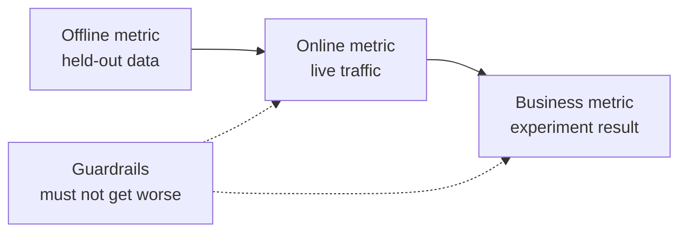

# 机器学习系统设计: du problème au modèle déployé

> Le modèle est simplement une partie du système. Le modèle décide de prévoir ce que, selon la prédiction, qui doit agir.

**Type:** Build
**Languages:** Python
**Prerequisites:** 阶段 2，第 09 课（模型评估）和第 13 课（ML 流水线）
**Time:** 约 110 分钟

## Objectif de l'apprentissage

- Définir les problèmes d'entreprise comme des tâches de gestion des données, déterminer le contenu des prévisions, utiliser les prévisions pour prendre des décisions et expliquer les raisons pour lesquelles les règles ne sont pas suffisantes pour résoudre les problèmes.
- Il distingue les indicateurs de déconnexion, de déconnexion, d'affaires et de surveillance, et compare chaque modèle à des lignes de base simples et à des lignes de base en démarrage.
- Selon les estimations de flux, les coûts quotidiens de la détection de masse et de la détection en ligne, le retard et l'ancienneté des données
- 选择发布方式(影子、金丝雀、A/B 测试),并为每种故障模式选择安全默认行为
- 识别模型如何通过决策改变下一版本训练数据的反循环
- 编写 ML 设计文档,并按固定检查清单评分

##  problématique

Une société de souscription a demandé de faire un modèle de prédiction de dépôt ── un scientifique de données a formé un classifiant de degré de progression, rapportant que l'AUC atteignait 0,91── trois mois plus tard, mais personne ne l'a utilisé──

原因与算法无关──没有人决定分数应触发什么行动──分数每周才更新一次,但客户挽留团队每天都打电话──标签来自取消订阅表,而该表还存储取消原因,因此某特征直接包含答案──也没有人把模型与客户团原始规则比较:给连续两周不活跃客户打电话──

Ces échecs sont déjà enterrés avant le début de la formation. Ils sont tous des échecs de conception, et le document de conception peut être suivi de manière progressive.

## 核心概念

### De l'objectif de l'entreprise à l'objectif de l'entreprise

商业目标不等于 ML 任务.                                                                                                                                                                                                                                                          

1. 模型具体预测什么,预测对象是什么实体?
2. Quelles décisions sont prises par l'intermédiaire de prévisions, de qui ou de quel système ?
3. Quel est le temps de prévision, quelles données sont disponibles à ce moment-là ?
4. Comment améliorer la prise de décision ?

| 业务目标 | 预测 | 使用预测的决策 | ML 任务 |
|---|---|---|---|
| 减少流失 | 用户未来 30 天取消订阅的概率 | 每晚向风险最高的 5% 用户发送挽留优惠 | 二分类 |
| 减少欺诈损失 | 一笔支付属于欺诈的概率 | 在 100 ms 内批准、送审或阻止 | 二分类 |
| 保持货架有货 | 下周各门店每天的销售件数 | 各门店订货量 | 预测 |
| 展示相关商品 | （用户，商品）对的相关性分数 | 信息流中的商品顺序 | 排序 |

Deuxième étape: la définition de la liste des utilisateurs. Il n'y a pas de fenêtre de temps, de corps et d'action précise.

### 何时不应使用 ML

Google Rules of Machine Learning s rule 1                                                                                                                                                                                                                                                                                                                                                                                                                                                                                                                 

- 简短规则可以实现目标,并能持续保持正确.
-  pas de label, ni aucun moyen de collecte réel.
- Personne ne s'est fait attendre, donc la prédiction ne changera pas.
- 预测时可用数据不含所需信号──
- Une erreur est inacceptable, personne ne peut vérifier la sortie.
- Le coût de la construction et de l'exploitation du système est supérieur à la valeur apportée par de meilleures décisions.

Lorsque les règles deviennent longues et fragiles, le ML ne commence pas à être utile. La même règle de référence recommande de prioriser l'utilisation du ML plutôt que des règles de démarrage complexes, car le modèle apprenant est plus facile à mettre à jour et à entretenir.

### 3 étages

Dans trois niveaux, mesurer le système ML, en même temps, mettre en place un ensemble de limites:

| 层面 | 何时能测量 | 流失预测示例 |
|---|---|---|
| 离线指标 | 上线前，在留出的历史数据上 | 优惠阈值处的 F1、风险最高 5% 中的精确率 |
| 在线指标 | 上线期间，在真实流量上 | 优惠接受率、已评分用户比例、分数分布 |
| 业务指标 | 上线数周后，通过实验 | 干预组与保留对照组的 30 天流失率 |
| 护栏指标 | 始终监测 | 每挽留一名用户的优惠成本、退订率、p99 延迟 |



Les différents niveaux donnent souvent des conclusions différentes. Les données historiques d'évaluation des indicateurs en ligne ne sont pas à votre disposition. Les indicateurs en ligne dépendent de la réaction des gens à la prise de décision.

选择与决策匹配的离线指标――如果任务与风险最高的5%用户,就测量这个5%中的精确率――AUC对所有值综合评估,包括你从未使用的值――规则 2 要求先设计并实现指标,再决定ML系统具体做什么――

### 基线

Si le meilleur indicateur n'a pas d'importance, le meilleur modèle de remplacement est de 0,30, le F1 atteint 0,56 c'est bien; si une règle peut atteindre 0,60, c'est très mauvais.

- **简单基线。**始终预测多数类别,或始终预测训练集平均值──模型评估课使用过这种检查──
- **启发式基线。**Les règles de la connaissance du domaine ou les caractéristiques uniques adaptées aux données de formation
- **现有系统。**La méthode de prise de décision, même si elle est simplement une personne utilisant des formulaires électroniques.

Le volume de mise à niveau est le nombre de points de modèle déduit du nombre de points de base les plus forts. Avant de voir le résultat, fixez le minimum de mise à niveau requis, et assurez-vous qu'il suffit à couvrir les coûts supplémentaires du système.

### Règlement sur les données et les étiquettes

訓練前回答这些问题:

- **标签来源。**Qui est responsable de l'événement ?
- **标签延迟。**预测后多久才知道真实结果? fraude refusée peut survenir dans quelques semaines de paiement;流失标签 待 30 天预测窗口结束──
- **标签质量。**Qui a marqué, le taux d'erreur est trop élevé ?
- **预测时的可用性。**Chaque caractéristique est-elle présente lors de la prédiction ? Les caractéristiques inscrites après la formation ne sont-elles pas répertoriées dans l'entraînement ?
- **各类样本量。**Il n'y a que deux cents échantillons réels, généralement seulement un modèle simple.
- **时间切分。**留出最近一段时间──时间序列课按时间分区数据也出于同样的原因──

### 延迟、 dépense et budget des coûts

3 numéros pour chaque type de service:

- **延迟预算。**Le délai de paiement peut être de 50 ms; le rapport de nuit peut être effectué pendant plusieurs heures.
- **峰值吞吐量。**Le nombre de demandes par seconde est souvent plusieurs fois le nombre moyen.
- **成本预算。**Utiliser le coût par jour en dollars ou le coût par 1000 fois prévisible en dollars, il est facile de comparer les échantillons.

Les deux premiers sont liés par un petit principe: le nombre de demandes traitées est égal à la capacité de débit multipliée par le retard.

###  Régulation de la quantité et de la ligne

Il existe deux méthodes de prédiction:

- **批量推理。**定时任务为每实体评分,将分数写入表或键值存储――应用在收到请求时读取已存分――
- **在线推理。**应用在请求到达时把特征发送给模型服务,等分数回来──

| 属性 | 批量 | 在线 |
|---|---|---|
| 新鲜度 | 距离上次运行的时间，加上运行耗时 | 使用当前请求的数据 |
| 请求延迟 | 一次键值读取，几毫秒 | 特征获取时间加模型耗时 |
| 成本驱动因素 | 实体数乘以每天运行次数 | 按峰值 QPS 配置的副本数 |
| 新实体 | 下一次运行前没有分数 | 第一次请求时即可评分 |
| 故障时 | 旧分数仍可读取 | 请求失败或超时 |

Ce cours fournit une estimation des coûts de ces deux parties. Les coûts de lot augmentent avec le nombre d'objets et le nombre de fois de fonctionnement par jour. Il permet de réduire le temps de fonctionnement, de fonctionner plus fréquemment. Les coûts en ligne augmentent avec le flux de flux de valeur maximale, car les copies de la quantité de temps entre les sommets doivent également être payées.

混合设计很常见: tâches de lot de nuit donnent des notes aux utilisateurs déjà utilisés, des itinéraires en ligne traitent les demandes de nouveaux utilisateurs et nécessitent de nouveaux données.

### 部署模式

Nouveau modèle

1. **影子运行（Shadow）。**Le nouveau modèle reçoit une copie du flux réel. Le système de prédiction de l'enregistrement, mais ne l'utilise pas.
2. **金丝雀发布（Canary）。**Les nouveaux modèles sont utilisés pour une petite partie du flux de décision, généralement de 1% à 5% ∞.
3. **A/B 测试。**Les utilisateurs utilisent différents modèles à chaque fois.

Chaque étape doit être terminée en quelques minutes.[影子与金丝雀发布课](../../../17-infrastructure-and-production/20-shadow-canary-progressive/docs/en.md)et [A/B 测试课](../../../17-infrastructure-and-production/21-ab-testing-llm-features/docs/en.md)Il y a trois modèles de même.

### Retour

Lorsque la décision du modèle change des données de formation de la version suivante, il y a un cycle de réaction.

- **干预隐藏标签。**流失模型发送优惠,挽留了部分用户──下个月,高风险用户看起来很忠诚,重新训练的模型便学到这些特征不能预测流失──
- **被阻止的行动没有结果。**Le modèle de fraude empêche un paiement, ce paiement ne générera jamais de signe de refus.
- **曝光限制反馈。**Le modèle de classement ne montre que les produits classés en premier, donc seuls ces produits obtiennent des clics.

La révision des méthodes de réparation est de conserver les données qui n'ont pas été affectées par le modèle. Il est possible de conserver un groupe d'utilisateurs qui n'ont jamais été interceptés; de donner une petite quantité de flux à des décisions de répartition aléatoire; de différencier les données affectées et les données propres en fonction du nombre et de la décision de chaque échantillon.

### Accès à la sécurité

Chaque partie du système doit être mise en défaillance au stade de conception et non au cours de l'accident pour déterminer le comportement par défaut de chaque type:

| 故障 | 没有预案时的结果 | 安全默认行为 |
|---|---|---|
| 模型服务超时 | 请求失败 | 使用启发式基线 |
| 夜间批任务失败 | 分数缺失或过旧 | 在固定期限内提供最近的正常分数，之后使用规则 |
| 特征缺失或越界 | 模型对坏输入评分 | 使用文档规定的默认值，并记录事件 |
| 新实体没有历史 | 没有分数 | 使用规则或总体均值 |
| 分数分布突然变化 | 大规模错误决策 | 暂停自动行动，并通知人工处理 |

Le principe de base de la section des indicateurs est également le schéma par défaut de la plupart des faillites, il faut donc le mettre en œuvre en premier.

### 设计文档

设计文档在训练开始前集中记录上述决策――本课检查器为其 JSON 版本评分――其中, six des contrôles sont bloqués, car leur absence rend le système non sûr ou inutile:

| 章节 | 回答的问题 | 阻塞条件 |
|---|---|---|
| 问题 | 预测什么，哪项决策使用它，为什么规则不够？ | 必须明确决策 |
| 指标 | 适用哪些离线、在线、业务和护栏指标？ | 必须明确业务指标 |
| 基线 | 适用哪些简单、启发式和现有系统基线？ | 必须有启发式或现有系统基线 |
| 数据 | 标签来自哪里、延迟多久，每个特征预测时是否可用？ | 不得泄露标签 |
| 预算与服务 | 有哪些延迟、峰值 QPS、成本和陈旧时间限制，哪种模式满足它们？ | 无 |
| 发布 | 使用哪些影子、金丝雀及 A/B 阶段，如何回滚？ | 必须有影子或金丝雀阶段，以及回滚 |
| 反馈循环 | 模型如何改变未来数据，如何保留干净数据？ | 无 |
| 故障模式 | 每种故障的默认行动是什么？ | 每种故障都必须有默认行为 |
| 监控 | 上线后观察什么？ | 无 |

```figure
mlprod-serving-cost
```

## De la construction à la construction

`code/main.py` Utilisation uniquement de la bibliothèque de normes, comprenant trois outils: modèle de coûts de service, comparateur de lignes de base et inspecteur de documents de conception.

### Section 1 步: description du travail et des coûts

工作负载保存流量与预算数字,成本模型保存价格── ces prix sont des exemples de numérisation intégrale utilisés dans l'exercice, et non des prix fournisseurs──

```python
@dataclass(frozen=True)
class Workload:
    name: str
    entities: int
    requests_per_day: int
    peak_qps: float
    max_staleness_hours: float
    latency_budget_ms: float


@dataclass(frozen=True)
class CostModel:
    batch_dollars_per_million: float = 0.40
    batch_job_hours: float = 1.0
    lookup_dollars_per_million: float = 0.25
    lookup_latency_ms: float = 4.0
    replica_dollars_per_hour: float = 0.50
    replica_qps: float = 200.0
    min_replicas: int = 2
    online_latency_ms: float = 35.0
```

### Deuxième étape: calcul des quantités et des coûts de service en ligne

Les tâches de lot doivent être réalisées dans les limites du temps. L'intervalle entre deux opérations équivaut à la limite supérieure de décharge des tâches.

```python
def batch_plan(workload: Workload, costs: CostModel) -> ServingPlan:
    refresh_hours = workload.max_staleness_hours - costs.batch_job_hours
    if refresh_hours <= 0:
        return ServingPlan(
            "batch", False, math.inf, costs.lookup_latency_ms, math.inf, 0.0,
            "staleness limit is shorter than one batch job",
        )
    runs_per_day = 24.0 / refresh_hours
    predictions = workload.entities * runs_per_day
    dollars = (
        predictions / 1e6 * costs.batch_dollars_per_million
        + workload.requests_per_day / 1e6 * costs.lookup_dollars_per_million
    )
    ...
```

Les frais de paiement des services en ligne doivent être maintenus suffisamment pour pouvoir supporter le prix maximum, et au moins deux exemplaires doivent être conservés pour assurer leur disponibilité:

```python
def online_plan(workload: Workload, costs: CostModel) -> ServingPlan:
    replicas = max(costs.min_replicas, math.ceil(workload.peak_qps / costs.replica_qps))
    dollars = replicas * costs.replica_dollars_per_hour * 24.0
    feasible = costs.online_latency_ms <= workload.latency_budget_ms
    ...
```

`choose_serving`sele satisfaire à la différence et à l'ancienne limite de temps, retourner le plus abordable.`None`Je vous ai dit que vous deviez régler votre budget.

### 3ème étape: Comparer le modèle avec le modèle de base

Comparer le même indicateur d'évaluation du modèle avec tous les lignes de base.

```python
def compare_to_baselines(
    y_true: list,
    model_pred: list,
    baselines: dict[str, list],
    metric,
    metric_name: str,
    higher_is_better: bool = True,
    min_lift: float = 0.02,
) -> BaselineReport:
    if not baselines:
        raise ValueError("a model needs at least one baseline")
    scores = {name: metric(y_true, pred) for name, pred in baselines.items()}
    pick = max if higher_is_better else min
    best_name = pick(scores, key=scores.get)
    model_score = metric(y_true, model_pred)
    lift = model_score - scores[best_name] if higher_is_better else scores[best_name] - model_score
    return BaselineReport(metric_name, {"model": model_score, **scores}, best_name, lift, min_lift)
```

La ligne de base est un seul caractère.`fit_rule`Dans les données d'entraînement, chaque valeur de cette caractéristique est considérée comme une valeur, conservant la meilleure valeur de F1.

### 第4 步: Pour le design

Chaque élément de contrôle contient des clés, des poids, des signaux d'obstacle, des messages et des fonctions de contrôle.

```python
CheckItem("decision", 2, True, "name the action that uses each prediction", lambda d: _text(d, "problem.decision")),
CheckItem("baselines", 2, True, "add a heuristic or current-system baseline", check_baselines),
CheckItem("no_leakage", 2, True, "confirm every feature exists at prediction time",
          lambda d: get_path(d, "data.features_available_at_prediction_time") is True),
CheckItem("serving_fit", 1, False, "pick a serving mode that meets the staleness, latency, and cost budgets",
          check_serving_fit),
```

`check_serving_fit`复用成本模型,从文档读取负载数字,并估算选定模式的成本──如果该模式不能满足陈旧时间上限、延迟预算或每日成本预算,检查就失败──声明采用批但只允许三分钟陈旧时间的文档无法通过──成本模型没有混合方案,因此声明混合的文档也会失败,直到你加入该方案在练习1中──

`review_design_doc`Pour le passage de l'article, le poids total est ajouté, réparti et le poids total est déduit.

### Section 5 - La mise en œuvre

```bash
python3 code/main.py
```

```console
nightly churn scores
  ok batch        $0.91/day      4 ms  1.0 runs per day over 2,000,000 entities
  ok online      $24.00/day     35 ms  2 replicas sized for 40 peak QPS
  choose: batch

feed ranking, 2-hour freshness
  ok batch       $48.50/day      4 ms  24.0 runs per day over 5,000,000 entities
  ok online      $24.00/day     35 ms  2 replicas sized for 120 peak QPS
  choose: online

=== Model versus baselines (churn, metric F1) ===
  model                    0.564
  days_idle > 12.8688      0.500
  random at base rate      0.232
  majority class           0.000
  model beats the strongest baseline (days_idle > 12.8688) by +0.064
```

La plupart des lignes de base F1 est 0, car elle ne prévoit pas de fuite. Les règles de l'arrière-plan sont les seules réelles concurrentes. Le modèle est supérieur à 0,064, donc il y a des raisons d'utiliser le modèle. Si les caractéristiques sont plus faibles, les règles peuvent gagner, alors les règles sont le système qui devrait être déployé.

设计文档评审会印发缺少六阻塞项的薄弱文档, ainsi que 1.00分的完整文档──传入路径可评审您自己的文档:

```bash
python3 code/main.py my_design_doc.json
```

## Utilisation de l'outil

Les outils utilisés par le groupe de travail dans la production sont utilisés dans chaque partie du kit.

**基线。**Scikit-learn va réaliser des lignes simples comme un estimateur, afin qu'elles puissent être placées avec le modèle dans le même flux d'eau:

```python
from sklearn.dummy import DummyClassifier, DummyRegressor
from sklearn.metrics import f1_score

majority = DummyClassifier(strategy="most_frequent").fit(X_train, y_train)
base_rate = DummyClassifier(strategy="stratified", random_state=0).fit(X_train, y_train)
mean_value = DummyRegressor(strategy="mean").fit(X_train, y_reg_train)

print(f1_score(y_test, majority.predict(X_test)))
```

`most_frequent`Pour la`majority_baseline`- Je suis désolé .`stratified`Pour la`base_rate_baseline`◊ petit-apprendre 没有启发式基线,因为启发式规则来自你的具体领域──

**批量服务。**Apache Airflow, Dagster, etc.

**在线服务。**Le serveur de modèle KServe, BentoML, NVIDIA Triton, TorchServe, etc. sera le modèle enveloppé dans HTTP ou gRPC 端点后.

**发布。**Les Rollouts d'Argo et de Kubernetes sont des outils pour la publication de la distribution de données.

**设计评审。**Le score de test ML publié par Breck et autres contient les 28 tests et exigences de surveillance nécessaires à la production de systèmes ML.

## 交付成果

本课产 出 `outputs/skill-ml-design-review.md` Les compétences sont évaluées par étape dans le cadre de la conception de documents, en particulier en notant les lacunes en matière de blocage, en utilisant le volume de cours et le choix des services de contrôle des coûts en ligne.

## 练习

1. Pour`choose_serving`添加混合方案: les lots sont évalués par les utilisateurs déjà utilisés, les nouveaux utilisateurs sont évalués en ligne, et les coûts quotidiens sont comparés.
2. Modifier les données jusqu'à ce que le modèle ne surpasse plus les règles.
3. Dans le cadre de la vérification`budgets.max_dollars_per_1k_predictions`项,并编写缺少该项时会失败的测试──
4. Pour payer les fraudes de contrôle édition JSON design documentation。
5. 模拟流失反循环: déménagement de la réception des étiquettes des utilisateurs, réentraînement,并测量 de la F1

## 关键术语

| 术语 | 常见说法 | 实际含义 |
|------|----------------|----------------------|
| ML 任务 | “做一个流失模型” | 预测目标、实体、时间窗口，以及使用预测的决策 |
| 离线指标 | “模型分数” | 上线前在留出的历史数据上计算的指标 |
| 在线指标 | “实时数据” | 模型运行时在真实流量上测量的指标 |
| 业务指标 | “目标” | 决策必须改变、通过实验测量的公司业务结果 |
| 护栏指标 | “不要造成损害” | 新模型上线时不能变差的指标 |
| 基线 | “简单模型” | 模型必须以规定幅度超越的简单、启发式或现有系统预测器 |
| 批量推理 | “预先算好的分数” | 定时任务为每个实体评分并存储结果，供查询使用 |
| 在线推理 | “实时模型” | 每个请求到达时由模型评分 |
| 影子部署 | “暗发布” | 新模型对真实流量评分，但无人使用输出 |
| 金丝雀发布 | “逐步上线” | 新模型为逐渐扩大的小部分流量决策，同时备好回滚 |
| 反馈循环 | “模型训练自己” | 模型决策改变下一版本的训练数据 |

## 延伸阅读

- [Sculley et al., Hidden Technical Debt in Machine Learning Systems (NeurIPS 2015)](https://papers.nips.cc/paper/2015/hash/86df7dcfd896fcaf2674f757a2463eba-Abstract.html): contre le cycle, l'interconnexion et le coût du système autour du modèle
- [Google, Rules of Machine Learning](https://developers.google.com/machine-learning/guides/rules-of-ml): 1er modèle, indicateur et règle pratique de l'harmonisation entre les formations et les services
- [Breck et al., The ML Test Score (IEEE Big Data 2017)](https://research.google/pubs/the-ml-test-score-a-rubric-for-ml-production-readiness-and-technical-debt-reduction/): 28 tests pour mesurer la production
- [Kohavi, Tang, and Xu, Trustworthy Online Controlled Experiments (Cambridge University Press, 2020)](https://experimentguide.com/)Comment fonctionner pour obtenir des conclusions fiables
- [Sato, Wider, and Windheuser, Continuous Delivery for Machine Learning (2019)](https://martinfowler.com/articles/cd4ml.html): données, modèles et déploiements de flux de l'eau
- [Google Cloud, MLOps: Continuous delivery and automation pipelines in machine learning](https://cloud.google.com/architecture/mlops-continuous-delivery-and-automation-pipelines-in-machine-learning)Les trois niveaux de maturité de l'automatisation des services et de la formation
