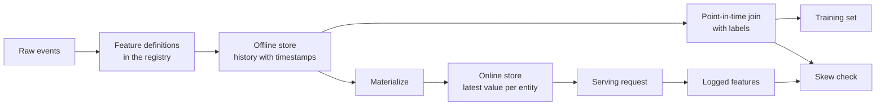

# Caractéristiques de la décharge et de la formation

> Une caractéristique n'a qu'une seule définition, mais il y a deux façons de lire.

**Type:** Build
**Languages:** Python
**Prerequisites:** Phase 2，第 08 课（特征工程）、第 13 课（机器学习流水线）、第 15 课（时间序列）和第 19 课（机器学习系统设计）
**Time:** ~100 分钟

## Objectif de l'apprentissage

- Expliquer le sens et les responsabilités de l'archivage hors ligne, de l'archivage en ligne, du temps d'événement physique et du TTL
- 实现时点正确的关联,并展示简单关联如何将未来值复制到训练数据中
- 列出训练服务偏差的四个原因: 两条代码路径、特征陈旧、默认值不同和时间穿越
- Construire un registre de caractéristiques, faire définir la même partie en même temps pour les routes de formation et les routes de service
- Remplir les nouvelles caractéristiques au cours des jours précédents, sans lire les données après chaque date
- Pour les mêmes entités et moments, comparer les caractéristiques du journal de service avec les caractéristiques des routes d'entraînement, afin de détecter les différences

##  problématique

Un groupe a construit un modèle de user流失―― chaque étiquette indique si l'utilisateur n'a pas acheté pendant les 30 jours qui suivent le jour de l'étiquette―― le groupe utilise `user_id`Les étiquettes et les caractéristiques des utilisateurs sont associées, et sont basées sur `days_since_last_purchase`Le taux de désabonnement est de 0,948

Dans le flux réel, ce modèle n'est pas comme une version plus ancienne et plus simple. Le tableau de caractéristiques conserve la dernière valeur de chaque utilisateur, son temps est quelques semaines plus tard que le jour de l'étiquette. Un utilisateur a effectué sa dernière achat au 115e jour, jusqu'au 175e jour, et il a déjà été placé 60 jours, de sorte que le modèle lui-même contient la réponse.

Ces deux défauts sont identiques: la formation et le service en ligne calculent la même caractéristique de deux manières différentes. Ce cours va être réalisé à partir de zéro pour chaque partie du stockage de caractéristiques. Vous rédigez un formulaire de registre, remplissez la logique, connectez-vous à des points, et vérifiez les déficits.

## 概念

### Les deux lecteurs ont le même caractère.

 formation et service en ligne sur la demande de caractéristique différent:

| 属性 | 训练（离线） | 服务（在线） |
|---|---|---|
| 问题 | “一千万个（实体，时间）组合各自对应的值是什么？” | “这个实体现在的值是什么？” |
| 时间 | 过去的多个时点 | 当前 |
| 数据量 | 每个任务数百万行 | 每次请求一行 |
| 延迟 | 可以接受数分钟 | 几毫秒 |
| 存储 | 离线存储：在列式文件或数据仓库中保存带时间戳的完整历史 | 在线存储：在键值数据库中保存每个实体的最新值 |

Les deux types de stockage sont définis selon le même groupe de caractéristiques.



### 实体、时间  et TTL

Chaque trait peut être décrit en quatre termes:

- **实体（Entity）。**Caractéristiques décrivant les clés de l'objet, par exemple`user_id`Ou `card_id`Il y a une autre.
- **事件时间戳（Event timestamp）。**Le moment de création du titre est le 14e jour du mois.
- **创建时间戳（Created timestamp）。**系统写入该行的时刻──今天执行的回填会写入事件时间早些、创建时间为当前时间的行──
- **TTL（time to live，生存时间）。**La valeur maximale de l'âge à atteindre ∞ est considérée comme manquante, de sorte que les lecteurs utilisent la valeur par défaut ∞.

具有相同实体、数据源和TTL的一组特征, généralement appelé "特征视图")

### 时点正确的关联

Une ligne de données de formation devrait associer les caractéristiques déjà existantes à chaque étiquette à celles qui existent à chaque étiquette.

1. 找到同一实体的特征行──
2. Il suffit de conserver le temps de l'événement pour ne pas être en retard sur le temps de l'étiquette.
3. Prenez la dernière ligne.
4. Si le temps de l'étiquette est plus long que le TTL, le temps de l'événement est plus court que le TTL, le temps de l'événement est plus court que le TTL.

Ci-dessous, on peut voir les 16e étiquettes d'un utilisateur ainsi que les caractéristiques générées chaque semaine:

| 特征行日期 | `purchases_30d` | 时点关联 | 仅按 `user_id` 进行朴素关联 |
|---|---|---|---|
| 7 | 4 | | |
| 14 | 3 | 选中 | |
| 21 | 1 | 未来 | |
| 28 | 0 | 未来 | 选中 |

Le label doit juger si l'utilisateur a acheté un produit au 17e à 46e jour. Le 28e jour, les pages ont déjà calculé les jours où il n'a pas acheté après le jour du label. Il montre le nombre de fois où il a acheté 0, c'est parce que l'utilisateur a arrêté de acheter, et c'est exactement l'événement de mesure du label.

时间序列一课按时间分数据, aussi pour la même raison. 时点关联将这条规则应用于每一行,而不是只是一个分时点.

###  entraînement  cause de service

Google définit les différences de performance entre les services de formation et les services en ligne en définissant trois raisons: deux différences de traitement des données entre les services et les données, ainsi que des changements de données entre les services et les services.

| 原因 | 发生的情况 | 演示中的例子 |
|---|---|---|
| 两条代码路径 | 训练与服务使用不同代码计算特征 | 服务窗口包含 `now - 30` 这一天，训练窗口却不包含 |
| 特征陈旧 | 服务读取的值与训练所用值的年龄不同 | 训练读取每周快照，而新服务计算实时的新值 |
| 默认值不同 | 两条路径对缺失值的填充方式不同 | 对“尚未购买”，训练使用 365，服务使用 -1 |
| 时间穿越 | 训练读取了标签时刻之后的值 | 朴素关联为每个标签读取最新快照 |

La même règle de l'article 32 du même guide exige que le code soit réutilisé autant que possible entre la ligne de formation et la ligne de service.

### Liste des caractéristiques

Le registre est un répertoire de caractéristiques définies. Chaque élément contient le nom, l'objet, la source de données, les changements, les fenêtres, la valeur par défaut, le TTL, le responsable, la version et la description.

两条规则可以保证其安全性:

- 两条路径都从注册表读取定义――任何服务都不能自维护变换逻辑的副本――
- 修改定义时创建新版本──旧版本继续保留,让旧模型仍然可以使用训练时的特征──

### Résumé

Le nouveau caractère n'a pas d'histoire, mais l'entraînement nécessite sa valeur de chaque moment de chaque étiquette historique. Il doit être rempli à chaque date de l'exécution définie, écrite en une ligne pour chaque entité et date.

Le coût de calcul du remplissage augmente avec le nombre d'objets et le nombre de dates. Il peut également entraîner des fuites cachées: le remplissage de la réponse d'aujourd'hui, bien qu'écrit dans un temps d'événement plus tôt, peut également être lu en retard ou modifié par la suite.

### 检测偏差

La même règle de l'article 29 du même guide exige que les caractéristiques utilisées lors du service soient enregistrées et utilisées pour l'entraînement. Même si elles ne sont enregistrées que sur une petite quantité d'échantillons, elles peuvent également vérifier la cohérence.

为了定位原因, comparer les résultats de la suite:

1. Les résultats de lecture et de formation sont liés à ceux du système.
2. Les résultats de ré-computation en temps réel sont liés aux résultats de l'entraînement.
3. Deuxième article: le chemin du code et les résultats du récalculateur en temps réel.

```figure
mlprod-pit-join
```

## 动手构建

`code/main.py`Le code central n'utilise que la base de données standard. Le temps est indiqué en plusieurs jours.

### 步骤 1: Caractéristiques définis et registre

`FeatureDefinition`À partir de ce moment, le nombre de données est modifié en termes de données: mode de regroupement, fenêtre et valeur par défaut.`compute`方法绝不会读取 `as_of`Après l'événement.

```python
@dataclass(frozen=True)
class FeatureDefinition:
    name: str
    entity: str
    aggregate: str
    window_days: int | None
    default: float
    version: int = 1
    owner: str = "growth-team"
    description: str = ""

    def compute(self, events: list[Event], as_of: int) -> float:
        visible = [e for e in events if e.day <= as_of]
        if self.window_days is not None:
            visible = [e for e in visible if e.day > as_of - self.window_days]
        if self.aggregate == "count":
            return float(len(visible))
        if self.aggregate == "sum":
            return round(sum(e.amount for e in visible), 2)
        if self.aggregate == "days_since_last":
            return float(as_of - max(e.day for e in visible)) if visible else self.default
        raise ValueError(f"unknown aggregate {self.aggregate!r}")
```

`FeatureRegistry.register`允许重复注册相同定义,但会拒绝名称和版本相同,内容却有不同的定义──`fill_defaults`Pour les deux voies, la valeur de la disparition est la même.

模型 `spend_30d@1`Cette citation est définie comme un "fixed definition".`compute`et `fill_defaults`会解析引用,不含 `@`Le nom de la page est la version la plus récente.`@`Il n' y a pas de version numéro de référence`ValueError`, donc l'orthographe ne sera pas lue sans avertissement jusqu'à la dernière version. Ce citation est également la clé de chaque ligne de stockage, donc le remplissage en ligne et le service de lecture utilisent des définitions fixes.

### 步骤 2: Remplissez le stockage en ligne

```python
def backfill(registry: FeatureRegistry, names: list[str], events: list[Event], days: list[int]) -> list[FeatureRow]:
    rows = []
    for entity, entity_events in sorted(group_events(events).items()):
        for day in days:
            rows.append(FeatureRow(entity, day, registry.compute(names, entity_events, day)))
    return rows
```

演示为 299 个用户在 25 个快照日回填三个特征,共生成 7475 行──

### 步骤 3: heure de connexion

Pour chaque étiquette, il est nécessaire de mettre en place un système de répartition de la ligne de chaque élément.`bisect_right`找到标签日当天或之前的最后一行. TTL 检查会丢弃过旧行.

```python
def point_in_time_join(labels: list[LabelRow], rows: list[FeatureRow], ttl_days: int | None = None) -> list[JoinedRow]:
    by_entity: dict[str, list[FeatureRow]] = defaultdict(list)
    for row in rows:
        by_entity[row.entity].append(row)
    days_index = {}
    for entity, entity_rows in by_entity.items():
        entity_rows.sort(key=lambda r: r.day)
        days_index[entity] = [r.day for r in entity_rows]
    joined = []
    for label in labels:
        days = days_index.get(label.entity, [])
        pos = bisect.bisect_right(days, label.day) - 1
        match = by_entity[label.entity][pos] if pos >= 0 else None
        if match is not None and ttl_days is not None and label.day - match.day > ttl_days:
            match = None
        joined.append(JoinedRow(
            label.entity, label.day, label.label,
            match.day if match else None, match.values if match else None,
        ))
    return joined
```

### Étape 4: Mesurer les fuites causées par la connexion

`naive_latest_join`Il est donc nécessaire de revenir à la dernière ligne pour chaque étiquette. Il est possible de construire des étiquettes dans les 100、120 et 140 jours et de préparer une seule règle de caractéristiques sur chaque séquence d'entraînement.

```console
  naive join used a snapshot from after the label day for 100% of rows
  offline accuracy, naive join: 0.948 (rule: idle > 53 days)
  offline accuracy, PIT join:   0.893 (rule: idle > 19 days)
  accuracy on day 145, trained with naive join: 0.763
  accuracy on day 145, trained with PIT join:   0.876
```

Les résultats de l'offre de connexion sont meilleurs: 0,948 contre 0,893..., mais les résultats de la nouvelle version sont plus faibles: 0,763 contre 0,876..., les caractéristiques de la fuite seront plus favorables à la mise en valeur du nombre de jours passés de 19 à 53 jours.

### Étape 5: stockage en ligne et matérialisation

Le stockage en ligne pour chaque entité conserve une ligne, et refuse de dépasser la ligne TTL.`materialize`Il suffit d'écrire le jour sans être en retard sur le moment de l'action.

```python
class OnlineStore:
    def __init__(self, ttl_days: int):
        self.ttl_days = ttl_days
        self._latest: dict[str, FeatureRow] = {}

    def write(self, row: FeatureRow) -> None:
        current = self._latest.get(row.entity)
        if current is None or row.day >= current.day:
            self._latest[row.entity] = row

    def read(self, entity: str, now: int) -> dict[str, float] | None:
        row = self._latest.get(entity)
        if row is None or row.day > now or now - row.day > self.ttl_days:
            return None
        return dict(row.values)
```

TTL est de 10 jours, la lecture du 145ème jour revient à la lecture du 140ème jour. Si aucune nouvelle matérialisation n'est faite, la lecture du 160ème jour revient à la valeur par défaut, car la lecture du 140ème jour a déjà 20 jours d'histoire.

### 步骤 6: Contrôle des décalages

`detect_skew`Comparer les deux`(entity, day)`Pour les deux visages, il indique la proportion de différence entre chaque caractéristique et la différence absolue moyenne, lorsqu'une valeur supérieure à 1% est différente.`ValueError` L'absence de requête peut masquer les différences, tandis que le contrôle sans requête ne peut expliquer aucun problème.

```python
def detect_skew(
    training: dict[tuple[str, int], dict[str, float]],
    serving: dict[tuple[str, int], dict[str, float]],
    features: list[str],
    tolerance: float = 1e-6,
    max_mismatch_rate: float = 0.01,
) -> list[SkewReport]:
    if set(training) != set(serving):
        raise ValueError(f"{len(set(training) ^ set(serving))} keys are in only one view: log and compare the same requests")
    if not training:
        raise ValueError("no requests to compare")
    keys = sorted(training)
    reports = []
    for feature in features:
        diffs = [abs(training[k][feature] - serving[k][feature]) for k in keys]
        mismatches = sum(1 for d in diffs if d > tolerance)
        rate = mismatches / len(keys)
        mean_diff = sum(diffs) / len(keys)
        reports.append(SkewReport(feature, len(keys), rate, mean_diff, rate > max_mismatch_rate))
    return reports
```

演示记录第141~第150天的请求,并运行概念部分介绍的三组比较――请求池中包含了20 nouveaux utilisateurs sans enregistrement historique――

```bash
python3 code/main.py
```

```console
=== Skew checks on 383 logged requests, days 141 to 150 ===
  online store read  vs  training join (one definition, same snapshots)
    ok   days_since_last_purchase   mismatch   0.0%  mean |diff|    0.00
    ok   purchases_30d              mismatch   0.0%  mean |diff|    0.00
    ok   spend_30d                  mismatch   0.0%  mean |diff|    0.00
  fresh compute      vs  training join (staleness only)
    SKEW days_since_last_purchase   mismatch  83.0%  mean |diff|    2.77
    SKEW purchases_30d              mismatch  30.5%  mean |diff|    0.38
    SKEW spend_30d                  mismatch  37.1%  mean |diff|   16.77
  second code path   vs  fresh compute (code differences only)
    SKEW days_since_last_purchase   mismatch   5.5%  mean |diff|   20.07
    SKEW purchases_30d              mismatch  12.5%  mean |diff|    0.13
    SKEW spend_30d                  mismatch  12.5%  mean |diff|    5.09
```

Suivez ces trois blocs de sortie:

- **同一定义、相同快照。**Les données de stockage et de formation en ligne sont liées à la même matérialisation, de sorte que la différence est de zéro.
- **陈旧性。**Dans la plupart des demandes, la valeur de calcul en temps réel diffère de celle de la vitesse de l'image de l'année. Les données ici ne sont pas de plus en plus nouvelles, car le modèle apprenant est la valeur maximale de six jours.
- **代码差异。**Le deuxième code est différent du nombre de fenêtres de 12,5%, car sa fenêtre contient plus d'une journée.`days_since_last_purchase`Les différences sont importantes: 1 à 365

## Utiliser des outils existants

La fête est un trésor de caractères ouverts.

| 从零实现 | Feast |
|---|---|
| `FeatureDefinition`、`FeatureRegistry` | 特征仓库中的 `Entity`、`FeatureView` 和 `Field`，通过 `feast apply` 注册 |
| `FeatureRow` 历史记录 | 离线存储，例如基于 Parquet 文件的 `FileSource` 或数据仓库表 |
| 带 TTL 的 `point_in_time_join` | `store.get_historical_features(entity_df=..., features=[...])` |
| `materialize` | `feast materialize-incremental <end time>` |
| `OnlineStore.read` | `store.get_online_features(features=[...], entity_rows=[...])` |
| 创建时间戳检查 | 数据源上的 `created_timestamp_column` 和 `filter_by_created_timestamp=True` |

定义如下──这些代码遵循节日快速入门指南,运行本课不需要它们──

```python
from datetime import timedelta

from feast import Entity, FeatureView, Field, FileSource
from feast.types import Float32, Int64

user = Entity(name="user", join_keys=["user_id"])

user_activity_source = FileSource(
    name="user_activity_source",
    path="data/user_activity.parquet",
    timestamp_field="event_timestamp",
    created_timestamp_column="created",
)

user_activity = FeatureView(
    name="user_activity",
    entities=[user],
    ttl=timedelta(days=10),
    schema=[
        Field(name="purchases_30d", dtype=Int64),
        Field(name="spend_30d", dtype=Float32),
        Field(name="days_since_last_purchase", dtype=Int64),
    ],
    source=user_activity_source,
)
```

Ensuite, la formation et le service en ligne ont été étudiés avec le même trait:

```python
from feast import FeatureStore

store = FeatureStore(repo_path=".")

training_df = store.get_historical_features(
    entity_df=labels_df,
    features=["user_activity:purchases_30d", "user_activity:days_since_last_purchase"],
    filter_by_created_timestamp=True,
).to_df()

online = store.get_online_features(
    features=["user_activity:purchases_30d", "user_activity:days_since_last_purchase"],
    entity_rows=[{"user_id": 42}],
).to_dict()
```

`labels_df`Pour chaque étiquette conserver une ligne, contenant `user_id`- Je suis là.`event_timestamp`Et le document souligne que le TTL est relativement différent de l'heure de la requête.`point_in_time_join`Le même page a également été présentée.`filter_by_created_timestamp=True`Il peut empêcher la fuite de valeur de remplissage dans les données de formation.

Les données de test de décalage, la validation des données de flux de tentateur peuvent être comparées à des données de service. Breck et autres ont présenté les systèmes de vérification des données de la plateforme de formation de l'équipe de l'équipe de recherche TFX, y compris la vérification des décalages de service.

## 交付成果

本课产 出 `outputs/skill-feature-skew-audit.md` Les compétences d'audit caractéristiques du débit de temps dans la ligne de traversée et de formation  déviation des services, vérification de la logique associée  définition  valeur par défaut  fraîcheur des données de chaque itinéraire, ainsi que les journaux nécessaires à l'examen des déviations 

## 练习

1. 将快照间隔从 7 天改为 1 天――重新运行陈旧性比较,并解释结果――
2. Pour les statistiques, il y a beaucoup de formation qui perd les caractéristiques, et pour les utilisateurs, il y a beaucoup de valeur par défaut.
3. Pour`FeatureRow`添加创建日期──让关联忽略标签日后写入的行──
4. Il va`spend_7d`Inscrire pour`spend_30d`La version 2... est remplie et imprimée en deux versions.
5. 修复 `legacy_serving_features`, jusqu'à ce que le troisième groupe de contrôle des différences passe.

## 关键术语

| 术语 | 常见说法 | 实际含义 |
|------|----------------|----------------------|
| 特征存储 | “存特征的数据库” | 根据同一组定义计算特征，并同时提供给训练与在线服务的系统 |
| 离线存储 | “训练数据” | 带事件时间戳的完整特征历史，由训练任务和回填任务读取 |
| 在线存储 | “特征缓存” | 每个实体的最新值，供服务路径以毫秒级延迟读取 |
| 实体 | “ID” | 特征所描述对象的键，例如用户或银行卡 |
| 事件时间戳 | “何时发生” | 特征值成立的时刻 |
| 时点关联 | “截至某时刻的关联” | 为每个标签匹配标签时刻当天或之前的最新特征行 |
| TTL | “有效期” | 特征值在被读取方视为缺失之前允许达到的最大年龄 |
| 物化 | “同步到线上” | 将最新特征值从离线存储复制到在线存储的任务 |
| 回填 | “计算历史” | 在过去的日期执行特征定义，以生成其历史记录 |
| 训练—服务偏差 | “离线时明明有效” | 训练与在线服务中的特征或行为差异 |

## 延伸阅读

- [Feast：时点关联](https://docs.feast.dev/getting-started/concepts/point-in-time-joins):TTL 语义与创建时间过
- [Feast 文档](https://docs.feast.dev/): Caractéristiques du stockage en ligne et de la matérialisation
- [Google：《机器学习规则》](https://developers.google.com/machine-learning/guides/rules-of-ml)Règles de formation et de parité de service
- [Breck 等：《机器学习的数据验证》（SysML 2019）](https://research.google/pubs/data-validation-for-machine-learning/)Google: vérification des données, y compris la formation des services
- [TensorFlow Data Validation 指南](https://www.tensorflow.org/tfx/guide/tfdv): mode checks, décalage et décalage
- [Sculley 等：《机器学习系统中隐藏的技术债》（NeurIPS 2015）](https://papers.nips.cc/paper/2015/hash/86df7dcfd896fcaf2674f757a2463eba-Abstract.html): Les données de la région dépendent des données de la région
