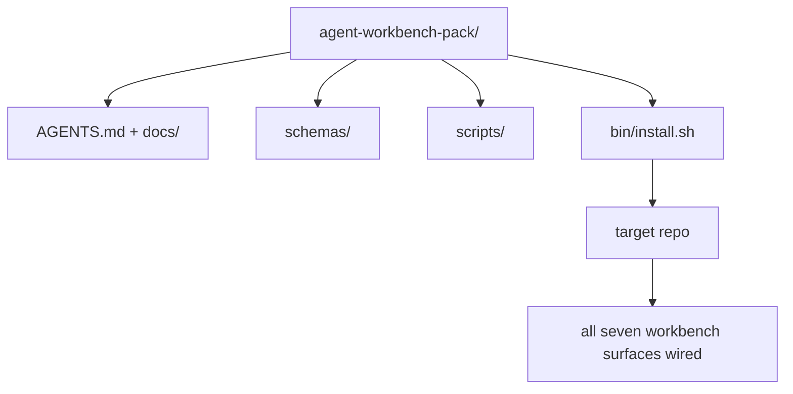

# Capstone: livrer un pack de travail d' agent réutilisable

> Cette mini-track est une que vous pouvez mettre dans n'importe quel paquet de repos.`cp -r`Le lendemain matin, on fait travailler l'agent. C'est le véritable objet de la formation.

**类型：**Construire
**语言：**Python (stdlib)
**前置要求：**Les phases 14 · 31 à 14 · 41
**时间：**- 75 minutes

## Objectif de l'apprentissage

- Envelopper sept surfaces de bureau en un catalogue directement intégrable.
- Fixed schema、script 和 template, faire un nouveau repo  obtenir une base de référence disponible déjà
- Ajouter un script d'installation, en utilisant la même façon de placer ce pack.
- Décider du contenu qui reste dans l'emballage, du contenu qui reste à l'extérieur, et pour chacun prendre en compte le débat.
-  présenter une fois que les changements de stock ont été effectués par l'agent  assisté  et fournir des preuves que l'auditeur est capable de les rétablir ⋅

##  problématique

Un Workbench qui existe dans Google Doc, Chat History et trois scripts qui ne sont que mal mémorisés, un Workbench qui sera reconstruit chaque trimestre. La solution est un pack avec une version: un référentiel ou un catalogue, qui contient une surface, un schéma, un script, ainsi qu'un installeur opérationnel.

À la fin de la classe, vous serez livré sur le disque.`outputs/agent-workbench-pack/`, et un qui peut le mettre dans n'importe quel repo.`bin/install.sh`Il y a une autre.

## 概念



### L' aménagement du paquet

```
outputs/agent-workbench-pack/
├── AGENTS.md
├── docs/
│   ├── agent-rules.md
│   ├── reliability-policy.md
│   ├── handoff-protocol.md
│   └── reviewer-rubric.md
├── schemas/
│   ├── agent_state.schema.json
│   ├── task_board.schema.json
│   └── scope_contract.schema.json
├── scripts/
│   ├── init_agent.py
│   ├── run_with_feedback.py
│   ├── verify_agent.py
│   └── generate_handoff.py
├── bin/
│   └── install.sh
└── README.md
```

### Qu'est-ce qui est laissé, qu'est-ce qui est mis dehors ?

Je suis là.

- Le schéma de surface... ils sont des contrats...
- Les quatre scénarios ci-dessus.
- Les quatre documents sont la règle et la rubrique.

 mettre à l'extérieur:

- 项目特定任务──任务 appartient au conseil d'administration de l'objectif répo, ne fait pas partie du paquet──
- 供应商 SDK 调用──这个包与框架 无关──
- Onboarding 文案── ce paquet  mettre le team déjà onboarding 旁边, plutôt que de le mettre dedans──

### Installateur

Une courte histoire.`bin/install.sh`(ou `bin/install.py`):

1. Il n' y a pas de`--force`时, refuser de couvrir l'installation jusqu'à ce qu'il y ait un emballage.
2. Il va emballer et répéter dans l'objectif.
3. Si il y en a`.github/workflows/`, alors entre dans le CI.
4. 打印后续步骤: remplir le tableau de bord 设置接受命令 运行 init script

### 版本管理

Cette meute , elle est avec toi .`VERSION`文件──需要迁移的 schema bump 和脚本 变更会跳大──仅 doc 的变更会跳补──目标 repo 的 `agent_state.json`记录它初始化时对应的包版──


```figure
wb-pack-install
```

## - Je le construis.

`code/main.py`Je vais mettre la valise à côté de la classe.`outputs/agent-workbench-pack/`En milieu, utilisez ce mini-track comme un schéma et un script du cours précédent, ainsi que le document que vous avez déjà écrit.

Je vais le faire.

```
python3 code/main.py
```

Ce script va copier et fixer la surface, écrire dans README, imprimer l'arbre de pack, puis à zéro 退出──重复运行是等的──

## Mode de production réelle

Un paquet ne vaut que lorsqu'il est capable de supporter une fourchette, une mise à jour et un manque d'amitié en amont.

**`VERSION` 是 contract，不是 marketing。**Les boulots majeurs nécessitent une migration d'état. Les boulots mineurs nécessitent une refonte du contrôleur. Les boulots de patch sont utilisés uniquement pour le document.`.workbench-version`写入目标 repo; si le but de verrouillage et de pack `VERSION`non conciliant,`lint_pack.py`Il refuse de me livrer.`npm`- Je suis là.`Cargo`et `pyproject.toml`能经受 10 years churn's method;agent ne changera pas ces règles.

**跨工具分发的单一来源。**Nx  fournir un `nx ai-setup`, à partir d' un seul configuration  placer `AGENTS.md`- Je suis là.`CLAUDE.md`- Je suis là.`.cursor/rules/`- Je suis là.`.github/copilot-instructions.md`Et un serveur MCP. Ce pack devrait aussi le faire.`ln -s AGENTS.md CLAUDE.md`), faire un simple fait de source de diffusion à chaque agent de codage. Pour soutenir un outil ou une fourchette, ce pack est un mode d'échec.

**`uninstall.sh` 会在存在非平凡 state 时拒绝执行。** Décharger ce paquet Impossible de supprimer l' utilisateur `agent_state.json`- Je suis là.`task_board.json`Ou `outputs/`❖ L'installateur va supprimer le schéma, le script, le document et`AGENTS.md`(带 `--keep-agents-md`opt-out), et si le fichier d'état a des modifications non soumises, on refuse de continuer.

**Skill-as-publishable。SkillKit-style 分发。**Ce pack                                                                                                                                                                                                                                                                                                                                                                                                                                                                                                                            `skillkit install agent-workbench-pack`La répartition de l'emballage est la source de la réalité. Le verrouillage du vendeur disparaît.

## Utilisez-le

Les colis seront livrés dans trois endroits:

- **作为一个你放进 repo 的目录。** `cp -r outputs/agent-workbench-pack /path/to/repo`Il y a une autre.
- **作为一个公开 template repo。**Forge et personnalisation,并用 `VERSION`- Je ne peux pas.
- **作为一个 SkillKit skill。**Envoyez votre agent, faites-lui un ordre.

L'emballage est une recette.

## Je le livre.

`outputs/skill-workbench-pack.md`La mise en place d'un ensemble de règles de référencement de projets sera plus claire, la portée globale sera plus étroite, la dimension rubrique sera plus large dans un domaine spécifique.

## 练习

1. Décider quel document de choix le 5ème mérite d'être promulgué dans le cadre canonique.
2. Utilisez Python pour réécrire l'installateur,并添加 `--dry-run`La marque de la marque est un modèle de marque de marque.
3. - Je suis là.`bin/uninstall.sh`Il a été refusé de le faire.
4. - Je suis là.`lint_pack.py`, enveloppé   `VERSION`时失败──把它连接到包──自备备的CI──
5. Écrire un manuel de travail à partir de la table de travail  Mettre en place ce pack  Quels sont les processus d'opération qui peuvent minimiser les temps d'arrêt ?

## 职业实践: démontrer une fois un changement de stockage

打包演示证明组装程序能够运行并生成文件──它不能证明您的代理能完成新任务──生成的检查能够验证该任务,或已部署的系统能正常工作──请区分这些结论──

Dans le stockage que vous possédez ou avez obtenu modification, choisissez une vraie petite tâche. Utilisez un agent de programmation que vous avez déjà pu visiter.

En plus de l'expérimentation, vous pouvez également réserver une fois le temps de travail.`learning-artifacts/`Réserver les modèles et les emballages déjà présents dans le stockage, comme référence.

### 1. 明确任务并选择自主程度

Utiliser le cadre de mission de la 43e classe et le plan de preuve de la 44e classe. Récogder la version initiale, les objectifs à observer, les non-objectifs, les voies de modification, ainsi que les preuves d'acceptation.

 choisir un mode de travail: réalisation progressive de la direction ‒ avec un point de contrôle, ou une exécution autonome de la frontière explicite ‒ expliquer pourquoi cette option est soutenue par l'incertitude ‒ les conséquences et la réversibilité potentielles ‒

¢ fixer un budget de temps réel; si un agent ¢ fournit des fonctions connexes, il doit également fixer des limites de coût ou de jetons ¢ pour les données de mesure inaccessibles, telles que les enregistrements ¢ pour les besoins de nouveaux droits ¢ fixer des conditions de cessation, et indiquer qui a le droit de résoudre ¢

### 2.  préparer un environnement minimal et utile

查找相关实现、调用方、测试和本地指令──记录每一个来源为什么应进入上下文,以及哪些现有证据能够推翻过去的笔记──不要默认加载整个仓库──

Pour chaque extension, déterminer le choix: compétences (skill) fournir un processus à utiliser à nouveau; MCP (instrument) fournir la capacité d'accès; 子 (hook) exécuter un contrôle de détermination;插件 (plugin) offrir la capacité de fournir un élargissement;

记录 un nouveau projet que vous avez rejeté entraînera des coûts de maintenance ou de maintenance ∙ Revoir une mémoire ou une instruction passée; si les preuves soutiennent le retrait ou le remplacement, il est nécessaire de vérifier les effets de la réutilisation dans un environnement d'apprentissage géré par vous-même ∙ Revoir la mise en œuvre, confirmer que le déménagement n'a pas perdu de contraintes nécessaires ∙

### 3. 记录基线并实现

编辑之前,运行最相关现有检查,展示所需行为现状――保留命令、版本、结果和证据位置――还没有存在的功能有基线:记录实际观察的反应或未支持的操作――: enregistrer les réponses observées ou les opérations non prises en charge

让代理在任务约定内实现变更. Réserver un journal de préparation, expliquant les raisons de chaque rectification.

### 4. 质疑证据

选择能够观察变更界面的验证方式―― Pour l'interface utilisateur, reconstruire et examiner le processus d'utilisation du service fourni en fonction de la largeur du port d'accès. Pour l'API, les demandes de vérification et la réponse après la séquestration. Pour les CLI, les commandes de fonctionnement après la construction, la vérification du code de sortie et de la sortie.

Selon les tâches qui sont prévues, écrivez indépendamment le résultat attendu, ne pas mettre en avant un résultat d'erreur spécifique dans une copie unique, par exemple accepter l'inefficacité ou la défaillance des résultats nécessaires.

Si le contrôle est passé, il faut d'abord renforcer les affirmations ou les méthodes d'observation, il faut le faire revivre correctement, et il faut le faire revivre jusqu'à ce que le contrôle soit passé.

Pour ce qui est des objectifs originaux et des voies de modification autorisées, les différences finales de l'évaluation, y compris les changements de l'évaluation.

### 5. 演练运行与恢复

Les livraisons effectuées dans un environnement local ou en milieu de publication unique seront marquées par:`local`- Je suis là.`staging`Ou `live`,并注明确版本或交付物标识──本地演习只支持本地结论;本地演习不要求部署到生产环境──

 choisir un signal d'échec lié à la tâche, définir value、observation window and responsibilityperson── expliquer comment réagir au dépassement de la valeur  déclencher le signal en toute sécurité pendant l'exercice, et conserver le journal ‧ indicateur ou réponse observé

演练回滚到已知可用交付物,并检查前行为是否恢复──适用时,应考虑持久化数据:仅替换二进制文件不一定能撤销数据变更──记录任何未经验证的恢复步骤──

### 6. 改进 la prochaine fois effectuer并交接

Les résultats sont comparés à la base, y compris le temps réel, les données de consommation et l'intervention artificielle. Une mission ne peut que décrire ce qui s'est passé dans la mission, et ne peut pas prouver qu'un agent est plus rapide ou plus fiable dans l'ensemble.

Selon le 46e cours, la correction qui aura eu lieu une fois sera transférée en test, en plus petit débit de pouvoir, en processus d'automatisation ou en plus clair de l'exemple.

### Les critères d'évaluation

Veuillez demander à l'examinateur de vérifier les documents de preuve, et au moins de répéter les contrôles de réception les plus faibles.`demonstrated`(déterminé)`needs revision`(doit être modifié) ou `unverified`(未验证) En tant qu'état, tout en fournissant des preuves de position et de raison, il est impossible de remplacer ces observations.

| 维度 | 评审者应质疑的证据 |
|---|---|
| 任务与自主程度 | 初始行为、边界明确的目标、合理的权限与预算，以及可执行的停止规则 |
| 上下文与环境 | 相关来源、合理的工具访问权限，以及经过重新核查的退役决定 |
| 验证 | 变更前后的实际行为，以及相同检查能够拒绝的、刻意引入的错误结果 |
| 评审与运行 | 已检查的差异、独立质疑、标明环境的运行观测，以及演练过的恢复流程 |
| 迭代与交接 | 一项经过验证的改进、如实说明的局限、干净的最终状态，以及可复现的下一步行动 |

Avant la fin de la mission, résoudre le problème.`needs revision`Les preuves non obtenues doivent être conservées.`unverified`Les travaux de l'ensemble montrent que vous êtes capable de juger de l'ingénierie dans une tâche spécifique, mais ne garantissent pas l'obtention d'un emploi ou la capacité de déploiement.

## 交付物

Gardez le sac à recycler et ce que vous avez fini.[career-agent-evidence.md](https://github.com/rohitg00/ai-engineering-from-scratch/blob/main/phases/14-agent-engineering/42-agent-workbench-capstone/outputs/career-agent-evidence.md)副本── The module will task framework、 execution plan、 operation credentials、 review、 recovery exercises and interconnection integration into a reviewable case study──

## 关键术语

| 术语 | 人们常说 | 它实际含义 |
|------|----------------|------------------------|
| Workbench pack | “starter kit” | 一个带版本的目录，携带全部七个 surface |
| Installer | “Setup script” | 以幂等方式放置 pack 的 `bin/install.sh` |
| Pack version | “VERSION” | schema/script 变更使用 major bump，仅 doc 变更使用 patch |
| Drop-in pack | “cp -r and go” | Pack 在第一天无需按 repo 定制即可工作 |
| Forkable template | “GitHub template” | GitHub 的 “Use this template” 可以从中 clone 的公开 repo |

## 延伸阅读

- Les phases 14 · 31 à 14 · 41  Cette boîte 打包 de chaque surface
- [SkillKit](https://github.com/rohitg00/skillkit) Dans 32 agents d' IA installent cette compétence
- [Nx Blog, Teach Your AI Agent How to Work in a Monorepo](https://nx.dev/blog/nx-ai-agent-skills) 跨六种工具的单一来源发电机
- [agents.md — the open spec](https://agents.md/) Le routeur de votre paquet  doit mettre en œuvre le contenu
- [HKUDS/OpenHarness](https://github.com/HKUDS/OpenHarness) réalisation de référence équivalent de pack
- [Augment Code, A good AGENTS.md is a model upgrade](https://www.augmentcode.com/blog/how-to-write-good-agents-dot-md-files) emballage de documents
- [Anthropic, Effective harnesses for long-running agents](https://www.anthropic.com/engineering/effective-harnesses-for-long-running-agents)
- [Anthropic, Harness design for long-running application development](https://www.anthropic.com/engineering/harness-design-long-running-apps)
- Phase 14 · 30  消费这个包的验证门的评估驱动代理开发
- Phase 14 · 41  Ce paquet doit être amélioré avant/après référence
