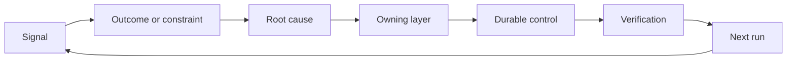

#  la formation d'un mécanisme d'intégration et de démission

> La publication du code met fin au cycle de construction de la période actuelle, tout en ouvrant un cycle d'apprentissage à long terme.

**Type:** Learn + Build
**Languages:** Python (stdlib)
**Prerequisites:** Phase 14 lessons 46 and 53
**Time:** ~75 minutes

## Objectif de l'apprentissage

- Les événements de défaillance, les données d'évaluation, les comportements des utilisateurs et les corrections sont transformés en actions qui sont responsables.
- Les différents signaux doivent être précisés par le réseau de communication, les systèmes de surveillance et les systèmes de surveillance.
- La priorité est de classer les risques de réapparition en fonction de la gravité et du nombre de fois où ils se produisent.
- Pour chaque système de contrôle, un mécanisme de contrôle définit des conditions de retrait de service.
- 沟通交付决策, fournir des preuves, évaluer les décisions et déterminer les décideurs responsables.

## Il s'agit aussi d'une infrastructure.

Une équipe peut recueillir une grande quantité de chaînes de systèmes de suivi des traces, des enregistrements d'évaluation, des supports de travail et des journaux de problèmes, mais sans tirer aucune leçon de cognition.**晋级通道（Promotion）**Le système de validation des preuves est un système de validation qui change de façon fixe.

Le dernier cycle de l'enquête est le suivant:

1. 观测到具体实测信号;
2. Leur relation avec les résultats de production prévus, les conditions de conditionnement ou les hypothèses de préposition;
3. Identifier les niveaux systémiques les plus bas de la responsabilité de l'incitation à l'appartenance;
4. 实施受控的持久化改进;
5. 验证 la probabilité de rechute de cette maladie a été réduite;
6. Le mécanisme de contrôle doit-il être maintenu en vigueur ?

## 精准路由至应对责任层级

| 信号类型 | 归属目的地 |
|---|---|
| 误报、功能倒退、错误输出结果 | 评测集（Evaluation）或自动化测试 |
| 上下文缺失、重复劳动、过时事实 | 上下文数据源或检索路由策略 |
| 不安全操作或越权漏洞 | 安全策略（Policy）或权限硬边界 |
| 超时、重试风暴、依赖服务不可用 | 运行时控制（Runtime Control） |
| 新的产品需求或尚未决断的权衡取舍 | 经过规范成型（Shaped）的待办项 |

Lorsque les limites de test automatisé ou de dureté suffisent à rendre complètement impossible l'erreur, ne pas ajouter un autre paragraphe de la formule dans le prompt.



## La responsabilité de l'appartenance elle-même fait partie du mécanisme de contrôle.

Chaque action en rotation doit être spécifiquement:

- 唯一的人类责任人(propriétaire);
- ), les priorités établies sur la base de l'évaluation globale des effets de la dégradation et de la fréquence de réapparition;
- 拟修改的目标系统组件 (Artifact)
- provisionner le programme de vérification de la modification et de l'effet réel;
- la fenêtre de révision ou de défaillance automatique;
- 明确的退役条件(Condition de retraite)

Un programme de réforme sans précédent, dont la quantité est simplement une partie de la version de l'observation.

## Décision de l'ancien mécanisme de contrôle

Les règles de contrôle et de contrôle peuvent être contradictoires et coûteuses. Dans les cas suivants, un mécanisme de contrôle et de contrôle doit être activement révisé et retiré:

- Les changements fondamentaux ont eu lieu dans l'architecture systémique ou le flux de travail des entreprises;
- Le mécanisme de l'invariabilité du niveau inférieur a complètement remplacé l'ordre écrit du niveau supérieur;
- Dans la fenêtre de temps prévue, les défaillances de prévention ne sont jamais réapparues;
- Les règles de contrôle entravent la fréquence de la promotion normale des activités, dépassant les bénéfices qu'elles apportent en matière de prévention des risques.

Les contrôles de retrait nécessitent également des preuves, mais ne peuvent pas être supprimés à la main simplement parce qu'ils semblent trop longs.

## 打通 produits de construction et de codeur de l'agent

Un mécanisme de rotation difficile peut servir simultanément les deux voies de développement des activités de produits et de développement de l'intelligence:

-  le développement d'un cadre de production prévue, d'un schéma de hypothèses, d'un plan de taille ou de coupe minimale;
- Optimisation du scénario ou du mécanisme de communication automatisé de l'agent de codage;
- Les problèmes réels sur la ligne peuvent aussi favoriser la régulation des limites des fonctions du produit, ou encore favoriser la consolidation de l'agent.

C'est pourquoi le cadre de tâches ne se situe pas avant la phase de déclenchement du code, mais au cours de chaque changement accepté par le système.

## 动手实现

Cette expérience a été menée par le groupe de recherche et de recherche, qui a été créé par le groupe de recherche et de recherche.`outputs/feedback-backlog.json`Il y a une autre.

```bash
python3 code/main.py
python3 -m unittest discover code/tests -v
```

尝试添加一个运行时超时信号,验证它将被正确路由至运行时控制层,而不是泛化混入通用需求待机列表.

## 实践实验: responsable des décisions prises après avoir été battues

Dans le cadre de votre cheminement d'apprentissage professionnel, parmi les projets de travail à la suite, choisissez un flux de travail.[职业交付模板](https://github.com/rohitg00/ai-engineering-from-scratch/blob/main/phases/14-agent-engineering/54-build-the-feedback-ratchet/outputs/career-delivery-evidence.md)Dans le centre.

Python expérimentation génère des exemples de projets d'action ⋅ il n'observe pas les utilisateurs ⋅ mesure les résultats de l'intervention, et ne prouve pas que vous avez déjà un pouvoir de travail ⋅ l'expérience est simplement un travail de préparation de l'exercice ⋅

### 1. C' est clair ce qui s' est passé .

记录 user、 tasks、 current workflow, ainsi que les résultats que vous souhaitez améliorer── Link to through consented observation record、 déjà défectueux support record, ou trajet de tâche réalisable── distinguer les faits que vous observez directement、 les rapports des autres, ainsi que vos conclusions──

 Découvrez une réaction: une hypothèse de défaillance  des résultats inutilisés  des coûts inattendus  des retards de communication  expliquez quelles preuves ont changé votre compréhension  Réaction et décision sont nécessaires au lieu d'être enveloppées dans une histoire de succès

Si vous ne pouvez pas contacter l'utilisateur, veuillez effectuer avec votre partenaire une simulation de marquage explicite, ou une simulation basée sur des scénarios explicites.

### 2. Dans la limite de pouvoir

列出未知项目, choisir le coût minimum,可逆,且有望解决影响最重大未知项目行动――说明哪些事可以由你决定,哪些选择受到既有约束,哪些操作需要先获得授权才能执行――

Par exemple, en attendant la permission d'utiliser les données des clients, vous pouvez d'abord préparer un déconnexion délicat. La progression active signifie que le travail d'autorisation est terminé, et la décision sera bloquée en clair; elle n'étendra pas vos droits d'accès ou d'approbation.

### 3. Comparer les programmes et les décisions

Pour ceux qui n'ont pas besoin de connaître les détails de la réalisation, écrivez un bref résumé de la décision.

- Les problèmes des utilisateurs, ainsi que les preuves du changement de plan;
- Au moins deux types de programmes; lorsqu'ils sont raisonnablement possibles, inclure des programmes d'emploi moins coûteux ou sans développement;
- - la qualité, la conception, la quantité de travail, les coûts d'exploitation et les risques;
- Les recommandations, les incertitudes et les décisions à prendre;
-  Responsable de la prise de décision  Parties intéressées concernées et date de prise de décision

S'il vous plaît, accompagnez-moi pour représenter un des parties intéressées concernées, questionnez l'un d'entre eux.

### 4.  mener des expériences de délimitation

En fonction des questions à répondre, choisir le type de travail initial, le point de départ ou la phase de production.

De l'initiation de l'utilisateur à la fin de la tâche, parcourir l'ensemble du processus de communication.

Le temps consacré à l'audit et à la correction artificiels est considéré dans le processus de travail.

### 5. Comparer les résultats avec l'économie

Utiliser les mêmes indicateurs définissant le total des tâches, les méthodes de collecte et les fenêtres d'observation comparables, enregistrant les résultats et les résultats ultérieurs.

Enterrer un résultat utilisateur  un indicateur de qualité ou de sécurité , ainsi que le total de travail d'audit artificiel. Même si les résultats ne sont pas atteints, il faut aussi enregistrer en réalité.

 estimation du coût de chaque tâche accomplie avec succès, prise en compte du modèle de réutilisation, de la réévaluation, du service de support et de l'audit artificiel,   présentation de l'hypothèse de prix unique de la capacité humaine, de la différence entre la valeur de l'utilisation et de l'estimation                                                                                                                                                                                                                                                                                                                                                                                                                                              

À travers les choses déjà [LLM FinOps 课程](https://aiengineeringfromscratch.com/lesson?path=phases/17-infrastructure-and-production/27-finops-llms), l'apprentissage de la coût de l'économie unitaire. Le modèle de changement est un moyen de réaction possible; réduire la portée du flux de travail ou conserver les étapes artificielles, peut-être une meilleure décision de produit.

### 6. 完成闭环

Selon les critères préalablement déclarés, la recommandation de continuer à réparer ou à arrêter, si les preuves sont encore indéterminées, indiquant l'absence d'observation, ainsi que les tests définis au niveau des limites suivantes, est de noter la réponse des décideurs responsables; si une décision n'a pas encore été prise, elle est conservée en état d'attente.

 choisir un élément d'amélioration du processus de livraison lui-même: un cadre de tâches plus clair, des utilisateurs plus tôt, un meilleur système d'évaluation, un agent plus petit, un réseau de services ou un cas d'évaluation plus ciblé, et un délai de révision.

Lors de la révision, la décision de conserver, modifier ou retirer cette amélioration est une preuve de la sélection des documents.

## 交付物

Il va[career-delivery-evidence.md](https://github.com/rohitg00/ai-engineering-from-scratch/blob/main/phases/14-agent-engineering/54-build-the-feedback-ratchet/outputs/career-delivery-evidence.md)☐ la rédaction de la lettre d'information est une obligation de travail, et la rédaction de la lettre d'information est une obligation de travail.

## 验证

Avec les collègues, utilisez les normes d'acceptation artificielle suivantes.**met**( déjà satisfait)**needs work**(Ne nécessite pas d'amélioration) ou **not observed**(enfin d'observation),并提供证据链接或具体缺失的观测──填好了字段,并不能证明判断合理──

| 检查项 | 满足标准的证据 |
|---|---|
| 工作流有事实依据 | 可追溯的观测支持问题定义；他人报告、推断和模拟均有标记。 |
| 遵守授权边界 | 下一项可逆工作明确，任何受限操作都等待真正的决策责任人授权。 |
| 权衡沟通清晰 | 记录可信的替代方案、利益相关方的异议、建议，以及明确的决策请求。 |
| 交互经过测试 | 走查覆盖成功、失败、恢复，以及人工审核工作量。 |
| 结果经过比较 | 基线与后续度量的定义一致；样本、护栏指标、成本和比较局限清晰可见。 |
| 对挫折承担责任 | 证据改变了继续、调整或停止的决策，并导向一项有明确责任人的后续行动。 |
| 流程得到改进 | 一项工作流改进具备责任人、复审日期，以及基于证据的保留、修改或退役决定。 |

Même si chaque étape de simulation est passée, le comportement des utilisateurs non observés reste un manque de preuves.

## 课后练习

1. Les problèmes de réaction et les réclamations réelles des utilisateurs seront transformés en actions concrètes.
2. L'indication de pouvoir empêcher de nouveau sa reprise à partir de la base des niveaux systémiques les plus basses.
3. Pour les expériences de production d'actions complétées par des commandes ou des indicateurs d'observation de vérification automatisées réalisables.
4. Pour une réglementation de la stratégie de sécurité existante, des conditions de démission claires sont établies.
5. En effet, les techniques de recherche et de recherche sont les plus efficaces pour les développeurs de l'information.

## 延伸阅读

- [Basili, Caldiera, and Rombach, The Goal Question Metric Approach](https://www.cs.toronto.edu/~sme/CSC444F/handouts/GQM-paper.pdf), explorer comment réaliser la perception continue au niveau de l'organisation par le biais de mécanismes de mesure orientés vers l'objectif.
- [Fagerholm et al., Building Blocks for Continuous Experimentation](https://doi.org/10.1145/2601248.2601276), la recherche et l'analyse des données probantes et des résultats de recherche et développement continu des produits et des technologies et des organisations.
- [Nuseibeh and Easterbrook, Requirements Engineering: A Roadmap](https://www.cs.toronto.edu/~sme/papers/2000/ICSE2000.pdf), expliquer les besoins en termes de conception de l'évolution des dynamiques du cycle de vie de l'ensemble du système.

## 交付物沉

Garder à l' écoute`outputs/feedback-backlog.json` comme exemple de route,并保留你完成的职业交付证据,记录自己的决策──两者共同为产品判断力与交付──产品判断和交付)学习路径结尾,并为下一个预期产出框架提供依据──
