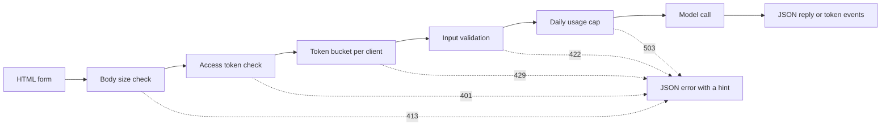

# Interface de démonstration du modèle: de la fonction à l'application partagée

> 模型演示有一个约定:输入、模型调用和输出──在分享链接之前,先为每部分设定限制──

**Type:** Build
**Languages:** Python
**Prerequisites:** Phase 11 · 13（构建生产级 LLM 应用）、Phase 17 · 08（推理指标）、Phase 17 · 19（AI 网关）
**Time:** ~90 分钟

## Objectif de l'apprentissage

- 写出演示的输入、模型调用和输出约定,并为每部分设定限制──
- Utilisez une bibliothèque standard pour créer une application HTTP, contenant une page HTML, un JSON et un serveur pour envoyer des événements.
- 按成本从低到高验证输入,并返回能够告诉用户下一步操作的 JSON 错误――
- Utiliser chaque baril de commandes client, limite de consommation quotidienne et commandes de visite optionnelles, protéger les expositions publiques.
- 编写不保留输入文本和客户端地址的请求日志──
- Comparer la présentation de la bibliothèque de normes avec les deux versions du cadre, et souligner que la présentation doit être améliorée en signal de produit.

##  problématique

Votre modèle est déjà en marche dans votre carnet de notes. Maintenant, un critique veut essayer 10 entrées, un client veut voir le résultat sur son téléphone.

Notebook 单元格 no input limit, ne pas progress display. Il est disponible en temps réel, vous pouvez le lire et le suivre. Il utilise également vos certificats et votre budget.

- Utilisateur coller un document de 40 000 caractères.
- Un scénario envoie 500 requêtes en une minute. Chaque requête est lancée par un modèle de paiement.
- 页面八秒没有显示任何内容,于是用户又点击了四次按──
- serveur日志 conserve chaque entrée, y compris celle contenant le numéro de compte du client.

interface de démonstration avec une petite quantité de code pour prévenir ces défauts. 本课堂先使用Python 标准库构建一个演示,让你看清每个部分;再使用两个流行框架构建相同演示,比较各自默认行为──

## 概念

### Le spectacle est un rendez-vous

Chaque présentation a trois parties. L'entrée est le contenu que l'utilisateur peut envoyer; le modèle de modification sera l'entrée transformée en sortie; l'extrait est le contenu que l'utilisateur voit, y compris l'erreur.

Avant de rédiger la page, écrivez cette convention:

| 部分 | 需要回答的问题 | 本课的答案 |
|------|--------------------|-----------------------|
| 输入 | 什么类型、多大、允许哪些字符？ | 长度为 1 到 500 个字符的字符串，不含控制字符 |
| 模型调用 | 一次调用需要多久、成本多少？ | 一个不到一毫秒即可运行完毕、没有调用费用的玩具关键词模型 |
| 输出 | 成功和失败时，用户分别看到什么？ | 标签、分数和回复，或带有操作提示的 JSON 错误 |

Notebook  n'a pas de limite pour ces trois parties  présentation  pour chaque partie  et le serveur exécute ces limites à chaque client 



 Exécution du contrôle selon le coût de la séquence de faible à hauteur

### Dans le cadre de la mise en œuvre de la loi

Le navigateur peut consulter les entrées avant de les envoyer.`maxlength`et `required`属性, sans besoin de réseau调用就能向用户提供反──────────────────────────────────────────────────────────────────────────────────────────────────────────────────────────────────────────────────────────────────────────────────────────────────────────────────────────────────────────────────────────────────────────────────────────────────────────────────────────────────────────────────────────────────────────────────────────────────────────────────────────────────────────────────────────────────────────────────────────────────────────────────────────────────────────────────────────────────────────────────────────────────────────────────────────────────────────────────────────────────────────────────────────────────────────────────────────────────────────────────────────────────────────────────────────────────────────────────────────────────────────────────────────────────────────────────────────────────────────────────────────────────────────────────────────────────────────────────────────────────────────────────────────

Pour les services de vérification par coût de bas à haut rang:

1. 读取 `Content-Length`En lisant la requête, refusez de dépasser la limite de la requête.
2. 解析 JSON Petition ⋅ Rejet non JSON objet de requête ⋅
3. 检查字段──拒绝空文本、超长文本和控制字符──
4.  seulement par la demande de l'ensemble du contrôle, pour consommer une seule fois le modèle de référencement

| 未通过的检查 | HTTP 状态 | 错误代码 |
|--------------|-------------|------------|
| 没有 `Content-Length` 请求头 | 411 Length Required（需要长度） | `length_required` |
| `Content-Length` 不是数字 | 400 Bad Request（错误请求） | `bad_length` |
| 请求体超过 4,096 字节 | 413 Content Too Large（内容过大） | `body_too_large` |
| 尚未收到 `Content-Length` 指定的字节数，请求体就停止传输 | 408 Request Timeout（请求超时） | `request_timeout` |
| 内容类型不是 JSON | 415 Unsupported Media Type（不支持的媒体类型） | `unsupported_media_type` |
| 请求体不是 JSON 对象 | 400 Bad Request（错误请求） | `bad_json` |
| 文本缺失、为空、过长或含有控制字符 | 422 Unprocessable Content（无法处理的内容） | `missing_text`、`empty_text`、`text_too_long`、`control_characters` |

RFC 9110 définit ces codes d'état et leur nom.

L'exemple fait également partie du design de l'entrée. L'exemple montre à l'utilisateur ce que l'entrée est, et permet au réviseur de cliquer une seule fois pour pouvoir effectuer un test.

### 让用户知道模型正在工作

模型调用可能需要几秒钟. Si aucun problème n'est posé, l'utilisateur ne peut pas distinguer entre le modèle lent et la page déformée.

Le cours de la page offre quatre types de réponses:

- Soyez en mesure de répondre à la demande.
- 显示已用时间, chaque 100 毫秒 mise à jour une fois.
- Le premier jeton arrive, montre le premier jeton 时间
- Je vous en prie, mettez-vous à l'écart.

En apprendre[推理指标](../../08-inference-metrics-goodput/)时,首代币 时间(TTFT) est un indicateur de serveur.

### Formation de délivrance et de sortie

语言模型个别代币 生成回复. Si le serveur attend le dernier token 才发送, l'utilisateur doit attendre le processus de génération.

服务器发送事件(Server-Send Events,SSE) est le format standard de ce comportement.`text/event-stream` chaque événement par un groupe `event:`et `data:`行组成,并以一个空行结束──WHATWG HTML 标准 a défini ce format──

```text
event: token
data: {"index":0,"text":"Label:"}

event: token
data: {"index":1,"text":" positive."}

event: done
data: {"label":"positive","score":1.0,"tokens":11}
```

浏览器提供用于 SSE 的 `EventSource`接口, mais il n'envoie que GET Petitions. GET Petitions seront insérées et insérées dans l'URL, tandis que Web  serveur et agent会 URL  écrit dans le journal de visite. `fetch()`et `response.body.getReader()`读取响应,并自行解析事件格式──

流式响应存在单次 JSON 回复 没有问题: le serveur a envoyé le code d'état 200 之前在第一个代币之前.`error`事件, ページ将该事件显示为错误──

Dans la construction[生产级 LLM 应用](../../../11-llm-engineering/13-production-app/)时, framework substitute vous via SSE 发送代币──本课写同协议,让你能够看到服务器发送的每一行──

###  éditer les erreurs de l'utilisateur

 err err information a deux tâches: dire à l'utilisateur ce qui s'est passé, et dire à l'utilisateur suivant ce qu'il doit faire. Pour ceux qui ne connaissent pas le système, le suivi de la tâche ne peut accomplir aucune de ces tâches.

Dans cette démonstration, chaque erreur utilise la même structure JSON:

```json
{
  "error": {
    "code": "text_too_long",
    "message": "The text has 812 characters. The limit is 500.",
    "hint": "Shorten the text to 500 characters or fewer.",
    "request_id": "a8f3c2b435e3"
  }
}
```

- `code`Il est stable, le nom, le code client et test l'utiliser comme comparaison.
- `message`陈述事实,并附上用户需求的数值──
- `hint` donner un utilisateur peut exécuter l'opération ⋅
- `request_id`Le compte rendu de l'utilisateur est lié à un journal.

RFC 9457 définit le format standard d'erreur de l'API HTTP, appelé problème détail (problème détail) ⋅ Dans cette présentation, l'utilisation d'une structure plus étroite pour atteindre le même objectif ⋅ Si d'autres équipes vont utiliser votre API, veuillez utiliser RFC 9457⋅

### Sécurité et partage de la présentation publique

Public links will change the population capable de envoyer des demandes.

| 风险 | 本演示中的控制措施 | 面向更多受众的控制措施 |
|------|----------------------|-------------------------------|
| 单个客户端发送过多请求 | 每客户端一个令牌桶，配合 429 和 `Retry-After` | 登录后按用户限流 |
| 陌生人发现链接 | `Authorization` 请求头中的可选访问令牌 | 通过身份提供方实现单点登录 |
| 总成本无限增长 | 每日用量上限，配合 503 和 `Retry-After` | 模型提供方的支出限制和告警 |
| 输入非常大或异常 | 请求体大小限制、文本长度限制、控制字符检查 | 输入与输出的内容审核 |
| 日志保留私人输入 | 只记录输入长度和客户端的带密钥哈希 | 日志保留期限与访问控制 |

La capacité détermine le nombre de demandes envoyées par un client; le taux de remplissage détermine le taux de demande à long terme.

```text
tokens = min(capacity, tokens + refill_rate * seconds_since_last_request)
accept the request if tokens >= 1, then subtract 1
```

桶为空时, le serveur retour `429 Too Many Requests` RFC 6585  define state code 429,并允许服务器附带 `Retry-After`响应头── Cette présentation a toujours ajouté cette réponse, donnant la distance de la prochaine mise en ligne disponible à attendre encore quelques secondes── page 读取响应头,并此期间禁用按──

演示 utiliser l'adresse IP du client comme clé de la barre. À l'arrière du client, chaque requête provient de l'adresse du client, de sorte que tous les utilisateurs partagent une barre.

Dans le cours [AI 网关](../../19-ai-gateways/)时,网关按租户执行限流――演示也需要同样的控制,只是规模更小――限流控制单个客户端,但没有控制总量――百个客户端即使都没有超越各自的限制,仍然可能耗尽全部预算――使用量上限统计一天内所有模型调调,并在达到固定次数后拒绝新调――

Il faut aussi faire preuve de prudence.`http.server`Le processeur inscrit l'adresse IP du client et la demande en erreur standard. Si l'entrée se trouve dans l'URL, l'entrée entrera également dans le journal. Cette présentation a remplacé ce journal. Chaque demande ne fait que rédiger un enregistrement, contenant le chemin, le code d'état, le code d'erreur, le délai et la longueur de l'entrée. L'adresse du client est transformée en un hash de clé clé, c'est-à-dire en utilisant la valeur hash de la clé secrète du calcul, vous permettant de ne pas avoir besoin de sauvegarder l'adresse en fonction de la demande de statistique du client.

 Dites à l'utilisateur ce que vous avez conservé  Exposition page  Exposition page  Exposition page  Exposition page  Exposition page  Exposition page  Exposition page  Exposition page  Exposition page  Exposition page  Exposition page  Exposition  Exposition  Exposition  Exposition  Exposition  Exposition  Exposition  Exposition  Exposition  Exposition  Exposition  Exposition  Exposition  Exposition  Exposition  Exposition  Exposition  Exposition  Exposition  Exposition  Exposition  Exposition  Exposition  Exposition  Exposition  Exposition  Exposition  Exposition  Exposition  Exposition  Exposition  Exposition  Exposition  Exposition  Exposition  Exposition  Exposition  Exposition  Exposition  Exposition  Exposition  Exposition  Exposition  Exposition  Exposition  Exposition  Exposition  Exposition  Exposition  Exposition  Exposition  Exposition  Exposition  Exposition  Exposition  Exposition  Exposition  Exposition  Exposition  Exposition  Exposition  Exposition  Exposition  Exposition  Exposition  Exposition  Exposition  Exposition  Exposition  Exposition  Exposition  Exposition  Exposition  Exposition  Exposition  Exposition  Exposition  Exposition  Exposition  Exposition  Exposition  Exposition  Exposition  Exposition  Ex: Ex: Ex: Ex: Ex: Ex: Ex: Ex: Ex: Ex: Ex: Ex: Ex: Ex: Ex: Ex: Ex: Ex: Ex: Ex: Ex: Ex: Ex: Ex: Ex: Ex: Ex: Ex: Ex: Ex: Ex: Ex: Ex: Ex: Ex: Ex: Ex: Ex: Ex: Ex: Ex: Ex: Ex: Ex: Ex: Ex: Ex: Ex: Ex: Ex: Ex: Ex

### 演示何时成为产品

演示由一进程提供服务,面向已知的人群和短时会话──: les signes suivants indiquent que l'exposition est devenue un produit:

- Les gens de l'extérieur de l'équipe l'utiliseront chaque semaine.
- Certains proposent des objectifs ou des interruptions de service.
- Utilisateur a demandé de se connecter, de sauvegarder ou de consulter l'histoire.
- Le coût de la modélisation hebdomadaire est un projet du budget.
- Les données de l'entrée sont liées à un contrat ou à une obligation légale.

| 属性 | 演示 | 产品 |
|----------|------|---------|
| 用户 | 已知人群，短时会话 | 未知人群，每日使用 |
| 状态 | 无 | 账户、历史、已保存的结果 |
| 可用性 | 尽力而为，单进程 | 书面目标、副本、值班责任人 |
| 成本控制 | 一个每日用量上限 | 每用户配额和计费 |
| 可观测性 | 每请求一条日志 | 链路跟踪、指标和告警 |

En voyant ces signaux, la démonstration devrait être transférée à la production de niveau LLM  application des cours de production ∙∙ Cette technologie ∙ a augmenté la véritable authentification ∙ les modèles de stockage ∙ le suivi des chaînes et le suivi des coûts par utilisateur ∙

```figure
demo-token-bucket
```

## 动手构建

Il n' y a qu' un seul document .`code/main.py`, à l'exception des normes, aucune dépendance n'est nécessaire.

```bash
python3 code/main.py
```

Autoservices de vérification de l'autorisation de vérification de la mise en œuvre du code de référence, ainsi qu'une véritable communication HTTP, qui démarre le serveur sur le port vide, envoie trois requêtes, arrête le serveur, puis sort.

```bash
python3 code/main.py --serve
```

Dans le navigateur`http://127.0.0.1:8000`❖ Ctrl+C 停止服务器♦

### 第 1 步: modèle调用

Le modèle est un jouet, un mot clé, un compteur, qui marque le texte en termes positifs, négatifs ou moyens.

```python
def classify(text):
    words = WORD_RE.findall(text.lower())
    positive = sum(1 for word in words if word in POSITIVE)
    negative = sum(1 for word in words if word in NEGATIVE)
    score = (positive - negative) / max(1, positive + negative)
    if score > 0:
        label = "positive"
    elif score < 0:
        label = "negative"
    else:
        label = "neutral"
    return {"label": label, "score": round(score, 3), "positive_cues": positive,
            "negative_cues": negative, "words": len(words)}


def generate(text):
    result = classify(text)
    reply = (
        f"Label: {result['label']}. Positive cues: {result['positive_cues']}. "
        f"Negative cues: {result['negative_cues']}. Words read: {result['words']}."
    )
    parts = reply.split(" ")
    yield parts[0]
    for part in parts[1:]:
        yield " " + part
```

换成真实模型时, il suffit de le remplacer `generate` Dans lequel il est placé dans l'API 调用或本地模型──保持函数签名不变:输入字符串,输出代币──验证器、限制和页面都保持不变──

### Deuxième étape: vérification et erreur de réponse

Un type anormal de code contient tous les erreurs. Il contient le code d'état HTTP, le code d'erreur stable, les messages, les instructions d'opération et les réponses choisies.

```python
class DemoError(Exception):
    def __init__(self, status, code, message, hint, headers=None):
        super().__init__(message)
        self.status = status
        self.code = code
        self.message = message
        self.hint = hint
        self.headers = dict(headers or {})


def validate_text(payload, max_chars=MAX_CHARS):
    if "text" not in payload:
        raise DemoError(422, "missing_text", 'The field "text" is missing.', 'Add a "text" field with your input.')
    text = payload["text"]
    if not isinstance(text, str):
        raise DemoError(422, "text_not_string", 'The field "text" is not a string.', "Send the input as a string.")
    text = text.strip()
    if not text:
        raise DemoError(422, "empty_text", "The text is empty.", "Type a sentence or pick an example.")
    if len(text) > max_chars:
        raise DemoError(422, "text_too_long", f"The text has {len(text)} characters. The limit is {max_chars}.",
                        f"Shorten the text to {max_chars} characters or fewer.")
    if CONTROL_RE.search(text):
        raise DemoError(422, "control_characters", "The text contains control characters.",
                        "Remove the hidden characters, then send the text again.")
    return text
```

Le testateur enlève d'abord le premier le vide vide.`check_body_size`et `parse_json_body`Pour les 411、413、415 et 400 états, l'utilisation du même modèle.`error_body`Ça va aller.`DemoError`转换为概念部分展示的 JSON 结构──

### 第3 步:令牌桶

```python
class TokenBucket:
    def __init__(self, capacity, refill_per_second, now):
        if capacity < 1:
            raise ValueError("capacity must be at least 1")
        if refill_per_second <= 0:
            raise ValueError("refill_per_second must be positive")
        self.capacity = float(capacity)
        self.refill_per_second = float(refill_per_second)
        self.tokens = float(capacity)
        self.updated = now

    def take(self, now, cost=1.0):
        elapsed = max(0.0, now - self.updated)
        self.tokens = min(self.capacity, self.tokens + elapsed * self.refill_per_second)
        self.updated = now
        if self.tokens >= cost:
            self.tokens -= cost
            return 0.0
        return (cost - self.tokens) / self.refill_per_second
```

`take` accepter la demande retourne à 0,0; sinon, retourner à la distance du baril de commandes suffisamment de seconde à attendre.`Retry-After`Il y a une autre.

`RateLimiter`Dans le`OrderedDict`Pour chaque clientèle, un baril est conservé.`ThreadingHTTPServer`Dans un processus indépendant, chaque requête est traitée, donc le nombre d'articles dans le dictionnaire est supérieur à la valeur de la protection.`max_clients`Lorsque le limiter supprime le client le plus longtemps non envoyé la demande, le client le plus tard supprimé obtient une bouteille remplie.`max_clients`Settage supérieur au nombre de clients actifs que vous attendez 

Un seul est accepté.`clock`参数──测试传入 `FakeClock`Il faut attendre, il faut avancer 10 secondes.`UsageCap`Utilisation du même modèle horaire pour traiter le total par jour: avec 86,400 secondes de vitres fixes, le nombre de fois qu'il faut pour revenir à la distance de la fenêtre suivante est également nécessaire d'attendre le nombre de secondes.

### 第4 步: casse-tête

```python
def sse_event(event, data):
    payload = json.dumps(data, separators=(",", ":"), ensure_ascii=False)
    return f"event: {event}\ndata: {payload}\n\n".encode("utf-8")


def stream_events(text, generate_fn=generate, delay=0.0, sleep=time.sleep):
    count = 0
    try:
        for token in generate_fn(text):
            yield sse_event("token", {"index": count, "text": token})
            count += 1
            if delay:
                sleep(delay)
    except Exception:
        yield sse_event("error", MODEL_ERROR)
        return
    result = classify(text)
    yield sse_event("done", {"label": result["label"], "score": result["score"], "tokens": count})
```

`json.dumps`J'ai changé de texte en texte.`\n`Ces deux caractères. Ainsi, chaque événement ne contient qu'une seule ligne de données, dont aucun ne contient le format d'événement perturbé.

Produit de la machine de capture de défaut de modèle,并发送 `error`L'événement, parce que le serveur a déjà envoyé l'état de l'accès.`delay`et `sleep`Les paramètres peuvent ralentir la vitesse de flux lors de la présentation du navigateur, tout en permettant au test de se maintenir rapide.

### 第5 步: traitement de requête

`DemoHandler`继承自 `BaseHTTPRequestHandler`POST  traitement par concept partie des séquences d'exécution de l'examen:

```python
def do_POST(self):
    app = self.server.app
    request_id = uuid.uuid4().hex[:12]
    client_id = self.client_address[0]
    started = time.perf_counter()
    route = self.path if self.path in self.routes else "other"
    status, code, chars = 200, None, 0
    try:
        declared = self.headers.get("Content-Length")
        try:
            if route == "other":
                raise DemoError(404, "not_found", "This endpoint does not exist.",
                                "Send requests to /api/predict or /api/stream.")
            size = check_body_size(declared, app.config.max_body_bytes)
        except DemoError:
            self.drain(int(declared) if declared and declared.isdigit() else 0)
            raise
        try:
            body = self.rfile.read(size)
        except TimeoutError:
            self.close_connection = True
            raise DemoError(408, "request_timeout", "The request body did not arrive in time.",
                            "Send the request again with the full body.") from None
        app.admit(client_id, self.headers.get("Authorization"))
        text = app.read_text(self.headers.get("Content-Type"), body)
        chars = len(text)
        app.charge()
        if route == "/api/predict":
            self.send_json(200, predict(text), request_id)
        else:
            code = self.send_stream(text, request_id)
    except DemoError as err:
        status, code = err.status, err.code
        self.send_error_json(err, request_id)
    except TimeoutError:
        status, code = 408, "request_timeout"
        self.close_connection = True
    except Exception:
        status, code = 500, "internal_error"
        self.send_error_json(DemoError(500, "internal_error", "The server failed on this request.",
                                       "Try again. Quote the request id if you report the problem."), request_id)
    finally:
        latency_ms = (time.perf_counter() - started) * 1000
        app.log.record(request_id, route, client_id, status, chars, latency_ms, code)
```

`admit`检查访问令牌和令牌桶。`charge` vérifier la limite de jour et l'exécuter finalement, donc seulement la demande valide est comptabilisée à la limite `finally`块中写入一条日志, incluant les demandes de refus.`route`, n'est pas un chemin d'origine, car il peut contenir des lignes de requête contenant le texte utilisateur.

Quatre éléments permettant de prévenir les défaillances facilement négligées:

-  traitement de classe `timeout = 10`Il n'y a pas de connexion. Il n'y a pas de connexion. Il ne s'agit pas d'un système de connexion. Il ne s'agit pas d'un système de connexion.
- `log_message`直接返回,不输出内容── ceci supprimera le contenu contenant l'adresse du client et le fichier par défaut de la demande──
- `drain`RFC 1122 note que lorsque la connexion du serveur principal est encore inachevée, le TCP va envoyer une nouvelle mise en place; le clientèle peut donc recevoir jusqu'à 413 réponses.
- `send_stream` Capture `BrokenPipeError`Il est également possible de supprimer le produit.

`BaseHTTPRequestHandler`L'utilisation par défaut de HTTP/1.0. Ainsi, le serveur se ferme au moment de la connexion et indique la fin du processus de réponse.

### Section 6 步: page

`render_page`Retourner un document HTML, dont les schémas et les scénarios sont insérés.

```javascript
const reader = response.body.getReader();
const decoder = new TextDecoder();
let buffer = "";
while (true) {
  const chunk = await reader.read();
  if (chunk.done) { break; }
  buffer += decoder.decode(chunk.value, { stream: true });
  let cut = buffer.indexOf("\n\n");
  while (cut >= 0) {
    const frame = parseFrame(buffer.slice(0, cut));
    buffer = buffer.slice(cut + 2);
    cut = buffer.indexOf("\n\n");
    if (frame.event === "token") { output.textContent += frame.data.text; }
  }
}
```

网络数据块可能在事件中结束. 阅读器会将保留未完整的部分在 `buffer`En milieu, jusqu'à ce que je reçoive le message.

 pages utilisées `textContent`写入模型输出,绝不使用 `innerHTML` le modèle de sortie est incroyable  supposer que la page sera répliquée comme HTML 插入, tandis que le réplique contient 带`onerror`属性元素, cette propriété est possible dans le navigateur utilisateur d'exécuter le code.

 serveur encore envoyer `default-src 'none'``Content-Security-Policy`响应头―― Cette stratégie ne permet qu'un script intégré et un style intégré, et passe par leurs propres SHA-256 哈希识别它们―― le navigateur rejettera tous les autres scripts, y compris les scripts de l'attaquant insérés dans la page――

```python
def csp_hash(source):
    digest = hashlib.sha256(source.encode("utf-8")).digest()
    return "'sha256-" + base64.b64encode(digest).decode("ascii") + "'"
```

### Section 7  步: le faire fonctionner, et essayer de le faire sortir

Initier le serveur, puis utiliser à partir du second terminal `curl` Le serveur qui est en cours d'exécution envoie en continu sept requêtes.

```bash
for i in 1 2 3 4 5 6 7; do
  curl -s -o /dev/null -w '%{http_code} ' -X POST http://127.0.0.1:8000/api/predict \
    -H 'Content-Type: application/json' -d '{"text": "ok"}'
done
```

```text
200 200 200 200 200 429 429
```

Attends 10 secondes, puis envoie le texte vide:

```bash
curl -s -X POST http://127.0.0.1:8000/api/predict \
  -H 'Content-Type: application/json' -d '{"text": ""}'
```

```json
{"error": {"code": "empty_text", "message": "The text is empty.", "hint": "Type a sentence or pick an example.", "request_id": "e3e3599feaea"}}
```

Utilisation de l'émission`curl -N`观察事件流:

```bash
curl -N -X POST http://127.0.0.1:8000/api/stream \
  -H 'Content-Type: application/json' -d '{"text": "The screen is bright."}'
```

Si vous voulez demander un ordre de visite, définissez avant le serveur de démarrage `DEMO_ACCESS_TOKEN`◊ page suivante affichera un令牌

```bash
export DEMO_ACCESS_TOKEN="$(python3 -c 'import secrets; print(secrets.token_urlsafe(24))')"
echo "$DEMO_ACCESS_TOKEN"
python3 code/main.py --serve
```

运行测试:

```bash
python3 -m unittest discover -s code/tests -v
```

HTTP 测试在端口 0 上启动服务器,由操作系统选择空端口──`tearDown`Arrêtez le serveur, et vérifiez si son fil est terminé.

## 使用框架

Gradio et Streamlit sont deux cadres Python qui peuvent être construits avec moins de code.`main.py`导入约定, donc les vérificateurs et les modèles restent inchangés.`main.py`Ou test, pas besoin d'installer un cadre de celui-ci.

###  autour d'un composant d'organisation de fonction

Gradio pour un Python  fonction emballage Web 界面──entrée et sortie composants description约定, générateur fonction envoyer partie de sortie──

```python
import os

import gradio as gr

from main import EXAMPLES, MAX_CHARS, DemoError, classify, generate, validate_text


def label_text(text):
    try:
        clean = validate_text({"text": text})
    except DemoError as err:
        raise gr.Error(f"{err.message} {err.hint}")
    label = classify(clean)["label"]
    reply = ""
    for token in generate(clean):
        reply += token
        yield reply, label


demo = gr.Interface(
    fn=label_text,
    inputs=gr.Textbox(label="Text to label", lines=5, max_length=MAX_CHARS),
    outputs=[gr.Textbox(label="Reply"), gr.Textbox(label="Label")],
    examples=list(EXAMPLES),
    flagging_mode="never",
)

if __name__ == "__main__":
    demo.queue(max_size=20).launch(auth=("demo", os.environ["DEMO_PASSWORD"]))
```

Chaque fois .`yield`La fonction est donc produite à chaque étape jusqu'à la réaction complète actuelle.

Dans le cadre de la mise en place de la communication,`flagging_mode` Mode par défaut affichera le marqueur en cliquant sur le serveur  User en cliquant sur le serveur  Gradio va entrer et sortir des fichiers CSV  Value `"never"`Je vais déménager.

`queue(max_size=20)`限制等待中的请求数量──默认并发发限制是每个事件只运行一个调用──在你提高限制之前,慢模型一次只服务一个用户──Gradio encore sera en cours de démarrage de l'application créer un API 端点,让脚本无需通过页面就能调用演示──你的限流也必须覆盖这些端点──

### Chaque fois que vous entrez, vous allez refaire le script.

Lorsqu'un utilisateur modifie chaque élément, Streamlit redémarre le texte de la page de l'utilisateur à la fin du processus.

```python
import streamlit as st

from main import EXAMPLES, MAX_CHARS, DemoError, classify, generate, validate_text

st.title("Toy sentiment demo")
st.caption("Do not paste private data.")

example = st.selectbox("Start from an example", ["", *EXAMPLES])
with st.form("demo"):
    text = st.text_area("Text to label", value=example, max_chars=MAX_CHARS)
    submitted = st.form_submit_button("Run model")

if submitted:
    try:
        clean = validate_text({"text": text})
    except DemoError as err:
        st.error(f"{err.message} {err.hint}")
    else:
        st.write_stream(generate(clean))
        st.write(f"Label: {classify(clean)['label']}")
```

`st.write_stream`直接 accepter le générateur, en écrivant chaque bloc de données à l'arrivée.`@st.cache_resource`La mise en œuvre de la rédaction de l'écriture est un processus de mise en œuvre de la rédaction de la rédaction de la rédaction de la rédaction.

### Les comportements de chaque programme

| 需求 | 标准库（本课） | Gradio | Streamlit |
|------|--------------------------------|--------|-----------|
| 表单、示例、结果区域 | 自己编写 HTML | `Interface` 根据组件和 `examples` 构建 | 使用 `st.text_area`、`st.selectbox` 等控件 |
| 输入长度限制 | 页面上的 `maxlength` 加服务器检查 | `Textbox` 上的 `max_length` | `st.text_area` 上的 `max_chars` |
| 部分输出 | 自己编写 SSE 和流读取器 | 使用生成器函数，每次 `yield` 替换输出 | `st.write_stream` 配合数据块生成器 |
| 进度显示 | 自己编写计时器 | 输出区域的进度显示，由 `show_progress` 设置 | `st.write_stream` 在每个数据块到达时显示它 |
| 面向用户的错误 | 带有 `code`、`message`、`hint`、`request_id` 的 JSON | `raise gr.Error(...)` 显示消息 | `st.error(...)` 显示消息 |
| 并发 | 每请求一个线程，无上限 | 队列，默认每个事件只运行一个调用 | 每次交互都会为该会话重新运行脚本 |
| 公开链接 | 自己运行服务器和管理域名 | `launch(share=True)` 提供一周后过期的链接 | 自己将应用部署到服务器 |
| 登录 | Bearer 令牌检查 | `launch(auth=...)` 使用用户名和密码 | `st.login()` 配合 OpenID Connect 提供方 |
| 限流与成本上限 | 令牌桶和每日上限 | 自己编写代码，通过请求获取客户端地址 | 自己编写代码 |
| 工具写入磁盘的输入信息 | 日志中只有输入长度 | 被标记的样本写入 CSV 文件，除非设置 `flagging_mode="never"` | 由自己的代码决定 |

Les résultats de la mise en page sont les plus courants: les exemples, les progrès, les performances et les sorties. Ils sont moins courants dans les aspects de la mise en page.

## Je le livre.

本课产 出 `outputs/skill-demo-interface-checklist.md` lui fournir des explications ou des codes de la présentation du modèle, elle évaluera les erreurs et les mesures de contrôle du lien public, et elle donnera des conclusions adoptées ou non.

## 练习

1. Il va`BUCKET_CAPACITY`设置为 2,将 `REFILL_PER_SECOND`设置为 1──预测七请求循环的输出,再实际运行并比较──
2. Dans le corps de la requête`language`字段, seulement accepté `"en"`◊ 422  erreur de tout autre retour avec des instructions d'exploitation,并添加两个测试――
3. 找出一个玩具模型会错分类的句子,例如"L'écran n'est pas bon".                                                                                                                                                                                                                                                 
4. Sur votre machine, le spectacle sera placé à l'arrière de l'agent.`trust_proxy`选项, seulement lues à partir de l'adresse de l'agent `X-Forwarded-For`◊ édition de tests, prouvant que le client ne peut pas choisir lui-même les touches du baril.
5. Il va`generate`替换为对流式返回代币的模型 API调调调――保持验证器、限制和事件形式不变── Comparer le premier jeton de la page 时间与服务器日志中的延迟──

## 关键术语

| 术语 | 人们常说 | 实际含义 |
|------|-----------------|------------------------|
| 演示约定 | “UI” | 输入限制、模型调用，以及包含错误在内的输出结构 |
| 令牌桶 | “限流器” | 每客户端一个计数器，按固定速率补充，最多达到容量上限；每个请求消耗一个令牌 |
| Retry-After | “稍后再试” | 响应头，指定客户端多久之后，或在哪个日期之后，可以再次尝试 |
| 服务器发送事件 | “流式传输” | 由 `event:` 和 `data:` 行组成的 `text/event-stream` 响应，每个事件后有一个空行 |
| 首 token 时间 | “延迟” | 从发出请求到第一个 token 显示在用户屏幕上的时间 |
| 用量上限 | “预算” | 一个时间窗口内所有客户端合计的模型调用次数上限 |
| 带密钥哈希 | “匿名 ID” | 使用秘密盐值对客户端地址计算 HMAC（基于哈希的消息认证码）；它只是化名，任何持有盐值的人都能检验某个已知地址 |
| 内容安全策略 | “CSP” | 响应头，告诉浏览器页面允许使用哪些脚本、样式和连接 |

## 延伸阅读

- [Python `http.server` 文档](https://docs.python.org/3/library/http.server.html): le serveur type ≠ HTTP/1.0 ≠ jour de garde, ainsi que ce module ne convient pas à l'environnement de production ⋅
- [WHATWG HTML 标准：服务器发送事件](https://html.spec.whatwg.org/multipage/server-sent-events.html)Les événements`EventSource`Je suis là.
- [MDN：使用服务器发送事件](https://developer.mozilla.org/en-US/docs/Web/API/Server-sent_events/Using_server-sent_events): exemple de format de cas et de l'API du navigateur
- [MDN：使用可读流](https://developer.mozilla.org/en-US/docs/Web/API/Streams_API/Using_readable_streams): comment se dérouler`fetch()`Je suis désolé.
- [MDN：使用 Fetch API](https://developer.mozilla.org/en-US/docs/Web/API/Fetch_API/Using_Fetch):带 JSON Requête de requête et réponse à la demande
- [MDN：429 Too Many Requests](https://developer.mozilla.org/en-US/docs/Web/HTTP/Reference/Status/429)et [MDN：Retry-After](https://developer.mozilla.org/en-US/docs/Web/HTTP/Reference/Headers/Retry-After): limite de flux de code et de réponse
- [MDN：内容安全策略](https://developer.mozilla.org/en-US/docs/Web/HTTP/Guides/CSP):内嵌脚本的哈希和 `default-src`Une ordonnance.
- [RFC 6585](https://www.rfc-editor.org/rfc/rfc6585.html): Nouveau code d'état HTTP, y compris 429。
- [RFC 9110](https://www.rfc-editor.org/rfc/rfc9110.html):HTTP 语义, comprenant 413、415 和 422。
- [RFC 9457](https://www.rfc-editor.org/rfc/rfc9457.html): problème détaillé, à savoir le format JSON standard de l'API HTTP 错误形式──
- [RFC 1122](https://www.rfc-editor.org/rfc/rfc1122.html)Les exigences principales, y compris la fermeture des données encore non lues, sont les suivantes:
- [Gradio：分享应用](https://gradio.app/guides/sharing-your-app): partager le lien, l'identité, l'API et les pages et les flux limités
- [Gradio：流式输出](https://gradio.app/guides/streaming-outputs):par le biais de la fonction générateur, une partie de la sortie est fournie.
- [Gradio：Interface](https://gradio.app/docs/gradio/interface)- Le numéro de la liste:`examples`- Je suis là.`flagging_mode`et `concurrency_limit`Il y a une autre.
- [Gradio：使用标记功能](https://gradio.app/guides/using-flagging): sont marqués par le modèle sur le disque de stockage.
- [Streamlit：基本概念](https://docs.streamlit.io/get-started/fundamentals/main-concepts): Récupération des données
- [Streamlit：st.write_stream](https://docs.streamlit.io/develop/api-reference/write-magic/st.write_stream)et [Streamlit：缓存](https://docs.streamlit.io/develop/concepts/architecture/caching): partie de sortie, ainsi que le modèle de chargement unique
- [Streamlit：st.login](https://docs.streamlit.io/develop/api-reference/user/st.login): via OpenID Connect  fournir un accès à la page 
