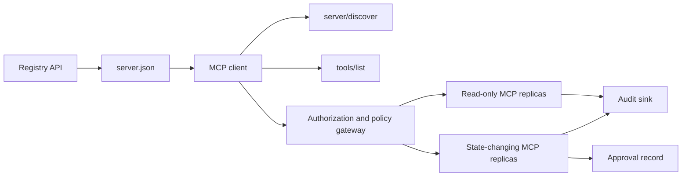

# 综合实战项目 13:带 Registre et administration sans état serveur MCP

> Le MCP de niveau de production n'est pas un processus de serveur simple. Il s'agit d'un ensemble de protocoles: données de base disponibles à publier, services de détection en temps réel, demande de dépôt, enveloppe, identité et autorisation, décision de stratégie de détail, certificat d'audit et certificat de déploiement.

**Type:** Capstone
**Languages:** Python 与 TypeScript 参考模型；支持任何生产级编程语言
**Prerequisites:** Phase 11, Phase 13, Phase 14, Phase 17 与 Phase 18
**必修 MCP 进阶课：** [Lesson 28: Tool Contracts](../../../13-tools-and-protocols/28-mcp-tool-contracts-and-content/docs/en.md)- Je suis là .[Lesson 29: 可靠性与流控](../../../13-tools-and-protocols/29-mcp-reliability-cancellation-and-flow-control/docs/en.md)- Je suis là .[Lesson 30: Registry 供应链](../../../13-tools-and-protocols/30-mcp-registry-supply-chain-and-drift/docs/en.md), 及 [Lesson 31: 一致性工程](../../../13-tools-and-protocols/31-mcp-conformance-versioning-and-operations/docs/en.md)
**目标协议规范：**MCP `2026-07-28`
**Time:** ~25 小时

## Objectif de l'apprentissage

- 实现合规的无状态 MCP Demande et résultat Enveloppe
- Le registre Statistical currency data et le protocole en temps réel de fonctionnement sont très différents.
- construire un système de recherche d'outils dotés de la séquence de la détermination et de la perception du caché.
- Pour chaque outil, il est nécessaire de mettre en œuvre des stratégies d'évaluation et de réception.
- 部署无 Session 亲和性绑定 流向 HTTP 集群──
- En ligne, les autorités compétentes fournissent des preuves d'ingénierie complètes à la frontière entre le registre et l'audit.

## MCP avant mise en route

Avant de concevoir ce projet en vue de sa production, il faut suivre le programme de quatre étapes de la phase 13:

1. [Lesson 28](../../../13-tools-and-protocols/28-mcp-tool-contracts-and-content/docs/en.md): définir ce serveur  doit être exposé  Tool、 Schema、 structuré contenu、 pages  auto-réparation、 routes  err err err errations                                                                                                                                                                                                                                                                                                                                                                                                                                                                                        
2. [Lesson 29](../../../13-tools-and-protocols/29-mcp-reliability-cancellation-and-flow-control/docs/en.md)Le défi de la répartition des données est de définir les conditions de répartition des données.
3. [Lesson 30](../../../13-tools-and-protocols/30-mcp-registry-supply-chain-and-drift/docs/en.md): définition nommées espaces de propriété, source de suivi, accès à la localisation, registre, état, déménagement, contrôle, enregistrement et déménagement
4. [Lesson 31](../../../13-tools-and-protocols/31-mcp-conformance-versioning-and-operations/docs/en.md)Les résultats de la recherche ont été publiés en ligne en ligne en ligne en ligne en ligne en ligne en ligne en ligne en ligne en ligne en ligne en ligne en ligne en ligne en ligne en ligne en ligne en ligne en ligne en ligne en ligne en ligne en ligne en ligne en ligne en ligne en ligne en ligne en ligne en ligne en ligne en ligne en ligne en ligne en ligne en ligne en ligne en ligne en ligne en ligne en ligne en ligne en ligne en ligne en ligne en ligne en ligne en ligne en ligne en ligne en ligne en ligne en ligne en ligne en ligne en ligne en ligne en ligne en ligne en ligne en ligne en ligne en ligne en ligne en ligne en ligne en ligne en ligne en ligne en ligne en ligne en ligne en ligne en ligne en ligne en ligne en ligne en ligne en ligne en ligne en ligne en ligne en ligne en ligne en ligne en ligne en ligne en ligne en ligne en ligne en ligne en ligne en ligne en ligne en ligne en ligne en ligne en ligne en ligne en ligne en ligne en ligne en ligne en ligne en ligne en ligne en ligne en ligne en ligne en ligne en ligne en ligne en ligne en ligne en ligne en ligne en ligne en ligne en ligne en ligne en ligne en ligne en ligne en ligne en ligne en ligne en ligne en ligne en ligne en ligne en ligne en ligne en ligne en ligne en ligne en ligne en ligne en ligne en ligne en ligne en ligne en ligne en ligne en ligne en ligne en ligne en ligne en ligne en ligne en ligne en ligne en ligne en ligne en ligne en ligne en ligne en ligne en ligne en ligne en ligne en ligne en ligne en ligne en ligne en ligne en ligne en ligne en ligne en ligne en ligne en ligne en ligne en ligne en ligne en ligne en ligne en ligne en ligne en ligne en ligne en ligne en ligne en ligne en ligne en ligne en ligne en ligne en ligne en ligne en ligne en ligne en ligne en ligne en ligne en ligne en ligne en ligne en ligne en ligne en ligne en ligne en ligne en ligne en ligne en ligne en ligne en ligne en ligne en ligne en ligne en ligne en ligne en ligne en ligne en ligne en ligne en ligne en ligne en ligne en ligne en ligne en ligne en ligne en ligne en ligne en ligne en ligne en ligne en ligne en ligne en ligne en ligne en ligne en ligne en ligne en ligne en ligne en ligne en ligne en ligne en ligne en ligne en ligne en ligne en ligne en ligne en ligne en ligne en ligne en ligne en

Ce projet est chargé de rassembler ces éléments de production, qui ne peuvent être déployés à l'aide d'un seul test SDK simple.

## 问题背景

 Les plateformes internes d'entreprise nécessitent un ensemble d'outils de lecture de données et une petite quantité d'outils d'écriture qui ont la capacité de modifier l'état.  Les développeurs doivent être en mesure de trouver le serveur  de comprendre comment se connecter  de vérifier sa capacité de fonctionnement en temps réel, et ne peuvent utiliser que ses opérations d'accès autorisées explicitement 

La vraie difficulté n'est pas de créer une fonction, mais de faire en sorte que les six sources de vérité suivantes soient parfaitement cohérentes.

1. `server.json`déclaré le serveur où installé ou par quel réseau terminal visité;
2. `server/discover`▌déclarer la capacité de soutien réel au processus en cours de fonctionnement;
3. Chaque requête spécifiquement indique la version de protocole utilisée et la déclaration de capacité du client;
4. 授权系统将调用方与合法的签发者、资源指示器(Ressource Indicator) et Scope 绑定;
5. 策略引擎独立决策该特定操作是否准备执行;
6. 审计日志忠实记录跨界的每次交往,绝不泄露敏感载荷或凭证密钥──

 toute éventuelle dérive, la plateforme peut démontrer un serveur orphelin incapable de se connecter  un client inadapté par un error route  une utilisation erronée de jetons émis pour d'autres ressources, ou une opération destructive dans le cas d'une évaluation imprévue 

## Les deux couches de découverte

Le serveur MCP réel répond à une question de dimension complètement différente:

| 发现层次 | 交互契约 | 回答的核心问题 |
|---|---|---|
| 发布层 (Publication) | `server.json` 与 Registry API | 该 Server 是什么？其代码包或远程网络端点在哪里？如何进行配置？ |
| 运行时 (Runtime) | `server/discover` | 该运行进程当前实际支持哪些协议版本、能力特性、扩展及 Server 身份？ |

官方 Registry 采用带版本控制的 `server.json`Schéma。 Un fichier à distance peut être déclaré Streamable HTTP 地址:

```json
{
  "$schema": "https://static.modelcontextprotocol.io/schemas/2025-12-11/server.schema.json",
  "name": "com.example/internal-readonly",
  "title": "Internal Read-Only Tools",
  "description": "Read-only incident and data lookup tools.",
  "version": "1.0.0",
  "remotes": [
    {
      "type": "streamable-http",
      "url": "https://mcp.internal.example.com/readonly"
    }
  ]
}
```

Le système de registre est complètement indépendant, ne pas modifier un jour pour faire harmoniser les deux, mais pour en modifier un.

具備合规 Schema 不代表拥有命名空间所有权──对 `example.com`完成验证的发行者使用反向 DNS 命名空间 `com.example/*`Ou son fils nommé espace. Le processus de certification du registre est responsable de la preuve de cette propriété.

标准库模型中的 `validate_registry_document`函数刻意只是 une partie du testateur de configure à distance.`name`- Je suis là.`description`Avec `version`字段,可选的 `title`, le nom et la durée des éditions publiées, le format de chaque édition, ainsi que la durée de chaque édition.`streamable-http`Ou `sse`远程端点的 HTTP(S) URL 格式──由于本综合项目总会对远程端点进行实时探测, it also extra requirment `remotes`列表非空──`validate_publisher_namespace`单独对照已验证的发行者域名检查名称, alors que `validate_runtime_alignment`则将发布名称与版本同实时的 则将发布名称与版本同实时的 则将发布名称与版本同实时的 则将发布名称与版本同实时的`serverInfo`进行比较──官方 Schema 还支持仅含代码包的记录以及更多远程字段── 发布前, veuillez utiliser la version officielle de JSON Schema ou `mcp-publisher`校验整个文档; ne considérez pas ce sous-ensemble indépendant comme un schéma complet 校验──

Le serveur doit être mis en œuvre`server/discover`Le client peut le faire avant de démarrer d'autres méthodes. Pour le projet global, le client le fera après avoir résolu le point de départ et obtiendra la version révisée du protocole actuel avec un ensemble de capacités en temps réel:

```json
{
  "resultType": "complete",
  "supportedVersions": ["2026-07-28"],
  "capabilities": {
    "tools": {
      "listChanged": false
    }
  },
  "_meta": {
    "io.modelcontextprotocol/serverInfo": {
      "name": "com.example/internal-readonly",
      "version": "1.0.0"
    }
  },
  "ttlMs": 3600000,
  "cacheScope": "public"
}
```

Les dossiers privés peuvent indiquer des données sur les droits de propriété, les évaluations ou le cycle de vie supplémentaires, mais ne peuvent jamais être conçues comme des données de MCP ou de MCP.`server.json`根字段── 组织策略应与已发布记录并列存储──当确实需要公开的自定义元数据时,使用登记的 `_meta.io.modelcontextprotocol.registry/publisher-provided`扩展,并保持在它的 4 KB 上限之内──

## 无状态 MCP 核心(Cœur de MCP sans état)

MCP `2026-07-28`Le déménagement complet de l'accord`initialize`- Je suis là .`notifications/initialized`La main, tout en déplaçant.`Mcp-Session-Id`Il y a une autre.

Chaque requête est en cours.`params._meta`Le texte suivant:

```json
{
  "io.modelcontextprotocol/protocolVersion": "2026-07-28",
  "io.modelcontextprotocol/clientCapabilities": {},
  "io.modelcontextprotocol/clientInfo": {
    "name": "internal-platform-client",
    "version": "1.0.0"
  }
}
```

版本与能力是请求层面的事实,而不是连接层面的事实――负载平衡器可以无忧地连续请求分发给不同的健康复制,因为任何一个复制都可以完全从报文自验并处理请求――

常规成功结果返回 `resultType: "complete"`, et le serveur doit être en fonction de chaque résultat .`_meta.io.modelcontextprotocol/serverInfo`中标明身份──协议版本缺失或不是字符串时返回 Params invalide 错误码 `-32602`Le dépôt de la commission`-32022`pour être utilisé uniquement pour fournir une version de caractères non supportée, ses données  doivent être correctement`{"supported": ["2026-07-28"], "requested": "..."}`Il y a une autre.

### Réservation du service

 Pour les mêmes outils efficaces,`tools/list`必須是確定性的──其結果包含:

- `ttlMs`: face à la demande du client;
- `cacheScope`- Le numéro de la liste:`public`(publicité) ou `private`(à la suite de la déclaration);
-  strictement stable, permettant à la même liste de réutiliser le caché rapide du modèle;
- `resultType: "complete"`Avec les données du serveur.

 contrôles des droits d'utilisateur spécifiques, généralement devraient être exportés `cacheScope: "private"`, ne peut pas définir la visibilité des outils réservés à l'utilisateur dans la réserve publique partagée.

## Transmission HTTP par le flux

面向网络的服务器 暴露单一的 POST 端点──每个 JSON-RPC requête ou notification sont classés comme POSTs indépendants──

 pour la demande, le serveur  retourner une réponse JSON unique  ou pour la demande de démarrage de la demande  SSE 流──长周期的变更通知通过 `subscriptions/listen`建立长连接流,承载选择订阅的变更通知──当前传输中不存在独立的GET流、Session DELETE、Session 请求头或 `Last-Event-ID`Je suis en train de le faire.

Chaque requête comprend:

- `MCP-Protocol-Version`: correspondant à la demande de données;
- `Mcp-Method`: avec JSON-RPC 方法名一致;
- `Mcp-Name`: utilisé `tools/call`- Je suis là.`resources/read`Avec `prompts/get`Le dépôt de la commission
- `Accept: application/json, text/event-stream`Il y a une autre.

 使用规定的`-32020`错误拒绝不一致的镜像请求头――校验 `Origin`,will local develop Server  tied to return ring address,认证远程客户端,并将已关闭的请求作用域 SSE 响应视为取消──



```figure
cf-mcp-gate
```

## 认证与策略决策

Les données de la transmission ne sont pas égales à des permis de licence.

 Pour le serveur à distance:

1. 动态发现受保护资源元数据;
2. Pour le choix des ressources et la réponse au serveur autorisé;
3. 优先使用客户端ID Metadata Documents(CIMD) 注册客户端,将动态客户端注册(Dynamic Client Registration)视为兼容性支持;
4. Indicateur de ressources dans le processus de délivrance de l'autorisation;
5. 验证返回 `iss`Si oui et si non, le serveur d'enregistrement est autorisé;
6. 按 Émetteur 隔离存储 Client 凭据,绝不跨 Émetteur 复用;
7. Dans le MCP Server 侧验证 Token 的签发者、受众、过期时间与 Scope;
8. Deuxième stratégie de décision pour les noms et les paramètres réels des outils spécifiques:

`readOnlyHint`Avec `destructiveHint`Équipements d'aide au client présentant des risques, mais ils ne sont pas des moyens de contrôle autorisé.

### L'approbation artificielle est un document de preuve, et non un champ de compétence magique.

status变更调用需要一个结构化的人工审批凭证 (en anglais: Structured Humanitarian Approval Diploma)  Approval Record),与操作者、工具名、规范化参数哈希值 (en anglais:                                                                                                                                                                                                                                  

Python 模型 va réglementer la classification des clés JSON 计算哈希, et va utiliser le Digest avec le Token Subject、 toolname、Server URL 和过期时间绑定──改哪怕一个参数段, cet enregistrement d'approbation va également être réaffecté avant la mise en œuvre du gestionnaire──── l'approbation est un certificat indépendant, plutôt que d'être ajouté à la portée du Token d'Access──

Lorsque la réduction de la taille de l'impact sur le milieu peut être substantielle, il est important de placer les outils à risque élevé sur une surface indépendante qui peut être examinée de manière indépendante.

## 动手构建

### 1. 建模发布元数据

 Création `server.json`Il est également utilisé dans le domaine de la désignation de l'éditeur.`repository`Ou `packages`Les données, ainsi que la configuration de transmission à distance ou en studio, ne peuvent être inscrites que comme variables de l'environnement de la déclaration.

### 2. 实现实时服务发现

Dans toute entreprise RPC  avant réalisation `server/discover`◊ Publier une version de protocole supportée, capacité collecte, expansion avec Server Identity, et ajouter une utilisation `-32022`La version rejette l'utilisation de la version.

### 3. 实现无状态信封 (enveloppe)

Chaque requête doit être accompagnée d'une version de l' accord avec la capacité du client; chaque résultat sera retourné .`resultType`Avec le serveur, le serveur est configuré en mode cache, le serveur est configuré en mode cache, le serveur est configuré en mode cache.

### 4. 构建工具表面

Pour chaque outil, fournissez un schéma JSON défini, une description précise, une structure de résultats de détermination et une description réelle. Lorsque le client dépend des résultats structurés, ajoutez un schéma de sortie.

### 5. 添加缓存感知的列表

Pour obtenir un retour en ordre stable,`ttlMs`Avec `cacheScope` Les résultats de la recherche et de la recherche

### 6. 添加认证与策略

校验发发发发商、受众、过期时间与范围── pour chaque outil, il doit utiliser une stratégie d'exécution pour prendre des décisions, et il doit lier l'approbation à une opération à risque élevé.

### 7. Déconnexion du registre et de l'expérience de la fonctionnement

Précédent`server.json`记录, réutiliser `server/discover`探测远程端点── Lorsque le processus de recherche ou de recherche est incompatible avec le temps réel, le rapport est déplacé──

### 8. 添加审计证据

记录操作者、发发发发发发发发发发发发发发发发发发发发发发发发发发发发发发发发发发发发发发发发发发发发发发发发发发发发发发发发发发发发发发发发发发发发发发发发发发发发发发发发发发发发发发发发发发发发发发发发发发发发发发发发发发发发发发发发发发发发发发发发发发发发发发发发发发发发发发发发发发发发发发发发发发发发发发发发发发发发发发发发发发发发发发发发发发发发发发发发发发发发发发发发发发发发发发发发发发发发发发发发发发发发发发发发发发发发发发发发发发发发发发发发发发发发发发发发发发发发发发发发发发发发发发发发发发发发发发发发发发发发发发发发发发发发发发发发发发发发发发发发发发发发发发发发发发发发发发发发发发发发发发发发发发发发发发发发发发发发发发发发发发发发发发发发发发发发发发发发发发发发发发发发发发发发发发发发发发发发发发发发发发发发发发发发发发发发发发发发发发发发发发发发发发发发发发发发发发发发发发发发发发发发发发发发发发发发发发发发发发发发发发发发发发发发发发发发发发发发发发发发发发发发发发发发发发发发发发发发发发发发发发发发发发发发发发发发发发发发发发发发发发发发发发发发发发发发发发发发发发发发发发发发发

### 9. 验证水平扩展

Après avoir placé deux copies sans état dans un équilibre de charge, envoyez au moins 100 requêtes et demandez à prouver que la validité n'est pas dépendante de la nature. Si un outil doit être utilisé à travers l'état, générez une explicite explication de l'insouciance et le conservez dans un système de duration partagé.

### 10. 跨越真实线路

针对真实服务器 二进制运行一致性检查――捕获请求头与JSON请求体,不仅仅是SDK对象――覆盖错误版本、请求头不匹配、缺少 Scope、受众错误、参数形、Handler 失败、取消与缓存过期等用例──

## Il est nécessaire de fournir des informations sur les données à caractère personnel.

 Les documents soumis doivent contenir les cinq catégories suivantes, sinon ils sont incomplets:

| 证据类别 | 最低验证标准 | 来源课程 |
|---|---|---|
| 网络线路 (Wire) | 正向与反向用例的脱敏原始请求头与 JSON-RPC 请求体，覆盖元数据类型错误、请求头不匹配、不受支持的版本、缺失或未知的 `resultType`、通知无响应以及响应 ID 匹配 | [Lesson 31](../../../13-tools-and-protocols/31-mcp-conformance-versioning-and-operations/docs/en.md) |
| 代理网络 (Proxy) | 同一稳定用例分别直连与经过已部署的中间层运行，记录入口、源站与出口的状态码及响应体摘要；证明协议错误未被折叠为通用 500 响应，且流式传输未被缓冲 | [Lessons 29](../../../13-tools-and-protocols/29-mcp-reliability-cancellation-and-flow-control/docs/en.md) 与 [31](../../../13-tools-and-protocols/31-mcp-conformance-versioning-and-operations/docs/en.md) |
| 准入管理 (Admission) | 已验证的发布者命名空间、不可变的 Registry 记录摘要、产物或远程端点来源证明、实时 `server/discover` 身份与能力观测、描述符锁定、当前 Registry 状态以及准入账本事件 | [Lesson 30](../../../13-tools-and-protocols/30-mcp-registry-supply-chain-and-drift/docs/en.md) |
| 重试与取消 (Retry) | 取消与完成的竞态、显式超时、安全的只读重试、写操作幂等键、重连后重新拉取，以及证明请求取消不会悄然变成持久任务取消 | [Lesson 29](../../../13-tools-and-protocols/29-mcp-reliability-cancellation-and-flow-control/docs/en.md) |
| 发布回滚 (Rollback) | 确切的先前版本、准入与产物摘要、描述符锁定、当前生效的 Registry 状态、当前健康窗口、路由恢复结果以及脱敏的决策证据 | [Lessons 30](../../../13-tools-and-protocols/30-mcp-registry-supply-chain-and-drift/docs/en.md) 与 [31](../../../13-tools-and-protocols/31-mcp-conformance-versioning-and-operations/docs/en.md) |

随版本一并保存脱敏证据包的摘要──只要缺少任意一类,就暂缓发布──不要从进程内分发器推断代理行为,不要从注册里存在该条目推断准入,不要从新的JSON-RPC ID推断重试安全,也不要从上一次部署推断回滚就绪──

## 本地参考模型运行

Python  modèle dans le cas où aucun ensemble de réseau n'est ouvert, a présenté Registry 元データ、反向 DNS 發布者命名空间校验、发布与运行时身份核查、实时发现、确定性工具列表、逐请求元数据、可信签发发发发发发发发发发发者/受众/过期时间/Scope 检查、绑定操作的审批、一个有档案说明的部分 Registry 校验器、策略以及审核:

```bash
cd phases/19-capstone-projects/13-mcp-server-with-registry
python3 code/main.py
python3 -m unittest discover -s code/tests -v
```

TypeScript 项目在不借助 MCP SDK, en utilisant le système de gestion de contenu de type JSON-RPC 结构──其`tools/call`路径执行与 `tools/list`Le même schéma d'entrée de données publié; lorsque des outils connus sont introduits dans des paramètres illégaux, retourner avec`isError: true`Pour les résultats complets, il n'y a pas de modification de l'exécuteur:

```bash
cd phases/19-capstone-projects/13-mcp-server-with-registry/code/ts
npm install
npm run typecheck
npm test
npm run demo
```

Ces modèles prouvent que la logique de la convention est propre, ne peuvent pas prouver que le HTTP requête titre, OAuth  échange, Registre  édition, OPA  intégration, équilibre de charge ou de prise de contrôle.

## 线路协议报文范例

```http
POST /mcp HTTP/1.1
Host: mcp.internal.example.com
Content-Type: application/json
Accept: application/json, text/event-stream
MCP-Protocol-Version: 2026-07-28
Mcp-Method: tools/call
Mcp-Name: postgres.readonly
Authorization: Bearer REDACTED

{
  "jsonrpc": "2.0",
  "id": 42,
  "method": "tools/call",
  "params": {
    "name": "postgres.readonly",
    "arguments": {"sql": "SELECT 1"},
    "_meta": {
      "io.modelcontextprotocol/protocolVersion": "2026-07-28",
      "io.modelcontextprotocol/clientCapabilities": {},
      "io.modelcontextprotocol/clientInfo": {
        "name": "internal-platform-client",
        "version": "1.0.0"
      }
    }
  }
}
```

## 交付物

交付一个包含以下内容的代码仓库:

- 通过 Schema 校验的 `server.json`Le dépôt de la commission
- Il suffit de lire et de modifier les deux types de serveurs.
- `server/discover`、 de certitude `tools/list`, ainsi que les stratégies contrôlées `tools/call`Le dépôt de la commission
- 带有两个可互换副本的流媒体 HTTP 部署;
- 认证与审批集成;
- l' API du registre  éditeur ou du registre privé  adaptateur;
-  la définition de la stratégie et le dossier d'approbation de l'opération de liaison;
- 脱敏的审计输出和追踪传播;
- 线路与代理故障证;
- 准入、重试、健康与回滚证据, ainsi que le résumé du dossier de la preuve de démence.

| 权重 | 评分标准 | 证据 |
|---:|---|---|
| 25 | 协议正确性 | 无状态请求元数据、服务发现、结果、请求头与反向用例 |
| 20 | 授权 | 签发者、受众、过期时间、Scope 与绑定操作的审批用例 |
| 15 | Registry 完整性 | 合法的 `server.json`、发布记录、实时发现探测与漂移报告 |
| 15 | 策略与安全 | 允许、拒绝、畸形、过期审批与敏感数据用例 |
| 15 | 扩展性与可靠性 | 两个副本、无亲和性依赖、取消、超时与恢复 |
| 10 | 可审计性 | 接收端脱敏审计与追踪证据 |

##  exercice et réflexion

1. Modifier l'URL à distance publiée, tout en maintenant le serveur en temps réel, faire le registre 校验报告确切漂移──
2. Et tout le même entrée et envoi deux fois.`tools/list`, prouver les outils de l'ordre des éléments; puis faire`ttlMs`过期并刷新──
3. Envoyez un requérant légitime, mais`MCP-Protocol-Version`Je vous en prie, retournez-y.`-32020`, et ne pas utiliser de stratégie ou d'outil.
4. Pour lire uniquement le serveur  émet un jeton et le montre à un serveur en état de changement, prouvant que le destinataire a échoué à la mise en service du gestionnaire 
5. En effet, les résultats de l'examen de la révision des normes sont généralement des résultats de la révision des normes.
6. Il est nécessaire de remplacer le processus caché par des expressions de partage.
7. Arrêtez une requête de domaine de travail SSE  connexion, et utilisez un nouveau JSON-RPC`Last-Event-ID`La réforme du système de santé

## 核心专业术语

| 术语 | 行业俗称 | 规范真实定义 |
|---|---|---|
| 无状态 MCP (Stateless MCP) | “到处都没有状态” | 协议层不存在 Session；跨调用状态是显式的，并由 Server 管理 |
| `server.json` | “工具清单” | Registry 静态元数据，用于定义发布命名、代码打包、配置项与传输端点 |
| `server/discover` | “传统握手” | 强制实现的常规 RPC，用于获取实时版本与能力，而非 Session 初始化器 |
| 缓存作用域 (Cache scope) | “能不能缓存？” | 标识可缓存结果是否可以被跨上下文公共复用（`public`）或仅限当前上下文（`private`） |
| 策略决策 (Policy decision) | “Token 允许就能调” | 针对调用者主体、工具、操作目标、参数载荷及外部上下文的细粒度二次判定 |
| 审批凭证 (Approval record) | “有人点了同意” | 在过期策略下绑定到一个操作者与一项重大操作的证据 |
| 显式句柄 (Explicit handle) | “Session ID” | 用于命名由 Server 管理之状态的普通应用数据，而非协议连接状态 |

## 延伸阅读

- [MCP 2026-07-28 核心变更](https://modelcontextprotocol.io/specification/2026-07-28/changelog)
- [Streamable HTTP 传输规范](https://modelcontextprotocol.io/specification/2026-07-28/basic/transports/streamable-http)
- [MCP 服务发现](https://modelcontextprotocol.io/specification/2026-07-28/server/discover)
- [MCP 鉴权与授权规范](https://modelcontextprotocol.io/specification/2026-07-28/basic/authorization)
- [官方 Registry server.json 要求](https://github.com/modelcontextprotocol/registry/blob/main/docs/reference/server-json/official-registry-requirements.md)
- [官方 Registry OpenAPI 契约](https://registry.modelcontextprotocol.io/openapi.yaml)
