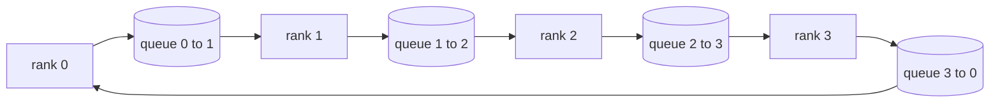

# De la réalisation à zéro des opérations collectives

> Les quatre formes de formation distribuées sont les fournisseurs de communication collective.`multiprocessing.Queue`La mise en œuvre de la mise en œuvre de la mise en œuvre de la mise en œuvre de la mise en œuvre de la mise en œuvre de la mise en œuvre de la mise en œuvre de la mise en œuvre de la mise en œuvre de la mise en œuvre de la mise en œuvre de la mise en œuvre de la mise en œuvre de la mise en œuvre de la mise en œuvre de la mise en œuvre de la mise en œuvre de la mise en œuvre de la mise en œuvre de la mise en œuvre de la mise en œuvre de la mise en œuvre de la mise en œuvre de la mise en œuvre de la mise en œuvre de la mise en œuvre de la mise en œuvre de la mise en œuvre de la mise en œuvre de la mise en œuvre de la mise en œuvre de la mise en œuvre de la mise en œuvre de la mise en œuvre de la mise en œuvre de la mise en œuvre de la mise en œuvre de la mise en œuvre de la mise en œuvre de la mise en œuvre de la mise en œuvre de la mise en ligne de la mise en ligne de la mise en ligne.

**Type:** Build
**Languages:** Python
**Prerequisites:** Phase 19 Track C lessons 42-49
**Time:** ~90 分钟

## Objectif de l'apprentissage

- Utiliser deux algorithmes pour réaliser le ring allreduce, réduire tout, rassembler tout, et prouver que chaque rang de la communication est un élément.$2(N-1)/N$Je suis un homme.
- Dans le`multiprocessing.Queue`Envoyer et réaliser la diffusion, tout rassembler et réduire la diffusion.
- Pour les mêmes entrées, utilisez`torch.distributed`Comme référence, l'épreuve de chaque langue originale.
- De la forme de groupe 延迟下限和带宽上限出发,论证该选环 还是树

##  problématique

Dans N 个级 上做朴素 allreduce, va mettre la张量向根 发送 N 次,再广播回来 N 次──$O(N)$La racine est transformée en bouteille, le temps est le plus lent.$2(N-1)$- Je suis un petit garçon .$T/N$Le nombre de caractères de chaque rang est réduit.$2T(N-1)/N$, à mesure que la tendance grandit$2T$且永不超出, 且永不超出, 且永不超出, 且永不超出, 且永不超出, 且永不超出, 且永不超出, 且永不超出, 且永不超出, 且永不超出, 且永不超出, 且永不超出, 且永不超出, 且永不超出, 且永不超出, 且永不超出, 且永不超出, 且永不超出, 且永不超出, 且永不超出, 且永不超出, 且永不超出, 且永不超出, 且永不超出, 且永不超出, 且永不超出, 且永不超出, 且永不超出, 且永不超出, 且永不超出, 且永不超出, 且深度是 且深度是 且深度是 且深度是 且深度是 且深度是 且深度是 且$\log_2(N)$跳, plutôt que $2(N-1)$Le plus lent de la GPU décide de l'étape du temps.

Vous allez lire dans ce cadre de formation distribué, tout dépend de ces quatre langues originales. PyTorch DDP utilise chaque paramètre bucket une fois allreduce pour venir avec le gradient. ZeRO utilise reduce_scatter, fragment optimiser l'état, reutilise allgather 广播更新后的参数. FSDP Place le complet en avant en tout ensemble 加减少_scatter. Pipe-line parallèle nécessite une diffusion en groupe de phase 传活.

## 概念



### Retour à la fin du cycle

Pour les classements, chaque rang possède la même classe que son rang.$(r - s) \bmod N$- Je vous en prie .$(r + 1) \bmod N$, et de rang $(r - 1) \bmod N$- Je suis un peu dégoûté .$(r - s - 1) \bmod N$, passe par N-1 étape, r r r r possède la totalité de la pièce r et, après, r r r r r r r r r r r r r r r r r r r r r r r r r r r r r r r r r r r r r r r r r r r r r r r r r r r r r r r r r r r r r r r r r r r r r r r r r r r r r r r r r r r r r r r r r r r r r r r r r r r r r r r r r r r r r r r r r r r r r r r r r r r r r r r r r r r r r r r r r r r r r r r r r r r r r r r r r r r r r r r r r r r r r r r r r r r r r r r r r r r r r r r r r r r r r r r r r r r r r r r r r r r r r r r r r r r r r r r r r r r r r r r r r r r r r r r r r r r r r r r r r r r r r r r r r r r r r r r r r r r r r r r r r r r r r r r r r r r r r r r r r r r r r r r r r r r r r r r r r r r r r r r r r r r r r r r r r r r r r r r r r r r r r r r r r r r r r r r r r r r r r r r r r r r r r r r r r r r r r r r r r r r r r r r r r r r r r r r r r r r r r r r r r r r r r r r r r r r r r r r r r r r r r r r r r r r r r r r r r r r r r r r r r r r r r r r r r r r r r r r r r r r r r r r r r r r r r r r r r r r r r r r r r r r r r r r r r r r r r r r r r r r r r

| 原语 | 每 rank 字节数 | 步数 | 何时使用 |
|-----------|---------------|-------|-------------|
| Ring allreduce | 2T(N-1)/N | 2(N-1) | 大 T、同构 fat-pipe 集群 |
| Tree allreduce | T log2(N) | 2 log2(N) | 小 T 或高延迟链路 |
| Broadcast | T | log2(N) tree | 参数初始化、标量配置 |
| Allgather | T(N-1)/N | N-1 | 分片 forward、ZeRO unshard |
| Reduce_scatter | T(N-1)/N | N-1 | ZeRO 梯度分片 |

### Utilisez la file d'attente en remplacement de la LCCL

NCCL 跑在PCIe 和 NVLink 上,归约可硬件卸载──在CPU上没有这些──环上每条边一个`multiprocessing.Queue`Il est possible d'obtenir un ordre de point par point de livraison, et seulement un seul producteur et un seul consommateur. Les conséquences se produisent en mode utilisateur, donc il faut payer Python, mais le mode de ligne et le ring NCCL réduisent tout de même.

### Pour faire des tests

Chaque langue originale est composée de plusieurs unités: dans le même monde, la même quantité de langue, la même production et la même utilisation.`torch.distributed`Pour le test, il est impossible de faire une erreur. Sans elle, le langage original aurait toujours été correct avant la course à la 1 000e étape.

```figure
ci-ring-allreduce
```

## - Je le construis.

`code/main.py`实现:

- `Mesh`类:把 N 个 `multiprocessing.Queue`接成环,并按级 暴露 `send(dst, tensor)`Avec `recv(src)`Il y a une autre.
- `ring_allreduce(mesh, rank, world_size, tensor)`Il y a deux fois.
- `broadcast(mesh, rank, world_size, tensor, src)`Je vais à la forêt.
- `allgather(mesh, rank, world_size, tensor)`Avec N-1 suivante
- `reduce_scatter(mesh, rank, world_size, tensor)`Comme tout réduire de la première moitié.
- `_gloo_reference(op, world_size, tensor)`: mettre la même entrée dans le monde`torch.distributed`, faire des épisodes

运行:

```bash
python3 code/main.py
```

输出: selon le langage original, par rapport à la file d'attente et au tableau de bord 输出验证表, ainsi qu'à la preuve $2T(N-1)/N$缩放的每级 字节计数器──

## Pratique dans le milieu de production

Trois modes permettent de rendre ces langues originales plus dures que possible.

**allreduce 前先对梯度分桶。**Un modèle de 10 milliards de paramètres a des milliers de degrés de volume. Chaque degré de volume une fois réduit, doit payer N 倍延迟下限.

**让通信与计算重叠。**Retour en arrière 按层反向逐层算梯度──最后一层梯度一就绪,就启动它的全部减小,同时下一层继续算──PyTorch DDP avec un crochet prêt à la bouteille 接上这个事──网络有余量时,重叠能把可见通信时间砍半──

**按消息大小选 ring 或 tree，不要教条。**NCCL Autoportrait de l'essai: environ 1 MB plus de bague de sélection, en bas de l'arbre de sélection.$2T(N-1)/N$占主导,ring 胜出; inférieur à 1 MB 时$\log_2(N)$J'ai écrit un livre qui a été écrit en gros.

## Utilisez-le

Utilisation dans le produit:

- **PyTorch DDP。**Retour en arrière  après pour la répartition des températures`dist.all_reduce`◊ bucket ⋅ 100Gbit 以太网下默认 25 MB 合理⋅
- **DeepSpeed ZeRO。**发 réduire_scatter 分片梯度,avant 前再全部重建完整参数──本课的原语正是 ZeRO 实际发射调用──
- **FSDP。**Avant tout rassembler, mettre cette couche en morceaux, calculer, reutiliser, réduire, disperser, réduire, réduire, réduire, réduire, réduire, réduire, réduire, réduire, réduire, réduire, réduire, réduire, réduire, réduire, réduire, réduire, réduire, réduire, réduire, réduire, réduire, réduire, réduire, réduire, réduire, réduire, réduire, réduire, réduire, réduire, réduire, réduire, réduire, réduire, réduire, réduire, réduire, réduire, réduire, réduire, réduire, réduire, réduire, réduire, réduire, réduire, réduire, réduire, réduire, réduire, réduire, réduire, réduire, réduire, réduire, réduire, réduire, réduire, réduire, réduire, réduire, réduire, réduire, réduire, réduire, réduire, réduire, réduire, réduire, réduire, réduire, réduire, réduire, réduire, réduire, réduire, réduire, réduire, réduire, réduire, réduire, réduire, réduire, réduire, réduire.

## Je le livre.

Dans les cours de 7781  cours utilisent ces filets de filet de ligne  原语。第 77 课把 allreduce 接到DDP。第 78 课把 reduce_scatter 接到ZERO。第 79 课用点对点发送/recv(而不是集体) 传递管道 激活。第 81 课把四者组成端到端演示。

## 练习

1. 增加 tree allreduce 变体,并按消息大小在 ring 与 tree 之间切换──测出交叉点──
2. 增加 `recv_timeout_ms`Laissez le rang de l'homme se défaire de l'erreur, plutôt que de rester en suspens.
3. Je veux dire, je veux dire, je veux dire, je veux dire, je veux dire, je veux dire, je veux dire, je veux dire, je veux dire, je veux dire, je veux dire, je veux dire, je veux dire, je veux dire, je veux dire, je veux dire, je veux dire, je veux dire, je veux dire, je veux dire, je veux dire, je veux dire, je veux dire, je veux dire, je veux dire, je veux dire, je veux dire, je veux dire, je veux dire, je veux dire, je veux dire, je veux dire, je veux dire, je veux, je veux, je veux, je veux, je veux, je veux, je veux, je veux, je veux, je veux, je veux, je veux, je veux, je veux, je veux, je veux, je veux, je veux, je veux, je veux, je veux, je veux, je veux, je veux, je veux, je veux, je veux, je veux, je veux, je veux, je veux, je veux, je veux, je veux, je veux, je veux,`multiprocessing.Queue`Il est aussi un système de connexion TCP.
4. Pour les autres, il faut mettre le nombre de points de l'échantillon en JSONL.
5. Dans 4 rangs, le temps de comparaison entre le ring et le mur de l'arbre est de 1 KB, 1 MB, 16 MB.

## 关键术语

| 术语 | 人们常说 | 实际含义 |
|------|----------------|------------------------|
| Allreduce | “跨 rank 求和” | 调用结束后每个 rank 持有相同的归约张量 |
| Ring | “更快的拓扑” | N-1 个大小为 T/N 的 chunk 绕环流两圈 |
| Tree | “对数拓扑” | 归约沿二叉树进行；深度为 log2(N) 跳 |
| Allgather | “拼接分片” | 每个 rank 最终持有所有其他 rank 的分片 |
| Reduce_scatter | “把求和切开” | 每个 rank 最终只持有某一个 chunk 的求和 |
| Bucket | “融合小张量” | 把 N 次小 allreduce 合并成一次大的 |

## 延伸阅读

- [PyTorch Distributed: NCCL collectives](https://pytorch.org/docs/stable/distributed.html#collective-functions)
- [Horovod ring allreduce paper](https://arxiv.org/abs/1802.05799)
- [NCCL topology and algorithm selection](https://docs.nvidia.com/deeplearning/nccl/user-guide/docs/index.html)
- [Patarasuk and Yuan, Bandwidth optimal allreduce algorithms](https://www.cs.fsu.edu/~xyuan/paper/09jpdc.pdf)
- Phase 10 Leçon 05 - aperçu de la formation distribuée
- L'étape 19 - Leçon 77 - DDP câblé sur ces primitifs
