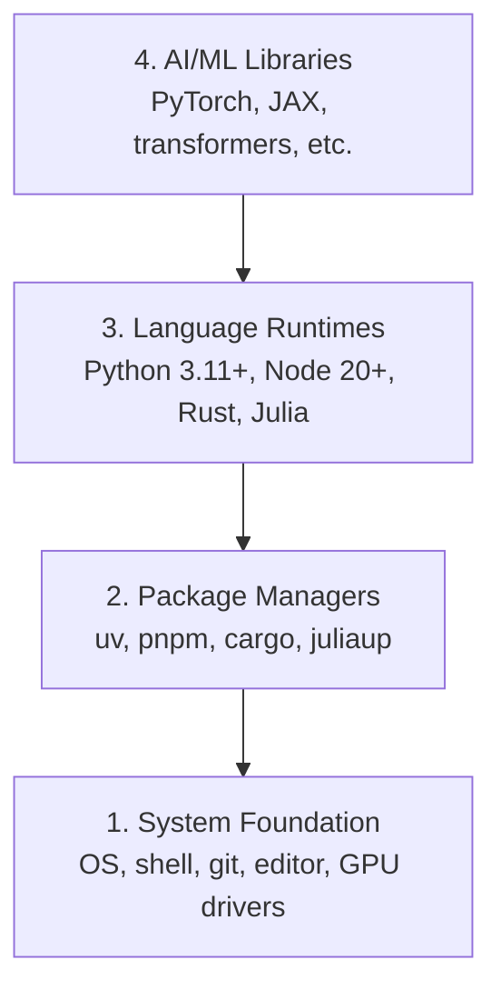

# विकास पर्यावरण

> आपके उपकरण आपके विचार को आकार देंगे। एक बार ठीक से कॉन्फ़िगर करें, और एक बार ठीक से कॉन्फ़िगर करें।

**Type:** Build
**Languages:** Python, Node.js, Rust
**Prerequisites:** None
**Time:** ~45 分钟

## 学习目标

- से零 बिल्डिंग पायथन 3.11+、नोड.जेएस 20+ 和 रुस्ट 工具链
- 配置虚拟环境和包管理器, आश्वासन निर्माण पुनः प्रयोज्य
- CUDA/MPS 验证 GPU 访问,并跑一次测试张量运算
- समझ चार स्तरीय तकनीक: प्रणाली、包管理、运行时、AI 库

## 问题

आप पायथन, टाइपस्क्रिप्ट, रुस्ट और जूलिया का उपयोग करके 500 से अधिक भागों की एआई इंजीनियरिंग की कक्षाएँ पूरी करेंगे। यदि पर्यावरण खराब हो जाता है, तो प्रत्येक भाग एक उपकरण के रूप में बदल जाएगा, सीखने के बजाय।

अधिकांश लोग पर्यावरण के निर्माण से कूदते हैं। इसके बाद कुछ घंटे लगते हैं आयात को डिबग करने के लिए।

## 概念

एक एआई इंजीनियरिंग  पर्यावरण में चार स्तर हैंः



हम खुद से नीचे ऊपर स्थापित हैं। प्रत्येक स्तर उस पर निर्भर करता है।

```figure
s0-env-stack
```

##  इसे निर्माण

### 步骤 1: सिस्टम आधार

检查你的系统并安装基础组件──

```bash
# macOS
xcode-select --install
brew install git curl wget

# Ubuntu/Debian
sudo apt update && sudo apt install -y build-essential git curl wget unzip

# Windows (use WSL2)
wsl --install -d Ubuntu-24.04
```

### 步骤 2: उपयोग करें यूवी स्थापित पायथन

हम उपयोग `uv`यह पाइप 快 10100 गुना अधिक है, और स्वचालित रूप से वर्चुअल वातावरण को संसाधित करेगा

```bash
curl -LsSf https://astral.sh/uv/install.sh | sh

uv python install 3.12

uv venv
source .venv/bin/activate  # or .venv\Scripts\activate on Windows

uv pip install numpy matplotlib jupyter
```

验证:

```python
import sys
print(f"Python {sys.version}")

import numpy as np
print(f"NumPy {np.__version__}")
a = np.array([1, 2, 3])
print(f"Vector: {a}, dot product with itself: {np.dot(a, a)}")
```

### 步骤 3: pnpm के साथ Node.js स्थापित करें

टाइपस्क्रिप्ट 课程(एजेंट्स、MCP सर्वर、वेब ऐप) 👇

```bash
curl -fsSL https://fnm.vercel.app/install | bash
fnm install 22
fnm use 22

npm install -g pnpm

node -e "console.log('Node', process.version)"
```

fnm स्थापना प्रक्रिया पहले जांच `unzip`, अभाव समय`Not installing fnm due to missing dependencies.`退出: Linux 上它需要解压一个 ज़िप 归档, macOS 上则通过 Homebrew 安装──macOS 自带 `unzip`;Ubuntu、Debian 和 WSL2 会通过步骤 1 的 apt 命令安装它(यदि आप उस कदम से कूद गए हैं,运行 `sudo apt install -y unzip`)。

**macOS / Apple Silicon（M1/M2/M3/M4）：**यदि इंस्टॉल प्रक्रिया के कारण `Error: Cannot install under Rosetta 2 in ARM default prefix (/opt/homebrew)`停止, अपने अंत में काम करने के लिए स्पष्ट रूप से Rosetta 2 नीचे`arch`输出 `i386`), जबकि होमब्रेव मूल रूप से arm64 构建 ∙∙                                                                                                                                                                                                                                                       `fnm install 22`开始重新运行 ऊपर दिए गए आदेशः

```bash
arch -arm64 brew install fnm
echo 'eval "$(fnm env --use-on-cd)"' >> ~/.zshrc
source ~/.zshrc
```

### 步骤 4:रोस्ट

प्रदर्शन के प्रति संवेदनशील पाठ्यक्रमों के लिए प्रयोग किया गया

```bash
curl --proto '=https' --tlsv1.2 -sSf https://sh.rustup.rs | sh

rustc --version
cargo --version
```

### 步骤 5:Julia(可选)

जूलिया के लिए एक अलग गणित पाठ्यक्रम है।

```bash
curl -fsSL https://install.julialang.org | sh

julia -e 'println("Julia ", VERSION)'
```

### 步骤 6:GPU  सेटिंग( अगर आप है)

**NVIDIA（Linux / Windows）：**

```bash
nvidia-smi

# Install PyTorch with CUDA
uv pip install torch torchvision torchaudio --index-url https://download.pytorch.org/whl/cu124
```

**macOS / Apple Silicon（M1/M2/M3/M4）：**मैक ऊपर कोई CUDA नहीं है यह अपेक्षित स्थिति है, कोई दोष नहीं है**不要**传入 `--index-url .../cuXXX`(ये पहिया केवल लिनक्स/विंडोज के लिए उपयुक्त हैं, स्थापना विफल)

```bash
uv pip install torch torchvision torchaudio
```

验证( किसी भी प्लेटफॉर्म के लिए लागू):

```python
import torch
print(f"CUDA available: {torch.cuda.is_available()}")           # False on macOS — expected
print(f"MPS available:  {torch.backends.mps.is_available()}")   # True on Apple Silicon
if torch.cuda.is_available():
    print(f"GPU: {torch.cuda.get_device_name(0)}")
```

没有GPU?没有问题──大多数课程可在CPU上运行──对训练很重的课程,使用Google Colab或云GPU──

### 步骤7: सत्यापित करें कि आप किस मार्ग से शुरू करना चाहते हैं

इस वर्ग में प्रत्येक आदेश भंडारण के मूल सूची से संचालित होता है, यानि समाहित होता है।`README.md`和 `phases/`इसके बाद से ही इस्तेमाल किए जाने वाले उपकरण को डिफ़ॉल्ट रूप से छोड़ दिया गया है, ताकि नए छात्र एक स्पष्ट निष्कर्ष देखें, न कि एक चेतावनी।

开始完整的入门序列:

```bash
python3 phases/00-setup-and-tooling/01-dev-environment/code/verify.py --route beginner
```

या बस जाँच आप चाहते हैं कि मार्ग से गुजरनाः

```bash
python3 phases/00-setup-and-tooling/01-dev-environment/code/verify.py --route ml-foundations
python3 phases/00-setup-and-tooling/01-dev-environment/code/verify.py --route llm-engineering
python3 phases/00-setup-and-tooling/01-dev-environment/code/verify.py --route agents
python3 phases/00-setup-and-tooling/01-dev-environment/code/verify.py --route mcp
python3 phases/00-setup-and-tooling/01-dev-environment/code/verify.py --route agent-skills
python3 phases/00-setup-and-tooling/01-dev-environment/code/verify.py --route certification
```

यदि आप एक ही पूर्व परीक्षा और परीक्षा के बाद के पाठ्यक्रम का उपयोग करने के लिए चाहते हैं, तो विकल्प उपकरण और निर्भरता, और `--show-later` अभाव बाद के साधन कभी भी चुने हुए मार्ग को अवरुद्ध नहीं करेंगे

प्रत्येक असफल आवश्यक जांच में जांच किए गए पथ या आयात त्रुटि के साथ-साथ एक निश्चित सुधार आदेश दिया जाएगा। एजेंट कौशल और प्रमाणन मार्ग भी दिखाएगा कि मेजबान परीक्षण को मैन्युअल रूप से पूरा करने की आवश्यकता है, क्योंकि पायथन स्क्रिप्ट एआई मेजबान को किसी कौशल की खोज करने का सबूत नहीं दे सकती है, न ही आपके चयनित कौशल का प्रमाण दे सकती है।

प्रवेश परीक्षा में प्रवेश करते समय, प्रथम कार्यवाही योग्य पाठ्यक्रम का एक निश्चित आदेश छापा जाएगाः

```text
Ready to start Beginner course.
Next: python3 phases/01-math-foundations/01-linear-algebra-intuition/code/vectors.py
```

## इसका उपयोग करें

आपके पर्यावरण ने आपके द्वारा जांच की गई मार्ग को शुरू कर दिया है। इसके बाद के उपकरण जैसे पाठ्यक्रमों को समय पर पुनः स्थापित करने की आवश्यकता है, आपको अपनी पहली कक्षा में पूरी तकनीक को अवरुद्ध करने की आवश्यकता नहीं हैः

| Language | Used In | Package Manager |
|----------|---------|-----------------|
| Python | Phases 1-12 (ML, DL, NLP, Vision, Audio, LLMs) | uv |
| TypeScript | Phases 13-17 (Tools, Agents, Swarms, Infra) | pnpm |
| Rust | Phases 12, 15-17 (Performance-critical systems) | cargo |
| Julia | Phase 1 (Math foundations) | Pkg |

## 交付 यह

इस कक्षा में एक प्रमाण पत्र का उत्पादन किया गया है जिसे कोई भी अपने पर्यावरण की जांच करने के लिए उपयोग कर सकता है।

查看 `outputs/prompt-env-check.md`, जिसमें से एक शीघ्र, मददगार एआई 助手诊断环境问题──

## अभ्यास

1. 运行验证脚本并修复任何失败项
2. इस कोर्स में एक पायथन 虚拟环境,并安装 PyTorch
3. चार भाषाओं में एक "हैलो वर्ल्ड" लिखें, और एक एक करके चलें

### 提示

**练习 1。**                                                                                                                                                                                                                                                                                                                                                                                                                                                                                                                             `python3 phases/00-setup-and-tooling/01-dev-environment/code/verify.py --route beginner`, पहले पहले असफलता को सुधारें, फिर निम्न को देखें, फिर से चलाने के लिए, सभी आवश्यक जांचें पूरी हो जाती हैं,才算完成,

**练习 2。**भंडारण में उपयोग की गई`uv venv` Create environment并激活, पुनः उपयोग चरण 6 में आपके हार्डवेयर के लिए उपयुक्त आदेश स्थापित करें PyTorch── इस वातावरण में चलें `python -c "import torch; print(torch.__version__)"`;输出版本号就表示安装成功──

**练习 3。**प्रयोग概念部分技术中四种运行时:पायथन、运行到 Node.js के टाइपस्क्रिप्ट、रुस्ट 和 जुलिया──分别编写一个小文件,用`python3``npx tsx`(Node.js 不能直接运行 `.ts`文件)`cargo run`या `rustc``julia`运行── प्रत्येक बार 运行都必须印印你的消息,并以退出码0 结束──
