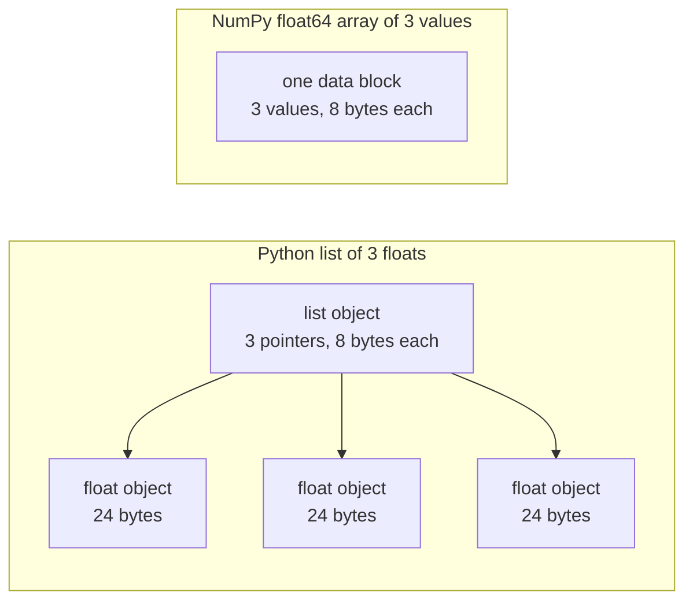

# 面向 AI 工程的पायथन

> इस कोर्स में अधिकांश कोड एक ही समूह के पायथन के प्रयोग के तरीके का उपयोग करते हैं। बाद के गणित और मॉडल पाठ्यक्रमों में उन पर निर्भर होने से पहले, पहले उन्हें यहां पर समझें।

**Type:** Build
**Languages:** Python
**Prerequisites:** 开发环境、Python 环境
**Time:** ~120 分钟

## 学习目标

- 读写课程代码中最常见的习惯用法,解包和f字符串到数据类与推导式──
- पायथन  समस्या का पता लगाने के लिए तीन प्रकार के जो गलत रिपोर्ट नहीं करेंगे लेकिन गलत परिणाम उत्पन्न करेंगेः साझा सूची, परिवर्तनीय डिफ़ॉल्ट मान और समाप्त जनरेटर 
- ️ केवल मानक पुस्तकालय का उपयोग करें, CSV और JSON लोडर का निर्माण करें, साथ ही साथ बीज के डेटा विभाजन, तथा लघु मात्रा जनरेटर
- शुद्ध पायथन के साथ अंक, औसत मूल्य और मानक अंतर गणना, और गति और स्मृति उपयोग को मापने के लिए
-  समझाएँ कि क्यों संख्यात्मक मूल्य के शुद्ध पायथन चक्र धीमे होते हैं, तथा NumPy 广播 कैसे चक्र को संकलन के बाद के कोड में स्थानांतरित करेगा

## 问题

इस चरण के बाद के पाठ्यक्रम में सामान्य पायथन का उपयोग करके गणित के संचालन और मॉडल को लागू किया गया।`dataclasses` इसके अलावा, 187 文件调用 `random.seed`या निर्माण`random.Random`生成器── यदि आप इन आदतों से परिचित नहीं हैं, तो गणित को समझने की कोशिश करते समय भाषा को समझने में व्यस्त हो जायेंगे──

पायथन में कुछ अन्य तत्व हैं जो गलत जानकारी नहीं देंगे, लेकिन गलत परिणामों के लिए कारण बनेंगे। दो नाम एक ही सूची में संदर्भित हो सकते हैं, इसलिए एक नाम संशोधन सूची के माध्यम से, अन्य नाम देखने की सामग्री को भी बदल देगा।

अंतिम प्रश्न गति है। हमारे परीक्षण लैपटॉप कंप्यूटर पर, शुद्ध पायथन चक्र में एक मिलियन फव्वॉइट्स के लिए गणना बिंदुओं का एक सेट होता है, लगभग 30 मिलीसेकंड की आवश्यकता होती है।

## 概念

### 课程代码使用哪些写法

हम उपयोग `ast`模块解析了 `phases/*/*/code/`मध्य में कुल 541 Python 文件── नीचे दी गई तालिका में कम से कम एक बार इस्तेमाल की गई एक संगत संरचना की फ़ाइलों की संख्या── इस पाठ्यक्रम को लिखने के दिन से प्राप्त आंकड़े, नए पाठ्यक्रम के साथ बदलेंगे और बदलेंगे──

| 结构 | 文件数 | 占比 |
|-----------|-------|-------|
| 函数定义 | 541 | 100% |
| `if __name__ == "__main__":` | 529 | 98% |
| f 字符串 | 517 | 96% |
| 元组解包 | 448 | 83% |
| 类 | 379 | 70% |
| 列表推导式 | 375 | 69% |
| 函数类型标注 | 342 | 63% |
| 生成器表达式 | 326 | 60% |
| 切片 | 314 | 58% |
| `lambda` | 175 | 32% |
| `try` 与 `except` | 120 | 22% |
| `with` 语句 | 96 | 18% |
| 字典推导式 | 93 | 17% |
| 使用 `yield` 的生成器函数 | 14 | 3% |

 आयात की स्थिति में 541 दस्तावेजों में से 340 में से कौन से मानक मॉड्यूल सबसे महत्वपूर्ण हैं।`from __future__ import annotations`开头,276 个导入 `dataclasses``math``random`和 `json`模块分别出现在187、175和126 文件中──`collections`70 दस्तावेजों में दिखाई दिया, और`itertools` केवल 4  फाइलों में दिखाई दिया

没有课程调用 `map()`या `filter()`इन कार्यों को करने के लिए 140 से अधिक दस्तावेज तैयार किए गए हैं।`sorted``min``max`या `.sort`时使用了 `key=`函数── इस वर्ग को इन सूचियों में पहले की आदतों के आधार पर सबसे अधिक समय व्यतीत होगा──

### 名称引用对象

पायथन में, चर वस्तु के नाम का संदर्भ है। यह वस्तु के नाम से बंधा है, वस्तु को नहीं दोहराता है। जब दो नाम एक ही सूची का संदर्भ देते हैं, तो किसी भी नाम के द्वारा किए गए संशोधनों के माध्यम से, दोनों नामों के लिए दृश्यमान हैं। संख्याएँ, वर्ण और तत्व अपरिवर्तनीय हैं, इसलिए यह नियम उन्हें समस्या नहीं देता है।

### 列表保存指针,数组保存数值

पायथन सूची प्रत्यक्ष भंडारण संख्यात्मक मूल्य नहीं है, बल्कि भंडारण संकेतक, प्रत्येक संकेतक एक पूर्ण पायथन वस्तु का हवाला देता है। 64 बिट्स CPython में, प्रत्येक संकेतक 8 字节, प्रत्येक `float`वस्तुओं का 24 字节──NumPy के `float64`संख्यात्मक तत्वों को एक ब्लॉक में रखा जाएगा।



प्रत्येक तत्व के लिए, यह प्रत्येक तत्व के लिए वस्तुओं को खोजने, प्रत्येक ऑपरेटिंग संख्या के प्रकार की जांच करने, फिर से फव्वॉइट गुणा कोड का उपयोग करने, और परिणामों को बचाने के लिए एक पायथन 浮点 वस्तु बनाने के लिए निर्देशित करता है।

NumPy मूल संख्यात्मक संचालन के लिए एक ही परिचालन को पूरा करने के लिए एक ही परिचालन को पूरा करता है। यह केवल पूरे एंजोलम के लिए एक बार डेटा प्रकार की जांच करता है, प्रत्येक तत्व के लिए पायथन वस्तुओं का निर्माण नहीं करता है।`(x - mean) / std`, पुनः द्वारा निष्पादन चक्र। इस वर्ग के वेट्यूर फ़ंक्शन भी इस सिद्धांत का पालन करते हैंः प्रत्येक फ़ंक्शन केवल एक संख्यात्मक ऑपरेशन को पूरा करता है, जिसके बाद इसे एक बार में बदल दिया जा सकता है।

### 列表保存全部元素, जनरेटर प्रति बार सहेजें एक

सूची का प्रवर्तन अगले पंक्ति में निष्पादन से पहले सभी तत्वों का निर्माण करेगा। जनरेटर प्रत्येक अनुरोध पर एक तत्व का निर्माण करेगा। सूची का भंडारण तत्वों की संख्या के साथ बढ़ता है; चाहे कितने भी तत्व हों, जनरेटर का भंडारण मात्रा लगभग अपरिवर्तित है।

सृजनकर्ता केवल एक बार पार कर सकता है। अंतिम तत्व के बाद, प्रत्येक अनुरोध टच होगा।`StopIteration`, तो दूसरे इसे पार करने के लिए ।`for`循环拿不到任何元素──训练代码每轮都会读取一次数据集,因此必须为每轮创建新的生成器──

️️️️️️️️️️️️️️️️️️️️️️️️️️️️️️️️️️️️️️️️️️️️️️️️️️️️️️️️️️️️️️️️️️️️️️️️️️️️️️️️️️️️️️️️️️️️️️️️️️️️️️️️️️️️️️️️️️️️️️️️️️️️️️️️️️️️️️️️️️️️️️️️️️️️️️️️️️️️️️️️️️️️️️️️️️️️️️️️️️️️️️️️️️️️️️️️️️️️️️️️️️️️️️️️️️️️️️️️️️️️️️️️️️️️️️️️️️️️️️️️️️️️️️️️️️️️️️️️️️️️️️️️️️️️️️️️️️️️️️️️️️️️️️️️️️️️️️️️️️️️️️️️️️️️️️️️️️️️️️️️️️️️️️️️️️️️️️️️️️️️️️️️️️️️️️️️️️️️️️️️️️️️️️️️️️️️️️️️️️️️️️️️️️️️️️️️️️️️️️️️️️️️️️️️️️️️️️️️️️️️️️️️️️️️️️️️️️️️️️️️️️️️️️️️️️️️️️️️️️️️️️️️️️️️️️️️️️️️️️️️️️️️️️️️️️️️️️️️️️️️️️️️️️️️️

```figure
s0-list-vs-generator
```

## आपको आदतों का उपयोग करने के लिए सीखना चाहिए

इस खंड में प्रत्येक कोड ब्लॉक स्वतंत्र रूप से संचालित किया जा सकता है.`python3`运行── कोड ब्लॉक को पायथन 3.11 या अपडेट संस्करण की आवश्यकता है, यह भी एक संस्करण है जिसे हम विकास पर्यावरण पाठ्यक्रम में स्थापित करते हैं──

### 1. √ कंटेनर एवं डिब्बा

पायथन में चार प्रकार के इन-एन्टेज कंटेनर हैं।

| 类型 | 示例 | 有序 | 可变 | 在课程中的典型用途 |
|------|---------|---------|------------|---------------------------|
| `list` | `[0.5, 1.2]` | 是 | 是 | 样本、损失、权重 |
| `tuple` | `(32, 784)` | 是 | 否 | 形状、固定记录、字典键 |
| `dict` | `{"lr": 0.01}` | 按插入顺序 | 是 | 配置、词表、JSON 行 |
| `set` | `{"cat", "dog"}` | 否 | 是 | 唯一 token、重叠检查 |

निम्नलिखित कोड सूची को प्रतिलिपि नहीं करने वाले मूल्य को प्रदर्शित करते हैं।

```python
weights = [0.5, -1.2, 3.0]
alias = weights
alias[0] = 99.0
print(weights)

independent = list(weights)
independent[1] = 0.0
print(weights, independent)

grid = [[0] * 3] * 2
grid[0][0] = 1
print(grid)

grid = [[0] * 3 for _ in range(2)]
grid[0][0] = 1
print(grid)
```

```text
[99.0, -1.2, 3.0]
[99.0, -1.2, 3.0] [99.0, 0.0, 3.0]
[[1, 0, 0], [1, 0, 0]]
[[1, 0, 0], [0, 0, 0]]
```

अभिव्यक्ति `[[0] * 3] * 2` एक बाहरी स्तरीय सूची बनाएं, जिनमें से दो संदर्भ एक ही आंतरिक स्तरीय सूची की ओर इशारा करते हैं推导式则为每一行创建新的内部 स्तरीय सूची数学阶段会使用列表构建矩阵,因此应使用推导式形式

解包在一行中将序列元素赋予多个名称──带星号的名称收集剩余元素──f 字符串将表达的值嵌入字符串,也可以在冒号之后指定格式──

```python
shape = (32, 784)
batch_size, n_features = shape
first, *middle, last = [1, 2, 3, 4, 5]
x, y = 1.0, 3.0
x, y = y, x

config = {"lr": 0.01, "epochs": 5}
config["seed"] = 7
tokens = ["the", "cat", "sat", "on", "the", "mat"]
vocab = set(tokens)

print(batch_size, n_features, first, middle, last, x, y)
print(config.get("momentum", 0.9), "cat" in vocab, len(vocab))
print(f"lr={config['lr']:.0e} loss={0.123456:.3f} n={60_000:,} {batch_size=}")
```

```text
32 784 1 [2, 3, 4] 5 3.0 1.0
0.9 True 5
lr=1e-02 loss=0.123 n=60,000 batch_size=32
```

键不存在时,`dict.get`返回默认值── चाहे集合大小如何,集合上 `in`检查所需时间都大致相同──`{batch_size=}`形式同时印名称和值,调试 में सहायक

切片 `a[start:stop:step]`包含 `start`, शामिल नहीं `stop`负索引从末尾开始计数──列表的切片是一个新列表,因此大型列表切片,会复制切片范围内的所有指针──

```python
tokens = ["<s>", "the", "cat", "sat", "on", "the", "mat", "</s>"]
print(tokens[1:-1])
print(tokens[:3], tokens[-3:])
print(tokens[::2])
print(tokens[::-1][:2])
windows = [tokens[i:i + 3] for i in range(len(tokens) - 2)]
print(len(windows), windows[0])
```

```text
['the', 'cat', 'sat', 'on', 'the', 'mat']
['<s>', 'the', 'cat'] ['the', 'mat', '</s>']
['<s>', 'cat', 'on', 'mat']
['</s>', 'mat']
6 ['<s>', 'the', 'cat']
```

### 2. 推导式

推导式 एक अभिव्यक्ति के माध्यम से, एक सूची, लिपि या संग्रह बनाने वाले वस्तुओं से 代物构建列表、字典或集合── इसकी पाठ विधि इसके वर्णित गणितीय परिचालन के करीब है──

```python
scores = [0.91, 0.42, 0.77, 0.15, 0.66]
labels = [1 if s >= 0.5 else 0 for s in scores]
high = [s for s in scores if s > 0.6]
squares = {i: i * i for i in range(4)}
lengths = {len(word) for word in ["a", "bb", "cc", "ddd"]}
sum_sq = sum(s * s for s in scores)

matrix = [[1, 2, 3], [4, 5, 6]]
transposed = [list(column) for column in zip(*matrix)]
flat = [v for row in matrix for v in row]

print(labels, high, squares, lengths, round(sum_sq, 4))
print(transposed, flat)
```

```text
[1, 0, 1, 0, 1] [0.91, 0.77, 0.66] {0: 0, 1: 1, 2: 4, 3: 9} {1, 2, 3} 2.0555
[[1, 4], [2, 5], [3, 6]] [1, 2, 3, 4, 5, 6]
```

末尾 के `if`केवल कुछ तत्वों को ही बचाएं।`for`पूर्वोक्त अभिव्यक्ति को शर्त अभिव्यक्ति के रूप में माना जा सकता है, अर्थात्`a if condition else b` दो `for`子句的运行顺序, दो嵌套循环 के साथ समान

圆括号创建生成器表达式──在 `sum(s * s for s in scores)`मध्य,`sum`प्रत्येक बार एक वर्ग मूल्य को पढ़ने के लिए, पायथन नहीं करेगा सूची बनाने में.`zip(*matrix)`मध्य, सितारा संख्या प्रत्येक पंक्ति स्वतंत्र तत्व के रूप में प्रवेश करेगा,`zip`समान स्थान के तत्वों को जोड़ना:-

### 3. 函数、参数与闭包

默认值让参数变为可选. 关键字实参在调用时明确指定形参名称. 参数列表中单独的.`*`, इसके बाद के पैरामीटर केवल कुंजीशब्दों के माध्यम से प्रसारित किए जाने के लिए सेट किया जाएगा।

```python
def clip(value, low=0.0, high=1.0):
    return max(low, min(high, value))


def train(data, *, lr=0.01, epochs=3):
    return f"{len(data)} samples, lr={lr}, epochs={epochs}"


def make_scaler(factor):
    def scale(values):
        return [v * factor for v in values]
    return scale


print(clip(1.7), clip(-3.0, low=-1.0), clip(0.4, high=0.3))
print(train([1, 2, 3], lr=0.1))
to_percent = make_scaler(100)
print(to_percent([0.25, 0.5]))
```

```text
1.0 -1.0 0.3
3 samples, lr=0.1, epochs=3
[25.0, 50.0]
```

केवल महत्वपूर्ण शब्दों के तत्वों का उपयोग करते समय,`train(data, 0.1, 3)`इस तरह के एक विन्यास होगा`TypeError`调用者必须写出 `lr=0.1`, इसलिए दो संख्याओं का मूल्य विदेशी मुद्रा में स्थान नहीं बदलेगा।

内部函数 `scale`उपयोग करना `factor` जब तक `scale` अभी भी मौजूद है, पायथन `factor`                                                                                                                                                                                                                                                              

`lambda`इसमें कोई नाम नहीं है, केवल एक अभिव्यक्ति फ़ंक्शन है।`key=`函数,第 8 部分会介绍 इस प्रकार उपयोग

Python में निष्पादित करें`def`语句时, केवल एक बार默认值的调用计算. प्रत्येक बार默认值 का उपयोग करके, प्राप्त किया जाता है, सभी एक ही वस्तु है.

```python
def add_bad(item, bucket=[]):
    bucket.append(item)
    return bucket


def add_good(item, bucket=None):
    if bucket is None:
        bucket = []
    bucket.append(item)
    return bucket


add_bad("a")
print(add_bad("b"))
add_good("a")
print(add_good("b"))
```

```text
['a', 'b']
['b']
```

列表、字典或集合的默认值应使用 `None`, और फ़ंक्शन के अंदर नए वस्तुओं का निर्माण करना

### 4. 类与数据类

`@dataclass`装饰器根据带类型标注的字段,生成 `__init__``__repr__`和 `__eq__` सेटिंग `frozen=True`后, वस्तु निर्माण के बाद अपरिवर्तनीय, उपयोग किया जा सकता है

```python
from dataclasses import dataclass, field


@dataclass(frozen=True)
class Example:
    features: tuple[float, ...]
    label: int


@dataclass
class TrainConfig:
    lr: float = 0.01
    epochs: int = 5
    hidden: list[int] = field(default_factory=lambda: [64, 32])

    def describe(self):
        return f"lr={self.lr} epochs={self.epochs} hidden={self.hidden}"


ex = Example((1.5, 2.0), 1)
print(ex)
print(ex == Example((1.5, 2.0), 1), len({ex, Example((1.5, 2.0), 1)}))
print(TrainConfig(epochs=10).describe())
try:
    ex.label = 0
except AttributeError as err:
    print(type(err).__name__)
```

```text
Example(features=(1.5, 2.0), label=1)
True 1
lr=0.01 epochs=10 hidden=[64, 32]
FrozenInstanceError
```

`field(default_factory=...)`प्रत्येक उदाहरण के लिए एक नई सूची प्रदान की गई है। यह डेटा श्रेणी के भीतर और भाग 3 के समान साझा किए गए डिफ़ॉल्ट मान की समस्या को हल करता है।

特殊方法将类与 Python 语法连接起来──`len(ds)`调用 `__len__`,`ds[2]`调用 `__getitem__`

```python
class SquaresDataset:
    def __init__(self, n):
        self.n = n

    def __len__(self):
        return self.n

    def __getitem__(self, index):
        if not 0 <= index < self.n:
            raise IndexError(index)
        return index, index * index


ds = SquaresDataset(4)
print(len(ds), ds[2])
print(list(ds))
```

```text
4 (2, 4)
[(0, 0), (1, 1), (2, 4), (3, 9)]
```

即使没有 `__iter__`方法,`list(ds)`内部 `for`循环也能工作──पायथन के अनुसार 0、1、2等索引调用 `__getitem__`, जब तक प्राप्त नहीं होता`IndexError`पायटॉर्च का मैग्ज़िंग डाटाबेस दो तरीकों का उपयोग करता हैः`__len__`和 `__getitem__`

### 5. 代器与生成器

किसी भी वस्तु को जो भी हो सकता है`for`循环接受的对象──`iter()`से中获取代器,`next()`代器 अनुरोध एक तत्व 代器 कोई अधिक तत्व नहीं है, जब, होगा触发 `StopIteration``for`循环替你调用 `next()`, और मिलना `StopIteration`时停止――

```python
numbers = [10, 20, 30]
it = iter(numbers)
print(next(it), next(it), next(it))
try:
    next(it)
except StopIteration:
    print("no more items")


def countdown(n):
    while n > 0:
        yield n
        n -= 1


gen = countdown(3)
print(type(gen).__name__)
print(list(gen))
print(list(gen))
```

```text
10 20 30
no more items
generator
[3, 2, 1]
[]
```

函数体中包含 `yield`का फ़ंक्शन ही जनरेटर फ़ंक्शन है। यह फ़ंक्शन के किसी भी कोड को निष्पादित नहीं करेगा, बल्कि एक जनरेटर ऑब्जेक्ट को वापस लौटाएगा।`next()`शहर में अगले कार्य करने के लिए होगा`yield`,并暂停在那里――第二次 `list(gen)`क्योंकि पहली बार इस्तेमाल किया गया है समाप्त जनरेटर

उत्पादन यंत्र को एक-एक करके पढ़ लिया जा सकता है।

```python
import os
import tempfile


def read_rows(path):
    with open(path, encoding="utf-8") as fh:
        header = fh.readline().rstrip("\n").split(",")
        for line in fh:
            yield dict(zip(header, line.rstrip("\n").split(",")))


with tempfile.TemporaryDirectory() as tmp:
    path = os.path.join(tmp, "rows.csv")
    with open(path, "w", encoding="utf-8") as fh:
        fh.write("x,label\n")
        fh.writelines(f"{i * 0.5},{i % 2}\n" for i in range(5))
    rows = read_rows(path)
    print(next(rows))
    print(sum(1 for _ in rows))
```

```text
{'x': '0.0', 'label': '0'}
4
```

`read_rows`हर बार केवल एक पंक्ति में एक फ़ाइल को मेमोरी में रखा जाता है। यह चित्र में है।`read_rows`                                                                                                                                                                                                                                                              `csv`模块──

```python
import sys

as_list = [i * i for i in range(1_000_000)]
as_generator = (i * i for i in range(1_000_000))
print(sys.getsizeof(as_list), sys.getsizeof(as_generator))
print(sum(as_list) == sum(as_generator))
```

64 स्थानों पर CPython ऊपर, सूची रिपोर्ट लगभग 8 MB, जनरेटर लगभग 200 字节──`sys.getsizeof`केवल सांख्यिकीय सूची स्वयं के सूचकांक, पूर्ण संख्या में वस्तुओं को अतिरिक्त भंडारण में भी शामिल किया जाएगा।`tracemalloc`️ वास्तविक शिखर मूल्य को मापने के लिए, हमने इसे परीक्षण और प्रदर्शन विश्लेषण पाठ्यक्रम में इस्तेमाल किया है 

### 6. 上下文管理器与异常

`with`语句 पहले तैयार कोड निष्पादित करें, पुनः运行语句体, अंतिम निष्पादित करें, निष्पादित करें`open()`रिटर्न फाइल का वस्तु एक जिम्मेदार है जो फ़ाइल के ऊपर नीचे व्यवस्थापक को बंद करता है।

परीक्षण और प्रदर्शन विश्लेषण के दौरान, हमने एक बैंड लिखा है।`__enter__`和 `__exit__``Timer`类──`contextlib.contextmanager`装饰器 से जनरेटर से समान वस्तुओं का निर्माण किया जा सकता है।`yield`之前的代码负责准备,`finally`块负责清理――

```python
import time
from contextlib import contextmanager


@contextmanager
def timer(label):
    start = time.perf_counter()
    try:
        yield
    finally:
        print(f"{label}: {(time.perf_counter() - start) * 1000:.1f} ms")


def parse_label(text):
    try:
        return int(text)
    except ValueError:
        raise ValueError(f"label must be an integer, got {text!r}") from None


with timer("sum of squares"):
    total = sum(i * i for i in range(200_000))

print(parse_label("3"))
try:
    parse_label("cat")
except ValueError as err:
    print("rejected:", err)
```

```text
sum of squares: 9.4 ms
3
rejected: label must be an integer, got 'cat'
```

आपके मशीन पर मापने का समय अलग होगा।`except`子句中, लेखन明预期的具体异常,例如 `ValueError`या `KeyError`不指定异常类型的 `except:`भी पकड़ेगा `KeyboardInterrupt`, इसलिए Ctrl+C को उसके चक्र को शामिल करना बंद नहीं कर सकता है।`from None`

### 7. टाइपटाइप √ मॉड्यूल तथा मुख्य प्रोग्रैम संरक्षण

类标签告诉读者函数接受什么、返回什么──पायथन 运行代码时不会检查这些标签──mypy等类标签器会在代码运行前读取它们──

```python
from __future__ import annotations

from collections.abc import Iterable, Sequence


def mean(values: Sequence[float]) -> float:
    if not values:
        raise ValueError("mean() needs at least one value")
    return sum(values) / len(values)


def count_tokens(docs: Iterable[str]) -> int:
    return sum(len(doc.split()) for doc in docs)


def main() -> None:
    print(mean([1.0, 2.0, 4.0]))
    print(count_tokens(["the cat sat", "on the mat"]))
    print(mean.__annotations__)


if __name__ == "__main__":
    main()
```

```text
2.3333333333333335
6
{'values': 'Sequence[float]', 'return': 'float'}
```

उपयोग `from __future__ import annotations`时,Python प्रत्येक चिह्न को एक स्ट्रिंग के रूप में सहेजेंगे, जैसा कि अंतिम पंक्ति में दिखाया गया है`Sequence`किसी भी समर्थन का प्रदर्शन करें`len()`और सूचकांक के वस्तुओं, जैसे सूची या समूह;`Iterable`किसी भी हो सकता है दिखाएँ `for`循环接受对象── कई पाठ्यक्रम दस्तावेज से `typing`导入 ये समान नाम, भी समान रूप से प्रभावी

प्रत्येक `.py`文件都是一个模块.`python3 file.py`运行文件时,पायथन इसे 将其 `__name__`设置为 `"__main__"`; एक और फ़ाइल इसे में आयात किया गया है,`__name__`则是模块名称── संरक्षण की शर्तें केवल पहले ही प्रयोग में आती हैं `main()` इसलिए,`code/tests/`मध्य परीक्षण आयात किया जा सकता है `main.py`, और प्रदर्शन शुरू नहीं करेगा

### 8. 文件、JSON、CSV तथा排序

`pathlib.Path`उपयोग `/`拼接路径,并能通过一次调用读取或写入整个文件──请始终指定 `encoding="utf-8"`, क्योंकि डिफ़ॉल्ट कोड ऑपरेटिंग सिस्टम पर निर्भर करता है.

```python
import csv
import json
import tempfile
from pathlib import Path

rows = [
    {"text": "great movie", "label": 1, "score": 0.93},
    {"text": "boring plot", "label": 0, "score": 0.12},
    {"text": "fine acting", "label": 1, "score": 0.58},
]

with tempfile.TemporaryDirectory() as tmp:
    json_path = Path(tmp) / "reviews.json"
    json_path.write_text(json.dumps(rows, indent=2), encoding="utf-8")
    from_json = json.loads(json_path.read_text(encoding="utf-8"))

    csv_path = Path(tmp) / "reviews.csv"
    with csv_path.open("w", newline="", encoding="utf-8") as fh:
        writer = csv.DictWriter(fh, fieldnames=["text", "label", "score"])
        writer.writeheader()
        writer.writerows(rows)
    with csv_path.open(newline="", encoding="utf-8") as fh:
        from_csv = list(csv.DictReader(fh))

print(from_json == rows)
print(from_csv[0])

by_score = sorted(rows, key=lambda r: r["score"], reverse=True)
print([r["text"] for r in by_score])
print(max(rows, key=lambda r: r["score"])["text"])
print([r["text"] for r in sorted(rows, key=lambda r: (-r["label"], r["text"]))])
```

```text
True
{'text': 'great movie', 'label': '1', 'score': '0.93'}
['great movie', 'fine acting', 'boring plot']
great movie
['fine acting', 'great movie', 'boring plot']
```

JSON 会将数值保留为数值──CSV 返回的每个字段都是字符串,因此你必须转换各字段──按照 `csv`文档的要求,打开 CSV文件时应指定 `newline=""`

`key=` फ़ंक्शन वापस पायथन उपयोग करने के लिए प्रत्येक तत्व के मूल्य की तुलना करें`sorted``min`和 `max`सभी इस प्रकार के कार्यों को स्वीकार करते हैं। पहला मान क्रम के अनुसार, केवल दूसरे मान का उपयोग करते हुए, दूसरा मान क्रम में होता है।

### 9. 计数、分组与代工具

इन दोनों मॉड्यूलों ने सामान्य सूची और लिपि रहित डेटा संरचना और पीढ़ी के उपकरण प्रदान किए हैं।

```python
from collections import Counter, defaultdict, deque
from itertools import chain, islice, product

labels = ["cat", "dog", "cat", "bird", "cat", "dog"]
counts = Counter(labels)
print(counts.most_common(2))

positions = defaultdict(list)
for i, label in enumerate(labels):
    positions[label].append(i)
print(dict(positions))

recent = deque(maxlen=3)
for loss in [2.0, 1.5, 1.2, 1.1, 0.9]:
    recent.append(loss)
print(list(recent), round(sum(recent) / len(recent), 3))

print(list(product([0.1, 0.01], [16, 32])))
print(list(chain([1, 2], [3], [4, 5])))
print(list(islice(range(100), 5, 10)))
```

```text
[('cat', 3), ('dog', 2)]
{'cat': [0, 2, 4], 'dog': [1, 5], 'bird': [3]}
[1.2, 1.1, 0.9] 1.067
[(0.1, 16), (0.1, 32), (0.01, 16), (0.01, 32)]
[1, 2, 3, 4, 5]
[5, 6, 7, 8, 9]
```

`Counter`统计标签、 टोकन 等可哈希元素──首次使用新键时,`defaultdict(list)`                                                                                                                                                                                                                                                              `deque(maxlen=3)`चौथे तत्व को जोड़ने पर, यह सबसे पुराने तत्व को हटा देता है, जिससे हाल ही में खोए हुए मूल्य को बचाने के लिए एक स्लाइड विंडो बन जाती है।`enumerate`प्रत्येक तत्व को सूचक प्रदान करें।

`product`生成输入 के पूरे संयोजन, यानि सुपरपरमानुष网格`chain`                                                                                                                                                                                                                                                              `islice`किसी भी 代器 से 片 ले सकते हैं, जिसमें  जनरेटर शामिल हैं                                                                                                                                                                                                                                                    `islice`

### 10. क्यों संख्यात्मक चक्र धीमा है

`dis`模块打印解释器 किसी फ़ंक्शन के निष्पादन के लिए संहिता निर्देशों का संचालन करना

```python
import dis


def dot(a, b):
    total = 0.0
    for x, y in zip(a, b):
        total += x * y
    return total


dis.dis(dot)
```

से `FOR_ITER`इसके आदेश को एक बार निष्पादित किया जाएगा। प्रत्येक गुणा और वृद्धि के लिए लगभग 10 आदेशों की आवश्यकता होगी।

循环中以字节码执行的步骤越少,速度越快──`sum``map`和 `zip`等内置函数用C 编写──动手构建部分会在纯Python中测量这种效果;现成工具部分则将整个循环转移到NumPy──

## 动手构建

现在构建后续课程需要的组件──完整版本位于 `code/main.py`, से `code/tests/test_main.py`测试──下方 प्रत्येक कोड ब्लॉक स्वतंत्र रूप से संचालित हो सकता है──

### पहला चरण: रिकॉर्ड प्रकार और डेटा संग्रह लोडर

लोडर CSV या JSON 文件读取为同样结构:浮点特征元组,加一个整数标签──

```python
import csv
import json
import tempfile
from dataclasses import dataclass
from pathlib import Path


@dataclass(frozen=True)
class Record:
    features: tuple[float, ...]
    label: int


def row_to_record(row, names, label_field="label"):
    if label_field not in row:
        raise ValueError(f"row has no {label_field!r} field: {row}")
    if set(row) != {*names, label_field}:
        raise ValueError(f"row fields {list(row)} do not match {[*names, label_field]}")
    return Record(tuple(float(row[name]) for name in names), int(row[label_field]))


def load_records(path, label_field="label"):
    path = Path(path)
    if path.suffix == ".json":
        rows = json.loads(path.read_text(encoding="utf-8"))
    elif path.suffix == ".csv":
        with path.open(newline="", encoding="utf-8") as fh:
            rows = list(csv.DictReader(fh))
    else:
        raise ValueError(f"unsupported file type: {path.suffix!r}")
    if not rows:
        return []
    names = [key for key in rows[0] if key != label_field]
    return [row_to_record(row, names, label_field) for row in rows]


with tempfile.TemporaryDirectory() as tmp:
    csv_path = Path(tmp) / "data.csv"
    csv_path.write_text("x1,x2,label\n1.5,60,1\n1.8,82.5,0\n", encoding="utf-8")
    json_path = Path(tmp) / "data.json"
    json_path.write_text('[{"x1": 1.5, "x2": 60, "label": 1}]', encoding="utf-8")
    print(load_records(csv_path))
    print(load_records(json_path))
```

```text
[Record(features=(1.5, 60.0), label=1), Record(features=(1.8, 82.5), label=0)]
[Record(features=(1.5, 60.0), label=1)]
```

प्रथम पंक्ति विशेषता नाम और क्रम को निर्धारित करें`DictReader`和 `json.loads`जश्न के लिए एक विशिष्ट क्रम है, जो कि एक विशिष्ट क्रम है।`row_to_record`पहली पंक्ति के क्रम में, नाम के अनुसार प्रत्येक पंक्ति को पढ़ लिया गया है प्रतिशब्दावश, विशेषतावश, अनुपस्थिति या अधिशेष, या फ़ाइल प्रकार अज्ञात होने पर, संदेश के साथ बाहर फेंका जाएगा `ValueError`, निष्क्रिय फ़ाइलों को चालू होने पर रोकना।`main.py`और प्रदान `save_records`, एक ही प्रकार के दो प्रारूपों को लिखने के लिए।

### द्वितीय चरण: प्रशिक्षण और परीक्षण के साथ बीज का विभाजन

```python
import random


def train_test_split(items, test_fraction=0.2, seed=0):
    if not 0.0 < test_fraction < 1.0:
        raise ValueError(f"test_fraction must be between 0 and 1, got {test_fraction}")
    if len(items) < 2:
        raise ValueError(f"need at least 2 items to split, got {len(items)}")
    order = list(range(len(items)))
    random.Random(seed).shuffle(order)
    n_test = min(max(1, round(len(items) * test_fraction)), len(items) - 1)
    test = [items[i] for i in order[:n_test]]
    train = [items[i] for i in order[n_test:]]
    return train, test


items = list(range(10))
print(train_test_split(items, seed=1))
print(train_test_split(items, seed=1) == train_test_split(items, seed=1))
print(train_test_split(items, seed=2)[1])
print(items)
```

```text
([9, 7, 5, 3, 0, 4, 1, 2], [6, 8])
True
[5, 9]
[0, 1, 2, 3, 4, 5, 6, 7, 8, 9]
```

`random.Random(seed)`创建私有随机数生成器──`random.seed(seed)`सभी मॉड्यूल साझा करने वाले एक पूर्ण-स्थान जनरेटर को पुनःस्थापित करें, इसलिए अन्य संग्रह में एक बार का उपयोग आपके अनुक्रम को बदल सकता है।`random.seed`,96 个创建 `random.Random`新代码中应使用私有生成器

函数打乱 सूचकांक सूची है, इसलिए इनपुट सूची में परिवर्तन नहीं होता है। एक ही बीज हमेशा एक ही विभाजन उत्पन्न करता है। दोनों पक्षों में कम से कम एक तत्व रहता है, इसलिए 2 तत्वों से कम की सूची में परिवर्तन होता है।`ValueError`️ मानकीकरण जैसे किसी भी चरण से पहले डेटा सीखने की आवश्यकता होती है, पहले डेटा को विभाजित करें️️️️️️️️️️️️️️️️️️️️️️️️️️️️️️️️️️️️️️️️️️️️️️️️️️️️️️️️️️️️️️️️️️️️️️️️️️️️️️️️️️️️️️️️️️️️️️️️️️️️️️️️️️️️️️️️️️️️️️️️️️️️️️️️️️️️️️️️️️️️️️️️️️️️️️️️️️️️️️️️️️️️️️️️️️️️️️️️️️️️️️️️️️️️️️️️️️️️️️️️️️️️️️️️️️️️️️️️️️️️️️️️️️️️️️️️️️️️️️️️️️️️️️️️️️️️️️️️️️️️️️️️️️️️️️️️️️️️️️️️️️️️️️️️️️️️️️️️️️️️️️️️️️️️️️️️️️️️️️️️️️️️️️️️️️️️️️️️️️️️️️️️️️️️️️️️️️️️️️️️️️️️️️️️️️️️️️️️️️️️️️️️️️️️️️️️️️️️️️️️️️️️️️️️️️️️️️️️️️️️️️️️️️️️️️️️️️️️️️️️️️️️️️️️️️️️️️️️️️️️️️️️️️️️️️️️️️️️️️️️️️️️️

### 第3 步: लघु मात्रा जनरेटर

```python
from itertools import islice


def batches(items, batch_size, drop_last=False):
    if batch_size < 1:
        raise ValueError(f"batch_size must be at least 1, got {batch_size}")
    return _batch_iter(iter(items), batch_size, drop_last)


def _batch_iter(iterator, batch_size, drop_last):
    while True:
        batch = list(islice(iterator, batch_size))
        if not batch or (drop_last and len(batch) < batch_size):
            return
        yield batch


print(list(batches(range(10), 4)))
print(list(batches(range(10), 4, drop_last=True)))
squares = (i * i for i in range(7))
print([len(b) for b in batches(squares, 3)])

for epoch in range(2):
    sizes = [len(b) for b in batches(range(10), 4)]
    print(f"epoch {epoch}: {sizes}")
```

```text
[[0, 1, 2, 3], [4, 5, 6, 7], [8, 9]]
[[0, 1, 2, 3], [4, 5, 6, 7]]
[3, 3, 1]
epoch 0: [4, 4, 2]
epoch 1: [4, 4, 2]
```

`islice`代器 से सबसे ज्यादा निकाल `batch_size`个元素──`batches`बस जरूरत है`iter()`, इसलिए सूची, दस्तावेज और अन्य जनरेटरों को स्वीकार करें। जब कुल लंबाई बैट के आकार के पूरे नंबर से अधिक नहीं होती है, तो अंतिम बैट छोटा होता है।`drop_last=True`इस बैच को हटा दिया जाएगा।

यह दो कार्यों में काम कर रहा है, क्योंकि जनरेटर समारोह पहली बार में है`next()`之前不会执行任何代码──如果将检查放在生成器内部,`batches(data, 0)`एक त्रुटि का पता लगाने के लिए, एक त्रुटि का पता लगाने के लिए एक सामान्य कार्य है।`batches()`, क्योंकि जनरेटर केवल एक बार अपने तत्व प्रदान करता है.

### चौथा चरण: वेटमथिमेटिक्स एवं स्टैंडर्डराइज़र

```python
import math


def dot(a, b):
    return sum(x * y for x, y in zip(a, b, strict=True))


def mean(values):
    if not values:
        raise ValueError("mean() needs at least one value")
    return sum(values) / len(values)


def std(values):
    mu = mean(values)
    return math.sqrt(sum((v - mu) ** 2 for v in values) / len(values))


def make_standardizer(rows):
    columns = list(zip(*rows))
    means = [mean(c) for c in columns]
    scales = [s if s > 0 else 1.0 for s in (std(c) for c in columns)]

    def standardize(row):
        return [(v - m) / s for v, m, s in zip(row, means, scales, strict=True)]

    return standardize


print(dot([1.0, 2.0, 3.0], [4.0, 5.0, 6.0]))
values = [2.0, 4.0, 4.0, 4.0, 5.0, 5.0, 7.0, 9.0]
print(mean(values), std(values))

train_rows = [(1.0, 100.0), (2.0, 300.0), (3.0, 500.0)]
standardize = make_standardizer(train_rows)
print([[round(v, 3) for v in standardize(r)] for r in train_rows])
print([round(v, 3) for v in standardize((4.0, 700.0))])
```

```text
32.0
5.0 2.0
[[-1.225, -1.225], [0.0, 0.0], [1.225, 1.225]]
[2.449, 2.449]
```

 सेटिंग `strict=True`后,两向量长度不同时,`zip` 会抛出 `ValueError` बिना इसके,`zip`एक छोटा सा प्रवेश समाप्त होने पर रुक जाता है, और कोई भी त्रुटि नहीं होती है।`strict`参数 Python 3.10 या अद्यतन संस्करण की आवश्यकता है.

`std``n`, इसलिए सकल मानक अंतर, के साथ`statistics.pstdev`एक प्रकार  नमूना अनुमान से अधिक समग्र शरीर के विखंडन की डिग्री का अनुमान लगाना`n - 1`

`make_standardizer`यह केवल प्रशिक्षण से एक बार औसत और मानक अंतर की गणना करता है, फिर से।`standardize`保存这些统计量── एक ही फ़ंक्शन को परीक्षण पथ पर लागू किया जाएगा, परीक्षण डेटा पर कोई प्रभाव नहीं पड़ेगा 统计量──常量列 के मानक अंतर 0 है, इसलिए मानकीकरणकर्ता इसके लिए 1 का उपयोग संकुचित कारक के रूप में करता है 

### 第5 步:完整运行

`code/main.py`इन घटकों को जोड़ें। यह दो से 400 条 रिकॉर्ड उत्पन्न करता है, CSV और JSON के लिए सहेजता है, फिर दो फ़ाइलों को पुनः लोड करता है।

हालिया गुणवत्ता वर्गीकरण प्रत्येक श्रेणी के औसत विशेषता वेट्यूम को संग्रहीत करता है, और निकटतम श्रेणी में प्रवेश से औसत मूल्य का अनुमान लगाता है।`fit_centroids`                                                                                                                                                                                                                                                              `predict`उपयोग `key=`函数 का `min()`, नवीनतम गुणवत्ता को खोजने के लिएः

```bash
python3 phases/00-setup-and-tooling/13-python-for-ai-engineering/code/main.py
```

```text
Python for AI engineering: a standard-library toolkit
data     400 records, CSV and JSON load back unchanged: True
split    320 train, 80 test, records in both: 0
batches  size 48: [48, 48, 48, 48, 48, 48, 32]
scale    train feature means after standardizing: [0.0, 0.0]
model    nearest-centroid test accuracy: raw 0.86, standardized 0.89
speed    dot product of 200,000 floats, best of 5:
           index loop         6.60 ms
           zip generator      5.93 ms
           map + mul          2.89 ms
memory   peak bytes to sum 100,000 squares:
           list              4,000,616
           generator               472
```

 दो विशेषताओं के पैमाने में अंतर बहुत बड़ा है द्वितीय विशेषता की विखंडन दर पहली की 10 गुना है, इसलिए मूल दूरी पर हावी है, जिससे मानकीकरण के समय सटीकता दर कम है आपकी गति और स्मृति मान यहां से भिन्न होंगे

### 第6 步: गति और स्मृति का माप

```python
import operator
import random
import time
import tracemalloc


def dot_index_loop(a, b):
    total = 0.0
    for i in range(len(a)):
        total += a[i] * b[i]
    return total


def dot_zip(a, b):
    return sum(x * y for x, y in zip(a, b, strict=True))


def dot_map(a, b):
    return sum(map(operator.mul, a, b))


def best_time(fn, *args, repeat=5):
    times = []
    for _ in range(repeat):
        start = time.perf_counter()
        fn(*args)
        times.append(time.perf_counter() - start)
    return min(times)


def peak_bytes(fn):
    tracemalloc.start()
    try:
        fn()
        return tracemalloc.get_traced_memory()[1]
    finally:
        tracemalloc.stop()


rng = random.Random(0)
a = [rng.random() for _ in range(1_000_000)]
b = [rng.random() for _ in range(1_000_000)]
for fn in (dot_index_loop, dot_zip, dot_map):
    print(f"{fn.__name__:15} {best_time(fn, a, b) * 1000:7.2f} ms")

print(peak_bytes(lambda: sum([i * i for i in range(100_000)])))
print(peak_bytes(lambda: sum(i * i for i in range(100_000))))
```

`best_time`报告多次运行中最快一次――机器 पर अन्य कार्यक्रम केवल समय खपत में वृद्धि करेंगे, इसलिए न्यूनतम मूल्य वास्तविक लागत के सबसे निकटतम होगा――`timeit`模块文档也给出相同的建议──

पायथन 3.11 के परीक्षण कंप्यूटर पर स्थापित किया गया है, सूचकांक चक्र लगभग 33 एमएस, ज़िप संस्करण लगभग 30 एमएस,`map`版本约14 ms──三者完成相同运算──`map`版本更快,是因为 `map`和 `operator.mul`उपयोग C 编写, प्रत्येक तत्व निष्पादन के字节码指令更少──内存结果也与图表一致:列表约4MB,生成器不到1 KB──

## उपयोग करें

### 标准库 संस्करण

आप निर्माण की मेजास्टि घटक, मानक पुस्तकालय में परीक्षण के माध्यम से किया गया संस्करण है।

| 自己构建的组件 | 标准库 | 说明 |
|-----------|------------------|------|
| `mean`、`std` | `statistics.fmean`、`statistics.pstdev` | 测试会与这些函数比较 |
| `dot` | `math.sumprod` | Python 3.12 或更新版本 |
| `batches` | `itertools.batched` | Python 3.12 或更新版本，返回元组 |
| `best_time` | `timeit.repeat` | 运行期间还会关闭垃圾回收 |
| `peak_bytes` | `tracemalloc` | 相同模块，支持快照和逐行统计 |

```python
import statistics
import sys

values = [2.0, 4.0, 4.0, 4.0, 5.0, 5.0, 7.0, 9.0]
print(statistics.fmean(values), statistics.pstdev(values))

if sys.version_info >= (3, 12):
    import math
    from itertools import batched

    print(math.sumprod([1.0, 2.0, 3.0], [4.0, 5.0, 6.0]))
    print(list(batched(range(10), 4)))
```

```text
5.0 2.0
32.0
[(0, 1, 2, 3), (4, 5, 6, 7), (8, 9)]
```

课程支持 पायथन 3.11, इसलिए `main.py`अपने आप को पूरा करने का उपयोग करें `dot`和 `batches`पायथन 3.11 में, यह कोड ब्लॉक केवल पहली पंक्ति प्रिंट करेगा

### उपयोग करके संकलित के बाद के संख्याओं को निष्पादित करें

Python में स्थापित वर्चुअल वातावरण में स्थापित NumPy, उदाहरण के लिए उपयोग `uv pip install numpy`️️️️️️️️️️️️️️️️️️️️️️️️️️️️️️️️️️️️️️️️️️️️️️️️️️️️️️️️️️️️️️️️️️️️️️️️️️️️️️️️️️️️️️️️️️️️️️️️️️️️️️️️️️️️️️️️️️️️️️️️️️️️️️️️️️️️️️️️️️️️️️️️️️️️️️️️️️️️️️️️️️️️️️️️️️️️️️️️️️️️️️️️️️️️️️️️️️️️️️️️️️️️️️️️️️️️️️️️️️️️️️️️️️️️️️️️️️️️️️️️️️️️️️️️️️️️️️️️️️️️️️️️️️️️️️️️️️️️️️️️️️️️️️️️️️️️️️️️️️️️️️️️️️️️️️️️️️️️️️️️️️️️️️️️️️️️️️️️️️️️️️️️️️️️️️️️️️️️️️️️️️️️️️️️️️️️️️️️️️️️️️️️️️️️️️️️️️️️️️️️️️️️️️️️️️️️️️️️️️️️️️️️️️️️️️️️️️️️️️️️️️️️️️️️️️️️️️️️️️️️️️️️️️️️️️️️️️️️️️️️️️️️️️️️️️️️️️️️️️️️️️️️️️️️

```python
import time

import numpy as np

n = 1_000_000
rng = np.random.default_rng(0)
a = rng.random(n)
b = rng.random(n)
a_list, b_list = a.tolist(), b.tolist()

start = time.perf_counter()
slow = sum(x * y for x, y in zip(a_list, b_list))
python_ms = (time.perf_counter() - start) * 1000

start = time.perf_counter()
fast = float(a @ b)
numpy_ms = (time.perf_counter() - start) * 1000

print(f"pure Python {python_ms:8.2f} ms")
print(f"NumPy       {numpy_ms:8.2f} ms")
print(f"difference  {abs(slow - fast):.1e}")
print(a.dtype, a.itemsize, a.nbytes)
```

टेस्ट में, NumPy का उपयोग 1 ms से कम समय में किया जाता है, शुद्ध पायथन संस्करण लगभग 30 ms है। दो परिणामों के अंतिम अंक अलग-अलग होते हैं, क्योंकि दो संस्करणों के क्रम में भिन्न संख्या में वृद्धि होती है।

तीन कारण हैं:

- 数组将原始 `float64`⇒ एक ही ब्लॉक में मौजूद होने के लिए, प्रत्येक मान में 8 字节──浮点数列表 के प्रत्येक मान को एक 8 字节 सूचक और एक 24 字节浮点 वस्तु की आवश्यकता होती है──
- 循环在编译后的代码中运行──NumPy केवल पूरे एंजॉय के लिए एक बार डेटा प्रकार की जांच करता है, प्रत्येक तत्व के लिए नहीं Python के लिए वस्तुओं को बनाता है──
- 内存中相邻数值让 NumPy SIMD(单指令多数据) आदेश,一条命令处理多个值── का उपयोग कर सकते हैं

 बहुत छोटे संख्याओं के लिए, एक बार NumPy 调用 固定开销可能超过一个简短的Python 循环──练习 4 会发现 NumPy 在您的机器上开始更快的数据规模──

### 广播

广播让NumPy 能够组合不同形的数组,而无需在你的代码中写循环―― इस कोड ब्लॉक का काम पूरा हो गया, चौथा चरण के साथ `make_standardizer`समान

```python
import numpy as np

X = np.array([[1.0, 100.0], [2.0, 300.0], [3.0, 500.0]])
mu = X.mean(axis=0)
sigma = X.std(axis=0)
Z = (X - mu) / sigma
print(X.shape, mu.shape, Z.shape)
print(Z.round(3))

norms = np.sqrt((X ** 2).sum(axis=1, keepdims=True))
print(norms.shape, (X / norms).shape)
```

```text
(3, 2) (2,) (3, 2)
[[-1.225 -1.225]
 [ 0.     0.   ]
 [ 1.225  1.225]]
(3, 1) (3, 2)
```

NumPy दो आकारों की तुलना पिछले आयाम से आगे की ओर करते हैं। दो आयामों का आकार एक ही है, या उनमें से एक 1 के लिए है, वे एक साथ हैं।

| `X` 的形状 | 另一个数组的形状 | 结果 |
|--------------|--------------------------|--------|
| `(3, 2)` | `(2,)`，各列均值 | `(3, 2)` |
| `(3, 2)` | `(3, 1)`，使用 `keepdims=True` 的各行范数 | `(3, 2)` |
| `(3, 2)` | `(3,)`，未使用 `keepdims` 的各行范数 | `ValueError` |

अंतिम पंक्ति सामान्य त्रुटि है। संख्याएँ 2 और 3 के अंतिम भागों की तुलना में होती हैं, जबकि दोनों 1 नहीं हैं।`keepdims=True`                                                                                                                                                                                                                                                              

## 交付 यह

本课产 出 `outputs/prompt-python-review.md`यह एआई और डेटा प्रोजेक्ट पायथन कोड की समीक्षा करने का सुझाव है इसे फ़ाइल या अंतर प्रदान करने के लिए, यह इस कक्षा की परिचय की आदतों और चुपचाप त्रुटियों की जांच करेगाः

- 共享引用与可变默认参数
- दूसरा दौर समाप्त हो गया जनरेटर
- अनसेटिड बीज, या केवल संपूर्ण बीज का उपयोग करने के लिए
- परीक्षण संग्रह की सांख्यिकी
-  बड़े संख्यात्मक संख्याओं के शुद्ध पायथन चक्र में

यह प्रत्येक खोज की गई समस्या की स्थिति, समस्या विवरण और सुधार विधि के लिए रिपोर्ट करेगा।

## अभ्यास

1. 运行 `main.py`मध्य `run_demo(seed=8)`                                                                                                                                                                                                                                                              
2. शुद्ध पायथन के साथ 编写 `median(values)`◊ प्रयोग करें अनूठी लंबाई और आकस्मिक लंबाई सूची,`statistics.median`परीक्षण के लिए
3. 编写 `stream_records(path)`, CSV फ़ाइलों से प्रत्येक उत्पादन के रूप में एक जनरेटर के रूप में `Record`एक दस्तावेज बनाएँ जिसमें 200,000 पेज हों,`tracemalloc`तुलना करें`stream_records`和 `load_records`का शिखर मूल्य内存
4. विभक्त शुद्ध पायथन और NumPy के साथ 编写 `matvec(matrix, vector)` उपयोग `best_time`️️️️️️️️️️️️️️️️️️️️️️️️️️️️️️️️️️️️️️️️️️️️️️️️️️️️️️️️️️️️️️️️️️️️️️️️️️️️️️️️️️️️️️️️️️️️️️️️️️️️️️️️️️️️️️️️️️️️️️️️️️️️️️️️️️️️️️️️️️️️️️️️️️️️️️️️️️️️️️️️️️️️️️️️️️️️️️️️️️️️️️️️️️️️️️️️️️️️️️️️️️️️️️️️️️️️️️️️️️️️️️️️️️️️️️️️️️️️️️️️️️️️️️️️️️️️️️️️️️️️️️️️️️️️️️️️️️️️️️️️️️️️️️️️️️️️️️️️️️️️️️️️️️️️️️️️️️️️️️️️️️️️️️️️️️️️️️️️️️️️️️️️️️️️️️️️️️️️️️️️️️️️️️️️️️️️️️️️️️️️️️️️️️️️️️️️️️️️️️️️️️️️️️️️️️️️️️️️️️️️️️️️️️️️️️️️️️️️️️️️️️️️️️️️️️️️️️️️️️️️️️️️️️️️️️️️️️️️️️️️️️️️️️️️️️️️️️️️️️️️️️️️️️️️️
5. 编写概念部分所述的语法结构扫描机──对 `phases/*/*/code/*.py`मध्य के प्रत्येक फ़ाइल उपयोग `ast.parse`和 `ast.walk`, सांख्यिकीय समाहित`ast.ListComp``ast.Yield`和 `ast.With`के साथ तुलना करें

### 提示

**练习 1。**से `code/main.py`导入 `run_demo`,分別使用 `seed=7`和 `seed=8`调用,再通过 `format_report`印两结果――随机数据的值会变化; विभाजन आकार केवल `n`和 `test_fraction`, इसलिए कायम रहे

**练习 2。**पूर्व क्रमबद्ध सूचियों के प्रतिकृति, अनोखी लंबाई के मध्य तत्व, सम संख्या की लंबाई के मध्य दो तत्वों के औसत मूल्य।`[3, 1, 2]``[4, 1, 3, 2]`等列表与 `statistics.median`तुलना करें, दोनों को समान मान देना चाहिए।

**练习 3。**阅读 `code/main.py`मध्य `load_records`, समाधान चरणों को बनाए रखें, लेकिन प्रत्येक को नहीं करना चाहिए `Record`添加到列表,而是使用 `yield`产出它── उपयोग `make_dataset(200_000)`配合 `save_records`创建文件,再比较 `peak_bytes(lambda: load_records(path))`和 `peak_bytes(lambda: sum(1 for _ in your_generator(path)))`️ इनपुट के भीतर प्रयोग योग्य वस्तुओं के लिए खपत जनरेटर होना चाहिए, अन्यथा `peak_bytes`️️️️️️️️️️️️️️️️️️️️️️️️️️️️️️️️️️️️️️️️️️️️️️️️️️️️️️️️️️️️️️️️️️️️️️️️️️️️️️️️️️️️️️️️️️️️️️️️️️️️️️️️️️️️️️️️️️️️️️️️️️️️️️️️️️️️️️️️️️️️️️️️️️️️️️️️️️️️️️️️️️️️️️️️️️️️️️️️️️️️️️️️️️️️️️️️️️️️️️️️️️️️️️️️️️️️️️️️️️️️️️️️️️️️️️️️️️️️️️️️️️️️️️️️️️️️️️️️️️️️️️️️️️️️️️️️️️️️️️️️️️️️️️️️️️️️️️️️️️️️️️️️️️️️️️️️️️️️️️️️️️️️️️️️️️️️️️️️️️️️️️️️️️️️️️️️️️️️️️️️️️️️️️️️️️️️️️️️️️️️️️️️️️️️️️️️️️️️️️️️️️️️️️️️️️️️️️️️️️️️️️️️️️️️️️️️️️️️️️️️️️️️️️️️️️️️️️️️️️️️️️️️️️️️️️️️️️️️️️️️️️️️️️️️️️️️️️️️️️️️️️️️️️️️

**练习 4。**纯पायथन 版本以 `dot`उदाहरण के लिए, प्रत्येक पंक्ति को एक बार में उपयोग करें;`np.array(matrix) @ np.array(vector)` `best_time`अलग-अलग समय में, प्रत्येक आकार के लिए एक पंक्ति की छपाई की जाती है।

**练习 5。**उपयोग `Path.read_text`读取每个文件,通过 `ast.parse`解析, पुनः उपयोग `any(isinstance(node, ast.ListComp) for node in ast.walk(tree))`检测一种结构── प्रत्येक फ़ाइल केवल एक बार गणना होती है, क्योंकि अवधारणा भाग की रूपरेखा संख्यात्मक फ़ाइलों है──

## 关键术语

| 术语 | 人们常说 | 含义 |
|------|----------------|----------------------|
| 可迭代对象 | “可以循环遍历的东西” | `iter()` 接受的对象，例如列表、文件或生成器 |
| 迭代器 | “游标” | `__next__` 方法每次调用返回一个元素，并在结束时抛出 `StopIteration` 的对象 |
| 生成器 | “惰性列表” | 来自 `yield` 函数或生成器表达式的迭代器，按需生成每个元素，且只能遍历一次 |
| 推导式 | “单行循环” | 从可迭代对象构建列表、字典或集合的表达式，可以附带筛选条件 |
| 闭包 | “函数里的函数” | 保留创建它的函数中变量的函数 |
| 数据类 | “结构体” | Python 根据带类型标注的字段，生成 `__init__`、`__repr__` 和 `__eq__` 方法的类 |
| 上下文管理器 | “with 块” | 在 `with` 块开始时运行准备代码、结束时运行清理代码的对象，即使发生异常也会清理 |
| 种子 | “随机数” | 伪随机生成器的起始值；相同种子产生相同序列 |
| 向量化代码 | “快速代码” | 将一个操作应用于整个数组，由编译后的代码执行循环的代码 |
| 广播 | “自动形状匹配” | NumPy 通过重复使用大小为 1 的维度、无需复制数据，来组合不同形状数组的规则 |

## 延伸阅读

- [Python 教程：数据结构](https://docs.python.org/3/tutorial/datastructures.html):列表、元组、集合、字典与推导式──
- [Python 教程：类](https://docs.python.org/3/tutorial/classes.html):作用域、类、代器与生成器──
- [dataclasses](https://docs.python.org/3/library/dataclasses.html): सजावट यंत्र के सभी विकल्प, सहित`frozen`和 `field`
- [collections](https://docs.python.org/3/library/collections.html):`Counter``defaultdict``deque`及其他容器类型──
- [itertools](https://docs.python.org/3/library/itertools.html):`islice``chain``product``batched`, तथा इनका संयोजन एवं संयोजन
- [排序技巧](https://docs.python.org/3/howto/sorting.html): की फ़ंक्शन、稳定排序和多键排序──
- [timeit](https://docs.python.org/3/library/timeit.html): कैसे मापें लघु कोड, तथा क्यों रिपोर्ट करना चाहिए न्यूनतम मूल्य
- [random](https://docs.python.org/3/library/random.html):全局生成器`random.Random`उदाहरण एवं पुनः प्राप्ति
- [PEP 255：简单生成器](https://peps.python.org/pep-0255/):引入 `yield`प्रस्ताव तथा डिजाइन कारणों
- [NumPy：广播](https://numpy.org/doc/stable/user/basics.broadcasting.html): पूर्ण रूप नियमन एवं चित्रण
- [Harris 等，Array programming with NumPy，Nature 585，2020](https://doi.org/10.1038/s41586-020-2649-2): संख्या संख्या के डिजाइन और गति की वरीयता के कारणों
