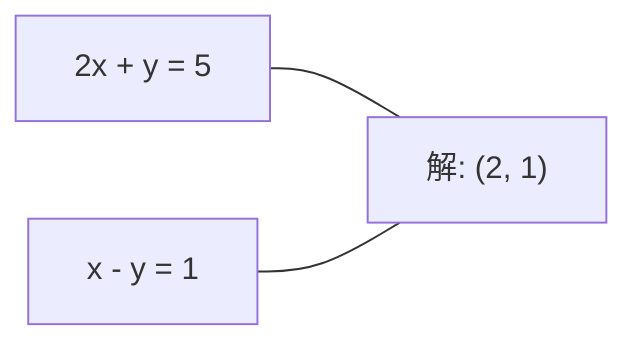
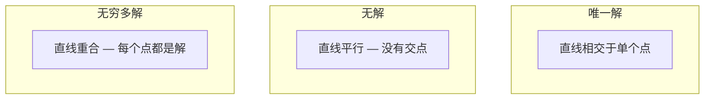

# रैखिक प्रणाली

> 求解 $Ax = b$यह गणित में सबसे पुरानी समस्याओं में से एक है, और यह आज भी आपके तंत्रिका नेटवर्क को चलाने में है।

**Type:** Build
**Language:**पायथन
**前置要求：**चरण 1पाठ 01 (रेखीय बीजगणित अंतर्ज्ञान),02 (वेक्टर और मैट्रिक्स),03 (मैट्रिक्स परिवर्तन)
**Time:** ~120 minutes

## 学习目标
- उपयोग带 आंशिक घूर्णन और वापस प्रतिस्थापन के Gaussian उन्मूलन 求解 $Ax = b$
- उपयोग LU、QR 和 Cholesky विघटन 分解矩阵,并解释每种方法适用场景
- 推导最小正方形的正常方程,并将其与线性回归和脊回归 联系起来
- उपयोग स्थिति संख्या  निदान खराब स्थिति वाले सिस्टम,并 लागू नियमन उसे स्थिर बनाने

## 问题
प्रत्येक प्रशिक्षण रैखिक प्रतिगमन , आप सभी एक रैखिक प्रणाली को हल करने के लिए खोज रहे हैं  प्रत्येक गणना न्यूनतम वर्ग फिट , आप सभी एक रैखिक प्रणाली को हल करने के लिए खोज रहे हैं  प्रत्येक तंत्रिका नेटवर्क परत `y = Wx + b`时,它都在评估线性系统的一侧. 时,你在修改这个系统. 时,你在分解一个矩阵. 时,你在分解一个矩阵. 时,你在解一个线性系统.

方程 $Ax = b$无处不在──$A$यह ज्ञात संख्याओं के गठन का एक मैट्रिक्स है।$b$                                                                                                                                                                                                                                                              $x$है आप अनजान मात्रा वेक्टर खोजने के लिए चाहते हैं.$A$यह आपका डेटा मैट्रिक्स है,$b$यह आपका लक्ष्य वेक्टर है,$x$है वजन वेक्टर── संपूर्ण मॉडल का समापन किया जा सकता है:找到 $x$,使 $Ax$尽可能接近 $b$

इस कक्षा में इस समीकरण को शून्य से बनाने के सभी मुख्य तरीकों को समझा जाएगा। आप समझेंगे कि क्यों कुछ तरीके तेज़ और अन्य तरीके अधिक स्थिर हैं, क्यों कुछ तरीके केवल वर्ग प्रणालियों के लिए लागू होते हैं जबकि अन्य अत्यधिक निर्धारित प्रणालियों को संभाल सकते हैं, और क्यों मैट्रिक्स की स्थिति संख्या आपके उत्तर का निर्णय लेती है कि क्या इसका कोई अर्थ है।

## 概念
### एक्स = बी का अर्थ क्या है

एक रैखिक समीकरण प्रणाली 具有几何解释── प्रत्येक समीकरण 定义一个超平面──解就是所有超平面相交的点(或点集)──

```
2x + y = 5          2D 中的两条直线。
x - y  = 1          它们相交于 x=2, y=1。
```



तीन प्रकार की स्थिति हो सकती हैः



"मैट्रिक्स" में, "एक समाधान" का अर्थ है$A$"कोई समाधान" का अर्थ है प्रणाली असंगत है$A$इसमें शून्य स्थान है। अधिकांश ML 问题都属于没有精确解的类别, क्योंकि आपके समीकरणों (Data points) अज्ञात (parameters) से अधिक हैं।

### स्तंभ चित्र बनाम पंक्ति चित्र

समझने के दो तरीके हैं$Ax = b$

**Row picture.** $A$के प्रत्येक पंक्ति एक समीकरण को परिभाषित करती है। प्रत्येक समीकरण एक हाइपरप्लेन है। इसका हल यह है कि वे सभी एक दूसरे के साथ स्थित हैं।

**Column picture.** $A$प्रत्येक पंक्ति एक वेक्टर है।$A$के स्तंभों का क्या रैखिक संयोजन  उत्पन्न $b$?

```
A = | 2  1 |    b = | 5 |
    | 1 -1 |        | 1 |

Row picture: 同时求解 2x + y = 5 和 x - y = 1。

Column picture: 找到 x1, x2，使得：
  x1 * [2, 1] + x2 * [1, -1] = [5, 1]
  2 * [2, 1] + 1 * [1, -1] = [4+1, 2-1] = [5, 1]   check.
```

स्तंभ चित्र 更根本──如果 $b$位于 $A$के स्तंभ स्थान के बीच, प्रणाली वहाँ है$b$इनमें से, आप स्तंभ स्थान को खोजने के लिए है, जो कि उसके निकटतम बिंदु से दूर है.

### गौसीयन उन्मूलन

गौसीयन उन्मूलन होगा$Ax = b$转换为 ऊपरी त्रिकोण प्रणाली $Ux = c$, फिर वापस प्रतिस्थापन के साथ  खोज समाधान यह सबसे सीधा तरीका है

算法:

```
1. 对每一列 k（pivot column）：
   a. 在第 k 行及其下方，找到 column k 中最大的 entry（partial pivoting）。
   b. 将该行与第 k 行交换。
   c. 对 k 下方的每一行 i：
      - 计算 multiplier m = A[i][k] / A[k][k]
      - 从第 i 行中减去 m 倍的第 k 行。
2. Back substitute：从最后一个 equation 向上求解。
```

उदाहरण:

```
Original:
| 2  1  1 | 8 |       R2 = R2 - (2)R1     | 2  1   1 |  8 |
| 4  3  3 |20 |  -->  R3 = R3 - (1)R1 --> | 0  1   1 |  4 |
| 2  3  1 |12 |                            | 0  2   0 |  4 |

                       R3 = R3 - (2)R2     | 2  1   1 |  8 |
                                       --> | 0  1   1 |  4 |
                                           | 0  0  -2 | -4 |

Back substitute:
  -2 * x3 = -4    -->  x3 = 2
  x2 + 2  = 4     -->  x2 = 2
  2*x1 + 2 + 2 = 8 --> x1 = 2
```

गौशियन उन्मूलन की गणना लागत के लिए$O(n^3)$ $1000 \times 1000$प्रणाली, यह लगभग एक अरब बार फ्लोटिंग-पॉइंट संचालन है. यह बहुत जल्दी है, लेकिन अगर आप एक ही उपयोग करने की जरूरत है।$A$                                                                                                                                                                                                                                                              

### आंशिक पिवटिंगः क्यों महत्वपूर्ण

 बिना पिवोटिंग, गौशियन उन्मूलन संभव विफलता या कचरा परिणाम उत्पन्न करना है यदि पिवोट तत्व शून्य है, तो आप शून्य से अलग हो जाएगा यदि यह बहुत छोटा है, तो आप गोल त्रुटि को बढ़ा देंगे

```
Bad pivot:                       With partial pivoting:
| 0.001  1 | 1.001 |            先交换行：
| 1      1 | 2     |            | 1      1 | 2     |
                                 | 0.001  1 | 1.001 |
m = 1/0.001 = 1000              m = 0.001/1 = 0.001
R2 = R2 - 1000*R1               R2 = R2 - 0.001*R1
| 0.001  1     | 1.001   |      | 1      1     | 2     |
| 0     -999   | -999.0  |      | 0      0.999 | 0.999 |

x2 = 1.000（正确）              x2 = 1.000（正确）
x1 = (1.001 - 1)/0.001          x1 = (2 - 1)/1 = 1.000（正确）
   = 0.001/0.001 = 1.000        稳定，因为 multiplier 很小。
```

सटीकता सीमित में फ्लोटिंग-पॉइंट अंकगणित में, अपरिवर्तित संस्करण महत्वपूर्ण अंकों को खो सकता है।

### एलयू विघटन

LU विघटन होगा$A$分解为 निचले त्रिकोण मैट्रिक्स $L$和 ऊपरी त्रिकोण मैट्रिक्स $U$:$A = LU$$L$मैट्रिक्स  भंडारण गौसीन उन्मूलन 中的 गुणक──$U$मैट्रिक्स ही उन्मूलन का परिणाम है।

```
A = L @ U

| 2  1  1 |   | 1  0  0 |   | 2  1   1 |
| 4  3  3 | = | 2  1  0 | @ | 0  1   1 |
| 2  3  1 |   | 1  2  1 |   | 0  0  -2 |
```

क्यों कारक और सीधे खत्म नहीं? क्योंकि एक बार जब वहाँ है$L$和 $U$, किसी भी नए के लिए ।$b$求解 $Ax = b$बस जरूरत है$O(n^2)$:

```math
\begin{aligned}
Ax &= b \\
LUx &= b \\
&\text{令 } y = Ux\text{:} \\
Ly &= b \quad \text{（前代，} O(n^2)\text{）} \\
Ux &= y \quad \text{（回代，} O(n^2)\text{）}
\end{aligned}
```

$O(n^3)$इसके बाद हर बार समाधान होते हैं।$O(n^2)$यदि आपको उसी का उपयोग करने की आवश्यकता हो तो $A$、 भिन्न $b$वेक्टर  1000  प्रणाली का हल खोजें,LU 会让总工作量节省约1000/3倍

उपयोग आंशिक घूर्णन 时, आप प्राप्त $PA = LU$, उनमें से $P$ रैंक स्वैप के परमुटेशन मैट्रिक्स को रिकॉर्ड करें

### क्यूआर विघटन

क्यूआर विघटन होगा$A$分解为 उभयचर मैट्रिक्स $Q$和 ऊपरी त्रिकोण मैट्रिक्स $R$:$A = QR$

ऑर्तोगनल मैट्रिक्स 具有 $Q^T Q = I$इसका स्तंभों में ऑर्थोनोर्मल वेक्टर होते हैं।$Q$लम्बाई और कोणों को बनाए रखें

```
A = Q @ R

Q has orthonormal columns: Q^T Q = I
R is upper triangular

To solve Ax = b:
  QRx = b
  Rx = Q^T b    (只需乘以 Q^T，不需要 inversion)
  Back substitute to get x.
```

                                                                                                                                                                                                                                                              $Q$:

```
Given columns a1, a2, ... of A:

q1 = a1 / ||a1||

q2 = a2 - (a2 . q1) * q1        (减去到 q1 上的 projection)
q2 = q2 / ||q2||                (normalize)

q3 = a3 - (a3 . q1) * q1 - (a3 . q2) * q2
q3 = q3 / ||q3||

R[i][j] = qi . aj    for i <= j
```

हर कदम से सब कुछ आगे बढ़ जाएगा$q$वेक्टरों का घटक, केवल एक नई ऑर्थोगनल दिशा छोड़ दें

### चोलेस्की विघटन

$A$यह सममित है$A = A^T$) और सकारात्मक निश्चित हैं ((सभी स्वमूल्य हैं) जब आप इसे विभाजित कर सकते हैं$A = L L^T$, उनमें से $L$यह निचला त्रिकोण है।

```
A = L @ L^T

| 4  2 |   | 2  0 |   | 2  1 |
| 2  5 | = | 1  2 | @ | 0  2 |

L[i][i] = sqrt(A[i][i] - sum(L[i][k]^2 for k < i))
L[i][j] = (A[i][j] - sum(L[i][k]*L[j][k] for k < j)) / L[j][j]    for i > j
```

चोलेस्की LU से 快两倍, और केवल आधा भंडारण स्थान की आवश्यकता है। यह केवल सममित सकारात्मक निश्चित मैट्रिक्स के लिए उपयुक्त है, लेकिन इस प्रकार का मैट्रिक्स अक्सर दिखाई देता हैः

- कोवरिएंसी मैट्रिक्स सममित सकारात्मक अर्ध-परिभाषित हैं।
- गौसी प्रक्रियाओं के मध्य के कर्नेल मैट्रिक्स सममित सकारात्मक निश्चित है。
- संकुचित फ़ंक्शन में न्यूनतम 处 का हेसनियन है सममित सकारात्मक निश्चित
- $A^T A$总是对称正半确的──

Gaussian प्रक्रियाओं में, आप Cholesky के साथ kernel मैट्रिक्स को विभाजित करने के लिए $K$, फिर हल मांगें$K \alpha = y$Cholesky कारक भी मार्जिनल संभावना के लॉग-निर्धारक देता हैः$\log \det(K) = 2 \sum \log(\mathop{\mathrm{diag}}(L))$

### न्यूनतम वर्गों:当 Ax = b 没有精确解时

यदि $A$$m \times n$且 $m > n$(समय अधिक है अज्ञात), प्रणाली है अतिपरिचित।

```
minimize ||Ax - b||^2

这是 squared residuals 的总和：
  sum((A[i,:] @ x - b[i])^2 for i in range(m))
```

न्यूनतम 满足 सामान्य समीकरणोंः

```math
A^T A x = A^T b
```

推导:展开 $\lVert Ax - b \rVert^2 = (Ax - b)^T (Ax - b) = x^T A^T A x - 2 x^T A^T b + b^T b$对 $x$求 ग्रेडिएंट,并令其为零:$2 A^T A x - 2 A^T b = 0$

```
Original system (overdetermined, 4 equations, 2 unknowns):
| 1  1 |         | 3 |
| 1  2 | x     = | 5 |       没有精确的 x 能满足全部 4 个 equations。
| 1  3 |         | 6 |
| 1  4 |         | 8 |

Normal equations:
A^T A = | 4  10 |    A^T b = | 22 |
        | 10 30 |            | 63 |

Solve: x = [1.5, 1.7]

这就是 linear regression。x[0] 是 intercept，x[1] 是 slope。
```

### सामान्य समीकरण = रैखिक प्रतिगमन

इस प्रकार के संबंध सटीक हैं। रैखिक regression में, डेटा मैट्रिक्स।$X$प्रत्येक पंक्ति एक नमूना से संबंधित है, प्रत्येक पंक्ति एक विशेषता से संबंधित है।$y$प्रत्येक प्रविष्टि एक नमूना के लिए है।$w$满足:

```math
\begin{aligned}
X^T X w &= X^T y \\
w &= (X^T X)^{-1} X^T y
\end{aligned}
```

यह रैखिक विघटन के बंद-रूप समाधान है।`sklearn.linear_model.LinearRegression.fit()`शहर गणना इस परिणाम ((( या QR या SVD  गणना बराबर मूल्य परिणाम) 👇

मैट्रिक्स 添加 नियमितता शब्द $\lambda I$, तुम एक रिडज रिग्रेशन प्राप्त कर रहे हैंः

```math
\begin{aligned}
(X^T X + \lambda I) w &= X^T y \\
w &= (X^T X + \lambda I)^{-1} X^T y
\end{aligned}
```

नियमन से मैट्रिक्स की स्थिति बेहतर होती है, और वजन को शून्य तक संकुचित करने से बचने के लिए वजन को अधिक से अधिक फिट करने से रोकता है।$\lambda > 0$时,मैट्रिक्स $X^T X + \lambda I$总是对称正确, इसलिए चॉलेस्की के साथ 求解──

### प्यूडियोइंवर्स (मूर-पेनरोज)

झूठी उलटा$A^+$推广到非正方形和单数矩阵――任意矩阵$A$:

```math
\begin{aligned}
x &= A^+ b \\[4pt]
\text{其中 } A^+ &= V \Sigma^+ U^T \quad \text{（通过 SVD 计算）}
\end{aligned}
```

$\Sigma^+$通过对每非零单数值 取相互并转置结果构成──如果 $A = U \Sigma V^T$, तो फिर $A^+ = V \Sigma^+ U^T$

```
A = U Sigma V^T        (SVD)

Sigma = | 5  0 |       Sigma+ = | 1/5  0  0 |
        | 0  2 |                | 0  1/2  0 |
        | 0  0 |

A+ = V Sigma+ U^T
```

प्यूडोइंवर्स  दे न्यूनतम-नॉर्म न्यूनतम-क्वायर समाधान―यदि प्रणाली है:
- 唯一解:$A^+ b$ दे देना इस समाधान.
- 无解:$A^+ b$ न्यूनतम वर्ग समाधान दें
- 无穷多解:$A^+ b$ दे देना $\lVert x \rVert$सबसे छोटा है कि समाधानः

NumPy के `np.linalg.lstsq`和 `np.linalg.pinv`内部都使用SVD──

### स्थिति संख्या

स्थिति संख्या  माप समाधान इनपुट के छोटे परिवर्तनों के प्रति अधिक संवेदनशील है $A$,शर्त संख्या है:

```math
\kappa(A) = \lVert A \rVert \cdot \lVert A^{-1} \rVert = \frac{\sigma_{\max}}{\sigma_{\min}}
```

उनमें से $\sigma_{\max}$和 $\sigma_{\min}$分别是最大和最小单数值──

```
Well-conditioned (kappa ~ 1):        Ill-conditioned (kappa ~ 10^15):
b 中的小变化 -->                    b 中的小变化 -->
x 中的小变化                         x 中的巨大变化

| 2  0 |   kappa = 2/1 = 2          | 1   1          |   kappa ~ 10^15
| 0  1 |   safe to solve            | 1   1+10^(-15) |   solution is garbage
```

经验法则:
- $\kappa < 100$: सुरक्षा, समाधान 准确──
- $\kappa \approx 10^k$: तुम लगभग फ्लोटिंग-पॉइंट अंकगणित से नुकसान $k$位精度──
- $\kappa \approx 10^{16}$(फ़्लोट64): समाधान 没有意义──矩阵 实际上是单一──

एमएल में,असंतोषजनक  घटना  लगभग संपीड़न  समय  नियमितता  जोड़ $\lambda I$) स्थिति संख्या से $\sigma_{\max} / \sigma_{\min}$ सुधार के लिए $(\sigma_{\max} + \lambda) / (\sigma_{\min} + \lambda)$

### पुनरावर्ती पद्धतिःसंयुक्त ग्रेडिएंट

 बहुत बड़ी दुर्लभ प्रणालियों के लिए (数百万未知),LU या Cholesky जैसे प्रत्यक्ष विधियाँ 成本过高──Iterative methods 会通过多次代改进一个猜想 来近似解决方案──

संयोग gradient (CG) $A$时求解 $Ax = b$ यह सटीक अंकगणित में सबसे अधिक $n$अगली बार पता लगाने के लिए एक सटीक समाधान, लेकिन अगर $A$                                                                                                                                                                                                                                                              

```
Algorithm sketch:
  x0 = initial guess (often zero)
  r0 = b - A x0           (residual)
  p0 = r0                 (search direction)

  For k = 0, 1, 2, ...:
    alpha = (rk . rk) / (pk . A pk)
    x_{k+1} = xk + alpha * pk
    r_{k+1} = rk - alpha * A pk
    beta = (r_{k+1} . r_{k+1}) / (rk . rk)
    p_{k+1} = r_{k+1} + beta * pk
    if ||r_{k+1}|| < tolerance: stop
```

CG के लिएः
- बड़े पैमाने पर अनुकूलन (न्यूटन-सीजी विधि)
- 求解 पीडीई विवशता
- कर्नेल विधियाँ, जिनमें कर्नेल मैट्रिक्स 太大无法 कारक
- 作为其他 पुनरावर्ती समाधान के पूर्व-संशोधन

अभिसरण दर  निर्भर करता है स्थिति संख्या  बेहतर प्रणाली 收更快, यह भी नियमितता  मददगार का एक और कारण 

### पूर्ण चित्रः何时使用哪种方法

| Method | Requirements | Cost | Use case |
|--------|-------------|------|----------|
| Gaussian elimination | Square, nonsingular $A$ | $O(n^3)$ | 对 square system 的一次性求解 |
| LU decomposition | Square, nonsingular $A$ | $O(n^3)$ factor + $O(n^2)$ solve | 使用相同 $A$ 的多次求解 |
| QR decomposition | Any $A$ ($m \ge n$) | $O(mn^2)$ | Least squares，numerically stable |
| Cholesky | Symmetric positive definite $A$ | $O(n^3/3)$ | Covariance matrices，Gaussian processes，ridge regression |
| Normal equations | Overdetermined ($m > n$) | $O(mn^2 + n^3)$ | Linear regression（小 $n$） |
| SVD / pseudoinverse | Any $A$ | $O(mn^2)$ | Rank-deficient systems，minimum-norm solutions |
| Conjugate gradient | Symmetric positive definite, sparse $A$ | $O(n \cdot k \cdot \text{nnz})$ | Large sparse systems，$k$ = iterations |

### एमएल से कनेक्शन

इस वर्ग में प्रत्येक विधि उत्पादन स्तर एमएल में दिखाई देती हैः

**Linear regression.**बंद-रूप समाधान 求解 सामान्य समीकरण $X^T X w = X^T y$ यह Cholesky के माध्यम से किया जा सकता है अगर $n$很小) 、QR(यदि संख्यात्मक स्थिरता 很重要) या SVD(यदि मैट्रिक्स संभव रैंक-अभावी)完成──

**Ridge regression.**$X^T X$添加 $\lambda I$❖नियमित प्रणाली $(X^T X + \lambda I) w = X^T y$总是可以通过Cholesky 求解,因为当 $\lambda > 0$时,$X^T X + \lambda I$ सममित सकारात्मक निश्चित 

**Gaussian processes.**भविष्यवाणी औसत 需要求解 $K \alpha = y$, उनमें से $K$यह नाभिक मैट्रिक्स है।$K$करना चोलेस्की कारककरण है मानक विधि。लॉग मार्जिनल संभावना प्रयोग $\log \det(K) = 2 \sum \log(\mathop{\mathrm{diag}}(L))$

**Neural network initialization.**ऑर्थोगनल आरंभिकरण का उपयोग करें क्यूआर विघटन  स्तंभों को बनाने के लिए ऑर्थोनॉर्मल के वजन मैट्रिक्स── यह गहरे नेटवर्क के बीच संकेतों के टूटने को रोक सकता है──

**Preconditioning.**बड़े पैमाने पर अनुकूलक उपयोग अपूर्ण Cholesky या अपूर्ण LU 作为 संयुग्मित ग्रेडिएंट सॉल्वर के पूर्व शर्तों──

**Feature engineering.** $X^T X$ बताओ विशेषताएँ  यदि $\kappa$很大, हटाना सुविधाएँ या जोड़ने नियमितकरण


```figure
linear-system-conditioning
```

##  इसे निर्माण
### 步骤 1: आंशिक पिवटिंग के साथ गौशियन उन्मूलन

```python
import numpy as np

def gaussian_elimination(A, b):
    n = len(b)
    Ab = np.hstack([A.astype(float), b.reshape(-1, 1).astype(float)])

    for k in range(n):
        max_row = k + np.argmax(np.abs(Ab[k:, k]))
        Ab[[k, max_row]] = Ab[[max_row, k]]

        if abs(Ab[k, k]) < 1e-12:
            raise ValueError(f"Matrix is singular or nearly singular at pivot {k}")

        for i in range(k + 1, n):
            m = Ab[i, k] / Ab[k, k]
            Ab[i, k:] -= m * Ab[k, k:]

    x = np.zeros(n)
    for i in range(n - 1, -1, -1):
        x[i] = (Ab[i, -1] - Ab[i, i+1:n] @ x[i+1:n]) / Ab[i, i]

    return x
```

### 步骤 2: LU विघटन

```python
def lu_decompose(A):
    n = A.shape[0]
    L = np.eye(n)
    U = A.astype(float).copy()
    P = np.eye(n)

    for k in range(n):
        max_row = k + np.argmax(np.abs(U[k:, k]))
        if max_row != k:
            U[[k, max_row]] = U[[max_row, k]]
            P[[k, max_row]] = P[[max_row, k]]
            if k > 0:
                L[[k, max_row], :k] = L[[max_row, k], :k]

        for i in range(k + 1, n):
            L[i, k] = U[i, k] / U[k, k]
            U[i, k:] -= L[i, k] * U[k, k:]

    return P, L, U

def lu_solve(P, L, U, b):
    n = len(b)
    Pb = P @ b.astype(float)

    y = np.zeros(n)
    for i in range(n):
        y[i] = Pb[i] - L[i, :i] @ y[:i]

    x = np.zeros(n)
    for i in range(n - 1, -1, -1):
        x[i] = (y[i] - U[i, i+1:] @ x[i+1:]) / U[i, i]

    return x
```

### 步骤 3: चोलेस्की विघटन

```python
def cholesky(A):
    n = A.shape[0]
    L = np.zeros_like(A, dtype=float)

    for i in range(n):
        for j in range(i + 1):
            s = A[i, j] - L[i, :j] @ L[j, :j]
            if i == j:
                if s <= 0:
                    raise ValueError("Matrix is not positive definite")
                L[i, j] = np.sqrt(s)
            else:
                L[i, j] = s / L[j, j]

    return L
```

### 步骤 4: सामान्य समीकरणों के माध्यम से न्यूनतम वर्ग

```python
def least_squares_normal(A, b):
    AtA = A.T @ A
    Atb = A.T @ b
    return gaussian_elimination(AtA, Atb)

def ridge_regression(A, b, lam):
    n = A.shape[1]
    AtA = A.T @ A + lam * np.eye(n)
    Atb = A.T @ b
    L = cholesky(AtA)
    y = np.zeros(n)
    for i in range(n):
        y[i] = (Atb[i] - L[i, :i] @ y[:i]) / L[i, i]
    x = np.zeros(n)
    for i in range(n - 1, -1, -1):
        x[i] = (y[i] - L.T[i, i+1:] @ x[i+1:]) / L.T[i, i]
    return x
```

### 步骤 5: स्थिति संख्या

```python
def condition_number(A):
    U, S, Vt = np.linalg.svd(A)
    return S[0] / S[-1]
```

## इसका उपयोग करें
इन भागों को संयोजित करके वास्तविक डेटा पर रैखिक रिएग्रेशन और रिज रिएग्रेशन करेंः

```python
np.random.seed(42)
X_raw = np.random.randn(100, 3)
w_true = np.array([2.0, -1.0, 0.5])
y = X_raw @ w_true + np.random.randn(100) * 0.1

X = np.column_stack([np.ones(100), X_raw])

w_ols = least_squares_normal(X, y)
print(f"OLS weights (ours):    {w_ols}")

w_np = np.linalg.lstsq(X, y, rcond=None)[0]
print(f"OLS weights (numpy):   {w_np}")
print(f"Max difference: {np.max(np.abs(w_ols - w_np)):.2e}")

w_ridge = ridge_regression(X, y, lam=1.0)
print(f"Ridge weights (ours):  {w_ridge}")

from sklearn.linear_model import Ridge
ridge_sk = Ridge(alpha=1.0, fit_intercept=False)
ridge_sk.fit(X, y)
print(f"Ridge weights (sklearn): {ridge_sk.coef_}")
```

## 交付 यह
本课产出:
- `code/linear_systems.py`, शून्य से प्राप्त Gaussian उन्मूलन शामिल है, LU विघटन, Cholesky विघटन, न्यूनतम वर्गों और रिज regression
- एक व्यवहार्य प्रदर्शन, सामान्य समीकरणों और sklearn के रैखिक regression का प्रदर्शन करें  समान वजन उत्पन्न करें

## अभ्यास
1. अपने गौशियन उन्मूलन प्रयोग करें, अपने LU समाधान और `np.linalg.solve`求解 प्रणाली `[[1,2,3],[4,5,6],[7,8,10]] x = [6, 15, 27]`验证三者在浮点容忍内给出相同答案──

2. 生成一个50x5 यादृच्छिक矩阵 X 和 लक्ष्य y = X @ w_true + noise──分别使用正常方程、QR(通过 `np.linalg.qr`)、SVD(पास `np.linalg.svd`) और `np.linalg.lstsq`求解 w―比较四个解决方案―测量 $X^T X$की स्थिति संख्या,并解释它如何影响你信任哪种方法──

3. 通过让两列几乎相同来创建一个几乎单一矩阵 (例如, स्तंभ 2 = स्तंभ 1 + 1e-10 *噪声) 计算它的条件数──分别在有规律化和无规律化的情况下求解$Ax = b$(添加 $0.01 I$)― समाधानों तथा अवशेषों की तुलना करें― व्याख्या करें कि नियमितता का लाभ क्यों मिलता है―

4. एक 100x100 यादृच्छिक सममित सकारात्मक निश्चित मैट्रिक्स के लिए  संयोजन ग्रेडिएंट एल्गोरिथ्म को प्राप्त करना 统计它收到容忍 1e-8 需要多少次反复──与 $n$पुनरावृत्ति का सिद्धांत अधिकतम मूल्य तुलना करें

5. 10 ̊50 ̊200 ̊500 के लिए बड़े पैमाने पर सममित सकारात्मक निश्चित मैट्रिक्स ऊपर, अपने Cholesky हल करने वाले के लिए, अपने LU हल करने वाले के लिए और`np.linalg.solve`计时――绘制结果――验证 चोलेस्की 约比 LU 快 2倍――

### 提示

**练习 1。**调用 `gaussian_elimination(A, b)`, पुनः प्रयोग`lu_decompose(A)`और फिर से इस्तेमाल किया`lu_solve(P, L, U, b)`, अंतिम调用 `np.linalg.solve(A, b)` उपयोग `np.allclose(A @ x, b)`检查每个解,并用 `np.allclose`इन तीनों के साथ तुलना करें।

**练习 2。**सामान्य समीकरणों के लिए प्रयोग `least_squares_normal`, शेष विधि का उपयोग करने के लिए तीन संख्यात्मक 函数── चार हल करना चाहिए`w_true` तुलना करें `condition_number(X.T @ X)`和 `condition_number(X)`: पूर्वक है बाद के वर्ग, इसलिए सामान्य समीकरणों 损失精度 सर्वाधिक 

**练习 3。**预期 स्थिति संख्या 会超过 $10^{9}$分別使用 `np.linalg.solve`和 `ridge_regression(A, b, 0.01)` खोजें, पुनः तुलना करें `np.linalg.norm(x)`तथा शेष मानदंडों में से दो में बहुत कम मात्रा हो सकती है, लेकिन नियमितता के बिना समाधानों में आमतौर पर बड़ी मात्रा शामिल होती है।

**练习 4。**उपयोग `B @ B.T + n * np.eye(n)` सममित सकारात्मक निश्चित मैट्रिक्स का निर्माण, सुनिश्चित प्रत्येक स्वयं मूल्य `conjugate_gradient`चक्र में एक कैलकुलेटर जोड़ें, फिर अंतिम अवशिष्ट मानदंड की जांच करें कि क्या 1e-8 से छोटा है या नहीं, और क्या समय की संख्या 100 से अधिक नहीं है।

**练习 5。**三种溶剂 使用相同 `B @ B.T + n * np.eye(n)`矩阵,并用 `time.perf_counter` प्रत्येक खोज के लिए व्यय को मापें, कई बार संचालन में सर्वोत्तम परिणाम प्राप्त करें

## 关键术语
| Term | What people say | What it actually means |
|------|----------------|----------------------|
| Linear system | "Solve for x" | 一组 linear equations $Ax = b$。找到 $x$ 意味着找到在 transformation $A$ 下产生 output $b$ 的 input。 |
| Gaussian elimination | "Row reduce" | 使用 row operations 系统性地将 diagonal 下方的 entries 置零，产生可通过 back substitution 求解的 upper triangular system。$O(n^3)$。 |
| Partial pivoting | "Swap rows for stability" | 在 column $k$ 中进行 elimination 前，将该 column 中 absolute value 最大的行交换到 pivot 位置。防止除以很小的数。 |
| LU decomposition | "Factor into triangles" | 写成 $A = LU$，其中 $L$ 是 lower triangular（存储 multipliers），$U$ 是 upper triangular（eliminated matrix）。将 $O(n^3)$ 成本摊销到多次求解中。 |
| QR decomposition | "Orthogonal factorization" | 写成 $A = QR$，其中 $Q$ 的 columns 是 orthonormal，$R$ 是 upper triangular。对于 least squares，比 LU 更稳定。 |
| Cholesky decomposition | "Square root of a matrix" | 对 symmetric positive definite $A$，写成 $A = LL^T$。成本是 LU 的一半。用于 covariance matrices、kernel matrices 和 ridge regression。 |
| Least squares | "Best fit when exact is impossible" | 当 system overdetermined（equations 多于 unknowns）时，最小化 squared residuals 的总和 $\lVert Ax - b \rVert^2$。 |
| Normal equations | "The calculus shortcut" | $A^T A x = A^T b$。将 $\lVert Ax - b \rVert^2$ 的 Gradient 设为零。这就是 linear regression 的 closed-form solution。 |
| Pseudoinverse | "Inversion for non-square matrices" | $A^+ = V \Sigma^+ U^T$ via SVD。对于任意 Matrix，无论 square 或 rectangular、singular 与否，给出 minimum-norm least-squares solution。 |
| Condition number | "How trustworthy is this answer" | $\kappa = \sigma_{\max} / \sigma_{\min}$。衡量对 input perturbations 的敏感性。大约损失 $\log_{10}(\kappa)$ 位精度。 |
| Ridge regression | "Regularized least squares" | 求解 $(X^T X + \lambda I) w = X^T y$。添加 $\lambda I$ 改善 conditioning，并将 weights 向零收缩。防止 overfitting。 |
| Conjugate gradient | "Iterative Ax=b for big matrices" | 用于 symmetric positive definite systems 的 iterative solver。最多 $n$ 步收敛。适合 factorization 成本过高的大型 sparse systems。 |
| Overdetermined system | "More data than parameters" | 在 $m\text{-by-}n$ system 中 $m > n$。不存在精确解。Least squares 找到最佳近似。这就是每个 regression problem。 |
| Back substitution | "Solve from the bottom up" | 给定 upper triangular system，先求解最后一个 equation，然后向后 substitute。$O(n^2)$。 |
| Forward substitution | "Solve from the top down" | 给定 lower triangular system，先求解第一个 equation，然后向前 substitute。$O(n^2)$。用于 LU solves 中的 L step。 |

## 延伸阅读
- [MIT 18.06: Linear Algebra](https://ocw.mit.edu/courses/18-06-linear-algebra-spring-2010/)(गिलबर्ट स्ट्रैंग) --  关于线性系统和矩阵因数化的权威课程
- [Numerical Linear Algebra](https://people.maths.ox.ac.uk/trefethen/text.html)(ट्रेफेटन और बाउ) -- संख्यात्मक स्थिरता, संस्थिता और एल्गोरिदम को समझने के लिए असफलता के मानक संदर्भ
- [Matrix Computations](https://www.cs.cornell.edu/cv/GolubVanLoan4/golubandvanloan.htm)(गोलब एंड वान लोन) -- 涵盖各类矩阵算法 的百科式参考
- [3Blue1Brown: Inverse Matrices](https://www.3blue1brown.com/lessons/inverse-matrices)-- मांग के लिए हल$Ax = b$几何意义的可视化直觉
