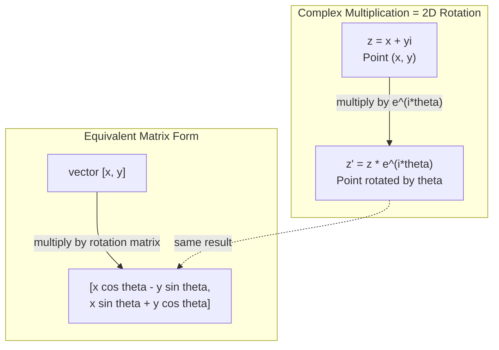
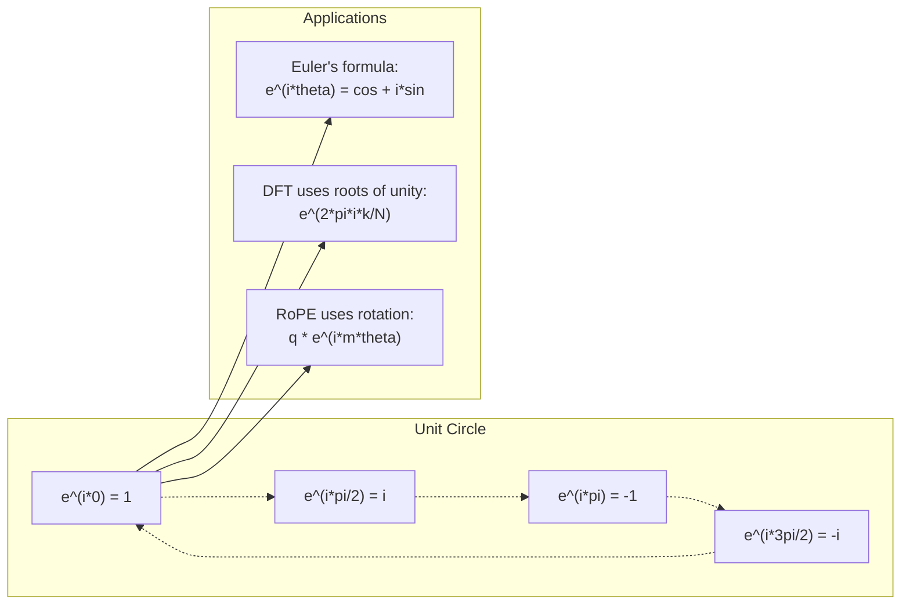

# AI 中中的复数

> -1 की वर्गमूल खोट नहीं है। यह घूर्णन, आवृत्ति तथा अर्धसिनल प्रसंस्करण क्षेत्र की कुंजी है।

**Type:** Learn
**Language:**पायथन
**Prerequisites:** Phase 1, Lessons 01-04（linear algebra, calculus）
**Time:** ~60 分钟

## 学习目标
-                                                                                                                                                                                                                                                               
-  अनुप्रयोग Euler के सूत्र में रूपांतरण 复指数与三角函数之间
- उपयोग करें प्रतिकृति इकाई आधार को प्राप्त करें
- 解释复数旋转 कैसे बनें ट्रांसफार्मर 中 RoPE 和正弦位置编码的基础

## 问题
तुम एक लेख खोलना Fourier परिवर्तनों के बारे में परिकल्पना, हर जगह हैं ।`i`你查看 ट्रांसफार्मर 位置编码, विभिन्न आवृत्ति के नीचे देखें `sin`和 `cos` 也就是复指数的实部和虚部──你读到量子计算,又发现一切都用复向 空间来表达──

复数 बहुत अमूर्त लगती है। -1 के वर्गमूल पर आधारित एक संख्यात्मक प्रणाली, एक प्रकार की गणितीय तकनीक की तरह महसूस होती है। लेकिन यह कोई तकनीक नहीं है। यह घूर्णन और झुकने की प्राकृतिक भाषा है।

यदि आप संख्या को नहीं समझते हैं, तो आप डिस्क्रिट फ़ौरियर ट्रांसफॉर्म को नहीं समझ सकते हैं। आप एफएफटी को नहीं समझ सकते हैं। आप आधुनिक भाषा मॉडल में रोपी (रोटरी स्थिति एम्बेडिंग) को नहीं समझ सकते हैं।

यह कक्षा शून्य से निर्माण से संख्यक परिचालन तक होगी, इसे भौतिकी से जोड़कर, और मशीन लर्निंग में संख्यक की स्थिति को प्रदर्शित करेगी।

## 概念
### क्या है?

复数 में दो भाग हैंः实部 और虚部──

```
z = a + bi

where:
  a is the real part
  b is the imaginary part
  i is the imaginary unit, defined by i^2 = -1
```

यही है। आप संख्या अक्ष को एक समतल में विस्तारित करते हैं। वास्तविक संख्या एक अक्ष पर स्थित है, शून्य संख्या दूसरी अक्ष पर स्थित है। प्रत्येक जटिल संख्या इस समतल पर एक बिंदु है।

### 复数运算

**加法。**实部相加,虚部相加──

```math
\begin{aligned}
(a + bi) + (c + di) &= (a + c) + (b + d)i \\[4pt]
\text{示例：} (3 + 2i) + (1 + 4i) &= 4 + 6i
\end{aligned}
```

**乘法。**उपयोग वितरण नियम,并记住 $i^2 = -1$

```math
\begin{aligned}
(a + bi)(c + di) &= ac + adi + bci + bdi^2 \\
&= ac + adi + bci - bd \\
&= (ac - bd) + (ad + bc)i \\[8pt]
\text{示例：} (3 + 2i)(1 + 4i) &= 3 + 12i + 2i + 8i^2 \\
&= 3 + 14i - 8 \\
&= -5 + 14i
\end{aligned}
```

**共轭。**翻转虚部的符号──

```math
(a + bi)\text{ 的共轭} = a - bi
```

एक गुणांक और उसके समकक्ष का गुणांक सामान्यतः वास्तविक संख्या हैः

```math
(a + bi)(a - bi) = a^2 + b^2
```

**除法。**分子 और分母 एक ही समय में分母 के सम──

```math
\frac{a + bi}{c + di} = \frac{(a + bi)(c - di)}{c^2 + d^2}
```

यह विभाजित में शून्य भाग को नष्ट कर देगा, एक शुद्ध गुणा प्राप्त करेगा।

### 复平面

复平面把每复数映射到一个2D点──水平轴是实轴,垂直轴是虚轴──

```
z = 3 + 2i  corresponds to the point (3, 2)
z = -1 + 0i corresponds to the point (-1, 0) on the real axis
z = 0 + 4i  corresponds to the point (0, 4) on the imaginary axis
```

复数同时是一点,也是从原点出发的向量── इस प्रकार का द्वि重解释正是复数在几何中有用的原因──

### 极坐标形式

समतल में किसी भी बिंदु को मूल बिंदु से दूरी के साथ-साथ उसके सापेक्ष वास्तविक धुरी के कोण के रूप में वर्णित किया जा सकता है।

```math
\begin{aligned}
z &= r (\cos\theta + i \sin\theta) \\[4pt]
\text{其中：} r &= |z| = \sqrt{a^2 + b^2} \quad \text{（magnitude，即模）} \\
\theta &= \mathop{\mathrm{atan2}}(b, a) \quad \text{（phase，即辐角）}
\end{aligned}
```

सीधा रूप$(a + bi)$适合加法──极坐标形式 $(r, \theta)$适合乘法──

**极坐标形式下的乘法。**模长相乘, कोण相加──

```math
\begin{aligned}
z_1 &= r_1 e^{i\theta_1} \\
z_2 &= r_2 e^{i\theta_2} \\[4pt]
z_1 z_2 &= (r_1 r_2) \, e^{i(\theta_1 + \theta_2)}
\end{aligned}
```

यही कारण है कि एक बार में एक बार में एक बार में एक बार में एक बार में एक बार में एक बार में एक बार में एक बार में एक बार में एक बार में एक बार में एक बार में एक बार में एक बार में एक बार में एक बार में एक बार में एक बार में एक बार में एक बार में एक बार में एक बार में एक बार में एक बार में एक बार में एक बार में एक बार में एक बार में एक बार में एक बार में एक बार में एक बार में एक बार में एक बार में एक बार में एक बार में एक बार में एक बार में एक बार में एक बार में एक बार में एक बार में एक बार में एक बार में एक बार में एक बार में एक बार में एक बार में एक बार में एक बार में एक बार में एक बार में एक बार में एक बार में एक बार में एक बार में एक बार में एक बार में एक बार में एक बार में एक बार में एक बार में एक बार में एक बार में एक बार में एक बार में एक बार में एक बार में एक बार में एक बार में एक बार में एक बार में एक बार में एक बार में एक बार में एक बार में एक बार में एक बार में एक बार में एक बार में एक बार में एक बार में एक बार में एक बार में एक बार में एक बार में एक बार में एक बार में एक बार में एक बार में एक बार में एक बार में एक बार में एक बार में एक बार में एक बार में एक बार में एक बार में एक बार में एक बार में एक बार में एक बार में एक बार में एक बार में एक बार में एक बार में एक बार में एक बार में एक बार में एक बार में एक बार में एक बार में एक बार में एक बार में एक बार में एक बार में एक बार में एक बार में एक बार में एक बार में एक बार में एक बार में एक बार में एक बार में एक बार में एक बार में एक बार में एक बार में एक बार में एक बार में एक बार में एक बार में एक बार में एक बार में एक बार में एक बार में एक बार में एक बार में एक बार में एक बार में एक बार में एक बार में एक बार में एक बार में एक बार में एक बार में एक बार में एक बार में एक बार में एक बार में एक बार में एक बार में एक बार में एक बार में एक बार में एक बार में एक बार में एक बार में एक बार में एक बार में एक बार में एक बार में एक बार में एक बार में एक बार में एक बार में एक बार में एक बार

### यूलर का सूत्र

复指数 और三角函数 के बीच का पुल:

```math
e^{i\theta} = \cos\theta + i \sin\theta
```

यह इस वर्ग का सबसे महत्वपूर्ण सूत्र है।$\theta = \pi$时:

```math
\begin{aligned}
e^{i\pi} &= \cos\pi + i \sin\pi = -1 + 0i = -1 \\[4pt]
\text{因此：} e^{i\pi} + 1 &= 0
\end{aligned}
```

五个基本常数$e$,$i$,$\pi$, 1, 0) एक साथ एक समतल से जुड़े हुए हैं

### एमएल के लिए यूलर का सूत्र क्यों महत्वपूर्ण है?

यूलर के सूत्र से पता चलता है,$e^{i\theta}$                                                                                                                                                                                                                                                                                                                                                                                                                                                                                                                             $\theta$变化描绘单位圆──当 $\theta = 0$时, तुम हो $(1, 0)$$\theta = \pi/2$时, तुम हो $(0, 1)$$\theta = \pi$时, तुम हो $(-1, 0)$$\theta = 3\pi/2$时, तुम हो $(0, -1)$                                                                                                                                                                                                                                                              $\theta = 2\pi$

इसका अर्थ है कि पुन सूचकांक घूर्णन है तथा घूर्णन सिग्नल प्रसंस्करण और एमएल में कहीं भी नहीं है।

### 2D घुमावदार के साथ संपर्क

 将复数 $(x + yi)$乘以 $e^{i\theta}$, इसे डाल देंगे$(x, y)$                                                                                                                                                                                                                                                                                                                                                                                                                                                                                                                             $\theta$角──

```math
\begin{aligned}
&\text{通过复数乘法旋转：} \\
&\quad (x + yi)(\cos\theta + i \sin\theta) = (x \cos\theta - y \sin\theta) + (x \sin\theta + y \cos\theta)i \\[8pt]
&\text{通过矩阵乘法旋转：} \\
&\quad \begin{bmatrix} \cos\theta & -\sin\theta \\ \sin\theta & \cos\theta \end{bmatrix} \begin{bmatrix} x \\ y \end{bmatrix} = \begin{bmatrix} x \cos\theta - y \sin\theta \\ x \sin\theta + y \cos\theta \end{bmatrix}
\end{aligned}
```

它们产生完全相同的结果──复数乘法就是 2D 旋转──旋转矩阵 只是用矩阵 记法写出的复数乘法──



### फासर और घूर्णन संकेत

复指数 $e^{i\omega t}$एक है $\omega$绕单位圆旋转的点──随随$t$增加, यह बिंदु चित्रित किया जाएगा

इस मोड़ का वास्तविक हिस्सा है$\cos(\omega t)$虚部是 $\sin(\omega t)$正弦信号就是旋转复数投下的影子

```math
\begin{aligned}
e^{i\omega t} &= \cos(\omega t) + i \sin(\omega t) \\[4pt]
\text{实部：} & \cos(\omega t) \quad \text{，即 cosine wave} \\
\text{虚部：} & \sin(\omega t) \quad \text{，即 sine wave}
\end{aligned}
```

यही चरण का दर्शाता तरीका है। आप एक झूलते-झूलते स्ट्रिंग तरंग को नहीं, बल्कि एक समतल घूर्णन वाले तीर को देख रहे हैं।

### 单位根

$N$द्वितीय इकाईमूल इकाई वृत्त ऊपर और अंतराल पर वितरित है ।$N$个点:

```math
w_k = e^{2\pi i k/N} \quad \text{其中 } k = 0, 1, 2, \ldots, N-1
```

$N = 4$时,根是:$1, i, -1, -i$(四个罗盘方向)
$N = 8$时, आप चार रो盘 दिशाओं प्राप्त होगा, फिर चार विपरीत दिशाओं को जोड़ना.

单位根 है विवश Fourier परिवर्तन का आधार. डीएफटी इस पर संकेत को विभाजित करेगा.$N$个等间隔频率 पर分量──

### डीएफटी के साथ संपर्क

信号 $x[0], x[1], \ldots, x[N-1]$का डिस्क्रिट फ़ूरियर ट्रांसफॉर्म है:

```math
X[k] = \sum_{n=0}^{N-1} x[n] \, e^{-2\pi i k n/N}
```

प्रत्येक $X[k]$衡量信号与第 $k$个单位根的相关程度, यानी आवृत्ति के साथ$k$处一个复正弦波的相关程度──DFT 将信号分解为 $N$个旋转phasor,并告诉你每一个振幅和相位的每个振幅和相位的并告诉你,并告诉你每一个振幅和相位的每个振幅和相位的并告诉你,并告诉你每一个振幅和相位的每一个振幅和相位的并告诉你,并告诉你每一个振幅和相位的每一个振幅和相位的并告诉你,并告诉你每一个振幅和相位的每一个振幅和相位的振幅和相位的并告诉你,并告诉你每一个振幅和相位的振幅和相位的振幅.

### क्यों मैं नहीं झूठा हूँ

कल्पना यह शब्द ऐतिहासिक संयोग है.$i$并不比负数更虚──负数 उत्तर है: 3 से घटाकर क्या प्राप्त करें 5? 虚数单位 उत्तर है: 什么数平方后得到 -1?

अधिक उपयोगी समझ है:$i$एक 90 डिग्री घूर्णन गणना है।$i$एक बार, आप 90 डिग्री के लिए झूठी धुरी पर घूमते हैं।$i$एक बार$i^2$),आप फिर से 90 डिग्री घूमते हैं, इस समय नकारात्मक दिशा में वास्तविक धुरी की ओर।$i^2 = -1$ यह रहस्यमय नहीं है यह दो चौथाई से बने अर्धचक्र से घूमता है

यही कारण है कि जटिलताएं इंजीनियरिंग में कहीं भी मौजूद नहीं हैं। किसी भी घूर्णन वाली वस्तु का विद्युत चुम्बकीय तरंग, क्वांटम अवस्था, संकेत झोंका, स्थान कोड, सभी प्राकृतिक रूप से जटिलता के वर्णन के लिए उपयुक्त हैं।

### 复指数 बनाम 三角函数

Euler के सूत्र से पहले, इंजीनियर ने संकेत लिखा था$A \cos(\omega t + \phi)$ 振幅 $A$、आवृत्ति $\omega$、相位 $\phi$ यह संभव है, लेकिन यह कामकाज को कष्टप्रद बना देगा                                                                                                                                                                                                                                                      

एक ही संकेत को दोहराए जाने के बाद लिखा जा सकता है।$A e^{i(\omega t + \phi)}$△相加两个信号只是相加两个复数──相乘(调制) △相长相乘、角度相加──相位偏移转变角加法──频率偏移转变乘以phasor──

 पूरे संकेत प्रसंस्करण क्षेत्र में सभी को दोहराव के लिए बदल दिया गया है, क्योंकि गणित अधिक शुद्ध है  वास्तविक संकेत हमेशा केवल संख्याओं का प्रतिनिधित्व करने के लिए वास्तविक भाग 虚部 को एक साथ ले जाने के रूप में, सभी तत्वों का संचालन स्वाभाविक रूप से स्थापित करते हैं

### ट्रांसफार्मर के साथ संपर्क करें

**正弦位置编码**(原始 论文)

```math
\begin{aligned}
PE(pos, 2i) &= \sin\left(pos / 10000^{2i/d}\right) \\
PE(pos, 2i+1) &= \cos\left(pos / 10000^{2i/d}\right)
\end{aligned}
```

और क्योंकि यह प्रकट होता है, वे विभिन्न आवृत्तियों के तहत दोहरा सूचकांक के वास्तविक और虚部 हैं। प्रत्येक आवृत्ति को अलग-अलग स्थिति के लिए कोड किया जाता है।

**RoPE（Rotary Position Embedding）**और आगे── यह स्पष्ट रूप से दोहरा घूर्णन मैट्रिक्स  गुणा करके क्वेरी तथा कुंजी वेक्टर── दो टोकन के बीच की सापेक्ष स्थिति एक घुमावदार कोण में बदल जाती है── ध्यान इन घूर्णन के बाद के वेक्टर  गणना का उपयोग करके, मॉडल को सापेक्ष स्थिति के प्रति संवेदनशील बनाने के लिए कई गुना गुणा करता है──

| Operation | Algebraic Form | Geometric Meaning |
|-----------|---------------|-------------------|
| 加法 | $(a+c) + (b+d)i$ | 平面中的 Vector 加法 |
| 乘法 | $(ac-bd) + (ad+bc)i$ | 旋转并缩放 |
| 共轭 | $a - bi$ | 关于实轴反射 |
| 模长 | $\sqrt{a^2 + b^2}$ | 到原点的距离 |
| 相位 | $\mathop{\mathrm{atan2}}(b, a)$ | 相对正实轴的角度 |
| 除法 | multiply by conjugate | 反向旋转并重新缩放 |
| 幂 | $r^n e^{in\theta}$ | 旋转 $n$ 次，按 $r^n$ 缩放 |




```figure
roots-of-unity
```

##  इसे निर्माण
### 步骤 1: जटिल 类

 एक जटिल संख्या वर्ग का निर्माण, 运算,模长,相位, तथा 直角形式 और 极坐标形式 के बीच परिवर्तन का समर्थन करना

```python
import math

class Complex:
    def __init__(self, real, imag=0.0):
        self.real = real
        self.imag = imag

    def __add__(self, other):
        return Complex(self.real + other.real, self.imag + other.imag)

    def __mul__(self, other):
        r = self.real * other.real - self.imag * other.imag
        i = self.real * other.imag + self.imag * other.real
        return Complex(r, i)

    def __truediv__(self, other):
        denom = other.real ** 2 + other.imag ** 2
        r = (self.real * other.real + self.imag * other.imag) / denom
        i = (self.imag * other.real - self.real * other.imag) / denom
        return Complex(r, i)

    def magnitude(self):
        return math.sqrt(self.real ** 2 + self.imag ** 2)

    def phase(self):
        return math.atan2(self.imag, self.real)

    def conjugate(self):
        return Complex(self.real, -self.imag)
```

### 步骤 2:极坐标转换与尤勒 के सूत्र

```python
def to_polar(z):
    return z.magnitude(), z.phase()

def from_polar(r, theta):
    return Complex(r * math.cos(theta), r * math.sin(theta))

def euler(theta):
    return Complex(math.cos(theta), math.sin(theta))
```

验证:`euler(theta).magnitude()`应始终为1.0──`euler(0)`应给出 (1, 0)`euler(pi)`应给出 (-1, 0)

### 步骤 3: घुमाव

$(x, y)$旋转 $\theta$角, केवल एक बार दोहराएँ

```python
point = Complex(3, 4)
rotated = point * euler(math.pi / 4)
```

模长保持不变──只有角度发生变化──

### 步骤 4: दोहरा संख्याओं के आधार पर DFT

```python
def dft(signal):
    N = len(signal)
    result = []
    for k in range(N):
        total = Complex(0, 0)
        for n in range(N):
            angle = -2 * math.pi * k * n / N
            total = total + Complex(signal[n], 0) * euler(angle)
        result.append(total)
    return result
```

यह है$O(N^2)$प्रत्येक आउटपुट$X[k]$                                                                                                                                                                                                                                                              

### 步骤 5: उल्टा डीएफटी

उल्टा डीएफटी से आवृत्ति पर मूल संकेतों का पुनर्निर्माण होता है।$N$

```python
def idft(spectrum):
    N = len(spectrum)
    result = []
    for n in range(N):
        total = Complex(0, 0)
        for k in range(N):
            angle = 2 * math.pi * k * n / N
            total = total + spectrum[k] * euler(angle)
        result.append(Complex(total.real / N, total.imag / N))
    return result
```

यह एक पूर्ण पुनर्निर्माण प्रदान करेगा। पहले डीएफटी का उपयोग करें, फिर आईडीएफटी का उपयोग करें, आप मशीन की सटीकता के दायरे में मूल संकेत प्राप्त करेंगे। कोई जानकारी नहीं खोई।

### 步骤 6: इकाई

```python
def roots_of_unity(N):
    return [euler(2 * math.pi * k / N) for k in range(N)]
```

验证 दो प्रकृतिएं:
- प्रत्येक जड़ के लिए एक के लिए कठोर है
- सभी $N$个根的和为零 (它们因对称性相互抵消)

इन गुणों से डीएफटी को उलटा-उलटा किया जाता है।

## इसका उपयोग करें
पायथन 内置支持复数──字面量 `j`दिखाएँ

```python
z = 3 + 2j
w = 1 + 4j

print(z + w)
print(z * w)
print(abs(z))

import cmath
print(cmath.phase(z))
print(cmath.exp(1j * cmath.pi))
```

对于数组,numpy 原生支持复数:

```python
import numpy as np

z = np.array([1+2j, 3+4j, 5+6j])
print(np.abs(z))
print(np.angle(z))
print(np.conj(z))
print(np.real(z))
print(np.imag(z))

signal = np.sin(2 * np.pi * 5 * np.linspace(0, 1, 128))
spectrum = np.fft.fft(signal)
freqs = np.fft.fftfreq(128, d=1/128)
```

## 交付 यह
运行 `code/complex_numbers.py`उत्पन्न करने के लिए`outputs/skill-complex-arithmetic.md`

## अभ्यास
1. **手算复数运算。**计算 $(2 + 3i)(4 - i)$,并用代码验证――然后计算 $(5 + 2i) / (1 - 3i)$ दो परिणामों को दोहराव पर चित्रित करें, और जांचें कि क्या गुणा विधि घूमती है और पहले अंक को छोटा करती है

2. **旋转序列。**से बिंदु $(1, 0)$开始──连续乘以 $e^{i\pi/6}$十二次──验证 12次乘法 后你会回来 $(1, 0)$ प्रत्येक चरण के लिए एक अनुक्रमणिका छापें और उन्हें एक सही 12 边形 में चित्रित करें

3. **已知信号的 DFT。**एक संकेत बनाएँ, यह 32 अंक पर है $\sin(2\pi \cdot 3t)$$0.5 \sin(2\pi \cdot 7t)$之和──运行你的DFT──验证幅度频谱在频率 3和 7 处有峰值,并且频率 7 处的峰值高度是频率 3 处的一半──

4. **单位根可视化。**計算 8 次单位根──验证它们的和为零──验证任意根乘以本原根$e^{2\pi i/8}$मैं अगले एक जड़ प्राप्त होगा.

5. **旋转 Matrix 等价性。**10 ् ् ् ् ् ् ् ् ् ् ् ् ् ् ् ् ् ् ् ् ् ् ् ् ् ् ् ् ् ् ् ् ् ् ् ् ् ् ् ् ् ् ् ् ् ् ् ् ् ् ् ् ् ् ् ् ् ् ् ् ् ् ् ् ् ् ् ् ् ् ् ् ् ् ् ् ् ् ् ् ् ् ् ् ् ् ् ् ् ् ् ् ् ् ् ् ् ् ् ् ् ् ् ् ् ् ् ् ् ् ् ् ् ् ् ् ् ् ् ् ् ् ् ् ् ् ् ् ् ् ् ् ् ् ् ् ् ् ् ् ् ् ् ् ् ् ् ् ् ् ् ् ् ् ् ् ् ् ् ् ् ् ् ् ् ् ् ् ् ् ् ् ् ् ् ् ् ् ् ् ् ् ् ् ् ् ् ् ् ् ् ् ् ् ् ् ् ् ् ् ् ् ् ् ् ् ् ् ् ् ् ् ् ् ् ् ् ् ् ् ् ् ् ् ् ् ् ् ् ् ् ् ् ् ् ् ् ् ् ् ् ् ् ् ् ् ् ् ् ् ् ् ् ् 

### 提示

**练习 1。**उपयोग $i^2 = -1$展开乘积;做除法时,将分子和分母同时乘以结合 $1 + 3i$ उपयोग `Complex(2, 3) * Complex(4, -1)`检查乘积:其 `magnitude()` दो परिमाणों के गुणा के बराबर होना चाहिए,`phase()`必须等于两个阶段 之和──

**练习 2。**उपयोग `euler(math.pi / 6)` प्रत्येक चरण के घूर्णन का निर्माण,并连续乘 12 बार── प्रत्येक चरण का निरीक्षण आयाम क्या 1 के रूप में बनाए रखा गया है, कोण क्या 30 डिग्री बढ़ाया गया है── अंतिम बिंदु और (1, 0) की दूरी लगभग 1 से 12 के भीतर होनी चाहिए──

**练习 3。**उपयोग $t = n/32$构造时间点,并调用 `dft` केवल 0 से 15 तक के डिब्बे देखें, क्योंकि ऊपरी भाग दर्पण है $A$की साइन वेव, बिन $k$处的大小是 $AN/2$, इसलिए अपेक्षित बिन 3 处 लगभग 16, बिन 7 处 लगभग 8 处

**练习 4。**调用 `roots_of_unity(8)`और सभी जड़ें जोड़ेंः कुल और परिमाण  के करीब होना चाहिए ∙ प्रत्येक जड़ को एक जड़ से पहले अलग किया जाएगा, और जांचें कि क्या प्रत्येक परिणाम बराबर है `euler(2 * math.pi / 8)`

**练习 5。**घूर्णन मैट्रिक्स है [[cos t, -sin t], [sin t, cos t]]──对每个角度 和点,计算 `euler(t) * Complex(x, y)`और रक्शंस गुणांक, पुनः रिकॉर्ड अधिकतम निरपेक्ष अंतर$10^{-15}$

## 关键术语
| Term | What it means |
|------|---------------|
| 复数 | 形如 $a + bi$ 的数，其中 $a$ 是实部，$b$ 是虚部，并且 $i^2 = -1$ |
| 虚数单位 | 数 $i$，定义为 $i^2 = -1$。它在哲学意义上并不“虚”——它是一个旋转算子 |
| 复平面 | x 轴为实轴、y 轴为虚轴的 2D 平面。也称为 Argand plane |
| 模长（模） | 到原点的距离：$\sqrt{a^2 + b^2}$。写作 $\lvert z \rvert$ |
| 相位（辐角） | 相对正实轴的角度：$\mathop{\mathrm{atan2}}(b, a)$。写作 $\arg(z)$ |
| 共轭 | 关于实轴的镜像：$a + bi$ 的共轭是 $a - bi$ |
| 极坐标形式 | 将 $z$ 表示为 $r e^{i\theta}$，而不是 $a + bi$。让乘法变得容易 |
| Euler's formula | $e^{i\theta} = \cos\theta + i \sin\theta$。连接指数函数与三角函数 |
| Phasor | 表示正弦信号的旋转复数 $e^{i\omega t}$ |
| 单位根 | $k = 0$ 到 $N-1$ 时的 $N$ 个复数 $e^{2\pi i k/N}$。单位圆上等间隔的 $N$ 个点 |
| DFT | Discrete Fourier Transform。使用单位根将信号分解为复正弦分量 |
| RoPE | Rotary Position Embedding。使用复数乘法在 Transformer Attention 中编码相对位置 |

## 延伸阅读
- [Visual Introduction to Euler's Formula](https://betterexplained.com/articles/intuitive-understanding-of-eulers-formula/)- बिना भारी पत्रकारिता के मामले में स्थापित
- [Su et al.: RoFormer (2021)](https://arxiv.org/abs/2104.09864)-  प्रस्तावित प्रयोग दोहराव घूर्णन के रोटरी स्थिति एम्बेडिंग का निबंध
- [Vaswani et al.: Attention Is All You Need (2017)](https://arxiv.org/abs/1706.03762)-  प्रस्तावित正弦位置编码的原始变压器 论文
- [3Blue1Brown: Euler's formula with introductory group theory](https://www.youtube.com/watch?v=mvmuCPvRoWQ)- क्यों ?$e^{i\pi} = -1$का दृश्यता व्याख्या
- [Needham: Visual Complex Analysis](https://global.oup.com/academic/product/visual-complex-analysis-9780198534464)-                                                                                                                                                                                                                                                                                                                                                                                                                                                                                                                             
- [Strang: Introduction to Linear Algebra, Ch. 10](https://math.mit.edu/~gs/linearalgebra/)- 线性代数和特征值语境中的复数
