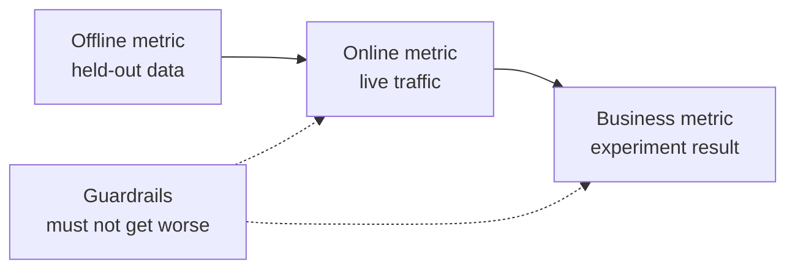

# 机器学习系统设计: समस्या से लेकर तैनात मॉडल तक

> 模型只是系统的一部分──设计决定模型预测什么、谁根据预测采取行动、成本是多少,以及失败时如何处理──

**Type:** Build
**Languages:** Python
**Prerequisites:** 阶段 2，第 09 课（模型评估）和第 13 课（ML 流水线）
**Time:** 约 110 分钟

## 学习目标

- व्यावसायिक समस्याओं को एमएल कार्य के रूप में परिभाषित करना, पूर्वानुमान सामग्री को स्पष्ट करना, पूर्वानुमान का उपयोग करना, और समस्या के समाधान के लिए नियम कम होने के कारण
- ऑनलाइन ऑनलाइन व्यापार और देखभाल सूचकांक को अलग करना, प्रत्येक मॉडल को सरल आधार लाइन और प्रारंभ आधार लाइन से तुलना करना
- प्रवाह अनुमानित मात्रा अनुमान और ऑनलाइन अनुमानित दैनिक लागत, देरी और डेटा की पुरानी मात्रा के आधार पर
- 选择发布方式(影子、金丝雀、A/B 测试),并为每种故障模式选择安全默认行为
- 识别模型 कैसे निर्णय के माध्यम से परिवर्तन करने के लिए निम्नलिखित संस्करण प्रशिक्षण डेटा के उलट चक्र
- 编写 ML 设计文档,并按固定检查清单评分

## 问题

एक ग्राहक कंपनी ने एक प्रक्षेपण मॉडल बनाने की मांग की। डेटा वैज्ञानिकों ने एक तरक्की वृद्धि वर्गीकरण उपकरण को प्रशिक्षित किया, रिपोर्ट एयूसी 0.91 तक पहुंच गया। तीन महीने बाद, कोई भी इसका उपयोग नहीं करता है।

原因与算法无关──没有人决定分数应触发什么行动──分数每周只更新一次,但客户挽留团队每天都打电话──标签来自取消订阅表,而该表还存储取消原因,因此某特征直接包含答案──也没有人把模型与客户团队原始规则比较:给连续两周不活跃的客户打电话──

ये असफलताएं प्रशिक्षण शुरू होने से पहले ही दफन हो चुकी हैं। ये सभी डिजाइन विफलताएं हैं, और एक पृष्ठ डिजाइन दस्तावेज़ एक-एक करके प्रश्न पूछ सकता है।

## 核心概念

### व्यावसायिक लक्ष्य से एमएल कार्य तक

व्यवसायिक लक्ष्य ML 任务 के बराबर नहीं है  इसे चार प्रश्नों के साथ कार्य में परिवर्तित करेंः

1. 模型具体预测什么,预测对象是什么实体?
2. भविष्यवाणी का उपयोग किस निर्णय प्रणाली द्वारा किया जाता है?
3. क्या समय पूर्वानुमान की आवश्यकता है, उस समय क्या डेटा उपलब्ध है?
4. निर्णय लेने में सुधार कैसे हुआ?

| 业务目标 | 预测 | 使用预测的决策 | ML 任务 |
|---|---|---|---|
| 减少流失 | 用户未来 30 天取消订阅的概率 | 每晚向风险最高的 5% 用户发送挽留优惠 | 二分类 |
| 减少欺诈损失 | 一笔支付属于欺诈的概率 | 在 100 ms 内批准、送审或阻止 | 二分类 |
| 保持货架有货 | 下周各门店每天的销售件数 | 各门店订货量 | 预测 |
| 展示相关商品 | （用户，商品）对的相关性分数 | 信息流中的商品顺序 | 排序 |

दूसरा सबसे ज्यादा विस्तार से परिभाषित करना चाहिए।  पूर्वानुमान प्रवाह  कोई स्पष्ट समय विंडो नहीं है  वस्तुओं और कार्यों  पूर्वानुमान यह है कि क्या यह उपयोगकर्ता भविष्य में 30 दिनों में सदस्यता समाप्त करेगा, चलो आज रात के कार्य का निर्णय कौन लाभ प्राप्त करेगा                                                                                                                                                                                                                                 

### 何時不应使用 ML

Google नियम मशीन लर्निंग  के नियम 1  सुझाव, मत डरना शुरू करें मशीन लर्निंग के उत्पादों का उपयोग नहीं करना चाहिए।

- 简短规则可以实现目标,并能持续保持正确――规则运行、测试和解释的成本较低――
-  कोई टैग नहीं, न ही कोई व्यावहारिक संग्रह विधि है
- भविष्यवाणी के अनुसार कोई कार्रवाई नहीं करेगा, इसलिए भविष्यवाणी अधिक सटीक नहीं होगी।
- 预测时可用数据不含所需信号──
- एक बार गलती भी स्वीकार नहीं की जा सकती है, और कोई भी बाहर आ सकता है।
-  बेहतर निर्णय लेने के मूल्य से अधिक लागत का निर्माण और संचालन प्रणाली 

जब नियम लम्बे और कमजोर होते हैं, तो एमएल को निवेश करने लायक होना शुरू होता है। उसी दिशा के नियम 3 में, जटिल आरंभिक नियमों के बजाय एमएल का उपयोग करने की सलाह दी जाती है, क्योंकि सीखने वाले मॉडल को अपडेट और बनाए रखना आसान होता है।

### तीन स्तरीय सूचक

तीन स्तरों में मापने के लिए एक ही समय में एक सीमा सेट करेंः

| 层面 | 何时能测量 | 流失预测示例 |
|---|---|---|
| 离线指标 | 上线前，在留出的历史数据上 | 优惠阈值处的 F1、风险最高 5% 中的精确率 |
| 在线指标 | 上线期间，在真实流量上 | 优惠接受率、已评分用户比例、分数分布 |
| 业务指标 | 上线数周后，通过实验 | 干预组与保留对照组的 30 天流失率 |
| 护栏指标 | 始终监测 | 每挽留一名用户的优惠成本、退订率、p99 延迟 |



विभिन्न स्तरों में अक्सर अलग-अलग निष्कर्ष दिए जाते हैं। ऑनलाइन सूचकांक का आकलन ऐतिहासिक डेटा है, जबकि अतीत में आपके मॉडल नहीं हैं। ऑनलाइन सूचकांक निर्णयों पर लोगों की प्रतिक्रिया पर निर्भर करता है।

选择与决策匹配的离线指标――如果任务与风险最高的5%用户,就测量这一5%中精确率――AUC सभी值综合评估, जिनमें आप कभी उपयोग न करने वाले值 शामिल हैं――同一指南的规则2 要求先设计并实现指标,再决定ML系统具体做什么――

### 基线

孤立的指标没有意义――यदि सर्वोत्तम विकल्प केवल 0.30,F1 达到0.56 तो बहुत अच्छा है; यदि एक नियम 0.60 तक पहुंच सकता है, तो यह बहुत खराब है―― प्रत्येक मॉडल को तीन प्रकार के आधार लाइनों के साथ तुलना करना चाहिएः

- **简单基线。**始终预测多数类别,或始终预测训练集平均值──模型评估课使用过这种检查──
- **启发式基线。**क्षेत्र के ज्ञान के नियमों से, या प्रशिक्षण डेटा पर उपयुक्त एकल विशेषता मूल्य से।
- **现有系统。**निर्णय लेने का तरीका, भले ही यह केवल एक व्यक्ति का इलेक्ट्रॉनिक रूपरेखा का उपयोग कर रहे हो।

升级量是模型分数减强基线分数―― 升级要求在查看结果前设定最低升级要求,并确保它足以覆盖额外系统成本―― 简单基线通常很弱,启动基线才是真正难以击败的对手――

### आंकड़े और लेबल आवश्यकता

训练前回答这些问题:

- **标签来源。**किस घटना का नामकरण किया गया है, इसके लिए कौन जिम्मेदार है?
- **标签延迟。**预测后多久才知道真实结果? धोखाधड़ी से इनकार करना संभव है भुगतान के कुछ हफ्तों बाद दिखाई दें;流失标签 预测窗口 समाप्त हो गया है।
- **标签质量。** कौन चिह्नित, बाहर गलत आवृत्ति अधिक उच्च?
- **预测时的可用性。**क्या प्रत्येक लक्षण पूर्वानुमान के दौरान मौजूद है? परिणाम उत्पन्न होने के बाद ही लक्षणों को प्रशिक्षण में लेबल के रूप में प्रकट किया जाएगा।
- **各类样本量。**केवल दो सौ ही असली नमूने होते हैं, आमतौर पर केवल सरल मॉडल का उपयोग किया जाता है।
- **时间切分。**留出最近一段时间── समय क्रम क्रम क्रम क्रम क्रम क्रम क्रम क्रम क्रम क्रम क्रम क्रम क्रम क्रम क्रम क्रम क्रम क्रम क्रम क्रम क्रम क्रम क्रम क्रम क्रम क्रम क्रम क्रम क्रम क्रम क्रम क्रम क्रम क्रम क्रम क्रम क्रम क्रम क्रम क्रम क्रम क्रम क्रम क्रम क्रम क्रम क्रम क्रम क्रम क्रम क्रम क्रम क्रम क्रम क्रम क्रम क्रम क्रम क्रम क्रम क्रम क्रम क्रम क्रम क्रम क्रम क्रम क्रम क्रम क्रम क्रम क्रम क्रम क्रम क्रम क्रम क्रम क्रम क्रम क्रम क्रम क्रम क्रम क्रम क्रम क्रम क्रम क्रम क्रम क्रम क्रम क्रम क्रम क्रम क्रम क्रम क्रम क्रम क्रम क्रम क्रम क्रम क्रम क्रम क्रम क्रम क्रम क्रम क्रम क्रम क्रम क्रम क्रम क्रम क्रम क्रम क्रम क्रम क्रम क्रम क्रम क्रम क्रम क्रम क्रम क्रम क्रम क्रम क्रम क्रम क्रम क्रम क्रम क्रम क्रम क्रम क्रम क्रम क्रम क्रम क्रम क्रम क्रम क्रम क्रम क्रम क्रम क्रम क्रम क्रम क्रम क्रम क्रम क्रम क्रम क्रम क्रम क्रम क्रम क्रम क्रम क्रम क्रम क्रम क्रम क्रम क्रम क्रम क्रम क्रम क्रम क्रम क्रम क्रम क्रम क्रम क्रम क्रम क्रम क्रम क्रम क्रम क्रम क्रम क्रम क्रम क्रम क्रम क्रम क्रम क्रम क्रम क्रम क्रम क्रम क्रम क्रम क्रम क्रम क्रम क्रम क्रम क्रम क्रम क्रम क्रम क्रम क्रम क्रम क्रम क्रम क्रम क्रम क्रम क्रम क्रम क्रम क्रम क्रम क्रम क्रम क्रम क्रम क्रम क्रम क्रम क्रम क्रम क्रम क्रम क्रम क्रम क्रम क्रम क्रम क्रम क्रम क्रम क्रम क्रम क्रम क्रम क्रम क्रम क्रम क्रम क्रम क्रम क्रम क्रम क्रम क्रम क्रम क्रम क्रम क्रम क्रम क्रम क्रम क्रम क्रम क्रम क्रम क्रम क्रम क्रम क्रम क्रम क्रम क्रम क्रम क्रम क्रम क्रम क्रम क्रम क्रम क्रम क्रम क्रम क्रम क्रम क्रम क्रम क्रम क्रम क्रम क्रम क्रम क्रम क्रम क्रम क्रम क्रम क्रम क्रम क्रम क्रम क्रम क्रम क्रम क्रम क्रम क्रम क्रम क्रम क्रम क्रम क्रम क्रम क्रम क्रम क्रम क्रम क्रम क्रम क्रम क्रम क्रम क्रम क्रम क्रम क्रम क्रम क्रम क्रम क्रम क्रम क्रम क्रम क्रम क्रम क्रम क्रम क्रम क्रम क्रम क्रम क्रम क्रम क्रम क्रम क्रम क्रम क्रम क्रम क्रम क्रम क्रम क्रम क्रम क्रम क्रम क्रम क्रम क्रम क्रम क्रम क्रम क्रम क्रम क्रम क्रम क्रम क्रम क्रम क्रम क्रम क्रम क्रम क्रम क्रम क्रम क्रम क्रम क्रम क्रम क्रम क्रम क्रम क्रम क्रम क्रम क्रम क्रम क्रम क्रम क्रम क्रम क्रम क्रम क्रम क्रम क्रम क्रम क्रम क्रम क्रम क्रम क्रम क्रम क्रम क्रम क्रम क्रम क्रम क्रम क्रम क्रम क्रम क्रम क्रम क्रम क्रम क्रम क्रम क्रम क्रम क्रम क्रम क्रम क्रम क्रम क्रम क्रम क्रम क्रम क्रम क्रम क्रम क्रम क्रम क्रम क्रम क्रम क्रम क्रम क्रम क्रम क्रम क्रम क्रम क्रम क्रम क्रम क्रम क्रम क्रम क्रम क्रम क्रम क्रम क्रम क्रम क्रम क्रम क्रम क्रम क्रम क्रम क्रम क्रम क्रम क्रम क्रम क्रम क्रम क्रम क्रम क्रम क्रम क्रम क्रम क्रम क्रम क्रम क्रम क्रम क्रम क्रम क्रम क्रम क्रम क्रम क्रम क्रम क्रम क्रम क्रम क्रम क्रम क्रम क्रम क्रम क्रम क्रम क्रम क्रम क्रम क्रम क्रम

### 延迟、吞吐量和成本预算

तीन संख्यात्मक बंधन प्रत्येक प्रकार की सेवा डिजाइनः

- **延迟预算。**p99 延迟是100 अनुरोधों में से 99 低于耗时的. भुगतान जांच 50 ms की आवश्यकता हो सकती है; रात में रिपोर्टिंग के लिए कुछ घंटे चल सकते हैं.
- **峰值吞吐量。**按最忙一分钟而非日均流量配置系统──峰值 QPS(प्रति सेकंड अनुरोध संख्या)往往是平均值的数倍──
- **成本预算。**प्रति दिन डॉलर की लागत या प्रति 1000 बार अनुमानित डॉलर की लागत का उपयोग करके, तुलनात्मक रूप से सरल है।

छोटे नियम पहले दो को जोड़ेंगेः प्रसंस्करण में अनुरोधों की संख्या व्युत्पन्नता को देरी से गुणा करने के बराबर है। यदि प्रति सेकंड 400 अनुरोधों का उपयोग किया जाता है, तो प्रत्येक 50 एमएस का उपयोग करता है, तो औसत में 20 अनुरोध प्रसंस्करण में हैं।

### 批量推理与在线推理

提供预测 दो प्रकार के बुनियादी तरीके हैंः

- **批量推理。**定時任務 प्रत्येक इकाई के लिए मूल्यांकन, होगा अंक लिखने या कुंजी मूल्य भंडारण में 定時任務 हेतु 定時任務, होगा अंक लिखने या कुंजी मूल्य भंडारण में 定時任務, होगा 定時任務, होगा 定時任務, होगा 定時任務, होगा 定時任務, होगा 定時任務, होगा 定時任務, होगा 定時任務, होगा 定時任務, होगा 定時任務, होगा 定時任務, होगा 定時任務, होगा 定時任務, होगा 定時任務, होगा 定時任務, होगा 定時數, होगा 定時數, होगा 定時數, होगा 定時數, होगा 定時數, होगा 定時數, होगा 定時數, होगा 定時數, होगा 定時數, होगा 定時數, होगा 定時數
- **在线推理。** अनुप्रयोग अनुरोध पर पहुँचते समय विशेषताएं मॉडल सेवा को भेजें, प्रत्याशा करें कि अंक वापस आएँ

| 属性 | 批量 | 在线 |
|---|---|---|
| 新鲜度 | 距离上次运行的时间，加上运行耗时 | 使用当前请求的数据 |
| 请求延迟 | 一次键值读取，几毫秒 | 特征获取时间加模型耗时 |
| 成本驱动因素 | 实体数乘以每天运行次数 | 按峰值 QPS 配置的副本数 |
| 新实体 | 下一次运行前没有分数 | 第一次请求时即可评分 |
| 故障时 | 旧分数仍可读取 | 请求失败或超时 |

इस पाठ्यपुस्तक में दो लागतों का अनुमान लगाया गया है। वस्तुओं की संख्या और दैनिक परिचालन की संख्या के साथ-साथ वस्तु लागत में वृद्धि हुई है। यह समय को कम करने की अनुमति देता है, परिचालन को अधिक बार होता है।

混合设计 बहुत आम हैः रात में बैच टास्क पहले से ही उपयोगकर्ता को रेटिंग देते हैं, ऑनलाइन मार्ग नए उपयोगकर्ताओं और नए डेटा की आवश्यकता के अनुरोधों को संसाधित करते हैं।

### 部署模式

नया मॉडल分阶段接触用户:

1. **影子运行（Shadow）。**नई मॉडल वास्तविक प्रवाह की एक प्रति प्राप्त करती है। सिस्टम रिकॉर्ड पूर्वानुमान, लेकिन इसका उपयोग नहीं करती है।
2. **金丝雀发布（Canary）。**नए मॉडल के लिए एक छोटे से हिस्से के लिए वास्तविक निर्णय लेने, आम तौर पर 1% से 5% तक शुरू होते हैं।
3. **A/B 测试。**随机分组的用户分别使用不同模型──统计检查测测业务指标,需要足够的流量和时间才能清晰的差异──

प्रत्येक चरण को कुछ मिनटों में पूरा करने के लिए रील करना आवश्यक है।[影子与金丝雀发布课](../../../17-infrastructure-and-production/20-shadow-canary-progressive/docs/en.md)和 [A/B 测试课](../../../17-infrastructure-and-production/21-ab-testing-llm-features/docs/en.md)भाषा मॉडल के लिए तीन प्रकार की व्याख्या

### प्रति चक्र

जब मॉडल के निर्णय निम्न संस्करण के प्रशिक्षण डेटा में परिवर्तन करते हैं, तो एक विपरीत चक्र होता है। स्कली  आदि सीधे और छिपे हुए विपरीत चक्र को एमएल  प्रणाली प्रौद्योगिकी ऋण के मुख्य स्रोत के रूप में वर्गीकृत करते हैं। तीन सामान्य परिस्थितियां हैंः

- **干预隐藏标签。**流失模型发送优惠,挽留了部分用户──下个月,高风险用户看起来很忠诚,重新训练的模型便学到这些特征不能预测流失──
- **被阻止的行动没有结果。** धोखाधड़ी मॉडल एक भुगतान को रोकता है, यह भुगतान पर कभी भी अस्वीकार करने के लिए एक संकेत उत्पन्न नहीं होगा।
- **曝光限制反馈。**排序模型 केवल पहले के सामानों पर ही प्रदर्शित होता है, इसलिए केवल इन वस्तुओं को ही क्लिक प्राप्त होता है।

修复方法 का साझा विचार कुछ अप्रभावित मॉडल डेटा को संरक्षित करना है 随机保留一小组永不接受干预的用户; कुछ मात्रा में प्रवाह को यादृच्छिक वितरण निर्णय देना; प्रत्येक नमूना रिकॉर्ड के साथ अंक और निर्णय, ताकि बाद की प्रशिक्षण प्रभावित डेटा और शुद्ध डेटा में अंतर कर सके

### विकार मोड तथा सुरक्षा

系统的每部分迟早会失败――विविध प्रकार के दोषों के लिए डिझाइन चरण में निर्णय लेना चाहिए, दुर्घटना के दौरान नहींः

| 故障 | 没有预案时的结果 | 安全默认行为 |
|---|---|---|
| 模型服务超时 | 请求失败 | 使用启发式基线 |
| 夜间批任务失败 | 分数缺失或过旧 | 在固定期限内提供最近的正常分数，之后使用规则 |
| 特征缺失或越界 | 模型对坏输入评分 | 使用文档规定的默认值，并记录事件 |
| 新实体没有历史 | 没有分数 | 使用规则或总体均值 |
| 分数分布突然变化 | 大规模错误决策 | 暂停自动行动，并通知人工处理 |

यह भी अधिकांश दोषों का पूर्वनिर्धारित कार्यक्रम है, इसलिए इसे पहले लागू करना चाहिए।

### 设计文档

设计文档在训练开始前集中记录上述决策――本课检查器为其JSON 版本评分―― इनमें से छह जांच项目具有阻塞性,因为任一缺失都会使系统不安全或无用:

| 章节 | 回答的问题 | 阻塞条件 |
|---|---|---|
| 问题 | 预测什么，哪项决策使用它，为什么规则不够？ | 必须明确决策 |
| 指标 | 适用哪些离线、在线、业务和护栏指标？ | 必须明确业务指标 |
| 基线 | 适用哪些简单、启发式和现有系统基线？ | 必须有启发式或现有系统基线 |
| 数据 | 标签来自哪里、延迟多久，每个特征预测时是否可用？ | 不得泄露标签 |
| 预算与服务 | 有哪些延迟、峰值 QPS、成本和陈旧时间限制，哪种模式满足它们？ | 无 |
| 发布 | 使用哪些影子、金丝雀及 A/B 阶段，如何回滚？ | 必须有影子或金丝雀阶段，以及回滚 |
| 反馈循环 | 模型如何改变未来数据，如何保留干净数据？ | 无 |
| 故障模式 | 每种故障的默认行动是什么？ | 每种故障都必须有默认行为 |
| 监控 | 上线后观察什么？ | 无 |

```figure
mlprod-serving-cost
```

## शून्य से निर्माण

`code/main.py`️ केवल मानक पुस्तकालय का उपयोग करें, जिसमें तीन उपकरण शामिल हैंः सेवा लागत मॉडल, आधार लाइन तुलना और डिजाइन दस्तावेज़ जांचकर्ता।

### पहला चरण: विवरण कार्यभार एवं मूल्य

工作负载保存流量与预算数字,成本模型保存价格── ये मूल्य अभ्यास के लिए एक समग्र संख्यात्मक उदाहरण हैं, आपूर्तिकर्ता की पेशकश नहीं हैं──

```python
@dataclass(frozen=True)
class Workload:
    name: str
    entities: int
    requests_per_day: int
    peak_qps: float
    max_staleness_hours: float
    latency_budget_ms: float


@dataclass(frozen=True)
class CostModel:
    batch_dollars_per_million: float = 0.40
    batch_job_hours: float = 1.0
    lookup_dollars_per_million: float = 0.25
    lookup_latency_ms: float = 4.0
    replica_dollars_per_hour: float = 0.50
    replica_qps: float = 200.0
    min_replicas: int = 2
    online_latency_ms: float = 35.0
```

### चरण 2: गणना मात्रा और ऑनलाइन सेवा लागत

批次任务必须在陈旧时间上限内完成――两次运行间隔等于上限减去任务耗时――无论有人请求分数,每次运行都给所有实体评分――

```python
def batch_plan(workload: Workload, costs: CostModel) -> ServingPlan:
    refresh_hours = workload.max_staleness_hours - costs.batch_job_hours
    if refresh_hours <= 0:
        return ServingPlan(
            "batch", False, math.inf, costs.lookup_latency_ms, math.inf, 0.0,
            "staleness limit is shorter than one batch job",
        )
    runs_per_day = 24.0 / refresh_hours
    predictions = workload.entities * runs_per_day
    dollars = (
        predictions / 1e6 * costs.batch_dollars_per_million
        + workload.requests_per_day / 1e6 * costs.lookup_dollars_per_million
    )
    ...
```

ऑनलाइन सेवा के लिए भुगतान की आवश्यकता है, ताकि उपलब्धता सुनिश्चित करने के लिए अधिकतम मूल्य के लिए पर्याप्त प्रतिलिपि बनाए रखें और कम से कम दो प्रतिलिपि बनाए रखेंः

```python
def online_plan(workload: Workload, costs: CostModel) -> ServingPlan:
    replicas = max(costs.min_replicas, math.ceil(workload.peak_qps / costs.replica_qps))
    dollars = replicas * costs.replica_dollars_per_hour * 24.0
    feasible = costs.online_latency_ms <= workload.latency_budget_ms
    ...
```

`choose_serving` चयन पूरा करने के लिए देरी और पुराने समय सीमा के कार्यक्रम, सबसे सस्ता पर लौटें.`None`, सुझाव आप बजट समायोजित करने की जरूरत है

### तीसरा चरण: मॉडल की तुलना आधार रेखा से करें

तुलनात्मक उपकरण एक ही सूचक मूल्यांकन मॉडल और सभी आधार लाइनों के साथ। यह अपेक्षाकृत सबसे मजबूत और सबसे कमजोर आधार लाइनों के उन्नयन की गणना करता है।

```python
def compare_to_baselines(
    y_true: list,
    model_pred: list,
    baselines: dict[str, list],
    metric,
    metric_name: str,
    higher_is_better: bool = True,
    min_lift: float = 0.02,
) -> BaselineReport:
    if not baselines:
        raise ValueError("a model needs at least one baseline")
    scores = {name: metric(y_true, pred) for name, pred in baselines.items()}
    pick = max if higher_is_better else min
    best_name = pick(scores, key=scores.get)
    model_score = metric(y_true, model_pred)
    lift = model_score - scores[best_name] if higher_is_better else scores[best_name] - model_score
    return BaselineReport(metric_name, {"model": model_score, **scores}, best_name, lift, min_lift)
```

启发式基线是单特征规则──`fit_rule`प्रशिक्षण डेटा पर प्रत्येक विशेषता को क्रमशः मूल्य के रूप में मानें, F1 के सर्वोत्तम मूल्य को बनाए रखें।

### 第4 步:为设计文档评分

प्रत्येक जांच में कुंजी, शक्ति, बाधा चिन्ह, संदेश और जांच फ़ंक्शन शामिल हैं।

```python
CheckItem("decision", 2, True, "name the action that uses each prediction", lambda d: _text(d, "problem.decision")),
CheckItem("baselines", 2, True, "add a heuristic or current-system baseline", check_baselines),
CheckItem("no_leakage", 2, True, "confirm every feature exists at prediction time",
          lambda d: get_path(d, "data.features_available_at_prediction_time") is True),
CheckItem("serving_fit", 1, False, "pick a serving mode that meets the staleness, latency, and cost budgets",
          check_serving_fit),
```

`check_serving_fit`复用成本模型,文件读取负载数字,并估计选定模式的成本── यदि यह मॉडल पुराने समय सीमा 延迟预算或每日成本预算 को पूरा नहीं कर सकता है, तो चेक विफल हो जाता है──声明采用批, लेकिन केवल तीन मिनट के लिए अनुमति देता है 陈旧时间的文件不能通过──成本模型没有混合方案,因此声明混合的文件也会失败,直到你加入该方案在练习1中──

`review_design_doc`इस पर विचार करने के लिए, केवल 0.85 तक पहुंचने के बाद ही सभी बाधाओं को पारित किया जा सकता है, निष्कर्ष केवल समीक्षा के लिए तैयार है।

### 第5 步:运行

```bash
python3 code/main.py
```

```console
nightly churn scores
  ok batch        $0.91/day      4 ms  1.0 runs per day over 2,000,000 entities
  ok online      $24.00/day     35 ms  2 replicas sized for 40 peak QPS
  choose: batch

feed ranking, 2-hour freshness
  ok batch       $48.50/day      4 ms  24.0 runs per day over 5,000,000 entities
  ok online      $24.00/day     35 ms  2 replicas sized for 120 peak QPS
  choose: online

=== Model versus baselines (churn, metric F1) ===
  model                    0.564
  days_idle > 12.8688      0.500
  random at base rate      0.232
  majority class           0.000
  model beats the strongest baseline (days_idle > 12.8688) by +0.064
```

अधिकांश प्रकार की आधार रेखाओं के F1 का आकार 0 है, क्योंकि यह अप्रत्याशित रूप से गायब है। इसके बाद के नियम केवल वास्तविक प्रतियोगी हैं। मॉडल इसके 0.064 से अधिक है, इसलिए मॉडल का उपयोग करने के लिए कोई कारण नहीं है। यदि विशेषताएं कमजोर हैं, तो नियम जीत सकते हैं, इस समय नियम ही प्रणाली है जिसे तैनात किया जाना चाहिए।

设计文档评审会印缺少六阻塞项的薄弱文档,以及 1.00 अंक का पूर्ण文档──传入路径可评审您自己的文档:

```bash
python3 code/main.py my_design_doc.json
```

## उपयोग करें

工具包 प्रत्येक भाग टीम द्वारा उत्पादन में उपयोग किए जाने वाले उपकरण के लिए है।

**基线。**स्किट-लर्न एक आकलनकर्ता के रूप में सरल आधार लाइनों को लागू करेगा, इसलिए वे मॉडल के साथ एक ही प्रवाह में डाल सकते हैंः

```python
from sklearn.dummy import DummyClassifier, DummyRegressor
from sklearn.metrics import f1_score

majority = DummyClassifier(strategy="most_frequent").fit(X_train, y_train)
base_rate = DummyClassifier(strategy="stratified", random_state=0).fit(X_train, y_train)
mean_value = DummyRegressor(strategy="mean").fit(X_train, y_reg_train)

print(f1_score(y_test, majority.predict(X_test)))
```

`most_frequent`                                                                                                                                                                                                                                                                                                                                                                                                                                                                                                                             `majority_baseline`,`stratified`                                                                                                                                                                                                                                                                                                                                                                                                                                                                                                                             `base_rate_baseline`छोटा-शिक्षा  कोई प्रारम्भिक आधार नहीं है, क्योंकि प्रारम्भिक नियम आपके विशिष्ट क्षेत्र से आते हैं

**批量服务。**अपाचे एयरफ्लो, डैगस्टर आदि काम प्रवाह调度器运行评分任务,任务将分数写入数仓表,或Redis、DynamoDB等键值存储──

**在线服务。**KServe、BentoML、NVIDIA Triton、TorchServe आदि मॉडल सर्वर मॉडल को HTTP या gRPC 端点后 में कवर करेगा।

**发布。**Argo Rollouts आदि Kubernetes  उपकरण                                                                                                                                                                                                                                                                                                                                                                                                                                                                                                                   

**设计评审。**ब्रेक  व अन्य द्वारा प्रकाशित एमएल टेस्ट स्कोर में एमएल सिस्टम के उत्पादन के लिए आवश्यक 28 项 परीक्षण एवं निगरानी आवश्यकताएँ शामिल हैं।

## 交付成果

本课产 出 `outputs/skill-ml-design-review.md` इस कौशल को चरणबद्ध रूप से समीक्षा करें, प्राथमिकता से बाधाओं की कमी का उल्लेख करें, और इस पाठ्यक्रम की मात्रा एवं ऑनलाइन लागत गणना परीक्षण सेवा चयन करें

## अभ्यास

1. `choose_serving`添加混合方案:批量为已用户评分,在线为新用户评分――比较日费――
2. 修改流失数据,直到模型不再胜过规则──报告使提升消失的最小系数变动──
3. में जाँच सूची जोड़ा `budgets.max_dollars_per_1k_predictions`项,并编写缺少项时会失败的测试──
4.                                                                                                                                                                                                                                                               
5. 模拟流失反循环: हटाना प्राप्त लाभ उपयोगकर्ता के टैग, पुनः प्रशिक्षण,并测量 F1 के परिवर्तनों

## 关键术语

| 术语 | 常见说法 | 实际含义 |
|------|----------------|----------------------|
| ML 任务 | “做一个流失模型” | 预测目标、实体、时间窗口，以及使用预测的决策 |
| 离线指标 | “模型分数” | 上线前在留出的历史数据上计算的指标 |
| 在线指标 | “实时数据” | 模型运行时在真实流量上测量的指标 |
| 业务指标 | “目标” | 决策必须改变、通过实验测量的公司业务结果 |
| 护栏指标 | “不要造成损害” | 新模型上线时不能变差的指标 |
| 基线 | “简单模型” | 模型必须以规定幅度超越的简单、启发式或现有系统预测器 |
| 批量推理 | “预先算好的分数” | 定时任务为每个实体评分并存储结果，供查询使用 |
| 在线推理 | “实时模型” | 每个请求到达时由模型评分 |
| 影子部署 | “暗发布” | 新模型对真实流量评分，但无人使用输出 |
| 金丝雀发布 | “逐步上线” | 新模型为逐渐扩大的小部分流量决策，同时备好回滚 |
| 反馈循环 | “模型训练自己” | 模型决策改变下一版本的训练数据 |

## 延伸阅读

- [Sculley et al., Hidden Technical Debt in Machine Learning Systems (NeurIPS 2015)](https://papers.nips.cc/paper/2015/hash/86df7dcfd896fcaf2674f757a2463eba-Abstract.html): प्रति  चक्र  परस्पर 合, तथा मॉडल के आसपास के सिस्टम लागत
- [Google, Rules of Machine Learning](https://developers.google.com/machine-learning/guides/rules-of-ml): प्रथम मॉडल, सूचक एवं प्रशिक्षण एवं सेवा अनुरूपता के व्यावहारिक नियम
- [Breck et al., The ML Test Score (IEEE Big Data 2017)](https://research.google/pubs/the-ml-test-score-a-rubric-for-ml-production-readiness-and-technical-debt-reduction/): उत्पादन की मात्रा मापने के 28 项测试
- [Kohavi, Tang, and Xu, Trustworthy Online Controlled Experiments (Cambridge University Press, 2020)](https://experimentguide.com/): कैसे चलें ताकि विश्वसनीय निष्कर्ष निकाले जा सकें
- [Sato, Wider, and Windheuser, Continuous Delivery for Machine Learning (2019)](https://martinfowler.com/articles/cd4ml.html): संस्करणकृत डेटा, मॉडल और तैनाती प्रवाह
- [Google Cloud, MLOps: Continuous delivery and automation pipelines in machine learning](https://cloud.google.com/architecture/mlops-continuous-delivery-and-automation-pipelines-in-machine-learning)प्रशिक्षण और सेवा स्वचालन के तीन परिपक्वता स्तर
