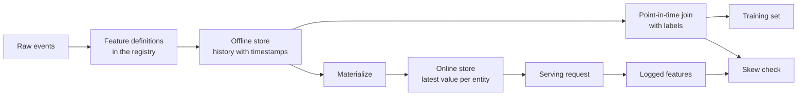

# भंडारण और प्रशिक्षण के बीच सेवा अंतर

> एक विशेषता केवल एक परिभाषा है, लेकिन दो पढ़ने के तरीके हैं। प्रशिक्षण प्रत्येक टैग के समय के ऐतिहासिक मूल्य को पढ़ता है, ऑनलाइन सेवा नवीनतम मूल्य को पढ़ता है।

**Type:** Build
**Languages:** Python
**Prerequisites:** Phase 2，第 08 课（特征工程）、第 13 课（机器学习流水线）、第 15 课（时间序列）和第 19 课（机器学习系统设计）
**Time:** ~100 分钟

## 学习目标

- स्पष्टीकरण ऑफ़लाइन भंडारण, ऑनलाइन भंडारण, वस्तु, घटना समय और टीटीएल के अर्थ तथा उनके दायित्व
- 实现时点正确的关联,并展示简单关联如何将未来值复制到训练数据中
- 列出训练服务偏差的四个原因:两条代码路径、特征陈旧、默认值不同和时间穿越
- ् ापयोगी सुविधाओं का निर्माण, प्रशिक्षण मार्गों और सेवा मार्गों के उपयोग के लिए एक ही परिभाषा का उपयोग करें
- पिछले दिनों में नए लक्षणों को पुनः भरें, प्रत्येक दिन के बाद के आंकड़ों को न पढ़ें
- एक ही वस्तु और समय के लिए, सेवा की तुलना में विशेषताएं और प्रशिक्षण मार्ग से उत्पन्न विशेषताएं, ताकि अंतर का पता लगाया जा सके

## 问题

एक टीम ने उपयोगकर्ता के लिए एक मॉडल बनाया है। प्रत्येक टैग ने बताया कि क्या उपयोगकर्ता ने टैग के दिन के 30 दिनों के भीतर कोई खरीद नहीं की है।`user_id`टैग और उपयोगकर्ता विशेषताएँ`days_since_last_purchase`訓練一条规则──离线准确率 0.948──

वास्तविक प्रवाह में, यह मॉडल पुराने से भिन्न है, सरल संस्करणों में। विशेषता सूची प्रत्येक उपयोगकर्ता के नवीनतम मान को संग्रहीत करती है, जिसका समय टैगिंग दिन से कुछ सप्ताह पीछे है। किसी उपयोगकर्ता की अंतिम खरीद 115 दिन में हुई, 175 दिन के त्वरित चित्रण में पहले से ही 60 दिन में तैनात है, इसलिए विशेषता स्वयं में उत्तर शामिल है। साथ ही, एक अन्य टीम ने विभिन्न सेवाओं में ऑनलाइन विशेषता गणना तर्क को फिर से लिखा है। उनकी 30 दिन की खिड़की में एक दिन से अधिक शामिल है, नए उपयोगकर्ता का डिफ़ॉल्ट मान भी -1 है, 365 नहीं है।

इन दो दोषों के कारण एक ही हैंः प्रशिक्षण और ऑनलाइन सेवा दो अलग-अलग तरीकों से एक ही विशेषता की गणना करती है। इस पाठ्यक्रम में विशेषता भंडार के प्रत्येक भाग को शून्य से बनाएगा।

## 概念

### एक ही विशेषता के दो पठन

 प्रशिक्षण और ऑनलाइन सेवा के लिए विशेषता के अनुरोध के रूप में भिन्नः

| 属性 | 训练（离线） | 服务（在线） |
|---|---|---|
| 问题 | “一千万个（实体，时间）组合各自对应的值是什么？” | “这个实体现在的值是什么？” |
| 时间 | 过去的多个时点 | 当前 |
| 数据量 | 每个任务数百万行 | 每次请求一行 |
| 延迟 | 可以接受数分钟 | 几毫秒 |
| 存储 | 离线存储：在列式文件或数据仓库中保存带时间戳的完整历史 | 在线存储：在键值数据库中保存每个实体的最新值 |

विशेषता भंडारण एक ही समूह की विशेषताओं के अनुसार परिभाषित भंडारण के इन दो प्रकारों को भरना। भौतिककरण (materialisation) नवीनतम मूल्य को ऑफ़लाइन भंडारण से ऑनलाइन भंडारण के लिए कॉपी करने का कार्य है।



### 实体、时间与TTL

प्रत्येक विशेषता चार शब्दों में वर्णित की जा सकती हैः

- **实体（Entity）。**विशेषताएं जो वस्तु के की का वर्णन करती हैं, उदाहरण के लिए `user_id`या `card_id`
- **事件时间戳（Event timestamp）。**इस घटना का समय 14 दिन है।
- **创建时间戳（Created timestamp）。**系统写入该行的时刻──今日执行的回填会写入事件时间早些、创建时间为当前时间的行──
- **TTL（time to live，生存时间）。** अधिकतम आयु प्राप्त करने की अनुमति                                                                                                                                                                                                                                                           

具有相同实体、数据源和TTL的一组特征,通常称为特征视图(特征视图) 

### 时点正确的关联

एक पंक्ति प्रशिक्षण डेटा को प्रत्येक टैग के लिए निम्नलिखित चरणों को लागू करने के लिए टैग और टैग के समय पहले से मौजूद विशेषता मूल्य के साथ जोड़ा जाना चाहिएः

1. 找到同一实体的特征行──
2. केवल घटना का समय                                                                                                                                                                                                                                                             
3. 取其中最新的一行──
4. यदि टैग समय घटाने से घटना समय TTL से अधिक हो तो इस पथ को त्याग दिया जाए।

नीचे एक उपयोगकर्ता के 16वें दिन के टैग और प्रति सप्ताह उत्पन्न होने वाली विशेषताएं दिखाएंः

| 特征行日期 | `purchases_30d` | 时点关联 | 仅按 `user_id` 进行朴素关联 |
|---|---|---|---|
| 7 | 4 | | |
| 14 | 3 | 选中 | |
| 21 | 1 | 未来 | |
| 28 | 0 | 未来 | 选中 |

टैग ने यह तय किया कि क्या उपयोगकर्ता ने 17 से 46 दिन में कोई वस्तु खरीदी है या नहीं। 28 दिन के बाद उन दिनों की संख्या की गणना की गई है, जब कोई भी उत्पाद नहीं खरीदा गया था। यह 0 के बाद से खरीदारी की संख्या दिखाता है। यह इसलिए है क्योंकि उपयोगकर्ता ने खरीद बंद कर दी है, और यह टैग मापने का घटना है।

时间序列 एक वर्ग के अनुसार समय विभाजन डेटा, भी इसी कारण से  समय बिंदु संबंधित होगा इस नियम को प्रत्येक पंक्ति पर लागू, न कि सिर्फ एक विभाजन समय बिंदु 

###  प्रशिक्षण सेवा विकृति के कारण

Google के  मशीन लर्निंग नियम प्रशिक्षण के दौरान और ऑनलाइन सेवा के दौरान प्रदर्शन में अंतर को परिभाषित करते हैं, और तीन कारणों को सूचीबद्ध करते हैंः दो धाराएं जलमार्ग डेटा संसाधित करने के तरीके में अंतर; प्रशिक्षण और सेवा के बीच डेटा परिवर्तन, तथा विपरीत मार्ग।

| 原因 | 发生的情况 | 演示中的例子 |
|---|---|---|
| 两条代码路径 | 训练与服务使用不同代码计算特征 | 服务窗口包含 `now - 30` 这一天，训练窗口却不包含 |
| 特征陈旧 | 服务读取的值与训练所用值的年龄不同 | 训练读取每周快照，而新服务计算实时的新值 |
| 默认值不同 | 两条路径对缺失值的填充方式不同 | 对“尚未购买”，训练使用 365，服务使用 -1 |
| 时间穿越 | 训练读取了标签时刻之后的值 | 朴素关联为每个标签读取最新快照 |

इसी दिशा के अनुच्छेद 32 के नियमों में यह आवश्यक है कि प्रशिक्षण प्रवाह और सेवा प्रवाह के बीच कोड का यथासंभव दोहराया जाए।

### विशेषता पंजीकृत

पंजी सूची विशेषता परिभाषित सूची है। प्रत्येक अनुच्छेद में नाम, संस्था, डेटा स्रोत, परिवर्तन, खिड़की, डिफ़ॉल्ट मूल्य, टीटीएल, जिम्मेदार, संस्करण और विवरण शामिल हैं।

两条规则可以保证其安全性:

- 两条路径都从注册表读取定义――任何服务都不能自维护变换逻辑的副本――
- 修改定义时创建新版本──旧版本继续保留,让旧模型仍能使用训练时的特征──

### 回填

नई विशेषता का कोई इतिहास नहीं है, लेकिन प्रशिक्षण के लिए प्रत्येक ऐतिहासिक संकेत के समय के मूल्य की आवश्यकता होती है।

पुनःपूर्ति की गणना लागत वस्तुओं की संख्या और दिनांक की संख्या के साथ गुणा वृद्धि के साथ हो सकती हैः यह भी छिपे हुए लीक को लेकर आ सकती हैः आज निष्पादित किए गए पुनःपूर्ति हालांकि पहले की घटना समय में लिखी गई है, लेकिन देर से डेटा या बाद में संशोधित डेटा को पढ़ सकती है।

### 检测偏差

इसी दिशा के अनुच्छेद 29 के नियमों में सेवा के दौरान उपयोग की जाने वाली विशेषताओं को रिकॉर्ड करने की आवश्यकता है, और इसे प्रशिक्षण के लिए उपयोग किया जाएगा।

为了定位原因,比较以下三组结果:

1. ऑनलाइन भंडारण पढ़ने के परिणाम प्रशिक्षण से संबंधित परिणामों से जुड़े हुए हैं।
2.  वास्तविक समय में पुनः गणना के परिणाम प्रशिक्षण से संबंधित परिणामों से संबंधित हैं।
3. दूसरा कोड पथ और वास्तविक समय में पुनः गणना के परिणामों से। यह अलग-अलग पहचान विंडो, डिफ़ॉल्ट मान आदि कोड अंतरों को प्राप्त कर सकता है।

```figure
mlprod-pit-join
```

## 动手构建

`code/main.py`मध्य कोड केवल मानक पुस्तकालय का उपयोग करता है। समय में पूरे दिनों का पता चलता है।

### 步骤 1: विशेषता परिभाषा एवं पंजीकरण पत्र

`FeatureDefinition`                                                                                                                                                                                                                                                              `compute`方法绝不会读取 `as_of`之后的事件──

```python
@dataclass(frozen=True)
class FeatureDefinition:
    name: str
    entity: str
    aggregate: str
    window_days: int | None
    default: float
    version: int = 1
    owner: str = "growth-team"
    description: str = ""

    def compute(self, events: list[Event], as_of: int) -> float:
        visible = [e for e in events if e.day <= as_of]
        if self.window_days is not None:
            visible = [e for e in visible if e.day > as_of - self.window_days]
        if self.aggregate == "count":
            return float(len(visible))
        if self.aggregate == "sum":
            return round(sum(e.amount for e in visible), 2)
        if self.aggregate == "days_since_last":
            return float(as_of - max(e.day for e in visible)) if visible else self.default
        raise ValueError(f"unknown aggregate {self.aggregate!r}")
```

`FeatureRegistry.register`允许重复注册相同定义, लेकिन नाम और संस्करण एक ही, सामग्री भिन्न परिभाषा `fill_defaults`दोनों मार्गों के अभाव मूल्य समान मान प्रदान करते हैं।

模型通过 `spend_30d@1`इस प्रकार की उद्धरण निश्चित परिभाषा है।`compute`和 `fill_defaults`会解析引用,不含 `@`का नामकरण किया गया`@`                                                                                                                                                                                                                                                              `ValueError`, इसलिए वर्तनी त्रुटि बिना चेतावनी के नवीनतम संस्करण को पढ़ने में नहीं आती है। यह संदर्भ प्रत्येक भंडारण लाइन में कुंजी भी है, इसलिए पुनःपूर्ति, ऑनलाइन भंडारण और सेवा पढ़ने के लिए एक निश्चित परिभाषा का उपयोग किया जाता है।

### 步骤 2: पुनःपूर्ति

```python
def backfill(registry: FeatureRegistry, names: list[str], events: list[Event], days: list[int]) -> list[FeatureRow]:
    rows = []
    for entity, entity_events in sorted(group_events(events).items()):
        for day in days:
            rows.append(FeatureRow(entity, day, registry.compute(names, entity_events, day)))
    return rows
```

演示为 299 个用户在 25 个快照日回填三个特征,共生成 7475 行──

### 步骤 3: समय

प्रत्येक वस्तु के लिए एक बार क्रमबद्ध होना।`bisect_right`找到标签日当天或之前的最后一行──TTL 检查会丢弃过旧行──

```python
def point_in_time_join(labels: list[LabelRow], rows: list[FeatureRow], ttl_days: int | None = None) -> list[JoinedRow]:
    by_entity: dict[str, list[FeatureRow]] = defaultdict(list)
    for row in rows:
        by_entity[row.entity].append(row)
    days_index = {}
    for entity, entity_rows in by_entity.items():
        entity_rows.sort(key=lambda r: r.day)
        days_index[entity] = [r.day for r in entity_rows]
    joined = []
    for label in labels:
        days = days_index.get(label.entity, [])
        pos = bisect.bisect_right(days, label.day) - 1
        match = by_entity[label.entity][pos] if pos >= 0 else None
        if match is not None and ttl_days is not None and label.day - match.day > ttl_days:
            match = None
        joined.append(JoinedRow(
            label.entity, label.day, label.label,
            match.day if match else None, match.values if match else None,
        ))
    return joined
```

### 步骤 4: माप सरल संबंध पैदा हुए रिसाव

`naive_latest_join`केवल वस्तु से संबंधित, इसलिए प्रत्येक टैग के लिए नवीनतम पंक्ति पर लौटें। प्रस्तुति में 100、120 और 140 दिनों में टैग बनाएं, और प्रत्येक प्रशिक्षण सेट पर एक एकल विशेषता नियम तैयार करें। इसके बाद उपयोग के समय सटीक विशेषताएं, 145 दिनों के टैग पर दो नियम का परीक्षण करेंः

```console
  naive join used a snapshot from after the label day for 100% of rows
  offline accuracy, naive join: 0.948 (rule: idle > 53 days)
  offline accuracy, PIT join:   0.893 (rule: idle > 19 days)
  accuracy on day 145, trained with naive join: 0.763
  accuracy on day 145, trained with PIT join:   0.876
```

朴素关联的离线表现更好:0.948对0.893――但在新数据上更差:0.763对0.876――泄漏的特征将适应出发的置天数值从19天推至53天――

### 步骤 5: ऑनलाइन भंडारण और भौतिककरण

ऑनलाइन भंडारण प्रत्येक वस्तु के लिए एक पंक्ति को बनाए रखता है, और TTL के पंक्ति से अधिक करने से इनकार करता है।`materialize`केवल दिन का समय कार्य के समय में देर से नहीं लिखना

```python
class OnlineStore:
    def __init__(self, ttl_days: int):
        self.ttl_days = ttl_days
        self._latest: dict[str, FeatureRow] = {}

    def write(self, row: FeatureRow) -> None:
        current = self._latest.get(row.entity)
        if current is None or row.day >= current.day:
            self._latest[row.entity] = row

    def read(self, entity: str, now: int) -> dict[str, float] | None:
        row = self._latest.get(entity)
        if row is None or row.day > now or now - row.day > self.ttl_days:
            return None
        return dict(row.values)
```

टीटीएल 10 天时,第145 天的读取会返回第140 天的行── यदि कोई नया भौतिककरण नहीं हुआ तो第160 天的读取会返回默认值, क्योंकि इस行 के पहले से ही 20 天的历史──

### 步骤 6: अंतर जांच

`detect_skew`तुलना दो से`(entity, day)`यह प्रत्येक विशेषता के असंगत अनुपात और औसत पूर्ण अंतर की रिपोर्ट करता है, जब 1% से अधिक के मूल्य में अंतर होता है तो यह विशेषता को चिह्नित करता है। यदि दो दृश्यों के कुंजी अलग हैं या कोई कुंजी नहीं है, तो यह ट्रिगर करता है।`ValueError` अनुरोध की अनुपस्थिति किसी भी समस्या को प्रकट नहीं कर सकती है।

```python
def detect_skew(
    training: dict[tuple[str, int], dict[str, float]],
    serving: dict[tuple[str, int], dict[str, float]],
    features: list[str],
    tolerance: float = 1e-6,
    max_mismatch_rate: float = 0.01,
) -> list[SkewReport]:
    if set(training) != set(serving):
        raise ValueError(f"{len(set(training) ^ set(serving))} keys are in only one view: log and compare the same requests")
    if not training:
        raise ValueError("no requests to compare")
    keys = sorted(training)
    reports = []
    for feature in features:
        diffs = [abs(training[k][feature] - serving[k][feature]) for k in keys]
        mismatches = sum(1 for d in diffs if d > tolerance)
        rate = mismatches / len(keys)
        mean_diff = sum(diffs) / len(keys)
        reports.append(SkewReport(feature, len(keys), rate, mean_diff, rate > max_mismatch_rate))
    return reports
```

演示记录第141~第150天的请求,并运行概念部分介绍的三组比较──请求池中包含没有历史记录的20 नए उपयोगकर्ता──

```bash
python3 code/main.py
```

```console
=== Skew checks on 383 logged requests, days 141 to 150 ===
  online store read  vs  training join (one definition, same snapshots)
    ok   days_since_last_purchase   mismatch   0.0%  mean |diff|    0.00
    ok   purchases_30d              mismatch   0.0%  mean |diff|    0.00
    ok   spend_30d                  mismatch   0.0%  mean |diff|    0.00
  fresh compute      vs  training join (staleness only)
    SKEW days_since_last_purchase   mismatch  83.0%  mean |diff|    2.77
    SKEW purchases_30d              mismatch  30.5%  mean |diff|    0.38
    SKEW spend_30d                  mismatch  37.1%  mean |diff|   16.77
  second code path   vs  fresh compute (code differences only)
    SKEW days_since_last_purchase   mismatch   5.5%  mean |diff|   20.07
    SKEW purchases_30d              mismatch  12.5%  mean |diff|    0.13
    SKEW spend_30d                  mismatch  12.5%  mean |diff|    5.09
```

इन तीनों आउटपुट ब्लॉकों को पढ़ेंः

- **同一定义、相同快照。**ऑनलाइन भंडारण और प्रशिक्षण संबंधित पढ़ने एक ही भौतिककरण लाइन, इसलिए विकृति शून्य है।
- **陈旧性。**अधिकांश अनुरोधों में, वास्तविक समय गणना मूल्य प्रति सप्ताह तेजी से चित्रित करने से भिन्न है।
- **代码差异。**दूसरा कोड पथ 12.5% के विंडो गणना पर भिन्न होता है, क्योंकि इसकी विंडो में एक दिन से अधिक होता है।`days_since_last_purchase`उपरोक्त में अंतर होता है, लेकिन अंतर बहुत बड़ा होता हैः -1 प्रति 365।

## उपयोग मौजूदा उपकरण

उत्सव में प्रत्येक भाग में निम्नलिखित प्रकार के प्रतिरोधों का पता लगाया जा सकता हैः

| 从零实现 | Feast |
|---|---|
| `FeatureDefinition`、`FeatureRegistry` | 特征仓库中的 `Entity`、`FeatureView` 和 `Field`，通过 `feast apply` 注册 |
| `FeatureRow` 历史记录 | 离线存储，例如基于 Parquet 文件的 `FileSource` 或数据仓库表 |
| 带 TTL 的 `point_in_time_join` | `store.get_historical_features(entity_df=..., features=[...])` |
| `materialize` | `feast materialize-incremental <end time>` |
| `OnlineStore.read` | `store.get_online_features(features=[...], entity_rows=[...])` |
| 创建时间戳检查 | 数据源上的 `created_timestamp_column` 和 `filter_by_created_timestamp=True` |

定义如下── ये कोड उत्सव 快速入门指南 का अनुसरण करते हैं, इस वर्ग को चलाने के लिए इनकी आवश्यकता नहीं है──

```python
from datetime import timedelta

from feast import Entity, FeatureView, Field, FileSource
from feast.types import Float32, Int64

user = Entity(name="user", join_keys=["user_id"])

user_activity_source = FileSource(
    name="user_activity_source",
    path="data/user_activity.parquet",
    timestamp_field="event_timestamp",
    created_timestamp_column="created",
)

user_activity = FeatureView(
    name="user_activity",
    entities=[user],
    ttl=timedelta(days=10),
    schema=[
        Field(name="purchases_30d", dtype=Int64),
        Field(name="spend_30d", dtype=Float32),
        Field(name="days_since_last_purchase", dtype=Int64),
    ],
    source=user_activity_source,
)
```

इसके बाद, प्रशिक्षण और ऑनलाइन सेवा पढ़िये एक ही विशेषता देखेंः

```python
from feast import FeatureStore

store = FeatureStore(repo_path=".")

training_df = store.get_historical_features(
    entity_df=labels_df,
    features=["user_activity:purchases_30d", "user_activity:days_since_last_purchase"],
    filter_by_created_timestamp=True,
).to_df()

online = store.get_online_features(
    features=["user_activity:purchases_30d", "user_activity:days_since_last_purchase"],
    entity_rows=[{"user_id": 42}],
).to_dict()
```

`labels_df`प्रत्येक टैग को सहेजें, शामिल हैं`user_id``event_timestamp`                                                                                                                                                                                                                                                              `point_in_time_join`中的 TTL 检查一致──同一页还介绍了 `filter_by_created_timestamp=True`, यह प्रशिक्षण डेटा में रिफिल वैल्यू लीक को रोक सकता है। सभी ऑफ़लाइन भंडारण इस विकल्प का समर्थन नहीं करते हैं।

टेक्टन、 होप्सवर्क्स व बड़े क्लाउड मशीन लर्निंग प्लेटफॉर्म में विशेषता भंडारण, भी एक ही ऑफ़लाइन और ऑनलाइन भंडारण विभाजन का उपयोग करते हैं।

## 交付成果

本课产 出 `outputs/skill-feature-skew-audit.md` इस कौशल की लेखा परीक्षा में समय के पार और प्रशिक्षण में सेवा के अंतर, क्रमशः संबंधित तर्क, परिभाषा, डिफ़ॉल्ट मूल्य, प्रत्येक मार्ग के डेटा की ताजाई, तथा अंतर जांच की आवश्यकता की तारीखों का निरीक्षण किया गया है

## अभ्यास

1. 将快照间隔从 7 天改为 1 天――再运行陈旧性比较,并解释结果――
2.                                                                                                                                                                                                                                                               
3. `FeatureRow`添加创建日期──让关联忽略标签日后写入的行──
4. `spend_7d`पंजीकरण के लिए`spend_30d`संस्करण 2― पुनःपूर्ति,并注册表中印印两版──
5. 修复 `legacy_serving_features`, जब तक कि तृतीय समूह अंतर जांच पारित नहीं हो जाती।

## 关键术语

| 术语 | 常见说法 | 实际含义 |
|------|----------------|----------------------|
| 特征存储 | “存特征的数据库” | 根据同一组定义计算特征，并同时提供给训练与在线服务的系统 |
| 离线存储 | “训练数据” | 带事件时间戳的完整特征历史，由训练任务和回填任务读取 |
| 在线存储 | “特征缓存” | 每个实体的最新值，供服务路径以毫秒级延迟读取 |
| 实体 | “ID” | 特征所描述对象的键，例如用户或银行卡 |
| 事件时间戳 | “何时发生” | 特征值成立的时刻 |
| 时点关联 | “截至某时刻的关联” | 为每个标签匹配标签时刻当天或之前的最新特征行 |
| TTL | “有效期” | 特征值在被读取方视为缺失之前允许达到的最大年龄 |
| 物化 | “同步到线上” | 将最新特征值从离线存储复制到在线存储的任务 |
| 回填 | “计算历史” | 在过去的日期执行特征定义，以生成其历史记录 |
| 训练—服务偏差 | “离线时明明有效” | 训练与在线服务中的特征或行为差异 |

## 延伸阅读

- [Feast：时点关联](https://docs.feast.dev/getting-started/concepts/point-in-time-joins):TTL 语义与创建时间过
- [Feast 文档](https://docs.feast.dev/): विशेषताएँ दृश्य ∞ ऑफ़लाइन भंडारण ∞ ऑनलाइन भंडारण और भौतिककरण
- [Google：《机器学习规则》](https://developers.google.com/machine-learning/guides/rules-of-ml)अनुच्छेद 29 से अनुच्छेद 37 तक प्रशिक्षण सेवा विभेद नियम
- [Breck 等：《机器学习的数据验证》（SysML 2019）](https://research.google/pubs/data-validation-for-machine-learning/)Google के डेटा सत्यापन, प्रशिक्षण सहित सेवा अंतर
- [TensorFlow Data Validation 指南](https://www.tensorflow.org/tfx/guide/tfdv): मोड चेक,偏差 जांच और漂移 जांच
- [Sculley 等：《机器学习系统中隐藏的技术债》（NeurIPS 2015）](https://papers.nips.cc/paper/2015/hash/86df7dcfd896fcaf2674f757a2463eba-Abstract.html)ढाँचाःआसमान के आसपास के डेटा प्रवाह लाइन प्रौद्योगिकी ऋण पर निर्भर
