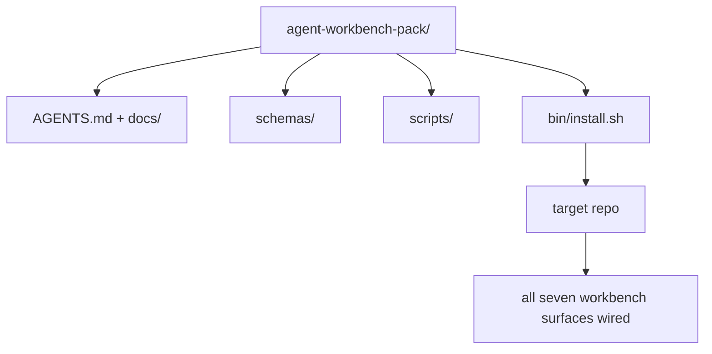

# कैपस्टोनः एक पुनः प्रयोज्य एजेंट कार्यबेंच पैक वितरित

> इस मिनी-ट्रैक को एक से किसी भी रेपो पैक में रखा जा सकता है ∞`cp -r`और फिर अगले दिन सुबह हम एजेंट को काम करने के लिए तैयार करते हैं।

**类型：**निर्माण
**语言：**पायथन (stdlib)
**前置要求：**चरण 14 · 31 से 14 · 41
**时间：**~ 75 मिनट

## 学习目标

- सात कार्यक्षेत्र सतहों को सीधे सम्मिलित करने योग्य सूची में पैक करना
- 固定 schema、script 和 template, let new repo  obtain a known available baseline── एक ज्ञात उपलब्ध आधार रेखा प्राप्त करने के लिए 
- 添加一个安装脚本, 等方式放置这个包──
- यह तय करें कि पैक में क्या सामग्री है, बाहर क्या सामग्री है, और प्रत्येक के लिए इसका निर्णय लें।
-                                                                                                                                                                                                                                                                                                                                                                                                                                                                                                                              

## 问题

एक कार्यक्षेत्र जो Google डॉक में मौजूद है, चर्चा इतिहास और तीन केवल अमूर्त रूप से याद किए गए स्क्रिप्ट में है, एक कार्यक्षेत्र जो हर तिमाही में पुनर्निर्माण किया जाएगा। समाधान एक संस्करण पैक हैः एक रेपो या कैटलॉग, जिसमें सतह, योजना, स्क्रिप्ट शामिल है, और एक एक आदेश है कि चलाने योग्य इंस्टॉलर।

इस कक्षा के अंत में, आप डिस्क पर वितरित किया जाएगा।`outputs/agent-workbench-pack/`, और एक जो इसे किसी भी लक्ष्य रेपो में डाल सकता है ।`bin/install.sh`

## 概念



### पैक लेआउट

```
outputs/agent-workbench-pack/
├── AGENTS.md
├── docs/
│   ├── agent-rules.md
│   ├── reliability-policy.md
│   ├── handoff-protocol.md
│   └── reviewer-rubric.md
├── schemas/
│   ├── agent_state.schema.json
│   ├── task_board.schema.json
│   └── scope_contract.schema.json
├── scripts/
│   ├── init_agent.py
│   ├── run_with_feedback.py
│   ├── verify_agent.py
│   └── generate_handoff.py
├── bin/
│   └── install.sh
└── README.md
```

### क्या छोड़ दिया, क्या बाहर रखा

留下:

- सतह योजनाएँ--- ये अनुबंध हैं---
- ऊपर चार स्क्रिप्ट हैं।
- चार भागों के दस्तावेज. . . वे नियम और अनुच्छेद हैं.

 बाहर रखाः

- 项目特定任务──任务属于目标 repo के बोर्ड, पैक में नहीं आती──
-  आपूर्तिकर्ता एसडीके 调用── यह पैक ढांचे से 无关──
- इस पैक को टीम के साथ रखा गया है, इसके बजाय इसे उसके साथ रखा गया है।

### इंस्टॉलर

एक संक्षिप्त `bin/install.sh`(या `bin/install.py`):

1.  नहीं `--force`时, अस्वीकार करना 封装装到已有包装上.
2.                                                                                                                                                                                                                                                               
3. यदि वहाँ `.github/workflows/`, तो एक सीआई में प्रवेश करें
4. 打印后续步骤:填写板、设置接受命令、运行 init script──

###  संस्करण प्रबंधन

इस पैक  एक ले लो `VERSION`文件──需要迁移的 schema bump 和脚本 变更会出现重大突破──仅 doc 的变更会出现突破补丁──目标 repo 的 `agent_state.json`记录它初始化时对应的包版──


```figure
wb-pack-install
```

##  इसे निर्माण

`code/main.py`मैं इस कक्षा के बगल में पैक                                                                                                                                                                                                                                                                                                                                                                                                                                                                                                                     `outputs/agent-workbench-pack/`इस मिनी-ट्रैक को पहले की कक्षा में स्कीमा और स्क्रिप्ट के साथ-साथ आपके द्वारा लिखे गए डॉक्यूमेंट्स को भी इस्तेमाल किया गया है।

运行它:

```
python3 code/main.py
```

इस स्क्रिप्ट को दोहराकर सतह को फिक्स्ड कर Readme में लिखें, पैक ट्री प्रिंट करें, फिर शून्य से 退出──重复运行是等的──

## वास्तविक उत्पादन में मोड

एक पैक केवल तभी मूल्यवान होता है जब वह फोरक के माध्यम से संचालित हो सके, अपडेट हो सके और अपस्ट्रीम के साथ दोस्ती न हो सके।

**`VERSION` 是 contract，不是 marketing。**प्रमुख bump  राज्य माइग्रेशन की आवश्यकता है。 मामूली bump  पुनर्प्रचालन की आवश्यकता है चेकर。 पैच bump केवल उपयोग किया जाता है डॉक。 इंस्टॉलर प्रत्येक बार स्थापना `.workbench-version`写入目标 repo; यदि लक्ष्य के लॉक और पैक के `VERSION`असंगत,`lint_pack.py`मैं इसे देने से इनकार करूंगा।`npm``Cargo`和 `pyproject.toml`能经受 10年 churn 的方式;एजेंट इन नियमों को नहीं बदलेगा。

**跨工具分发的单一来源。**एक  प्रदान `nx ai-setup`, से एकल कॉन्फ़िग स्थापना `AGENTS.md``CLAUDE.md``.cursor/rules/``.github/copilot-instructions.md`和一个MCP सर्वर──这个包也应该这样做;इंस्टॉलर 输出 symlink(`ln -s AGENTS.md CLAUDE.md`), एक तथ्य स्रोत को प्रत्येक कोडिंग एजेंट पर वितरित करें 

**`uninstall.sh` 会在存在非平凡 state 时拒绝执行。** इस पैक को हटाने के लिए नहीं किया जा सकता उपयोगकर्ता `agent_state.json``task_board.json`या `outputs/`❖उपस्थापनकर्ता 会删除 schema、script、doc 和 `AGENTS.md`(带 `--keep-agents-md`opt-out) और यदि राज्य फ़ाइल में कोई भी अनाम परिवर्तन है, तो इसे जारी रखने से इनकार करें।

**Skill-as-publishable。SkillKit-style 分发。**इस पैक को SkillKit कौशल के रूप में 交付:`skillkit install agent-workbench-pack`एक स्रोत से इसे 32 एआई एजेंटों में रखा गया है। पैक रेपो वास्तविक स्रोत है।

## इसका उपयोग करें

तीन स्थानों पर पैक किया जाएगाः

- **作为一个你放进 repo 的目录。** `cp -r outputs/agent-workbench-pack /path/to/repo`
- **作为一个公开 template repo。**फोर्क-और-अनुकूलन,并用 `VERSION` नियंत्रण बहाव 
- **作为一个 SkillKit skill。**अपने एजेंट के साथ संपर्क करें, एक आदेश पूरा करें और उसे रखें।

पैक एक नुस्खा है।

## 交付 यह

`outputs/skill-workbench-pack.md`परियोजना के अनुकूलन के लिए एक पैक उत्पन्न करेगा: नियम, टीम के इतिहास के आधार पर स्पष्ट होगा, वैश्विक दायरा, अनुसूची के अनुरूप होगा, रूबिक आयाम, एक क्षेत्र के विशिष्ट अनुच्छेद का विस्तार करेगा।

## अभ्यास

1. इस पर विचार करने के लिए, यह निर्णय लेना कि किस पांचवें दस्तावेज को कैनोनिकल पैक में अपग्रेड किया जाना चाहिए।
2. Python के साथ पुनर्लेख स्थापित,并添加 `--dry-run`ध्वज──जो एर्गोनोमिक्स से बैश के मुकाबले
3. 添加一个 `bin/uninstall.sh`, सुरक्षित रूप से पैक स्थानांतरित, और राज्य फ़ाइल में अपवादात्मक इतिहास में निष्पादन से इनकार किया गया.
4. 添加一个 `lint_pack.py`, पैक                                                                                                                                                                                                                                                                                                                                                                                                                                                                                                                           `VERSION`时失败──把它连接到自己的回复的IC──
5.  एक रिनबुक लिखें जो इस पैक के लिए एक हाथ से काम करने वाली डेस्क से स्थानांतरित हो जाए

## 职业实践: साबित एक बार भंडारण परिवर्तन

打包演示证明组装程序能够运行并生成文件──它不能证明您的代理能完成新任务──生成的检查能够验证该任务,或已部署的系统能正常工作──请区分这些结论──

आपके पास जो भंडार है या उसे संशोधित करने की अनुमति है, उसमें एक वास्तविक लघु कार्य चुनें। एक प्रोग्रामिंग एजेंट का उपयोग करें जिसे आप पहले से ही उपयोग कर चुके हैं।

इसके अलावा, एक बार काम करने के लिए एक और समय निर्धारित करें।`learning-artifacts/`वर्तमान में, भंडारण में मौजूद पैक और पैक को संदर्भ के रूप में रखा जाए।

### 1. 明确任务并选择自主程度

43 वें अनुच्छेद के कार्य ढांचे और 44 वें अनुच्छेद के प्रमाण योजना का उपयोग करके, प्रारंभ संस्करणों का रिकॉर्ड करें, लक्ष्य का अवलोकन करें, गैर-अंतर्देश, परिवर्तन की अनुमति दें, और प्रमाण प्राप्त करें।

 एक कार्य मोड चुनें: चरणबद्ध मार्गदर्शन  साथ निरीक्षण बिंदु के कार्यान्वयन, या सीमा स्पष्ट स्व-निष्पादन  स्पष्ट अनिश्चितता  संभावित परिणाम और उल्टापन का समर्थन क्यों करते हैं इस विकल्प को चुनें

् ् ् ् ् ् ् ् ् ् ् ् ् ् ् ् ् ् ् ् ् ् ् ् ् ् ् ् ् ् ् ् ् ् ् ् ् ् ् ् ् ् ् ् ् ् ् ् ् ् ् ् ् ् ् ् ् ् ् ् ् ् ् ् ् ् ् ् ् ् ् ् ् ् ् ् ् ् ् ् ् ् ् ् ् ् ् ् ् ् ् ् ् ् ् ् ् ् ् ् ् ् ् ् ् ् ् ् ् ् ् ् ् ् ् ् ् ् ् ् ् ् ् ् ् ् ् ् ् ् ् ् ् ् ् ् ् ् ् ् ् ् ् ् ् ् ् ् ् ् ् ् ् ् ् ् ् ् ् ् ् ् ् ् ् ् ् ् ् ् ् ् ् ् ् ् ् ् ् ् ् ् ् ् ् ् ् ् ् ् ् ् ् ् ् ् ् ् ् ् ् ् ् ् ् ् ् ् ् ् ् ् ् ् ् ् ् ् ् ् ् ् ् ् ् ् ् ् ् ् ् ् ् ् ् ् ् ् ् ् ् ् ् ् ् ् ् ् ् ् ् ् ् ् ्

### 2. पसंद और उपयोगी वातावरण तैयार

查找相关实现、调用方、测试和本地指令──记录每一个来源为什么应进入上下文,以及哪些现有证据能够推翻过去的笔记──不要默认加载整个仓库──

प्रत्येक संबंधित विस्तार के लिए स्पष्ट चयन करें: कौशल (skill) प्रदान करने के लिए पुनः उपयोग योग्य प्रक्रिया; MCP (MCP) उपकरण प्रदान करने के लिए पहुंच क्षमता;子 (hook) निष्पादन निश्चितता जांच;插件 (plugin)

記錄你拒絕的新增项会带来的下文或维护成本── पुनर्परीक्षण एक पुरानी स्मृति या निर्देश; यदि प्रमाण समाप्ति या प्रतिस्थापन का समर्थन करता है, तो अपने द्वारा प्रबंधित सीखने के वातावरण में निष्पादित── पुनर्प्रचालन प्रभावित की जांच, पुष्टि करें कि इसे हटाया गया है कोई खोने की आवश्यकता नहीं बाध्यता──

### 3. 记录基线并实现

编辑之前,运行最相关现有检查,显示所需行为的现有状态──保留命令、版本、结果和证据位置──尚未存在的功能也有基线:记录实际观察的响应或未支持的操作──

让代理在任务约定内实现变更――保留干预日志,说明每次纠正、权限变更或计划调整的原因――委派是可选的; यदि वास्तव में उपयोगी है, तो दूसरे निष्पादक को जोड़ने से पहले, पहले धारा 45 को लागू करें 责任归属与集成约定――

### 4. 质疑证据

选择能够观察变更界面的验证方式―― UI के लिए, पुनः निर्माण, और संबंधित दृश्य चौड़ाई के तहत वास्तविक सेवा प्रदान करने वाले उपयोगकर्ता प्रक्रम की जांच करें―― API के लिए, जांच अनुरोध और क्रमबद्धता के बाद के प्रतिक्रिया के लिए―― CLI के लिए, संचालन के बाद के आदेश, चेक आउट कोड और आउटपुट―― चयन कार्यों की आवश्यकता की जांच करें, और उनकी सीमाओं को समझाएं।

कार्य के अनुसार स्वतंत्र रूप से अपेक्षित परिणाम लिखें, एजेंट के कार्यान्वयन से अनुशंसा न करें। एक बार प्रतियों में एक विशिष्ट त्रुटि परिणाम, जैसे कि निष्क्रियता या चूक की आवश्यकता का उत्तर प्राप्त करें, को पेश करें।

यदि जाँच पूर्व पारित हो, पहले दृढ़तापूर्वक निष्कर्ष या अवलोकन विधि, पुनः विश्वास करें, पुनः प्राप्त करें, पुनः प्राप्त करें, पुनः प्राप्त करें, पुनः प्राप्त करें, पुनः प्राप्त करें, पुनः प्राप्त करें, पुनः प्राप्त करें, पुनः प्राप्त करें, पुनः प्राप्त करें, पुनः प्राप्त करें, पुनः प्राप्त करें, पुनः प्राप्त करें, पुनः प्राप्त करें, पुनः प्राप्त करें, पुनः प्राप्त करें, पुनः प्राप्त करें, पुनः प्राप्त करें, पुनः प्राप्त करें, पुनः प्राप्त करें, पुनः प्राप्त करें, पुनः प्राप्त करें, पुनः प्राप्त करें, पुनः प्राप्त करें, पुनः प्राप्त करें, पुनः प्राप्त करें, पुनः प्राप्त करें, पुनः प्राप्त करें, पुनः प्राप्त करें, पुनः प्राप्त करें, पुनः प्राप्त करें, पुनः प्राप्त करें, पुनः प्राप्त करें, पुनः प्राप्त करें, पुनः प्राप्त करें, पुनः प्राप्त करें, पुनः प्राप्त करें, पुनः प्राप्त करें, पुनः प्राप्त करें, पुनः प्राप्त करें, पुनः प्राप्त करें, पुनः प्राप्त करें, पुनः प्राप्त करें, पुनः प्राप्त करें, पुनः प्राप्त करें, पुनः प्राप्त करें, पुनः प्राप्त करें, पुनः प्राप्त करें, पुनः प्राप्त करें, पुनः प्राप्त करें, और पुनः प्राप्त करें, और पुनः प्राप्त करें, और पुनः प्राप्त करें, और पुनः प्राप्त करें, और पुनः प्राप्त करें, और पुनः प्राप्त करें, और पुनः प्राप्त करें, और पुनः प्राप्त करें, और पुनः प्राप्त करें, और पुनः प्राप्त करें, और पुनः प्राप्त करें, और पुनः प्राप्त करें, और पुनः प्राप्त करें, और पुनः प्राप्त करें, और पुनः प्राप्त करें, और पुनः प्राप्त करें, और पुनः प्राप्त करें, और पुनः प्राप्त करें, और पुनः प्राप्त करें, और पुनः प्राप्त करें, और पुनः प्राप्त करें, और पुनः प्राप्त करें, और पुनः प्राप्त करें, और पुनः प्राप्त करें, और, और, और पुनः प्राप्त करें, और, और, और, और, और, और, और, और, और, और, और, और, और, और, और, और, और, और, और, और, और, और, और, और, और, और, और, और, और, और, और, और, और, और, और, और, और, और, और, और, और, और, और, और, और, और, और, और, और, और, और, और, और, और, और, और, और, और, और, और, और, और, और, और, और, और, और, और, और, और, और, और, और, और, और, और, और, और, और, और, और, और, और

मूल उद्देश्यों और संशोधन के मार्ग पर नियंत्रण, अंतिम अंतरों की समीक्षा, जिसमें परीक्षण के परिवर्तन शामिल हैं।

### 5. 演练运行 तथा पुनर्वास

एक बार के स्थानीय वातावरण या पूर्व-प्रकाशित वातावरण में चल रहे परिवर्तन के बाद की डिलीवरी।`local``staging`या `live`,并注明确版本或交付物标识──本地演练只支持本地结论;本地演练不要求部署到生产环境──

 चयन करें एक मिशन से संबंधित विफलता संकेत,  मूल्य  अवलोकन विंडो और जिम्मेदारी  जिम्मेदार व्यक्ति  वर्णन करें कि कैसे ओवर  मूल्य के दौरान प्रतिक्रिया करनी चाहिए  अभ्यास के दौरान सुरक्षित रूप से इस संकेत को कैच करें, और देखी गई日志  संकेत या प्रतिक्रिया को बनाए रखें

演练回滚到已知可用交付物,并检查前行为是否恢复──适用时,应考虑持久化数据:仅取代二进制文件不一定能撤销数据变更──记录任何未经验证的恢复步骤──

### 6. 改进 अगली बार निष्पादन并交接

परिणामों को मूल लाइन के साथ तुलना में, वास्तविक समय की खपत सहित, उपलब्ध मात्रा डेटा और कृत्रिम हस्तक्षेप। एक मिशन केवल उस मिशन में क्या हुआ है, यह साबित नहीं कर सकता कि कोई एजेंट  समग्र रूप से अधिक तेज़ या अधिक विश्वसनीय है।

 अनुच्छेद 46 के अनुसार, एक बार वास्तविक रूप से हुई सुधार को परीक्षण में परिवर्तित किया जाएगा छोटी अधिकार सीमाएँ स्वचालित प्रक्रिया या अधिक स्पष्ट उदाहरणों  पुनः लागू प्रभावित जांच छोटे परिवर्तनों को हटा दें, और अगली बैठक के लिए अंतिम शाखाओं परिवर्तन फ़ाइलों अनिष्कृत जोखिम और अगले कदम कार्रवाई

### 人工评审标准

कृपया समीक्षक प्रमाण पत्र की जांच करे, तथा कम से कम कम कम कम से कम कम कम उपलब्ध सबसे कमजोर स्वीकृति जांच करे।`demonstrated`(प्रमाणित)`needs revision`(आवश्यकताएँ) या `unverified`(未验证) के रूप में स्थिति, साथ ही साथ साक्ष्य स्थान और कारणों को प्रदान करते हुए, इन विचारों को प्रतिस्थापित नहीं किया जा सकता है।

| 维度 | 评审者应质疑的证据 |
|---|---|
| 任务与自主程度 | 初始行为、边界明确的目标、合理的权限与预算，以及可执行的停止规则 |
| 上下文与环境 | 相关来源、合理的工具访问权限，以及经过重新核查的退役决定 |
| 验证 | 变更前后的实际行为，以及相同检查能够拒绝的、刻意引入的错误结果 |
| 评审与运行 | 已检查的差异、独立质疑、标明环境的运行观测，以及演练过的恢复流程 |
| 迭代与交接 | 一项经过验证的改进、如实说明的局限、干净的最终状态，以及可复现的下一步行动 |

                                                                                                                                                                                                                                                              `needs revision`प्रश्नों का प्रमाण नहीं मिल सकता है।`unverified`,并相应缩小结论的范围── कार्य संग्रह एक सीमा-परिभाषित कार्य में आपकी इंजीनियरिंग निर्णय क्षमता को प्रदर्शित करता है, न कि रोजगार प्राप्त करने या तैनाती की शर्तों की गारंटी देता है──

## 交付物

रखो पुनर्नवीनीकरण पैक, और आप पूरा किया है [career-agent-evidence.md](https://github.com/rohitg00/ai-engineering-from-scratch/blob/main/phases/14-agent-engineering/42-agent-workbench-capstone/outputs/career-agent-evidence.md)副本── इस मॉड्यूल को एक समीक्षा योग्य केस स्टडी के रूप में कार्य ढांचे, निष्पादन योजना, परिचालन प्रमाण पत्र, समीक्षा, पुनर्स्थापना अभ्यास और संपर्क को एकीकृत किया जाएगा──

## 关键术语

| 术语 | 人们常说 | 它实际含义 |
|------|----------------|------------------------|
| Workbench pack | “starter kit” | 一个带版本的目录，携带全部七个 surface |
| Installer | “Setup script” | 以幂等方式放置 pack 的 `bin/install.sh` |
| Pack version | “VERSION” | schema/script 变更使用 major bump，仅 doc 变更使用 patch |
| Drop-in pack | “cp -r and go” | Pack 在第一天无需按 repo 定制即可工作 |
| Forkable template | “GitHub template” | GitHub 的 “Use this template” 可以从中 clone 的公开 repo |

## 延伸阅读

- चरण 14 · 31 से 14 · 41  इस पैक 打包 के प्रत्येक सतह
- [SkillKit](https://github.com/rohitg00/skillkit) 32 एआई एजेंटों में इस कौशल को स्थापित करें
- [Nx Blog, Teach Your AI Agent How to Work in a Monorepo](https://nx.dev/blog/nx-ai-agent-skills) 跨六种工具的单一来源生成器
- [agents.md — the open spec](https://agents.md/) अपने पैक के राउटर  सामग्री को लागू करना होगा
- [HKUDS/OpenHarness](https://github.com/HKUDS/OpenHarness) पैक-समतुल्य का संदर्भ प्राप्ति
- [andrewgarst/agentic_harness](https://github.com/andrewgarst/agentic_harness) 带 eval suite के Redis समर्थित 参考实现
- [Augment Code, A good AGENTS.md is a model upgrade](https://www.augmentcode.com/blog/how-to-write-good-agents-dot-md-files) पैक डॉक की गुणवत्ता
- [Anthropic, Effective harnesses for long-running agents](https://www.anthropic.com/engineering/effective-harnesses-for-long-running-agents)
- [Anthropic, Harness design for long-running application development](https://www.anthropic.com/engineering/harness-design-long-running-apps)
- चरण 14 · 30  消费 इस पैक के सत्यापन गेट का मूल्यांकन-चालित एजेंट विकास
- चरण 14 · 41  इस पैकेज को सुधारना होगा पूर्व/पश्चात बेंचमार्क
