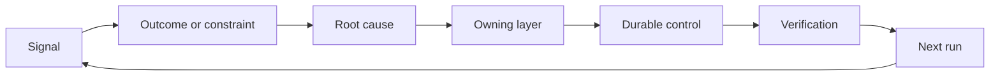

# सहायता एवं विस्थापन तंत्र के निर्माण के लिए

> कोड प्रकाशन ने वर्तमान निर्माण चक्र को समाप्त कर दिया, साथ ही एक दीर्घकालिक सीखने चक्र को शुरू किया।

**Type:** Learn + Build
**Languages:** Python (stdlib)
**Prerequisites:** Phase 14 lessons 46 and 53
**Time:** ~75 minutes

## 学习目标

- अपघटन घटनाओं, समीक्षा डेटा, उपयोगकर्ता व्यवहार और सुधारों को जिम्मेदारियों से संबंधित कार्यों में परिवर्तित करना
- विभिन्न संकेतों को सटीक रूप से परिभाषित करने के लिए निम्नलिखित से नीचे दिए गए संदेशों को परिभाषित करें, समीक्षाओं को एकत्र करें, सुरक्षा रणनीति, संचालन समय या आवश्यकताओं को पूरा करें।
- पुनरावृत्ति जोखिम के लिए गंभीरता एवं पुनरावृत्ति के आधार पर प्राथमिकता वर्गीकरण किया जाना चाहिए।
- प्रत्येक प्रणाली नियंत्रण तंत्र में सेवानिवृत्ति की शर्तें निर्धारित की जाती हैं।
- 沟通交付决策, साक्ष्य प्रदान करना,权衡取舍及明确负责的决策者──

## स्वयं भी बुनियादी ढांचा है

एक टीम बड़ी संख्या में सिस्टम लिंक ट्रैकिंग (ट्रेस) ✓ ✓ ✓ ✓ ✓ ✓ ✓ ✓ ✓ ✓ ✓ ✓ ✓ ✓ ✓ ✓ ✓ ✓ ✓ ✓ ✓ ✓ ✓ ✓ ✓ ✓ ✓ ✓ ✓ ✓ ✓ ✓ ✓ ✓ ✓ ✓ ✓ ✓ ✓ ✓ ✓ ✓ ✓ ✓ ✓ ✓ ✓ ✓ ✓ ✓ ✓ ✓ ✓ ✓ ✓ ✓ ✓ ✓ ✓ ✓ ✓ ✓ ✓ ✓ ✓ ✓ ✓ ✓ ✓ ✓ ✓ ✓ ✓ ✓ ✓ ✓ ✓ ✓ ✓ ✓ ✓ ✓ ✓ ✓ ✓ ✓ ✓ ✓ ✓ ✓ ✓ ✓ ✓ ✓ ✓ ✓ ✓ ✓ ✓ ✓ ✓ ✓ ✓ ✓ ✓ ✓ ✓ ✓ ✓ ✓ ✓ ✓ ✓ ✓ ✓ ✓ ✓ ✓ ✓ ✓ ✓ ✓ ✓ ✓ ✓ ✓ ✓ ✓ ✓ ✓ ✓ ✓ ✓ ✓ ✓ ✓ ✓ ✓ ✓ ✓ ✓ ✓ ✓ ✓ ✓ ✓ ✓ ✓ ✓ ✓ ✓ ✓ ✓ ✓ ✓ ✓ ✓ ✓ ✓ ✓ ✓ ✓ ✓ ✓ ✓ ✓ ✓ ✓ ✓ ✓ ✓ ✓ ✓ ✓ ✓ ✓ ✓ ✓ ✓ ✓ ✓ ✓ ✓ ✓ ✓ ✓ ✓ ✓ ✓ ✓ ✓ ✓ ✓ ✓ ✓ ✓ ✓ ✓ ✓ ✓ ✓ ✓ ✓ ✓ ✓ ✓ ✓ ✓ ✓ ✓ ✓ ✓ ✓ ✓ ✓ ✓ ✓ ✓ ✓ ✓ ✓ ✓ ✓ ✓ ✓ ✓ ✓ ✓ ✓ ✓ ✓ ✓ ✓ ✓ ✓ ✓ ✓ ✓ ✓ ✓ ✓ ✓ ✓ ✓ ✓ ✓ ✓ ✓ **晋级通道（Promotion）**: अर्थात्, निरीक्षण तथ्यों से लेकर स्पष्ट दायित्व वाले व्यक्तियों तक सत्यापन प्रमाणों के स्थायित्व प्रणाली में परिवर्तन के निश्चित मार्गों तक।

प्रतिक्रिया रत्चेट) का समापन चक्र है:

1. 观测到具体实测信号;
2. इसके संबंध में अपेक्षित उत्पादन परिणाम, बाध्यकारी शर्त या पूर्व निर्धारित परिकल्पना;
3. इस कारण से जिम्मेदारियों को संभालने के लिए सबसे निचले सिस्टम स्तर की पहचान करना;
4. 实施受控的持久化改进;
5. 验证 इस दुर्घटना के पुनरावृत्ति की संभावना को कम कर दिया गया है;
6. 定期复审该控制机制是否应继续保留──

## 精准路由至应对责任层

| 信号类型 | 归属目的地 |
|---|---|
| 误报、功能倒退、错误输出结果 | 评测集（Evaluation）或自动化测试 |
| 上下文缺失、重复劳动、过时事实 | 上下文数据源或检索路由策略 |
| 不安全操作或越权漏洞 | 安全策略（Policy）或权限硬边界 |
| 超时、重试风暴、依赖服务不可用 | 运行时控制（Runtime Control） |
| 新的产品需求或尚未决断的权衡取舍 | 经过规范成型（Shaped）的待办项 |

जब स्वचालित परीक्षण या कठोरता की सीमाएं पूरी तरह से त्रुटि को अक्षम करने के लिए पर्याप्त हों, तो शीघ्र में एक और अनुच्छेद जोड़ने की आवश्यकता नहीं है।



##  जिम्मेदारी स्वयं नियंत्रण तंत्र का हिस्सा है

प्रत्येक चरण में निम्नलिखित तत्वों का स्पष्ट रूप से निहित होना चाहिएः

- 唯一的人类责任人 (अन्यथा)
- षण्ण परिणाम और पुनरावृत्ति आवृत्ति के समग्र मूल्यांकन के आधार पर प्राथमिकता;
- 拟修改的目标系统组件 (आर्टिफैक्ट)
- ⇒ संशोधित वास्तविक प्रभाव के प्रमाणन कार्यक्रम का प्रमाणन करना;
- 复审 या स्वचालित विफलता विंडो;
- 明确的退役条件(सेवानिवृत्ति की शर्त)

एक अज्ञानी तथाकथित सुधार योजना, जिसका मात्रा केवल एक खंड है।

## 果断退役过时的控制机制

विपक्ष में लगातार जमा होने वाली रणनीति और नियंत्रण की व्यवस्थाएं हैं, जो कि परस्पर विरोधी और लागत प्रभावी हो सकती हैं। निम्नलिखित मामलों में, नियंत्रण तंत्र को सक्रिय रूप से समीक्षा और निष्कासन किया जाना चाहिएः

-  सिस्टम संरचना या व्यावसायिक कार्यप्रवाह में मौलिक परिवर्तन हुआ है;
- नीचे की परत के अपरिवर्तनीय तंत्र ने ऊपर की परत के अक्षर निर्देशों को पूरी तरह से बदल दिया है;
- पूर्व निर्धारित समय के भीतर, पूर्वोत्तर दोष कभी फिर से नहीं दिखाई देता है;
- नियंत्रण नियम सामान्य व्यापार के विकास की आवृत्ति को रोकते हुए, इसके प्रतिरक्षा के लाभों से अधिक हो गए हैं।

退役控制项 भी आवश्यक है, केवल इसलिए नहीं कि  लग रहा है वर्ष बहुत लंबे समय से 

## 打通 उत्पाद निर्माण तथा कोडिंग एजेंट का प्रति समापन

एक ही टक्कर तंत्र उत्पाद व्यवसाय और बुद्धिमान विकास दोनों पर एक साथ सेवा दे सकता हैः

- 产品业务实证驱动预期产出框架、假设图谱、最小切片或量度计划的发展;
- कोडिंग एजेंट के संचालन को सुधारने या स्वचालित स्वचालित परीक्षणों को अनुकूलित करने के लिए;
- 线上真故障既能促成产品功能边界调整,也能促成代理工作台的加固──

यह भी यही कारण है कि कार्य ढांचे का सिद्धांत कोड से पहले घोषित होने के अंत में नहीं है, बल्कि यह प्रत्येक बार सिस्टम द्वारा स्वीकार किए जाने वाले परिवर्तनों में से एक है।

## 动手实现

इस प्रयोग में प्रयोगात्मक संकेतों को वर्गीकृत किया गया, जो कि प्राथमिकता के अनुसार क्रमबद्ध, और आउटपुट के आधार पर जिम्मेदारियों के साथ कार्यवाही की योजना बनाई गई है।`outputs/feedback-backlog.json`

```bash
python3 code/main.py
python3 -m unittest discover code/tests -v
```

尝试添加一个运行时超时信号,验证它将被正确路由至运行时控制层,而不是泛化混入通用需求等待列表

## 实践实验: असफलता के बाद निर्णय लेने के लिए जिम्मेदार

अपने कार्ययात्रा सीखने के मार्ग से संबंधित कार्यसमूह परियोजनाओं में से एक कार्यप्रवाह चुनें। इसके आसपास एक निर्णय, एक छोटा प्रयोग और एक पुनरावलोकन पूरा करें।[职业交付模板](https://github.com/rohitg00/ai-engineering-from-scratch/blob/main/phases/14-agent-engineering/54-build-the-feedback-ratchet/outputs/career-delivery-evidence.md)मध्य में

पायथन प्रयोग उदाहरण उत्पन्न करता है, कार्रवाई के लिए प्रतीक्षा करता है। यह उपयोगकर्ता का निरीक्षण नहीं करता है, न ही आप के लिए एक कार्यक्षमता है, इसका परीक्षण करने के लिए प्रयोग केवल अभ्यास के लिए तैयारी है।

### 1. स्पष्ट क्या हुआ है

记录用户、任务、当前工作流,以及你希望改善的结果──链接到经过同意的观察记录、已脱敏的支持记录,或可复制的任务轨迹──区分你直接观察的事实、他人报告的情况,以及你的推论──

एक असफलता का पता लगाएं: असफल परिकल्पनाएँ、असहायता परिणाम、अचानक लागत, या विलंबित संचार― व्याख्या करें कि किस प्रमाण ने आपकी समझ को बदल दिया है― असफलता को प्रतिक्रिया और निर्णय लेने की आवश्यकता होती है, न कि सफलता की कहानी में पैक होने की आवश्यकता होती है―

यदि आप उपयोगकर्ता से संपर्क नहीं कर सकते हैं, तो कृपया अपने साथी के साथ स्पष्ट रूप से चिह्नित करने का अनुकरण करें, या स्पष्ट रूप से स्पष्ट रूप से स्पष्ट परिदृश्य के आधार पर अनुकरण करें।

### 2. अधिकार सीमा के भीतर आगे बढ़ें

列出未知项目,选择成本最低,可逆,且有望解决影响最重大未知项目行动――说明哪些事由你决定,哪些选择受到既有约束,哪些操作需要先获得授权才能执行――

उदाहरण के लिए, ग्राहक डेटा के उपयोग की अनुमति की प्रतीक्षा करते समय, आप पहले से ही संवेदनशील ऑफ़लाइन रिलीज़ की तैयारी कर सकते हैं। सक्रिय प्रगति का मतलब है कि अधिकृत कार्य पूरा हो गया है, और यह स्पष्ट रूप से तय किया जाएगा कि निर्णय में बाधा होगी; यह आपके उपयोग या अनुमोदन अधिकारों का विस्तार नहीं करेगा।

### 3. तुलनात्मक योजना तथा निर्णय लेने की जिम्मेदारी

इस पर कोई ध्यान देने की जरूरत नहीं है, जो व्यक्ति एक संक्षिप्त निर्णय संक्षिप्त पत्र लिखता हैः

- उपयोगकर्ता प्रश्न, तथा परिवर्तन योजना के प्रमाण;
- कम से कम दो प्रकार के कार्यक्रम; जब उचित हो, तो कम लागत वाले श्रम कार्यक्रम या विकास के बिना कार्यक्रमों को शामिल करें;
- 质量、交互设计、工作量、运营成本和风险方面的权衡;
- आपके सुझाव, अनिश्चितता और निर्णय लेने की आवश्यकता;
- 决策责任人、 प्रभावित हितधारकों, तथा निर्णय लेने की आवश्यकता की तिथि

कृपया एक प्रभावित हितधारक के प्रतिनिधि के साथ एक प्रश्न पूछें, उनमें से एक का भार-वज़न करें।

### 4.  सीमाओं को स्पष्ट करने के लिए प्रयोग करें

प्रश्नों के उत्तर की आवश्यकता के आधार पर, मूल प्रकार, परीक्षण बिंदु या उत्पादन चरण का चयन करें।

उपयोगकर्ता के प्रारंभ बिंदु से लेकर कार्य पूरा होने तक, संपूर्ण संवाद प्रक्रिया को देखें। किसी त्रुटि आउटपुट या डेटा की कमी की स्थिति में प्रवेश करें।

इस प्रक्रिया में समय की मात्रा को जोड़ना और सुधार करना। मॉडल तेजी से प्रतिक्रिया करता है, पूरा कार्य धीमा हो सकता है, या परिणामों को अधिक कठिन बनाता है।

### 5. परिणाम की तुलना आर्थिक

एक ही संकेतक परिभाषित करें, कार्य समग्र, संग्रह विधि और तुलनात्मक अवलोकन विंडो का उपयोग करें, रिकॉर्ड की आधारशिला और बाद के परिणामों को रिकॉर्ड करें। नमूना संख्या, निष्कासन और प्रमाण लिंक को संख्यात्मक मूल्य के बगल में रखा जाएगा। यदि इन शर्तों में परिवर्तन होता है, तो व्याख्या करें कि तुलना क्यों सीमित है।

 एक उपयोगकर्ता परिणाम  एक गुणवत्ता या सुरक्षा  सूचकांक, तथा कुल कृत्रिम अनुबंध कार्य मात्रा  शामिल करें  भले ही परिणाम लक्ष्य तक न पहुंचे, यथार्थ में भी रिकॉर्ड करें  लघु नमूना या अनुकरण नमूना केवल सीमित परिमाण के सीखने के निष्कर्षों का समर्थन करता है, व्यापार प्रभाव का प्रमाण नहीं दे सकता

 प्रत्येक सफल कार्य के लिए लागत का अनुमान, मॉडल तैनाती, पुनः परीक्षण, सहायक सेवा और कृत्रिम अनुबंधन, मानव शक्ति की एक मूल्य परिकल्पना, वास्तविक उपयोगिता और अनुमानित मूल्य की तुलना, या परियोजना के पीछे मूल्य परिकल्पना की तुलना।

 पहले से ही [LLM FinOps 课程](https://aiengineeringfromscratch.com/lesson?path=phases/17-infrastructure-and-production/27-finops-llms), आगे सीखने की लागत के कारण इकाई अर्थव्यवस्था में परिवर्तन मॉडल केवल संभव प्रतिक्रियाओं में से एक है; श्रम प्रवाह की सीमा को छोटा करना या कृत्रिम चरणों को बनाए रखना, बेहतर उत्पाद निर्णय लेने के लिए संभव है।

### 6. 完成闭环

पूर्व घोषित मानदंडों के अनुसार, सुझाव जारी रखना, समायोजित करना या रोकना। यदि साक्ष्य अनिश्चित हैं, तो यह स्पष्ट रूप से देखा जा सकता है कि अवलोकन की कमी है, साथ ही निम्नलिखित सीमाओं के स्पष्ट परीक्षणों का उल्लेख किया गया है।

 एक विकल्प चुनेंः वितरण प्रक्रिया के लिए स्वयं में सुधारः स्पष्ट कार्य ढांचा, पहले उपयोगकर्ता की खोज, बेहतर समीक्षा सूची, छोटे एजेंट, कनेक्शन इकाई, या अधिक लक्षित मूल्यांकन मामले,  जिम्मेदार व्यक्ति और समीक्षा तिथि को निर्दिष्ट करें

复审时,决定保留、修改还是退役改进的记录选择的证据── यदि कोई नई सूची कार्य量 बढ़ाए, लेकिन लक्ष्य विफलता को नहीं रोके, तो यह स्थायी रूप से नहीं बने रहना चाहिए──

## 交付物

[career-delivery-evidence.md](https://github.com/rohitg00/ai-engineering-from-scratch/blob/main/phases/14-agent-engineering/54-build-the-feedback-ratchet/outputs/career-delivery-evidence.md) अपनी परियोजनाओं पर कॉपी करें, और सबूत लिंक भरें।  अपना ढाँचा बनाए रखें।  अपने प्रोजेक्ट्स पर कॉपी करें, और अपने प्रोजेक्ट्स पर कॉपी करें।

## 验证

साथियों के साथ निम्नलिखित आर्टिफिशियल एक्सेप्शन स्टैंडर्ड का प्रयोग करें।**met**(समाप्त)**needs work**(आवश्यक सुधार) या **not observed**(अभी तक नहीं देखा गया),并提供证据链接或具体缺失的观测──填好了字段,并不能证明判断合理──

| 检查项 | 满足标准的证据 |
|---|---|
| 工作流有事实依据 | 可追溯的观测支持问题定义；他人报告、推断和模拟均有标记。 |
| 遵守授权边界 | 下一项可逆工作明确，任何受限操作都等待真正的决策责任人授权。 |
| 权衡沟通清晰 | 记录可信的替代方案、利益相关方的异议、建议，以及明确的决策请求。 |
| 交互经过测试 | 走查覆盖成功、失败、恢复，以及人工审核工作量。 |
| 结果经过比较 | 基线与后续度量的定义一致；样本、护栏指标、成本和比较局限清晰可见。 |
| 对挫折承担责任 | 证据改变了继续、调整或停止的决策，并导向一项有明确责任人的后续行动。 |
| 流程得到改进 | 一项工作流改进具备责任人、复审日期，以及基于证据的保留、修改或退役决定。 |

यहां तक कि प्रत्येक अनुकरण चरण में भी, अवलोकन किए गए वास्तविक उपयोगकर्ता व्यवहार अभी भी सबूत की कमी है।

## 课后练习

1. एक साथ हालिया त्रुटियों और एक उपयोगकर्ता वास्तविक शिकायत, अलग अलग रूप से विशिष्ट टर्नर एक्शन में परिवर्तित हो गया।
2. यह पहचानना कि यह मूलतः से इसके पुनः प्रकोप को रोकने में सक्षम है।
3. प्रयोगों के निष्पादन के लिए कार्रवाई के लिए पूरक वास्तविक रूप से व्यवहार्य स्वचालन सत्यापन आदेश या अवलोकन संकेतकों।
4. एक मौजूदा सुरक्षा रणनीति के नियमों के अनुसार स्पष्ट वापसी की शर्तें निर्धारित की जाएंगी।
5. एक प्रणाली द्वारा प्राप्त एक सुधारात्मक प्रशिक्षण को, अनुवर्ती अनुवर्ती और अगले कार्य ढांचे में एकीकृत करना

## 延伸阅读

- [Basili, Caldiera, and Rombach, The Goal Question Metric Approach](https://www.cs.toronto.edu/~sme/CSC444F/handouts/GQM-paper.pdf), उद्देश्य-निर्देशित माप तंत्र के माध्यम से संगठन स्तर पर निरंतर संज्ञानात्मक भार को प्राप्त करने का तरीका पता लगाने के लिए।
- [Fagerholm et al., Building Blocks for Continuous Experimentation](https://doi.org/10.1145/2601248.2601276), सैद्धांतिक साक्ष्य और उत्पादों के निरंतर विकास से जुड़े प्रौद्योगिकी और संगठन के लिए एक ठोस आधार होगा।
- [Nuseibeh and Easterbrook, Requirements Engineering: A Roadmap](https://www.cs.toronto.edu/~sme/papers/2000/ICSE2000.pdf), आवश्यकता को पूरे सिस्टम जीवन चक्र में गतिशीलता के विकास के लिए इंजीनियरिंग दृष्टिकोण के रूप में व्याख्या करेगा।

## 交付物沉

रखरखाव`outputs/feedback-backlog.json` मार्ग द्वारा उदाहरण के रूप में,并保留你完成的职业交付证据,记录自己的决策──两者共同为产品判断力与交付 (उत्पाद निर्णय और वितरण) 学习路径结尾,并为下一个预期产出框架提供依据──
