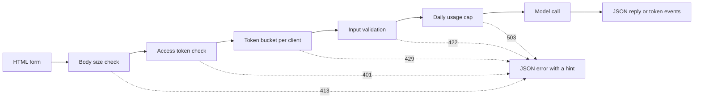

# 模型演示界面: फ़ंक्शन से साझा करने योग्य अनुप्रयोग तक

> 模型演示 एक नियम हैः输入、模型调用和输出── पहले प्रत्येक भाग के लिए सीमाएँ निर्धारित करें।

**Type:** Build
**Languages:** Python
**Prerequisites:** Phase 11 · 13（构建生产级 LLM 应用）、Phase 17 · 08（推理指标）、Phase 17 · 19（AI 网关）
**Time:** ~90 分钟

## 学习目标

- 写出演示的输入、模型调用和输出约定,并为每部分设定限制──
- उपयोग मानक पुस्तकालय एक HTTP अनुप्रयोग, जिसमें एक HTML पृष्ठ, एक JSON अंत बिंदु और एक सर्वर घटना अंत बिंदु शामिल है
- ₹ कम से उच्च प्रमाणीकरण इनपुट तक की लागत के अनुसार,并返回能够告诉用户下一步操作的JSON 错误――
- प्रति ग्राहक आदेश के बैरल का उपयोग करें, दैनिक उपयोग की अधिकतम मात्रा और चयनित विजिट आदेश, सार्वजनिक प्रदर्शन को संरक्षित करें।
- 编写不保留输入文本和客户端地址的请求日志──
- दो फ्रेमवर्क संस्करणों के साथ मानक पुस्तकालय प्रदर्शन की तुलना करें, और प्रदर्शन को उत्पाद के संकेत के लिए अपग्रेड करना होगा।

## 问题

आपका मॉडल नोटबुक में चल सकता है। अब एक समीक्षक दस प्रकार के इनपुट का प्रयास करना चाहता है, एक ग्राहक अपने मोबाइल पर एक बार परिणाम देखना चाहता है। वे आपकी नोटबुक नहीं खोलेंगे।

नोटबुक 单元格 कोई इनपुट प्रतिबंध नहीं है, न ही कोई प्रगति प्रदर्शित करती है। यह रिपोर्ट में दी गई गलतियों का पता लगाने के लिए एक ढेर है, केवल आप इसे पढ़ सकते हैं। यह आपके प्रमाण पत्र और बजट का उपयोग करता है।

- उपयोगकर्ता एक 40,000 字符的文档粘贴──模型调用运行一分钟后失败,返回一段堆跟踪──
- एक स्क्रिप्ट एक मिनट में 500 अनुरोध भेजती है। प्रत्येक अनुरोध एक बार भुगतान मॉडल का उपयोग करता है।
- 页面八秒没有显示任何内容,于是用户再次点击四次按──
-  सर्वर जियरी प्रत्येक प्रविष्टि को, ग्राहक खाता संख्या सहित उस प्रविष्टि को बनाए रखता है。

प्रदर्शन इंटरफ़ेस कम मात्रा में कोड के साथ इन त्रुटियों को रोकने में सक्षम है।

## 概念

### प्रदर्शन एक समझौता है

प्रत्येक प्रस्तुति के तीन भाग होते हैं। इनपुट उपयोगकर्ता द्वारा भेजे जाने वाली सामग्री है; मॉडल रूपांतरण में इनपुट को आउटपुट में परिवर्तित किया जाएगा; आउटपुट उपयोगकर्ता द्वारा देखे जाने वाले सामग्री है, जिसमें त्रुटि भी शामिल है।

इस अनुबंध को लिखने से पहले,

| 部分 | 需要回答的问题 | 本课的答案 |
|------|--------------------|-----------------------|
| 输入 | 什么类型、多大、允许哪些字符？ | 长度为 1 到 500 个字符的字符串，不含控制字符 |
| 模型调用 | 一次调用需要多久、成本多少？ | 一个不到一毫秒即可运行完毕、没有调用费用的玩具关键词模型 |
| 输出 | 成功和失败时，用户分别看到什么？ | 标签、分数和回复，或带有操作提示的 JSON 错误 |

नोटबुक  इन तीनों भागों के लिए कोई सीमा नहीं निर्धारित करती है 



परीक्षण निम्न से उच्च के क्रम में निष्पादन के अनुसार किया जाता है। निष्क्रिय अनुरोध पहली बार अप्रतिबंधित जांच में रुक जाता है, इसलिए लगभग सर्वर संसाधनों का उपभोग नहीं करता है।

### मॉडेल运行之前验证

浏览器 浏览器 浏览器 浏览器 浏览器 浏览器 浏览器 浏览器 浏览器 浏览器 浏览器 浏览器 浏览器 浏览器 浏览器 浏览器 浏览器 浏览器 浏览器 浏览器 浏览器 浏览器 浏览器 浏览器 浏览 浏览 浏览 浏览 浏览 浏览 浏览 `maxlength`和 `required`属性,无需网络调用就能向用户提供反──这些检查只能帮助遵守规则的用户──任何客户端都能绕过页面发送请求,因此服务器必须重复每一次检查──

निम्न से उच्च श्रेणी तक की लागत के अनुसार सर्वर की जाँच करेंः

1. 读取 `Content-Length`अनुरोध शीर्षक──在读取请求体之前,拒绝超过上限的请求体──
2. 解析 JSON अनुरोधों── अस्वीकार नहीं JSON वस्तुओं के अनुरोधों──
3. 检查字段──拒绝空文本、超长文本和控制字符──
4.  केवल पूर्ण जांच के अनुरोध के माध्यम से, एक मॉडल को उपयोग करने के लिए एक बार में उपयोग किया जा सकता है

| 未通过的检查 | HTTP 状态 | 错误代码 |
|--------------|-------------|------------|
| 没有 `Content-Length` 请求头 | 411 Length Required（需要长度） | `length_required` |
| `Content-Length` 不是数字 | 400 Bad Request（错误请求） | `bad_length` |
| 请求体超过 4,096 字节 | 413 Content Too Large（内容过大） | `body_too_large` |
| 尚未收到 `Content-Length` 指定的字节数，请求体就停止传输 | 408 Request Timeout（请求超时） | `request_timeout` |
| 内容类型不是 JSON | 415 Unsupported Media Type（不支持的媒体类型） | `unsupported_media_type` |
| 请求体不是 JSON 对象 | 400 Bad Request（错误请求） | `bad_json` |
| 文本缺失、为空、过长或含有控制字符 | 422 Unprocessable Content（无法处理的内容） | `missing_text`、`empty_text`、`text_too_long`、`control_characters` |

आरएफसी 9110 इन स्टेट कोड और उनके नाम को परिभाषित करता है।

उदाहरण भी इनपुट डिजाइन का हिस्सा है। उदाहरण उपयोगकर्ता को दिखाता है कि उपयुक्त इनपुट क्या है, समीक्षक को केवल एक बार क्लिक करने की आवश्यकता है ताकि परीक्षण किया जा सके। प्रत्येक आउटपुट श्रेणी के लिए एक उदाहरण चुनें।

### 让用户知道模型正在工作

模型调用可能需要几秒钟. यदि कोई प्रतिक्रिया नहीं है, तो उपयोगकर्ता मॉडल को धीमा और पृष्ठ क्षतिग्रस्त नहीं कर सकता है.

इस वर्ग के पृष्ठ में चार प्रकार के प्रतिवाद हैंः

- अनुरोध संचालन के दौरान禁用提交按──
- 显示已用时间, हर 100 मिलीसेकंड में एक बार अपडेट किया गया
- पहला टोकन आ गया, पहला टोकन दिखाया गया 时间
- कृपया समाप्ति के समय, दिखाएँ कुल खपत समय

में सीखना[推理指标](../../08-inference-metrics-goodput/)时,首代币 时间(TTFT) 是服务器标标──演示页面向用户展示相同标标,但改为在浏览器中测量──

### प्रवाहित स्वरूप में भेजना

语言模型个别代币 生成回复── यदि सर्वर अंतिम टोकन तक प्रतीक्षा करता है 才发送, उपयोगकर्ता को संपूर्ण उत्पादन प्रक्रिया का इंतजार करना होगा── यदि सर्वर प्रत्येक टोकन पर 就绪时即发发送, उपयोगकर्ता पहले टोकन प्राप्त करता है तो पढ़ना शुरू कर सकता है──

服务器发送事件(सर्वर-सेंड इवेंट्स,SSE) इस व्यवहार को प्राप्त करने के लिए मानक प्रारूप है।`text/event-stream` प्रत्येक घटना एक समूह द्वारा `event:`和 `data:`行组成,并以一个空行结束──WHATWG HTML 标准 ने इस प्रारूप को परिभाषित किया है──

```text
event: token
data: {"index":0,"text":"Label:"}

event: token
data: {"index":1,"text":" positive."}

event: done
data: {"label":"positive","score":1.0,"tokens":11}
```

浏览器提供用于 SSE 的 `EventSource`接口, लेकिन यह केवल भेजता है GET अनुरोध.GET अनुरोध में URL दर्ज किया जाएगा, जबकि वेब  सर्वर और एजेंट में URL  लिखने के लिए जाएगा visit日志.`fetch()`和 `response.body.getReader()`读取响应,并自行解析事件格式──

流式响应存在单次 JSON 回复 没有问题: सर्वर ने पहले टोकन 之前就发送了状态码200―― यदि मॉडल बाद में विफल रहता है, तो सर्वर पुनः स्थिति कोड नहीं बदल सकता है।`error`事件,由页面将该事件显示为错误──

निर्माण में[生产级 LLM 应用](../../../11-llm-engineering/13-production-app/)时,框架替你通过SSE 发送代币――本课写同协议,让你能够看到服务器发送的每一行――

### लेखक उपयोगकर्ता इस क्रिया के अनुसार गलत जानकारी कर सकता है

错误信息有两个任务:用户告诉发生了什么事,并告诉用户接下来该怎么做――系统不熟悉的人,堆跟踪无法完成其中任何一个――

इस प्रदर्शन में प्रत्येक त्रुटि एक ही JSON  संरचना का उपयोग करता हैः

```json
{
  "error": {
    "code": "text_too_long",
    "message": "The text has 812 characters. The limit is 500.",
    "hint": "Shorten the text to 500 characters or fewer.",
    "request_id": "a8f3c2b435e3"
  }
}
```

- `code`यह एक स्थिर नाम है, ग्राहक कोड और परीक्षण इसका प्रयोग तुलना के रूप में करते हैं।
- `message`陈述事实,并附上用户需要的数值──
- `hint`एक उपयोगकर्ता को निष्पादित करने के लिए एक ऑपरेशन प्रदान करें
- `request_id`एक प्रयोगकर्ता रिपोर्ट को एक प्रयोगकर्ता पत्रिका के साथ जोड़ा गया है।

RFC 9457  ने HTTP API के मानक त्रुटि प्रारूप को परिभाषित किया है, जिसे समस्या विवरण कहा जाता है।

### सुरक्षित भूमि सार्वजनिक प्रदर्शन साझा

सार्वजनिक लिंक परिवर्तन कर सकता है अनुरोध भेजने में सक्षम लोगों की भीड़।

| 风险 | 本演示中的控制措施 | 面向更多受众的控制措施 |
|------|----------------------|-------------------------------|
| 单个客户端发送过多请求 | 每客户端一个令牌桶，配合 429 和 `Retry-After` | 登录后按用户限流 |
| 陌生人发现链接 | `Authorization` 请求头中的可选访问令牌 | 通过身份提供方实现单点登录 |
| 总成本无限增长 | 每日用量上限，配合 503 和 `Retry-After` | 模型提供方的支出限制和告警 |
| 输入非常大或异常 | 请求体大小限制、文本长度限制、控制字符检查 | 输入与输出的内容审核 |
| 日志保留私人输入 | 只记录输入长度和客户端的带密钥哈希 | 日志保留期限与访问控制 |

एक ग्राहक द्वारा सबसे अधिक क्षमता से कितनी अनुरोध भेजने का निर्णय करने के लिए दो संख्याओं का उपयोग करें। एक ग्राहक द्वारा सबसे अधिक क्षमता से कितनी अनुरोध भेजने का निर्णय करने के लिए क्षमता; एक ग्राहक द्वारा अनुरोध की गति से अधिक मात्रा में अनुरोध करने के लिए क्षमता; प्रत्येक अनुरोध एक आदेश का उपयोग करता है, एक आदेश का उपयोग करता है, एक आदेश का उपयोग करता है, लेकिन क्षमता से अधिक नहीं हैः

```text
tokens = min(capacity, tokens + refill_rate * seconds_since_last_request)
accept the request if tokens >= 1, then subtract 1
```

桶为空时, सर्वर वापस `429 Too Many Requests`◊RFC 6585  ने स्टेट कोड 429 को परिभाषित किया,并允许服务器附带 `Retry-After`响应头── इस प्रस्तुति में हमेशा इस प्रतिक्रिया को जोड़ना है, अगले आदेश से दूरी प्रदान करना है।

演示 उपयोग करें ग्राहक IP पता के रूप में桶的键──反向代理后面, प्रत्येक अनुरोध से代理 पता आता है, इसलिए सभी उपयोगकर्ता एक桶 को साझा करेंगे── इस समय, अपने स्वयं के एजेंट सेटअप के अनुरोध शीर्षक से ग्राहक पता पढ़ना चाहिए── किसी अन्य स्रोत के समान नाम के अनुरोध शीर्षक पर भरोसा न करें, क्योंकि ग्राहक इसमें किसी भी मूल्य को भर सकता है──

में सीखना [AI 网关](../../19-ai-gateways/)时,网关按租户执行限流――演示也需要同样的控制,只是规模较小――限流控制单个客户端,但没有控制总量――一百客户端即使都没有超越各自的限制,仍可能耗尽全部预算――使用量上限统计一天内所有模型调调,并在达到固定数次后拒绝新调――

इनपुट तथा इनपुट को भी सावधानीपूर्वक संसाधित करना आवश्यक है।`http.server`प्रसंस्करणकर्ता क्लाइंट के आईपी पते और अनुरोध को मानक त्रुटि में लिखता है। यदि प्रविष्टि URL में स्थित है, तो प्रविष्टि भी日志 में प्रवेश करेगी। इस प्रस्तुति ने इस日志 को बदल दिया है। प्रत्येक अनुरोध केवल एक रिकॉर्ड लिखता है, जिसमें मार्ग मार्ग, राज्य कोड, त्रुटि कोड, देरी और प्रविष्टि लंबाई शामिल हैं।

 tell user you retain what information  प्रदर्शन पृष्ठ विवरण, सर्वर पाठ की लंबाई को बनाए रखता है, लेकिन कभी भी पाठ को स्वयं नहीं रखता 

### 演示何时成为产品

演示由一进程提供服务,面向已知的人群和短时会话── निम्नलिखित संकेत बताते हैं, प्रदर्शन उत्पाद बन गया हैः

- टीम के बाहर के लोग इसे हर हफ्ते उपयोग करेंगे।
- किसी ने उपलब्ध लक्ष्य, या रिपोर्ट सेवा में विराम दिया।
- उपयोगकर्ता लॉगिन करना चाहता है, परिणाम सहेजें या इतिहास देखें
- प्रति सप्ताह मॉडल लागत बजट में एक परियोजना बन जाती है।
- 输入包含受合同或法律约束的数据──

| 属性 | 演示 | 产品 |
|----------|------|---------|
| 用户 | 已知人群，短时会话 | 未知人群，每日使用 |
| 状态 | 无 | 账户、历史、已保存的结果 |
| 可用性 | 尽力而为，单进程 | 书面目标、副本、值班责任人 |
| 成本控制 | 一个每日用量上限 | 每用户配额和计费 |
| 可观测性 | 每请求一条日志 | 链路跟踪、指标和告警 |

इन संकेतों को देखते हुए, प्रदर्शन को उत्पादन स्तर पर स्थानांतरित किया जाना चाहिए LLM अनुप्रयोग पाठ्यक्रम में उत्पादन तकनीक── इस तकनीक ने वास्तविक पहचान प्रमाण पत्र, भंडारण मॉडल, लिंक ट्रैकिंग और प्रति उपयोगकर्ता लागत ट्रैकिंग बढ़ा दी है──

```figure
demo-token-bucket
```

## 动手构建

कोड केवल एक फ़ाइल है`code/main.py`, मानक के अलावा किसी भी निर्भरता की आवश्यकता नहीं है.

```bash
python3 code/main.py
```

स्वयं जांच परीक्षा प्रमाणक 令牌桶 流 स्वरूप, तथा एक वास्तविक HTTP 往返通信── यह खाली पोर्ट पर सर्वर को प्रारंभ करता है, तीन अनुरोध भेजता है, सर्वर को रोकता है, और फिर बाहर निकलता है── केवल ब्राउज़र के उपयोग के दौरान सर्वर को प्रारंभ करता हैः

```bash
python3 code/main.py --serve
```

ब्राउज़र में खोलें`http://127.0.0.1:8000` Ctrl+C पर 停止服务器

### 第 1 步: मॉडल调用

模型 एक खिलौना है, जिसे सही, नकारात्मक या मध्यम के रूप में चिह्नित किया जाएगा।

```python
def classify(text):
    words = WORD_RE.findall(text.lower())
    positive = sum(1 for word in words if word in POSITIVE)
    negative = sum(1 for word in words if word in NEGATIVE)
    score = (positive - negative) / max(1, positive + negative)
    if score > 0:
        label = "positive"
    elif score < 0:
        label = "negative"
    else:
        label = "neutral"
    return {"label": label, "score": round(score, 3), "positive_cues": positive,
            "negative_cues": negative, "words": len(words)}


def generate(text):
    result = classify(text)
    reply = (
        f"Label: {result['label']}. Positive cues: {result['positive_cues']}. "
        f"Negative cues: {result['negative_cues']}. Words read: {result['words']}."
    )
    parts = reply.split(" ")
    yield parts[0]
    for part in parts[1:]:
        yield " " + part
```

换成真实模型时, बस बदलने की जरूरत `generate` इनमे से एपीआई में डालने 调用或本地模型──保持函数签名不变:输入字符串,输出代币──验证器、限制和页面都保持不变──

### द्वितीय चरण: सत्यापन एवं त्रुटि प्रतिक्रिया

एक असामान्य वर्ग सभी त्रुटियों को संभालता है। इसमें HTTP स्टेट कोड, स्थिर त्रुटि कोड, संदेश, ऑपरेशन सुझाव और चयन योग्य प्रतिक्रिया शीर्षक शामिल हैं।

```python
class DemoError(Exception):
    def __init__(self, status, code, message, hint, headers=None):
        super().__init__(message)
        self.status = status
        self.code = code
        self.message = message
        self.hint = hint
        self.headers = dict(headers or {})


def validate_text(payload, max_chars=MAX_CHARS):
    if "text" not in payload:
        raise DemoError(422, "missing_text", 'The field "text" is missing.', 'Add a "text" field with your input.')
    text = payload["text"]
    if not isinstance(text, str):
        raise DemoError(422, "text_not_string", 'The field "text" is not a string.', "Send the input as a string.")
    text = text.strip()
    if not text:
        raise DemoError(422, "empty_text", "The text is empty.", "Type a sentence or pick an example.")
    if len(text) > max_chars:
        raise DemoError(422, "text_too_long", f"The text has {len(text)} characters. The limit is {max_chars}.",
                        f"Shorten the text to {max_chars} characters or fewer.")
    if CONTROL_RE.search(text):
        raise DemoError(422, "control_characters", "The text contains control characters.",
                        "Remove the hidden characters, then send the text again.")
    return text
```

验证器 पहले पहले खो देता है 首尾空白── केवल खाली में मौजूद ग्रंथों को खाली के लिए ठहराया जाता है, सुझाव सूचना उपयोगकर्ता को बताएगी कि क्या दर्ज करना चाहिए──`check_body_size`和 `parse_json_body`411、413、415 और 400 形状 के लिए एक ही मोड का उपयोग करना`error_body` 会将任何 `DemoError`转换为概念部分展示的 JSON 结构──

### 第 3 步:令牌桶

```python
class TokenBucket:
    def __init__(self, capacity, refill_per_second, now):
        if capacity < 1:
            raise ValueError("capacity must be at least 1")
        if refill_per_second <= 0:
            raise ValueError("refill_per_second must be positive")
        self.capacity = float(capacity)
        self.refill_per_second = float(refill_per_second)
        self.tokens = float(capacity)
        self.updated = now

    def take(self, now, cost=1.0):
        elapsed = max(0.0, now - self.updated)
        self.tokens = min(self.capacity, self.tokens + elapsed * self.refill_per_second)
        self.updated = now
        if self.tokens >= cost:
            self.tokens -= cost
            return 0.0
        return (cost - self.tokens) / self.refill_per_second
```

`take` अनुरोध स्वीकार करते समय 0.0 लौटाएं; अन्यथा, बैरल में आदेश के लिए पर्याप्त दूरी पर वापस लौटें।`Retry-After`

`RateLimiter``OrderedDict`मध्य के लिए प्रत्येक ग्राहक सहेज एक बैरल.`ThreadingHTTPServer`इस प्रकार प्रत्येक अनुरोध का संसाधित करने के लिए इस शब्दकोश में अनुच्छेदों की संख्या से अधिक है।`max_clients`时,限流器将移除最久未发发请求的客户端──被移除的客户端下次请求时,将获得一个充满的桶──将`max_clients` आपके अपेक्षित सक्रिय ग्राहक संख्या से अधिक सेट करें

限流器 स्वीकार एक `clock`参数──测试传入 `FakeClock`, इसलिए बिना किसी वास्तविक प्रतीक्षा की जरूरत, हम समय को आगे बढ़ा सकते हैं`UsageCap`उसी घंटों के मॉडल के साथ संसाधित प्रति दिन कुल मात्रा: 86,400 सेकंड के फिक्स्ड विंडो के साथ, समय का उपयोग करने पर अगली विंडो से दूरी पर लौटने के लिए प्रतीक्षा करने के लिए सेकंडों की संख्या।

### 第4 步: घटनाक्रम

```python
def sse_event(event, data):
    payload = json.dumps(data, separators=(",", ":"), ensure_ascii=False)
    return f"event: {event}\ndata: {payload}\n\n".encode("utf-8")


def stream_events(text, generate_fn=generate, delay=0.0, sleep=time.sleep):
    count = 0
    try:
        for token in generate_fn(text):
            yield sse_event("token", {"index": count, "text": token})
            count += 1
            if delay:
                sleep(delay)
    except Exception:
        yield sse_event("error", MODEL_ERROR)
        return
    result = classify(text)
    yield sse_event("done", {"label": result["label"], "score": result["score"], "tokens": count})
```

`json.dumps` 会把字符串中换行写成 `\n`इन दो वर्णों में से प्रत्येक घटना में केवल एक ही पंक्ति डेटा होती है जिसमें मूल परिवर्तन वर्ण शामिल नहीं होते हैं।

生成器捕获模型故障,并发送 `error`घटना, क्योंकि सर्वर ने स्थिति भेज दी है।`delay`和 `sleep`参数 ब्राउज़र प्रदर्शन में प्रवाह की गति को धीमा कर सकता है, जबकि परीक्षण को तेजी से बनाए रख सकता है।

### 第5 步: अनुरोध प्रसंस्करण

`DemoHandler`继承自`BaseHTTPRequestHandler`◊POST प्रसंस्करणक अनुसार अवधारणा भाग में वर्णित क्रम निष्पादन जांचः

```python
def do_POST(self):
    app = self.server.app
    request_id = uuid.uuid4().hex[:12]
    client_id = self.client_address[0]
    started = time.perf_counter()
    route = self.path if self.path in self.routes else "other"
    status, code, chars = 200, None, 0
    try:
        declared = self.headers.get("Content-Length")
        try:
            if route == "other":
                raise DemoError(404, "not_found", "This endpoint does not exist.",
                                "Send requests to /api/predict or /api/stream.")
            size = check_body_size(declared, app.config.max_body_bytes)
        except DemoError:
            self.drain(int(declared) if declared and declared.isdigit() else 0)
            raise
        try:
            body = self.rfile.read(size)
        except TimeoutError:
            self.close_connection = True
            raise DemoError(408, "request_timeout", "The request body did not arrive in time.",
                            "Send the request again with the full body.") from None
        app.admit(client_id, self.headers.get("Authorization"))
        text = app.read_text(self.headers.get("Content-Type"), body)
        chars = len(text)
        app.charge()
        if route == "/api/predict":
            self.send_json(200, predict(text), request_id)
        else:
            code = self.send_stream(text, request_id)
    except DemoError as err:
        status, code = err.status, err.code
        self.send_error_json(err, request_id)
    except TimeoutError:
        status, code = 408, "request_timeout"
        self.close_connection = True
    except Exception:
        status, code = 500, "internal_error"
        self.send_error_json(DemoError(500, "internal_error", "The server failed on this request.",
                                       "Try again. Quote the request id if you report the problem."), request_id)
    finally:
        latency_ms = (time.perf_counter() - started) * 1000
        app.log.record(request_id, route, client_id, status, chars, latency_ms, code)
```

`admit`检查访问令牌和令牌桶──`charge`查查每日上限,并最后执行,因此只有有效请求才会计入上限──每请求都会在 `finally`块中写入一条日志, जिसमें अस्वीकृत अनुरोध शामिल है।`route`, निश्चित रूप से मूल पथ नहीं है, क्योंकि पथ में उपयोगकर्ता पाठ के साथ प्रश्न पत्र शामिल हो सकते हैं।

चार विवरण आसानी से अनदेखी होने से बचने में सक्षम हैंः

- 处理器类上 `timeout = 10`                                                                                                                                                                                                                                                              
- `log_message`直接返回,不输出内容── यह स्थानांतरण शामिल ग्राहक पता और अनुरोध की डिफ़ॉल्ट日志──
- `drain`RFC 1122 में कहा गया है कि जब मुख्य संयंत्र बंद हो जाता है तो टीसीपी पुनःपूर्ति भेजता है; इसलिए ग्राहक 413 प्रतिक्रिया प्राप्त नहीं कर सकता है।
- `send_stream` पकड़े `BrokenPipeError`नहीं बंद जनरेटर. उपयोगकर्ता बंद करता है, मॉडल बंद हो जाता है, यह अनुरोध भी लागत में वृद्धि नहीं करता है.

`BaseHTTPRequestHandler`默认使用HTTP/1.0── इसलिए, सर्वर बंद होने के समय क्रमबद्ध प्रतिक्रिया का अंत होता है।

### 第 6 步: पृष्ठ

`render_page`返回一个HTML文档,其中内嵌样式和脚本──页面不载任何外部脚本、字体或图片──脚本按以下方式读取流:

```javascript
const reader = response.body.getReader();
const decoder = new TextDecoder();
let buffer = "";
while (true) {
  const chunk = await reader.read();
  if (chunk.done) { break; }
  buffer += decoder.decode(chunk.value, { stream: true });
  let cut = buffer.indexOf("\n\n");
  while (cut >= 0) {
    const frame = parseFrame(buffer.slice(0, cut));
    buffer = buffer.slice(cut + 2);
    cut = buffer.indexOf("\n\n");
    if (frame.event === "token") { output.textContent += frame.data.text; }
  }
}
```

网络数据块可能在事件中结束.`buffer`मध्य, जब तक रिक्त पद प्राप्त नहीं हो जाता।

页面使用 `textContent`写入模型输出,绝不使用 `innerHTML` मॉडल आउटपुट अविश्वसनीय है  परिकल्पना पृष्ठ को HTML 插入 के रूप में पुनः प्राप्त किया जाएगा, जबकि पुनः प्राप्ति समाहित `onerror`属性元素, इस गुण पर उपयोगकर्ता ब्राउज़र में निष्पादन कोड संभव है.

 सेवाकर्ता भी भेजेगा `default-src 'none'``Content-Security-Policy`响应头―― यह रणनीति केवल एक इनमेटेड स्क्रिप्ट और एक इनमेटेड स्टाइल को अनुमति देती है, और अपने स्वयं के SHA-256 哈希 पहचान उन्हें पारित करती है। ब्राउज़र पृष्ठ में हमलावरों के प्रवेश सहित अन्य सभी स्क्रिप्टों को अस्वीकार कर देगा।

```python
def csp_hash(source):
    digest = hashlib.sha256(source.encode("utf-8")).digest()
    return "'sha256-" + base64.b64encode(digest).decode("ascii") + "'"
```

### #7 कदमः इसे चलाना, इसे गलत बनाने की कोशिश करना

 सर्वर को प्रारंभ करें, फिर दूसरे टर्मिनल से उपयोग करें `curl`◊ प्रक्षेपित सर्वर सात अनुरोधों को लगातार भेजता है ◊ बैरल की क्षमता पांच कमांड है, प्रत्येक दो सेकंड में एक कमांड भरता हैः

```bash
for i in 1 2 3 4 5 6 7; do
  curl -s -o /dev/null -w '%{http_code} ' -X POST http://127.0.0.1:8000/api/predict \
    -H 'Content-Type: application/json' -d '{"text": "ok"}'
done
```

```text
200 200 200 200 200 429 429
```

प्रतीक्षा 10 सेकंड, फिर भेजें रिक्त लेखः

```bash
curl -s -X POST http://127.0.0.1:8000/api/predict \
  -H 'Content-Type: application/json' -d '{"text": ""}'
```

```json
{"error": {"code": "empty_text", "message": "The text is empty.", "hint": "Type a sentence or pick an example.", "request_id": "e3e3599feaea"}}
```

उपयोग करना बंद करें`curl -N`观察事件流:

```bash
curl -N -X POST http://127.0.0.1:8000/api/stream \
  -H 'Content-Type: application/json' -d '{"text": "The screen is bright."}'
```

यदि आप एक आदेश का अनुरोध करना चाहते हैं, तो सर्वर को प्रारंभ करने से पहले सेट करें `DEMO_ACCESS_TOKEN`ページ  तब एक令牌输入框 प्रदर्शित होगा

```bash
export DEMO_ACCESS_TOKEN="$(python3 -c 'import secrets; print(secrets.token_urlsafe(24))')"
echo "$DEMO_ACCESS_TOKEN"
python3 code/main.py --serve
```

运行测试:

```bash
python3 -m unittest discover -s code/tests -v
```

HTTP 测试在端口 0 上启动服务器, ऑपरेटिंग सिस्टम द्वारा चयनित空端口──`tearDown`停止服务器,并检查它的线程是否已结束──

## 使用框架

ग्रेडियो और स्ट्रीमलाइट ये दो पायथन फ्रेमवर्क कम कोड के साथ निर्माण कर सकते हैं।`main.py`导入约定, इसलिए सत्यापितकर्ता एवं मॉडल बरकरार रहे।`main.py`या परीक्षण, इनमें से किसी एक फ्रेमवर्क को स्थापित करने की आवश्यकता नहीं है।

###  एक समारोह संगठन के आसपास

ग्रेडियो 为一个Python 函数包装Web界面──输入和输出组件描述约定,生成器函数发送部分输出──

```python
import os

import gradio as gr

from main import EXAMPLES, MAX_CHARS, DemoError, classify, generate, validate_text


def label_text(text):
    try:
        clean = validate_text({"text": text})
    except DemoError as err:
        raise gr.Error(f"{err.message} {err.hint}")
    label = classify(clean)["label"]
    reply = ""
    for token in generate(clean):
        reply += token
        yield reply, label


demo = gr.Interface(
    fn=label_text,
    inputs=gr.Textbox(label="Text to label", lines=5, max_length=MAX_CHARS),
    outputs=[gr.Textbox(label="Reply"), gr.Textbox(label="Label")],
    examples=list(EXAMPLES),
    flagging_mode="never",
)

if __name__ == "__main__":
    demo.queue(max_size=20).launch(auth=("demo", os.environ["DEMO_PASSWORD"]))
```

हर बार`yield`इस प्रकार, यह फ़ंक्शन प्रत्येक चरण में वर्तमान के पूर्ण प्रतिपादन के लिए उत्पन्न होता है।

                                                                                                                                                                                                                                                                                                                                                                                                                                                                                                                             `flagging_mode`◊默认模式 will display tagged ──user 🏻 🏻 🏻 🏻 🏻 🏻 🏻 🏻 🏻 🏻 🏻 🏻 🏻 🏻 🏻 🏻 🏻 🏻 🏻 🏻 🏻 🏻 🏻 🏻 🏻 🏻 🏻 🏻 🏻 🏻 🏻 🏻 🏻 🏻 🏻 🏻 🏻 🏻 🏻 🏻 🏻 🏻 🏻 🏻 🏻 🏻 🏻 🏻 🏻 🏻 🏻 🏻 🏻 🏻 🏻 🏻 🏻 🏻 🏻 🏻 🏻 🏻 🏻 🏻 ♀️🏻 ♀️🏻 ♀️🏻 ♀️🏻 ♀️🏻 ♀️🏻 ♀️🏻 ♀️🏻 ♀️🏻 ♀️🏻 ♀️🏻 ♀️🏻 ♀️🏻 ♀️♀️♀️♀️♀️♀️♀️♀️♀️♀️♀️♀️♀️♀️♀️♀️♀️♀️♀️♀️♀️`"never"`इस प्रेस को हटाने के लिए होगा

`queue(max_size=20)`限制等待中的请求数量──默认并发限制是每个事件只运行一个调用──你提高限制之前,慢模型一次只服务一个用户──Gradio भी अनुप्रयोग लॉन्च होने पर एपीआई 端点创建 करेगा,让脚本无需通过页面就能调用演示──你的限流也必须覆盖这些端点──

### प्रत्येक प्रविष्टि के लिए पुनः चलाने के लिए स्क्रिप्ट

उपयोगकर्ता प्रत्येक परिवर्तन नियंत्रण में, स्ट्रीमलाइट पूरे स्क्रिप्ट को शुरू से अंत तक फिर से चलाएगा।

```python
import streamlit as st

from main import EXAMPLES, MAX_CHARS, DemoError, classify, generate, validate_text

st.title("Toy sentiment demo")
st.caption("Do not paste private data.")

example = st.selectbox("Start from an example", ["", *EXAMPLES])
with st.form("demo"):
    text = st.text_area("Text to label", value=example, max_chars=MAX_CHARS)
    submitted = st.form_submit_button("Run model")

if submitted:
    try:
        clean = validate_text({"text": text})
    except DemoError as err:
        st.error(f"{err.message} {err.hint}")
    else:
        st.write_stream(generate(clean))
        st.write(f"Label: {classify(clean)['label']}")
```

`st.write_stream`直接 स्वीकार जनरेटर, प्रत्येक डेटा ब्लॉक पर पहुँचने पर इसे लिखें. कृपया उपयोग करें `@st.cache_resource`वास्तविक मॉडल को लोड करें, क्योंकि प्रत्येक बार प्रस्तुत किया जाता है, प्रत्येक बार एक मॉडल उदाहरण को पुनः उपयोग किया जाता है।

### विभिन्न कार्यक्रमों का स्वीकृत व्यवहार

| 需求 | 标准库（本课） | Gradio | Streamlit |
|------|--------------------------------|--------|-----------|
| 表单、示例、结果区域 | 自己编写 HTML | `Interface` 根据组件和 `examples` 构建 | 使用 `st.text_area`、`st.selectbox` 等控件 |
| 输入长度限制 | 页面上的 `maxlength` 加服务器检查 | `Textbox` 上的 `max_length` | `st.text_area` 上的 `max_chars` |
| 部分输出 | 自己编写 SSE 和流读取器 | 使用生成器函数，每次 `yield` 替换输出 | `st.write_stream` 配合数据块生成器 |
| 进度显示 | 自己编写计时器 | 输出区域的进度显示，由 `show_progress` 设置 | `st.write_stream` 在每个数据块到达时显示它 |
| 面向用户的错误 | 带有 `code`、`message`、`hint`、`request_id` 的 JSON | `raise gr.Error(...)` 显示消息 | `st.error(...)` 显示消息 |
| 并发 | 每请求一个线程，无上限 | 队列，默认每个事件只运行一个调用 | 每次交互都会为该会话重新运行脚本 |
| 公开链接 | 自己运行服务器和管理域名 | `launch(share=True)` 提供一周后过期的链接 | 自己将应用部署到服务器 |
| 登录 | Bearer 令牌检查 | `launch(auth=...)` 使用用户名和密码 | `st.login()` 配合 OpenID Connect 提供方 |
| 限流与成本上限 | 令牌桶和每日上限 | 自己编写代码，通过请求获取客户端地址 | 自己编写代码 |
| 工具写入磁盘的输入信息 | 日志中只有输入长度 | 被标记的样本写入 CSV 文件，除非设置 `flagging_mode="never"` | 由自己的代码决定 |

框架在页面方面省省省省省省省省省省省省省省省省省省省省省省省省省省省省省省省省省省省省省省省省省省省省省省省省省省省省省省省省省省省省省省省省省省省省省省省省省省省省省省省省省省省省省省省省省省省省省省省省省省省省省省省省省省省省省省省省省省省省省省省省省省省省省省省省省省省省省省省省省省省省省省省省省省省省省省省省省省省省省省省省省省省省省省省省省省省省省省省省省省省省省省省省省省省省省省省省省省省省省省省省省省省省省省省省省省省省省省省省省省省省省省省省省省省省省省省省省省省省省省省省省省省省省省省省省省省省省省省省省省省省省省省省省省省省省省省省省省省省省省省省省省省省省省省省省省省省省省省省省省省省省省省省省省省省省省省省省省省省省省省省省省省省省省省省省省省省省省省省省省省省省省省省省省省省省省省省省省省省省省省省省省省省省省省省省省省省省省省省省省省省省省省省省省省省省省省省省省省省省省省省省省省省省省省省省省省省省省省省省省省省省省省省省省省省省省省省省省省省省省省省省省省省省省省省省省省省省省省省省省省省省省省省省省省省省省省省省省省省省省省省省省省省省省省省省省省省省省省省省省省省省省省省

## 交付 यह

本课产 出 `outputs/skill-demo-interface-checklist.md` इसे मॉडल के प्रदर्शन का विवरण या कोड प्रदान करता है, यह मूल्यांकन करता है 反、 त्रुटि तथा सार्वजनिक लिंक के नियंत्रण उपाय, और पारित या अप्रतिबंधित निष्कर्ष देता है  प्रत्येक अप्राप्य अनुभाग एक संशोधन सुझाव के साथ संलग्न होगा

## अभ्यास

1. `BUCKET_CAPACITY`设置为 2,将 `REFILL_PER_SECOND`设置为1──预测七请求循环的输出,再实际运行并比较──
2. अनुरोध में जोड़ `language`字段, केवल स्वीकार `"en"`◊ किसी भी अन्य मूल्य पर लौटने के लिए  422  त्रुटि,并添加两个测试──
3. 找出一个玩具模型会错分类的句子,例如"स्क्रीन अच्छा नहीं है. "── इसे चौथे उदाहरण के रूप में, और पृष्ठ पर विवरण जोड़कर, व्याख्या मॉडल की सीमाएँ──
4. अपने मशीन पर, प्रदर्शन को विपरीत एजेंट के पीछे रखा जाएगा.`trust_proxy`选项,只读取来自代理地址的 `X-Forwarded-For`编写测试,证明客户端无法自行选择桶的键──
5. `generate`                                                                                                                                                                                                                                                              

## 关键术语

| 术语 | 人们常说 | 实际含义 |
|------|-----------------|------------------------|
| 演示约定 | “UI” | 输入限制、模型调用，以及包含错误在内的输出结构 |
| 令牌桶 | “限流器” | 每客户端一个计数器，按固定速率补充，最多达到容量上限；每个请求消耗一个令牌 |
| Retry-After | “稍后再试” | 响应头，指定客户端多久之后，或在哪个日期之后，可以再次尝试 |
| 服务器发送事件 | “流式传输” | 由 `event:` 和 `data:` 行组成的 `text/event-stream` 响应，每个事件后有一个空行 |
| 首 token 时间 | “延迟” | 从发出请求到第一个 token 显示在用户屏幕上的时间 |
| 用量上限 | “预算” | 一个时间窗口内所有客户端合计的模型调用次数上限 |
| 带密钥哈希 | “匿名 ID” | 使用秘密盐值对客户端地址计算 HMAC（基于哈希的消息认证码）；它只是化名，任何持有盐值的人都能检验某个已知地址 |
| 内容安全策略 | “CSP” | 响应头，告诉浏览器页面允许使用哪些脚本、样式和连接 |

## 延伸阅读

- [Python `http.server` 文档](https://docs.python.org/3/library/http.server.html): सर्वर क्लासेस 默认 HTTP/1.0 默认日志, तथा यह मॉड्यूल उत्पादन वातावरण के लिए अनुपयुक्त चेतावनी
- [WHATWG HTML 标准：服务器发送事件](https://html.spec.whatwg.org/multipage/server-sent-events.html)घटनाक्रम`EventSource`接口──
- [MDN：使用服务器发送事件](https://developer.mozilla.org/en-US/docs/Web/API/Server-sent_events/Using_server-sent_events)घटना प्रारूप और ब्राउज़र एपीआई के उदाहरण
- [MDN：使用可读流](https://developer.mozilla.org/en-US/docs/Web/API/Streams_API/Using_readable_streams): कैसे एक एक से दूसरे से सीखें `fetch()`响应体──
- [MDN：使用 Fetch API](https://developer.mozilla.org/en-US/docs/Web/API/Fetch_API/Using_Fetch):带 JSON अनुरोध अनुरोधों के अनुरोध及响应处理──
- [MDN：429 Too Many Requests](https://developer.mozilla.org/en-US/docs/Web/HTTP/Reference/Status/429)和 [MDN：Retry-After](https://developer.mozilla.org/en-US/docs/Web/HTTP/Reference/Headers/Retry-After):सीमित प्रवाह स्थिति कोड तथा उसके प्रतिसाद
- [MDN：内容安全策略](https://developer.mozilla.org/en-US/docs/Web/HTTP/Guides/CSP):内嵌脚本的哈希和 `default-src`निर्देश
- [RFC 6585](https://www.rfc-editor.org/rfc/rfc6585.html): नव增 HTTP 状态码, 429 सहित
- [RFC 9110](https://www.rfc-editor.org/rfc/rfc9110.html):HTTP 语义, 413、415 和 422── सहित
- [RFC 9457](https://www.rfc-editor.org/rfc/rfc9457.html): समस्या विवरण, अर्थात् HTTP API का मानक JSON 错误格式──
- [RFC 1122](https://www.rfc-editor.org/rfc/rfc1122.html)मुख्य आवश्यकताएं, जिसमें कनेक्शन के दौरान होने वाले TCP पुनर्स्थापना सहित समापन के लिए अभी भी अपठित डेटा शामिल है।
- [Gradio：分享应用](https://gradio.app/guides/sharing-your-app): साझा करें लिंक, पहचान प्रमाण पत्र, एपीआई पृष्ठ और सीमा प्रवाह
- [Gradio：流式输出](https://gradio.app/guides/streaming-outputs):आधारित जनरेटर फ़ंक्शन प्रदान करें
- [Gradio：Interface](https://gradio.app/docs/gradio/interface):`examples``flagging_mode`和 `concurrency_limit`
- [Gradio：使用标记功能](https://gradio.app/guides/using-flagging): डिस्क पर भंडारण स्थान पर चिह्नित नमूना
- [Streamlit：基本概念](https://docs.streamlit.io/get-started/fundamentals/main-concepts): पुनः परिचालन डेटा प्रवाह
- [Streamlit：st.write_stream](https://docs.streamlit.io/develop/api-reference/write-magic/st.write_stream)和 [Streamlit：缓存](https://docs.streamlit.io/develop/concepts/architecture/caching): भाग आउटपुट, तथा केवल एक बार के मॉडल को लोड करना
- [Streamlit：st.login](https://docs.streamlit.io/develop/api-reference/user/st.login): ओपनआईडी कनेक्ट के माध्यम से  प्रदान करने के लिए प्रवेश
