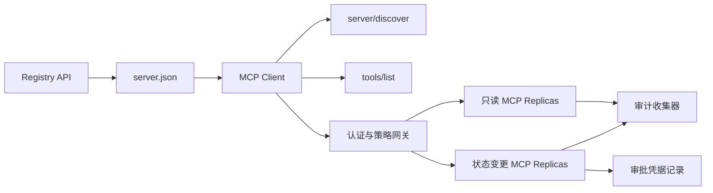

# 综合实战项目 13:带 रजिस्ट्री एवं प्रशासन के बिना राज्य एमसीपी सर्वर

> उत्पादन स्तर MCP  निश्चित रूप से एक एकल सरल सर्वर  प्रक्रिया नहीं है  यह एक संपूर्ण अनुबंध श्रृंखला हैः जारी किए जाने वाले डेटा  वास्तविक समय सेवा खोज  बिना स्थिति अनुरोध  परिपत्र  पहचान प्रमाण पत्र और प्राधिकरण  लघु सीमा रणनीति निर्णय  लेखा परीक्षा प्रमाण पत्र तथा तैनाती प्रमाण पत्र 

**Type:** Capstone
**Languages:** Python 与 TypeScript 参考模型；支持任何生产级编程语言
**Prerequisites:** Phase 11, Phase 13, Phase 14, Phase 17 与 Phase 18
**必修 MCP 进阶课：** [Lesson 28: Tool Contracts](../../../13-tools-and-protocols/28-mcp-tool-contracts-and-content/docs/en.md),[Lesson 29: 可靠性与流控](../../../13-tools-and-protocols/29-mcp-reliability-cancellation-and-flow-control/docs/en.md),[Lesson 30: Registry 供应链](../../../13-tools-and-protocols/30-mcp-registry-supply-chain-and-drift/docs/en.md), 及 [Lesson 31: 一致性工程](../../../13-tools-and-protocols/31-mcp-conformance-versioning-and-operations/docs/en.md)
**目标协议规范：**एमसीपी `2026-07-28`
**Time:** ~25 小时

## 学习目标

- 实现合规的无状态 MCP अनुरोध与结果 封筒
- रजिस्ट्री 静态元数据 और संचालन के समय वास्तविक समय समझौते में कठोर अंतर करना
- निर्मित पदानुक्रम एवं काशविन्यास संज्ञानात्मक उपकरण खोज प्रणाली का निर्माण
- प्रत्येक उपकरण के लिए 调用强制执行签发发者 (निष्पादक) ▌受众 (प्रशिक्षक) ▌作用域 (क्षेत्र) ▌अनुमोदन रणनीति。
- 部署无 सत्र 亲和性绑定 流媒体 HTTP 集群──
- नेटवर्क लाइनों में, प्राधिकरण, रणनीति, रजिस्ट्री और लेखा परीक्षा की सीमा पर पूर्ण इंजीनियरिंग प्रमाण प्रदान करना।

## अनिवार्य MCP 前置路径

इस परियोजना को उत्पादन के लिए तैयार करने से पहले, चरण 13 के चार चरणों के पाठ्यक्रम को निम्नलिखित रूप से पूरा करना होगाः

1. [Lesson 28](../../../13-tools-and-protocols/28-mcp-tool-contracts-and-content/docs/en.md): परिभाषित करें इस सर्वर को णपता होना चाहिए उपकरण, योजना, संरचनात्मक सामग्री, पृष्ठों की एक श्रृंखला, स्वचालित रूप से भरने, मार्ग और त्रुटि
2. [Lesson 29](../../../13-tools-and-protocols/29-mcp-reliability-cancellation-and-flow-control/docs/en.md): परिभाषा取消竞态、截止期限、等性、背压、重试与断线重连行为──
3. [Lesson 30](../../../13-tools-and-protocols/30-mcp-registry-supply-chain-and-drift/docs/en.md): परिभाषा नामकरण स्थान归属、来源追踪、准入锁定、 रजिस्ट्री 状态、漂移检测、账本记录与回滚凭证──
4. [Lesson 31](../../../13-tools-and-protocols/31-mcp-conformance-versioning-and-operations/docs/en.md): परिभाषित करें स्वर्ण मानक तथा विपरीत दिशा में प्रवेश प्रकरणे、 कठोर संस्करण时代、SDK  व्यवहार अंतर校验、代理网络凭证、 संवेदनशील डेटा脱敏、健康门禁和发布阻──

इस परियोजना के लिए जिम्मेदार है कि इन उत्पादन स्तर के तत्वों को घनिष्ठ रूप से एकीकृत किया जाए, यह एक साधारण रन-थ्रू एसडीके परीक्षण के साथ नहीं किया जा सकता है।

## 问题背景

企业内部平台需要一套只读数据工具和少量具有状态变更能力的写操作工具―― डेवलपर को सर्वर को ढूंढने में सक्षम होना चाहिए  कैसे कनेक्ट होना चाहिए  वास्तविक समय में इसकी संचालन क्षमता की जांच करना चाहिए, और केवल इसके द्वारा स्पष्ट रूप से अधिकृत उपयोग के संचालन को ही अनुकूलित करना चाहिए

सच्ची कठिनाई कभी एक पायथन फ़ंक्शन लिखने की नहीं है, बल्कि निम्नलिखित छह सत्य स्रोतों को उच्चतम स्तर पर संगत रखने के लिए कैसेः

1. `server.json`声明 सर्वर पर स्थापित या किस नेटवर्क के माध्यम से पहुँचने के लिए;
2. `server/discover`् ास वर्तमान में चल रहे वास्तविक समय प्रक्रियाओं का वास्तविक समर्थन करने की क्षमता का दावा किया है;
3. प्रत्येक अनुरोध में अपनाई गई अनुबंध संस्करण और ग्राहक क्षमता विवरण स्पष्ट रूप से निर्दिष्ट किया गया है;
4. 授权系统将调用方与法定发发发商、资源指示器(资源指标) तथा दायरा 绑定;
5. 策略引擎 स्वतंत्र निर्णय लेने के लिए कि क्या विशिष्ट संचालन और इनपुट तत्व निष्पादन के लिए तैयार हैं;
6. 审计日志 ट्रस्ट रिकॉर्ड सीमा पार के प्रत्येक बातचीत का, तथा कभी भी संवेदनशील भार या प्रमाण की कुंजी का खुलासा नहीं करता है

किसी भी कड़ी में एक प्रस्थान हो, प्लेटफॉर्म पर एक अक्षम सर्वर को प्रदर्शित किया जा सकता है, गलत मार्ग से असंगत क्लाइंट, अन्य संसाधनों के लिए टोकन का गलत उपयोग, या अनधिकृत स्थिति में उच्च जोखिम वाले ऑपरेशन निष्पादित करना।

## 两层发现机制 (द दो डिस्कवरी लेयर)

रजिस्ट्री 静态索引与实时的MCP सर्वर  उत्तर पूरी तरह से अलग आयाम के प्रश्न हैंः

| 发现层次 | 交互契约 | 回答的核心问题 |
|---|---|---|
| 发布层 (Publication) | `server.json` 与 Registry API | 该 Server 是什么？其代码包或远程网络端点在哪里？如何进行配置？ |
| 运行时 (Runtime) | `server/discover` | 该运行进程当前实际支持哪些协议版本、能力特性、扩展及 Server 身份？ |

官方 रजिस्ट्री 采用带版本控制的 `server.json`योजना ∙ एक दूरस्थ条目 का उपयोग किया जा सकता है Streamable HTTP 地址:

```json
{
  "$schema": "https://static.modelcontextprotocol.io/schemas/2025-12-11/server.schema.json",
  "name": "com.example/internal-readonly",
  "title": "Internal Read-Only Tools",
  "description": "Read-only incident and data lookup tools.",
  "version": "1.0.0",
  "remotes": [
    {
      "type": "streamable-http",
      "url": "https://mcp.internal.example.com/readonly"
    }
  ]
}
```

रजिस्ट्री स्कीमा  संस्करण  MCP 协议 संस्करण पूरी तरह से स्वतंत्र, मत भ्रमित करो एक बात के लिए। प्रत्येक दस्तावेज को अपने स्वयं के अनुबंध के अनुसार कठोर परीक्षण करना होगा।

具备合规 Schema 不代表拥有命名空间所有权──对 `example.com`完成验证的发布者使用反向 DNS 命名空间 `com.example/*`या उसके नाम की जगह

सर्वर ज़रूर कार्यान्वित `server/discover`ग्राहक व्यवसाय के प्रारम्भ से पहले इसका सक्रिय उपयोग कर सकता हैः

```json
{
  "resultType": "complete",
  "supportedVersions": ["2026-07-28"],
  "capabilities": {
    "tools": {
      "listChanged": false
    }
  },
  "_meta": {
    "io.modelcontextprotocol/serverInfo": {
      "name": "com.example/internal-readonly",
      "version": "1.0.0"
    }
  },
  "ttlMs": 3600000,
  "cacheScope": "public"
}
```

## 无状态 MCP 核心(राज्यहीन MCP कोर)

एमसीपी `2026-07-28`पूर्णतः समझौता सत्र को हटा दिया गया है`initialize`握手与 `Mcp-Session-Id` प्रत्येक अनुरोध में `params._meta`中携带协议上下文:

```json
{
  "io.modelcontextprotocol/protocolVersion": "2026-07-28",
  "io.modelcontextprotocol/clientCapabilities": {},
  "io.modelcontextprotocol/clientInfo": {
    "name": "internal-platform-client",
    "version": "1.0.0"
  }
}
```

लोड बैलेंसर बिना किसी चिंता के विभिन्न स्वस्थ प्रतिकृति को जारी किए जाने वाले अनुरोधों को जारी करेगा, क्योंकि किसी भी प्रतिकृति को पूरी तरह से रिपोर्ट से स्वयं सत्यापित और अनुरोधों को संसाधित किया जा सकता है।

常规成功结果返回 `resultType: "complete"`, और सर्वर 应在 `_meta.io.modelcontextprotocol/serverInfo`中标明身份──协议版本非法返回 अवैध पैराम्स 错误码 `-32602`; कानूनी लेकिन समर्थित संस्करण के लिए, वापस `-32022`डेटा में सटीकता नहीं है`supported``requested`

### सेवा का पता लगाने

`tools/list`必须保证确定性排序, इसके परिणाम में शामिल हैंः

- `ttlMs`: ग्राहक की ताजाता का ध्यान रखना;
- `cacheScope`:`public`(सार्वजनिक साझा) या `private`(上下文私有);
-  कड़ाई से स्थिर उपकरण क्रम, एक ही सूची को सक्षम बनाने के लिए मॉडल के अंत में त्वरित कैश का उपयोग;
- `resultType: "complete"`सर्वर के साथ डेटा को संरेखित करें

 विशिष्ट उपयोगकर्ता के अधिकार नियंत्रण के लिए, आमतौर पर आउटपुट `cacheScope: "private"`, उपयोगकर्ता के विशेष उपकरण को सार्वजनिक साझा संग्रह में उपलब्ध नहीं कर सकता है।

## स्ट्रीम करने योग्य HTTP 传输

面向网络的服务器 暴露单一的 POST 端点── प्रत्येक JSON-RPC अनुरोध या सूचना स्वतंत्र POST──

 अनुरोध पर, सर्वर  एकल JSON प्रतिक्रिया  या उस अनुरोध के लिए अनुरोध भूमिका क्षेत्र  SSE 流──长周期的变更通知通过 `subscriptions/listen`建立长连接流──

अनुरोध करना होगा कि आप एक छवि निर्दिष्ट करें HTTP अनुरोध शीर्षकः

- `MCP-Protocol-Version`: अनुरोध के साथ संगत;
- `Mcp-Method`: JSON-RPC 方法名一致;
- `Mcp-Name`: में调用 `tools/call`等方法时镜像工具名;
- `Accept: application/json, text/event-stream`

头部与请求体不一致时立即回归 `-32020`错误码――校验 `Origin` रक्षा DNS पुनः बाध्य,并将请求作用域 SSE 流的被动断开视为请求取消──



```figure
cf-mcp-gate
```

## 认证与策略决策

传输层元数据绝对不等于权限凭证―― प्रत्येक调用均需严格识别权:

1. 动态发现受保护资源元数据;
2. संसाधन चयन के लिए अधिकार प्राप्त सर्वर;
3. 优先使用客户 ID मेटाडेटा डॉक्यूमेंट्स(CIMD)
4. प्रसंस्करण प्रक्रम में प्रसंस्करण संकेतक भेजना;
5. 验证返回的 `iss`यदि रिकॉर्ड के अधिकृत सर्वर एक致;
6. 按 जारीकर्ता 隔离存储 凭据客户,绝不跨 जारीकर्ता 复用;
7. MCP सर्वर 侧验证 टोकन के प्रदाता、受众、过期时间与 Scope;
8. विशिष्ट उपकरण नाम और वास्तविक तत्वों के लिए दोहरी रणनीति निर्णय लेना।

### कृत्रिम स्वीकृति प्रमाणपत्र का अभिलेख है, जादू का दायरा नहीं

status变更调用需要一个结构化的人工审批凭证 (अनुमोदन रिकॉर्ड),与操作员、工具名、规范化参数哈希值 (डिजेस्ट) 、目标环境、过期时间及单次/多次使用策略深度绑定──单独一条聊天消息绝不能充当审批凭证──

पायथन मॉडल क्रमबद्ध कुंजी के विनियमन पर काम करेगा JSON 计算哈希,并将该 Digest与 टोकन Subject、工具名、服务器 URL 和过期时间签名绑定──改哪怕是一个参数段,该审批记录均无法重放──审批记录是独立证书证书,而不是直接进入Token 里乱塞的范围──

## 动手构建步骤

1. **建模发布元数据**编写并验证 `server.json`, सुनिश्चित करें कि नामकरण स्थान DNS के विपरीत नियमों के अनुरूप हो।
2. **实现实时服务发现**: किसी भी व्यवसायिक आरपीसी को संभालते समय प्राथमिकता प्राप्त करना`server/discover`
3. **实现无状态 Envelope**: प्रत्येक अनुरोध को अवश्य भरा संस्करण एवं क्षमता डेटा, सभी निम्न स्तर के सत्र को हटाएं  स्टेटस
4. **构建工具集**: केवल-पढ़ना और स्थिति परिवर्तन उपकरण प्रदान करना, बंद JSON योजना और सटीक सुझावों के साथ तैयारी करना
5. **支持缓存感知的工具列表**:输出确定性排序的工具列表,并配置 `ttlMs``cacheScope`
6. **接入认证与策略网关**: परीक्षा टोकन, और उच्च危工具调用前强校验防重放的审批凭证──
7. **分离静态 Registry 与运行时校验**: के लिए`server.json`वास्तविक समय के साथ`server/discover`,及时上报漂移──
8. **接入脱敏审计日志**: पूर्ण रिकॉर्ड पर नीचे,并对敏感参数执行哈希或脱敏落盘──
9. **验证水平扩展**: दो अव्यवस्थित प्रतिकृति, प्रक्षेपण और प्रक्षेपण अनुरोध सत्यापन निष्पक्षता पर निर्भरता
10. **真实网络验证**: वास्तविक नेटवर्क पर कब्जा अनुरोध के साथ JSON शरीर, विभिन्न सही और विपरीत विपरीत असामान्य उपयोग के उदाहरणों को सत्यापित करना

## अनिवार्य प्रमाण-पत्र (सबूत पैक)

 प्रस्तुत किए गए कोड को निम्नलिखित पांच प्रकार के इंजीनियरिंग प्रमाण पत्रों के साथ होना चाहिए:

| 证据类别 | 最低验证标准 | 来源课程 |
|---|---|---|
| 网络线路 (Wire) | 正反向用例中脱敏的原始 HTTP 头与 JSON-RPC 体，覆盖类型错误、头不匹配、不支持版本等 | [Lesson 31](../../../13-tools-and-protocols/31-mcp-conformance-versioning-and-operations/docs/en.md) |
| 代理网络 (Proxy) | 直连与经过代理转发的报文对比，证明协议错误未被粗暴折叠为 500 且流式传输未被缓冲 | [Lessons 29](../../../13-tools-and-protocols/29-mcp-reliability-cancellation-and-flow-control/docs/en.md) 与 [31](../../../13-tools-and-protocols/31-mcp-conformance-versioning-and-operations/docs/en.md) |
| 准入管理 (Admission) | 已验证的发布者命名空间、不可变 Registry 记录哈希、实时 `server/discover` 观察凭证与准入账本事件 | [Lesson 30](../../../13-tools-and-protocols/30-mcp-registry-supply-chain-and-drift/docs/en.md) |
| 重试与取消 (Retry) | 取消与完成的竞态测试、显式超时、安全只读重试、写操作幂等键、重连刷新机制 | [Lesson 29](../../../13-tools-and-protocols/29-mcp-reliability-cancellation-and-flow-control/docs/en.md) |
| 发布回滚 (Rollback) | 明确的先前版本哈希、描述符锁定、健康检查窗口、路由平滑切换结果与决策证据 | [Lessons 30](../../../13-tools-and-protocols/30-mcp-registry-supply-chain-and-drift/docs/en.md) 与 [31](../../../13-tools-and-protocols/31-mcp-conformance-versioning-and-operations/docs/en.md) |

## 本地参考模型运行

पायथन मॉडल ने बाहरी नेटवर्क सेटअप को अनपैक किए जाने के मामले में, नामकरण अंतरिक्ष परीक्षण, वास्तविक समय का पता लगाने, निश्चितता सूची, अनुरोध डेटा परीक्षण, टोकन पहचान अधिकार, और हसी के आधार पर अनुमोदन प्रमाण पत्र और लेखा परीक्षा प्रक्रिया को पूरा कियाः

```bash
cd phases/19-capstone-projects/13-mcp-server-with-registry
python3 code/main.py
python3 -m unittest discover -s code/tests -v
```

TypeScript  परियोजना ने प्रदर्शित किया है, जो बाहरी MCP SDK के बिना उधार के, मूल स्टूडियो के माध्यम से अप्रकाशित अराजकता JSON-RPC  इंटरफ़ेस और अवैध पैरामीटर पर लौटने `isError: true`:

```bash
cd phases/19-capstone-projects/13-mcp-server-with-registry/code/ts
npm install
npm run typecheck
npm test
npm run demo
```

## 线路协议报文范例

```http
POST /mcp HTTP/1.1
Host: mcp.internal.example.com
Content-Type: application/json
Accept: application/json, text/event-stream
MCP-Protocol-Version: 2026-07-28
Mcp-Method: tools/call
Mcp-Name: postgres.readonly
Authorization: Bearer REDACTED

{
  "jsonrpc": "2.0",
  "id": 42,
  "method": "tools/call",
  "params": {
    "name": "postgres.readonly",
    "arguments": {"sql": "SELECT 1"},
    "_meta": {
      "io.modelcontextprotocol/protocolVersion": "2026-07-28",
      "io.modelcontextprotocol/clientCapabilities": {},
      "io.modelcontextprotocol/clientInfo": {
        "name": "internal-platform-client",
        "version": "1.0.0"
      }
    }
  }
}
```

## 核心专业术语

| 术语 | 行业俗称 | 规范真实定义 |
|---|---|---|
| 无状态 MCP (Stateless MCP) | “到处都没有状态” | 协议层不存在 Session；跨调用状态属于显式传递且由业务服务端持久化管理 |
| `server.json` | “工具清单清单” | Registry 静态元数据，用于定义发布命名、代码打包、配置项与传输端点 |
| `server/discover` | “传统握手” | 强制实现的常规业务 RPC，用于获取实时支持的版本与能力，而非建立会话 |
| 缓存作用域 (Cache scope) | “能不能缓存？” | 标识可缓存结果是否可以被跨上下文公共复用（`public`）或仅限当前上下文（`private`） |
| 策略决策 (Policy decision) | “Token 允许就能调” | 针对调用者主体、工具、操作目标、参数载荷及外部上下文的细粒度二次判定 |
| 审批凭证 (Approval record) | “人工在群里点了同意” | 绑定至具体操作者、确切参数哈希与过期时间的强防篡改凭据证据 |
| 显式句柄 (Explicit handle) | “Session ID” | 业务层具名状态的普通应用标识符，绝非底层传输连接会话 |

## 延伸阅读

- [MCP 2026-07-28 核心变更](https://modelcontextprotocol.io/specification/2026-07-28/changelog)
- [Streamable HTTP 传输规范](https://modelcontextprotocol.io/specification/2026-07-28/basic/transports/streamable-http)
- [MCP 服务发现](https://modelcontextprotocol.io/specification/2026-07-28/server/discover)
- [MCP 鉴权与授权规范](https://modelcontextprotocol.io/specification/2026-07-28/basic/authorization)
- [官方 Registry server.json 要求](https://github.com/modelcontextprotocol/registry/blob/main/docs/reference/server-json/official-registry-requirements.md)
