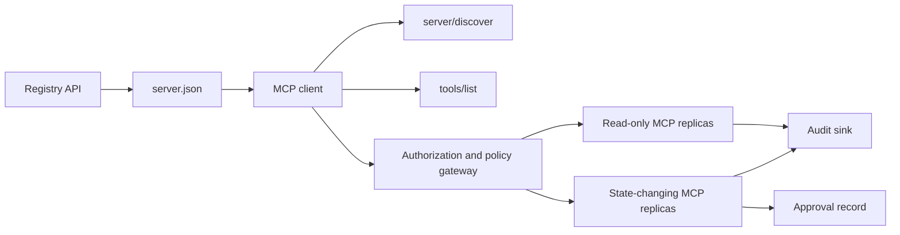

# 综合实战项目 13:带 रजिस्ट्री एवं प्रशासन के बिना राज्य एमसीपी सर्वर

> उत्पादन स्तर MCP  निश्चित रूप से एक एकल सरल सर्वर  प्रक्रिया नहीं है  यह एक संपूर्ण अनुबंध श्रृंखला हैः जारी किए जाने वाले डेटा  वास्तविक समय सेवा खोज  बिना स्थिति अनुरोध  परिपत्र  पहचान प्रमाण पत्र और प्राधिकरण  लघु सीमा रणनीति निर्णय  लेखा परीक्षा प्रमाण पत्र तथा तैनाती प्रमाण पत्र 

**Type:** Capstone
**Languages:** Python 与 TypeScript 参考模型；支持任何生产级编程语言
**Prerequisites:** Phase 11, Phase 13, Phase 14, Phase 17 与 Phase 18
**必修 MCP 进阶课：** [Lesson 28: Tool Contracts](../../../13-tools-and-protocols/28-mcp-tool-contracts-and-content/docs/en.md),[Lesson 29: 可靠性与流控](../../../13-tools-and-protocols/29-mcp-reliability-cancellation-and-flow-control/docs/en.md),[Lesson 30: Registry 供应链](../../../13-tools-and-protocols/30-mcp-registry-supply-chain-and-drift/docs/en.md), 及 [Lesson 31: 一致性工程](../../../13-tools-and-protocols/31-mcp-conformance-versioning-and-operations/docs/en.md)
**目标协议规范：**एमसीपी `2026-07-28`
**Time:** ~25 小时

## 学习目标

- 实现合规的无状态 MCP अनुरोध与结果 封筒
- रजिस्ट्री 静态元数据 और संचालन के समय वास्तविक समय समझौते में कठोर अंतर करना
- निर्मित पदानुक्रम एवं काशविन्यास संज्ञानात्मक उपकरण खोज प्रणाली का निर्माण
- प्रत्येक उपकरण के लिए 调用强制执行签发发者 (निष्पादक) ▌受众 (प्रशिक्षक) ▌作用域 (क्षेत्र) ▌अनुमोदन रणनीति。
- 部署无 सत्र 亲和性绑定 流媒体 HTTP 集群──
- नेटवर्क लाइनों में, प्राधिकरण, रणनीति, रजिस्ट्री और लेखा परीक्षा की सीमा पर पूर्ण इंजीनियरिंग प्रमाण प्रदान करना।

## अनिवार्य MCP 前置路径

इस परियोजना को उत्पादन के लिए तैयार करने से पहले, चरण 13 के चार चरणों के पाठ्यक्रम को निम्नलिखित रूप से पूरा करना होगाः

1. [Lesson 28](../../../13-tools-and-protocols/28-mcp-tool-contracts-and-content/docs/en.md): परिभाषित करें इस सर्वर को णपता होना चाहिए उपकरण, योजना, संरचनात्मक सामग्री, पृष्ठों की एक श्रृंखला, स्वचालित रूप से भरने, मार्ग और त्रुटि
2. [Lesson 29](../../../13-tools-and-protocols/29-mcp-reliability-cancellation-and-flow-control/docs/en.md): परिभाषा取消竞态、截止期限、等性、背压、重试与断线重连行为──
3. [Lesson 30](../../../13-tools-and-protocols/30-mcp-registry-supply-chain-and-drift/docs/en.md): परिभाषा नामकरण स्थान归属、来源追踪、准入锁定、 रजिस्ट्री 状态、漂移检测、账本记录与回滚凭证──
4. [Lesson 31](../../../13-tools-and-protocols/31-mcp-conformance-versioning-and-operations/docs/en.md): परिभाषित करें स्वर्ण मानक तथा विपरीत दिशा में प्रवेश प्रकरणे、 कठोर संस्करण时代、SDK  व्यवहार अंतर校验、代理网络凭证、 संवेदनशील डेटा脱敏、健康门禁和发布阻──

इस परियोजना के लिए जिम्मेदार है कि इन उत्पादन स्तर के तत्वों को घनिष्ठ रूप से एकीकृत किया जाए, यह एक साधारण रन-थ्रू एसडीके परीक्षण के साथ नहीं किया जा सकता है।

## 问题背景

企业内部平台需要一套只读数据工具和少量具有状态变更能力的写操作工具―― डेवलपर को सर्वर को ढूंढने में सक्षम होना चाहिए  कैसे कनेक्ट होना चाहिए  वास्तविक समय में इसकी संचालन क्षमता की जांच करना चाहिए, और केवल इसके द्वारा स्पष्ट रूप से अधिकृत उपयोग के संचालन को ही अनुकूलित करना चाहिए

वास्तविक कठिनाई एक फ़ंक्शन को पंजीकृत करना नहीं है, बल्कि निम्नलिखित छह सत्य स्रोतों को उच्चतम स्तर पर एकजुट रखने का तरीका हैः

1. `server.json`声明 सर्वर पर स्थापित या किस नेटवर्क के माध्यम से पहुँचने के लिए;
2. `server/discover`् ास वर्तमान में चल रहे वास्तविक समय प्रक्रियाओं का वास्तविक समर्थन करने की क्षमता का दावा किया है;
3. प्रत्येक अनुरोध में अपनाई गई अनुबंध संस्करण और ग्राहक क्षमता विवरण स्पष्ट रूप से निर्दिष्ट किया गया है;
4. 授权系统将调用方与法定发发发商、资源指示器(资源指标) तथा दायरा 绑定;
5. 策略引擎 स्वतंत्र निर्णय लेना कि क्या विशिष्ट ऑपरेशन निष्पादन के लिए तैयार है;
6. 审计日志 ट्रस्ट रिकॉर्ड सीमा पार के प्रत्येक बातचीत का, तथा कभी भी संवेदनशील भार या प्रमाण की कुंजी का खुलासा नहीं करता है

 किसी भी कड़ी में एक प्रस्थान हो, प्लेटफॉर्म पर एक अक्षम सर्वर को प्रदर्शित किया जा सकता है  गलत मार्ग से असंगत क्लाइंट  अन्य संसाधनों के लिए जारी किए गए टोकन का गलत उपयोग, या अप्रत्याशित समीक्षा के मामले में विनाशकारी संचालन का खुलासा किया जा सकता है

## 两层发现机制 (द दो डिस्कवरी लेयर)

रजिस्ट्री 静态索引与实时的MCP सर्वर  उत्तर पूरी तरह से अलग आयाम के प्रश्न हैंः

| 发现层次 | 交互契约 | 回答的核心问题 |
|---|---|---|
| 发布层 (Publication) | `server.json` 与 Registry API | 该 Server 是什么？其代码包或远程网络端点在哪里？如何进行配置？ |
| 运行时 (Runtime) | `server/discover` | 该运行进程当前实际支持哪些协议版本、能力特性、扩展及 Server 身份？ |

官方 रजिस्ट्री 采用带版本控制的 `server.json`योजना ∙ एक दूरस्थ条目 का उपयोग किया जा सकता है Streamable HTTP 地址:

```json
{
  "$schema": "https://static.modelcontextprotocol.io/schemas/2025-12-11/server.schema.json",
  "name": "com.example/internal-readonly",
  "title": "Internal Read-Only Tools",
  "description": "Read-only incident and data lookup tools.",
  "version": "1.0.0",
  "remotes": [
    {
      "type": "streamable-http",
      "url": "https://mcp.internal.example.com/readonly"
    }
  ]
}
```

रजिस्ट्री स्कीमा  संस्करण  MCP 协议 संस्करण पूरी तरह से स्वतंत्र है, दोनों को एक साथ लाने के लिए नहीं बल्कि उनमें से एक को बदलने के लिए एक दिन में लिखें। प्रत्येक दस्तावेज को अपने स्वयं के अनुबंध के अनुसार कठोर परीक्षण करना होगा।

具备合规 Schema 不代表拥有命名空间所有权──对 `example.com`完成验证的发布者使用反向 DNS 命名空间 `com.example/*`या उसके पुत्र नामकरण अंतरिक्ष── रजिस्ट्री का प्रमाणन प्रक्रिया इस स्वामित्व को प्रमाणित करने के लिए जिम्मेदार है── यदि सामान्य क्रम में लिपिबद्ध डोमेन नाम लेबल के अनुसार, तो यह दूसरे अलग नामकरण अंतरिक्ष── की ओर जाता है।

标准库模型中的 `validate_registry_document`函数刻意只是一个部分的远程配置校验器──它检查官方必填的 `name``description``version`字段,可选的 `title`, प्रकाशित नाम एवं लंबाई, विशिष्ट संस्करण संख्या के प्रारूप तथा प्रत्येक`streamable-http`या `sse`远程端点的 HTTP(S) URL 形式──由于 इस समग्र परियोजना में दूरस्थ端点 पर वास्तविक समय पर खोज करने की आवश्यकता होती है, यह अतिरिक्त आवश्यकताएँ भी है `remotes`列表非空──`validate_publisher_namespace`单独对照已验证的发行者域名检查名称, जबकि `validate_runtime_alignment`则将发布名称与版本同实时的 `serverInfo` तुलना करें── आधिकारिक योजना भी समर्थन केवल कोड पैक के रिकॉर्ड के साथ-साथ अधिक दूर के खण्डों को शामिल करती है।`mcp-publisher`校验全文档; इस अव्यवस्थित उपसंघात को पूर्ण योजना 校验的 रूप में मत समझो

सर्वर ज़रूर कार्यान्वित `server/discover`;क्लाइंट इसे अन्य तरीकों से पहले सक्रिय रूप से तैनात कर सकता है। इस समग्र परियोजना के लिए, क्लाइंट इसे निष्पादन के बाद करेगा और वर्तमान प्रोटोकॉल संशोधन संस्करण और वास्तविक समय क्षमता संग्रह प्राप्त करेगाः

```json
{
  "resultType": "complete",
  "supportedVersions": ["2026-07-28"],
  "capabilities": {
    "tools": {
      "listChanged": false
    }
  },
  "_meta": {
    "io.modelcontextprotocol/serverInfo": {
      "name": "com.example/internal-readonly",
      "version": "1.0.0"
    }
  },
  "ttlMs": 3600000,
  "cacheScope": "public"
}
```

निजी कैडस्ट्रे अतिरिक्त स्वामित्व, समीक्षा या जीवन चक्र डेटा को सूचकांकित कर सकते हैं, लेकिन इन डेटा को एमसीपी लाइन लाइन के लिए नहीं बनाया जा सकता है।`server.json`根字段── संगठन रणनीति                                                                                                                                                                                                                                                            `_meta.io.modelcontextprotocol.registry/publisher-provided`扩展,并保持在其 4 KB 上限之内──

## 无状态 MCP 核心(राज्यहीन MCP कोर)

एमसीपी `2026-07-28`् ् ् ् ् ् ् ् ् ् ् ् ् ् ् ् ् ् ् ् ् ् ् ् ् ् ् ् ् ् ् ् ् ् ् ् ् ् ् ् ् ् ् ् ् ् ् ् ् ् ् ् ् ् ् ् ् ् ् ् ् ् ् ् ् ् ् ् ् ् ् ् ् ् ् ् ् ् ् ् ् ् ् ् ् ् ् ् ् ् ् ् ् ् ् ् ् ् ् ् ् ् ् ् ् ् ् ् ् ् ् ् ् ् ् ् ् ् ् ् ् ् ् ् ् ् ् ् ् ् ् ् ् ् ् ् ् ् ् ् ् ् ् ् ् ् ् ् ् ् ् ् ् ् ् ् ् ् ् ् ् ् ् ् ् ् ् ् ् ् ् ् ् ् ् ् ् ् ् ् ् ् ् ् ् ् ् ् ् ् ् ् ् ् ् ् ् ् ् ् ् ् ् ् ् ् ् ् ् ् ् ् ् ् ् ् ् ् ् ् ् ् ् ् ् ् ् ् ् ् ् ् ् ् ् ् ् ् ् ् ् ् ् ् ् ् ् ् ् ् ् ् ् ् ्`initialize`/`notifications/initialized`握手,同时移除了 `Mcp-Session-Id`

प्रत्येक अनुरोध में`params._meta`中携带协议上下文:

```json
{
  "io.modelcontextprotocol/protocolVersion": "2026-07-28",
  "io.modelcontextprotocol/clientCapabilities": {},
  "io.modelcontextprotocol/clientInfo": {
    "name": "internal-platform-client",
    "version": "1.0.0"
  }
}
```

版本与能力是请求层面的事实,而不是连接层面的事实―― लोड संतुलनकर्ता बिना किसी चिंता के अनुरोधों को विभिन्न स्वस्थ प्रतिकृति में वितरित करेगा, क्योंकि किसी भी प्रतिकृति को पूरी तरह से रिपोर्ट से स्वयं सत्यापित और अनुरोधों को संसाधित किया जा सकता है――

常规成功结果返回 `resultType: "complete"`, और सर्वर 应在每个结果中 `_meta.io.modelcontextprotocol/serverInfo`中标明身份──协议版本缺失或不是字符串时返回 अमान्य पैरामीटर 错误码 `-32602`.`-32022`केवल वर्णमाला प्रदान करने के लिए, लेकिन समर्थित नहीं संस्करण, इसके डेटा `{"supported": ["2026-07-28"], "requested": "..."}`

### सेवा का पता लगाने

 समान प्रभावी उपकरण संग्रह के लिए,`tools/list`必須是確定性的──其結果包含:

- `ttlMs`: ग्राहक की ताजाता का ध्यान रखना;
- `cacheScope`:`public`(सार्वजनिक साझा) या `private`(上下文私有);
-  कठोर स्थिर उपकरण क्रम, एक ही सूची को सक्षम बनाने के लिए मॉडल के अंत में त्वरित कैश का पुनः उपयोग;
- `resultType: "complete"`सर्वर के साथ डेटा को संरेखित करें

 विशिष्ट उपयोगकर्ता के अधिकार नियंत्रण के लिए, आमतौर पर आउटपुट `cacheScope: "private"`, उपयोगकर्ता के विशेष उपकरण को सार्वजनिक साझा संग्रह में उपलब्ध नहीं कर सकता है।

## स्ट्रीम करने योग्य HTTP 传输

面向网络的服务器 暴露单一的 POST 端点── प्रत्येक JSON-RPC अनुरोध या सूचना स्वतंत्र POST──

 अनुरोध पर, सर्वर  एकल JSON प्रतिक्रिया  या उस अनुरोध के लिए अनुरोध भूमिका क्षेत्र  SSE 流──长周期的变更通知通过 `subscriptions/listen`建立长连接流,承载选择订阅的变更通知──当前传输中不存在独立的GET流、Session DELETE、Session 请求头或 `Last-Event-ID`भारण करना

प्रत्येक अनुरोध में शामिल हैंः

- `MCP-Protocol-Version`: अनुरोध के साथ संगत;
- `Mcp-Method`: JSON-RPC 方法名一致;
- `Mcp-Name`उपयोग में लाया जाता है`tools/call``resources/read``prompts/get`.
- `Accept: application/json, text/event-stream`

उपयोग नियमन`-32020`错误拒绝不一致的镜像请求头――校验 `Origin`,将本地开发服务器 绑定到回环地址,认证远程客户端,并将已关闭的请求作用域 SSE 响应视为取消──



```figure
cf-mcp-gate
```

## 认证与策略决策

传输层元数据绝对不等于权限凭证―― प्रत्येक调用均需严格识别权――

对于远程服务器:

1. 动态发现受保护资源元数据;
2. संसाधन चयन के लिए अधिकार प्राप्त सर्वर;
3. 优先使用客户端ID मेटाडेटा डॉक्यूमेंट्स(CIMD) 注册客户端,将动态客户端注册(动态客户端注册)视为兼容性支持;
4. प्रसंस्करण प्रक्रम में प्रसंस्करण संकेतक भेजना;
5. 验证返回的 `iss`यदि रिकॉर्ड के अधिकृत सर्वर एक致;
6. 按 जारीकर्ता 隔离存储 凭据客户,绝不跨 जारीकर्ता 复用;
7. MCP सर्वर 侧验证 टोकन के प्रदाता、受众、过期时间与 Scope;
8. विशिष्ट उपकरण नाम और वास्तविक तत्वों के लिए दोहरी रणनीति निर्णय लेना।

`readOnlyHint``destructiveHint`等工具注解帮助客户 呈现风险, लेकिन वे विश्वसनीय अधिकृत नियंत्रण साधन नहीं हैं

### कृत्रिम स्वीकृति प्रमाणपत्र का अभिलेख है, जादू का दायरा नहीं

status变更调用需要一个结构化的人工审批凭证 (अनुमोदन रिकॉर्ड),与操作员、工具名、规范化参数哈希值 (डिजेस्ट) 、目标环境、过期时间及单次/多次使用策略深度绑定──单独一条聊天消息绝不能充当审批凭证──

पायथन मॉडल क्रमबद्ध कुंजी के विनियमन पर काम करेगा JSON 计算哈希,并将该 Digest与 टोकन Subject、工具名、服务器 URL 和过期时间绑定──改哪怕是一个参数段,该审批记录也将在处理器运行之前重放失败──审批记录是独立证书证书,而不是添加到Access Token中的 Scope──

जब भौतिकता में कमी आभासात्मक त्रिज्या को प्रभावित कर सकती है, तो उच्च जोखिम वाले उपकरण को स्वतंत्र रूप से समीक्षा करने योग्य स्वतंत्र सतह पर रखा जाता है। केवल तभी जब प्रमाण, रणनीति, तैनाती की पहचान और लेखा नियंत्रण भी एक दूसरे से अलग होते हैं, तो इस तरह का विभाजन समझ में आता है।

## 动手构建

### 1. 建模发布元数据

创建 `server.json`तथा पूर्ण योजना 校验── जारीकर्ता द्वारा मान्यता प्राप्त नामकरण स्थान में स्थिर नाम का उपयोग,并包含版本、描述、适用时的官方`repository`या `packages`मूल डेटा, तथा दूरस्थ या स्टूडियो 传输配置── कुंजी केवल एक घोषणा के वातावरण चर के रूप में प्रवेश कर सकती है, निश्चित रूप से लिफाफे मूल्य में नहीं लिखा जा सकता──

### 2. 实现实时服务发现

                                                                                                                                                                                                                                                              `server/discover`◊ सार्वजनिक समर्थित प्रोटोकॉल संस्करण、 क्षमता संग्रह、 विस्तार से सर्वर के साथ, और एक उपयोग जोड़ `-32022`का संस्करण उपयोग करने से इनकार किया गया

### 3. 实现无状态信封 (संकेत)

प्रत्येक अनुरोध को ग्राहक के साथ समझौता संस्करण ले जाना चाहिए; प्रत्येक परिणाम वापस आ जाएगा ।`resultType`के साथ सर्वर की स्थिति, प्रारंभिक स्थिति, कनेक्शन के आधार पर कैश संग्रह क्षमताओं के सेट और सत्र पहचानकर्ता को हटा दें।

### 4. 构建工具 सतह

दो केवल-पढ़ने वाले उपकरण और एक स्थिति परिवर्तन उपकरण से शुरू करें। प्रत्येक उपकरण के लिए एक निश्चित JSON योजना प्रदान की जाती है। सटीक विवरण, निश्चितता के परिणाम संरचना और वास्तविक विवरण।

### 5. 添加缓存感知的列表

以稳定顺序返回工具,并附带 `ttlMs``cacheScope`分別测试缓存过期与列表变更通知行为

### 6. 添加认证与策略

校验发发发发商、受众、过期时间与范围── प्रत्येक उपकरण के लिए निष्पादन रणनीति निर्णय को नियोजित करना, और यह स्वीकृति सटीक उच्च जोखिम संचालन में बंधा रहेगा──

### 7. रजिस्ट्री से विभाजन और परिचालन

पूर्वानुमान स्थिति`server.json`记录, पुनः उपयोग `server/discover`探测远程端点── जब प्रकाशित दूरस्थ端点、身份、 संस्करण अथवा आवश्यक क्षमता वास्तविक समय के प्रक्रम से असंगत हो, तब अप अप अप अप अप अप अप अप漂移──

### 8. 添加审计证据

 रिकॉर्ड ऑपरेटर, जारीकर्ता, संसाधन, उपकरण, रणनीति निर्णय, अनुरोध पहचानकर्ता, ट्रैकिंग पर अवतरण, देरी और परिणामों को रिकॉर्ड करने से पहले संवेदनशील पैरामीटर और परिणामों को निष्क्रिय या गणना संक्षेप में प्रस्तुत करना, लेखा परीक्षा प्राप्त करने के लिए एक अंतराल मॉडल पर दिखाई देने वाले अवतरण के बाहर होना चाहिए।

### 9. 验证水平扩展

लोड संतुलनकर्ता में दो अस्थिर प्रतिलिपिओं को रखने के बाद, कम से कम 100 अनुरोध भेजें, सत्यापन को साबित करें कि सत्यता प्रासंगिकता पर निर्भर नहीं है। यदि किसी उपकरण को स्थिति के पार उपयोग की आवश्यकता होती है, तो एक स्पष्ट अस्थिर वाक्य उत्पन्न करें, और इसे साझा किए गए स्थायित्व प्रणाली में संग्रहीत करें।

### 10. 跨越真实线路

 वास्तविक सर्वर के लिए  二进制运行一致性检查── कैप्चर अनुरोध शीर्षक और JSON अनुरोध विषय, न केवल SDK वस्तुओं ∙ कवर त्रुटि संस्करण  अनुरोध शीर्षक असंगत 缺少 Scope 受众错误 参数 形 处理器 失败 取消与缓存过期等用例──

## अनिवार्य प्रमाण-पत्र (सबूत पैक)

प्रस्तुत वस्तुओं में निम्नलिखित सभी पांच प्रकार के प्रमाण शामिल होने चाहिए, अन्यथा दृष्टिहीन हैः

| 证据类别 | 最低验证标准 | 来源课程 |
|---|---|---|
| 网络线路 (Wire) | 正向与反向用例的脱敏原始请求头与 JSON-RPC 请求体，覆盖元数据类型错误、请求头不匹配、不受支持的版本、缺失或未知的 `resultType`、通知无响应以及响应 ID 匹配 | [Lesson 31](../../../13-tools-and-protocols/31-mcp-conformance-versioning-and-operations/docs/en.md) |
| 代理网络 (Proxy) | 同一稳定用例分别直连与经过已部署的中间层运行，记录入口、源站与出口的状态码及响应体摘要；证明协议错误未被折叠为通用 500 响应，且流式传输未被缓冲 | [Lessons 29](../../../13-tools-and-protocols/29-mcp-reliability-cancellation-and-flow-control/docs/en.md) 与 [31](../../../13-tools-and-protocols/31-mcp-conformance-versioning-and-operations/docs/en.md) |
| 准入管理 (Admission) | 已验证的发布者命名空间、不可变的 Registry 记录摘要、产物或远程端点来源证明、实时 `server/discover` 身份与能力观测、描述符锁定、当前 Registry 状态以及准入账本事件 | [Lesson 30](../../../13-tools-and-protocols/30-mcp-registry-supply-chain-and-drift/docs/en.md) |
| 重试与取消 (Retry) | 取消与完成的竞态、显式超时、安全的只读重试、写操作幂等键、重连后重新拉取，以及证明请求取消不会悄然变成持久任务取消 | [Lesson 29](../../../13-tools-and-protocols/29-mcp-reliability-cancellation-and-flow-control/docs/en.md) |
| 发布回滚 (Rollback) | 确切的先前版本、准入与产物摘要、描述符锁定、当前生效的 Registry 状态、当前健康窗口、路由恢复结果以及脱敏的决策证据 | [Lessons 30](../../../13-tools-and-protocols/30-mcp-registry-supply-chain-and-drift/docs/en.md) 与 [31](../../../13-tools-and-protocols/31-mcp-conformance-versioning-and-operations/docs/en.md) |

随版本一并保存脱敏证据包的摘要──只要缺少任意一类,就暂缓发布──不要从进程内分发发器推断代理行为,不要从注册表中存在该条目推断准入,不要从新的JSON-RPC ID 推断重试安全,也不要从上次部署推断回滚就绪──

## 本地参考模型运行

पायथन मॉडल किसी भी नेटवर्क सेटअप को नहीं खोलने के मामले में, रजिस्ट्री को प्रदर्शित करता है 元データ、反向 DNS 發布者命名空间校验、 प्रकाशन और संचालन के दौरान पहचान सत्यापन、 वास्तविक समय का पता लगाने、 निश्चितता उपकरण सूची、 प्रति अनुरोध元数据、可信签发发件者/受众/过期时间/Scope 检查、绑定操作的审批、 एक दस्तावेज विवरण के हिस्से रजिस्ट्री 校验器、 रणनीति तथा लेखा परीक्षाः

```bash
cd phases/19-capstone-projects/13-mcp-server-with-registry
python3 code/main.py
python3 -m unittest discover -s code/tests -v
```

टाइपस्क्रिप्ट 项目在不借助 MCP SDK के मामले में, स्टूडियो के माध्यम से 暴露无状态 JSON-RPC 结构──其`tools/call`路径执行与 `tools/list`ज्ञात उपकरण के लिए अवैध तत्वों में प्रवेश करने पर, लौटाएं।`isError: true`的完整结果,且不调用执行器:

```bash
cd phases/19-capstone-projects/13-mcp-server-with-registry/code/ts
npm install
npm run typecheck
npm test
npm run demo
```

ये मॉडल साबित होते हैं कि यह एक स्थानीय समझौता है, HTTP अनुरोध शीर्षक, OAuth 交换, रजिस्ट्री  जारी, OPA 集成, लोड संतुलन या采集端接收, को साबित नहीं कर सकता है।

## 线路协议报文范例

```http
POST /mcp HTTP/1.1
Host: mcp.internal.example.com
Content-Type: application/json
Accept: application/json, text/event-stream
MCP-Protocol-Version: 2026-07-28
Mcp-Method: tools/call
Mcp-Name: postgres.readonly
Authorization: Bearer REDACTED

{
  "jsonrpc": "2.0",
  "id": 42,
  "method": "tools/call",
  "params": {
    "name": "postgres.readonly",
    "arguments": {"sql": "SELECT 1"},
    "_meta": {
      "io.modelcontextprotocol/protocolVersion": "2026-07-28",
      "io.modelcontextprotocol/clientCapabilities": {},
      "io.modelcontextprotocol/clientInfo": {
        "name": "internal-platform-client",
        "version": "1.0.0"
      }
    }
  }
}
```

## 交付物

交付一个包含以下内容的代码仓库:

- 通过方案 校验的 `server.json`.
- केवल पढ़ने और स्थिति परिवर्तन सर्वर सतह के दो प्रकार;
- `server/discover`、 निश्चितता `tools/list`, तथा रणनीति नियंत्रण`tools/call`.
- 带有两个可互换副本的流向 HTTP 部署;
- 认证与审批集成;
- रजिस्ट्री  जारीकर्ता या निजी रजिस्ट्री एपीआई 适配器;
- 策略 परिभाषा तथा बाध्यकारी संचालन की अनुमोदन रिकॉर्ड;
- 脱敏的审计输出和追踪传播;
- 线路与代理故障证;
- 准入、重试、健康与回滚证据, तथा अपांगत्व प्रमाणपत्र के संक्षिप्त विवरण

| 权重 | 评分标准 | 证据 |
|---:|---|---|
| 25 | 协议正确性 | 无状态请求元数据、服务发现、结果、请求头与反向用例 |
| 20 | 授权 | 签发者、受众、过期时间、Scope 与绑定操作的审批用例 |
| 15 | Registry 完整性 | 合法的 `server.json`、发布记录、实时发现探测与漂移报告 |
| 15 | 策略与安全 | 允许、拒绝、畸形、过期审批与敏感数据用例 |
| 15 | 扩展性与可靠性 | 两个副本、无亲和性依赖、取消、超时与恢复 |
| 10 | 可审计性 | 接收端脱敏审计与追踪证据 |

## 练习与思考

1. परिवर्तन जारी किए गए दूरस्थ URL, जबकि वास्तविक समय सर्वर को अपरिवर्तित रखने, रजिस्ट्री 校验报告确切漂移──
2. एक ही तरह के दो बार`tools/list`, सबूत उपकरण क्रम क्रम क्रम क्रम क्रम क्रम क्रम क्रम क्रम क्रम क्रम क्रम क्रम क्रम क्रम क्रम क्रम क्रम क्रम क्रम क्रम क्रम क्रम क्रम क्रम क्रम क्रम क्रम क्रम क्रम क्रम क्रम क्रम क्रम क्रम क्रम क्रम क्रम क्रम क्रम क्रम क्रम क्रम क्रम क्रम क्रम क्रम क्रम क्रम क्रम क्रम क्रम क्रम क्रम क्रम क्रम क्रम क्रम क्रम क्रम क्रम क्रम क्रम क्रम क्रम क्रम क्रम क्रम क्रम क्रम क्रम क्रम क्रम क्रम क्रम क्रम क्रम क्रम क्रम क्रम क्रम क्रम क्रम क्रम क्रम क्रम क्रम क्रम क्रम क्रम क्रम क्रम क्रम क्रम क्रम क्रम क्रम क्रम क्रम क्रम क्रम क्रम क्रम क्रम क्रम क्रम क्रम क्रम क्रम क्रम क्रम क्रम क्रम क्रम क्रम क्रम क्रम क्रम क्रम क्रम क्रम क्रम क्रम क्रम क्रम क्रम क्रम क्रम क्रम क्रम क्रम क्रम क्रम क्रम क्रम क्रम क्रम क्रम क्रम क्रम क्रम क्रम क्रम क्रम क्रम क्रम क्रम क्रम क्रम क्रम क्रम क्रम क्रम क्रम क्रम क्रम क्रम क्रम क्रम क्रम क्रम क्रम क्रम क्रम क्रम क्रम क्रम क्रम क्रम क्रम क्रम क्रम क्रम क्रम क्रम क्रम क्रम क्रम क्रम क्रम क्रम क्रम क्रम क्रम क्रम क्रम क्रम क्रम क्रम क्रम क्रम क्रम क्रम क्रम क्रम क्रम क्रम क्रम क्रम क्रम क्रम क्रम क्रम क्रम क्रम क्रम क्रम क्रम क्रम क्रम क्रम क्रम क्रम क्रम क्रम क्रम क्रम क्रम क्रम क्रम क्रम क्रम क्रम क्रम क्रम क्रम क्रम क्रम क्रम क्रम क्रम क्रम क्रम क्रम क्रम क्रम क्रम क्रम क्रम क्रम क्रम क्रम क्रम क्रम क्रम क्रम क्रम क्रम क्रम क्रम क्रम क्रम क्रम क्रम क्रम क्रम क्रम क्रम क्रम क्रम क्रम क्रम क्रम क्रम क्रम क्रम क्रम क्रम क्रम क्रम क्रम क्रम क्रम क्रम क्रम क्रम क्रम क्रम क्रम क्रम क्रम क्रम क्रम क्रम क्रम क्रम क्रम क्रम क्रम क्रम क्रम क्रम क्रम क्रम क्रम क्रम क्रम क्रम क्रम क्रम क्रम क्रम क्रम क्रम क्रम क्रम क्रम क्रम क्रम क्रम क्रम क्रम क्रम क्रम क्रम क्रम क्रम क्रम क्रम क्रम क्रम क्रम क्रम क्रम क्रम क्रम क्रम क्रम क्रम क्रम क्रम क्रम क्रम क्रम क्रम क्रम क्रम क्रम क्रम क्रम क्रम क्रम क्रम क्रम क्रम क्रम क्रम क्रम क्रम क्रम क्रम क्रम क्रम क्रम क्रम क्रम क्रम क्रम क्रम क्रम क्रम क्रम क्रम क्रम क्रम क्रम क्रम क्रम क्रम क्रम क्रम क्रम क्रम क्रम क्रम क्रम क्रम क्रम क्रम क्रम क्रम क्रम क्रम क्रम क्रम क्रम क्रम क्रम क्रम क्रम क्रम क्रम क्रम क्रम क्रम क्रम क्रम क्रम क्रम क्रम क्रम क्रम क्रम क्रम क्रम क्रम क्रम क्रम क्रम क्रम क्रम क्रम क्रम क्रम क्रम क्रम क्रम क्रम क्रम क्रम क्रम क्रम क्रम क्रम क्रम क्रम क्रम क्रम क्रम क्रम क्रम क्रम क्रम क्रम क्रम क्रम क्रम क्रम क्रम क्रम क्रम क्रम क्रम क्रम क्रम क्रम क्रम क्रम क्रम क्रम क्रम क्रम क्रम क्रम क्रम क्रम क्रम क्रम क्रम क्रम क्रम क्रम क्रम क्रम क्रम क्रम क्रम क्रम क्रम क्रम क्रम क्रम क्रम क्रम क्रम क्रम क्रम क्रम क्रम क्रम क्रम क्रम क्रम क्रम क्रम क्रम क्रम क्रम क्रम क्रम क्रम क्रम क्रम क्रम क्रम क्रम क्रम क्रम क्रम क्रम क्रम क्रम क्रम क्रम क्रम क्रम क्रम`ttlMs`过期并刷新──
3. 发送一个合法请求体,但 `MCP-Protocol-Version`अनुरोध शीर्षक与之不同── वापसी `-32020`, और रणनीति या उपकरण का उपयोग नहीं करते हैं।
4. सर्वर                                                                                                                                                                                                                                                                                                                                                                                                                                                                                                                             
5. एक अनुमोदन को एक विशिष्ट विनियमन पैरामीटर संश्लेषण में बंधाकर, उनमें से एक खंड को संशोधित करना, यह साबित करना कि अनुमोदन को पुनः पेश नहीं किया जा सकता है।
6. कार्यप्रवाह को स्थायी रूप से स्थापित करने की आवश्यकता होने पर, छिपे हुए प्रक्रिया के लिए स्पष्ट साझाकरण के साथ एक दूसरे के साथ एक दूसरे के साथ एक दूसरे के साथ एक दूसरे के साथ एक दूसरे के साथ एक दूसरे के साथ एक दूसरे के साथ एक दूसरे के साथ एक दूसरे के साथ एक दूसरे के साथ एक दूसरे के साथ एक दूसरे के साथ एक दूसरे के साथ एक दूसरे के साथ एक दूसरे के साथ एक दूसरे के साथ एक दूसरे के साथ एक दूसरे के साथ एक दूसरे के साथ एक दूसरे के साथ एक दूसरे के साथ एक दूसरे के साथ एक दूसरे के साथ एक दूसरे के साथ एक दूसरे के साथ एक दूसरे के साथ एक दूसरे के साथ एक दूसरे के साथ एक दूसरे के साथ एक दूसरे के साथ एक दूसरे के साथ एक दूसरे के साथ एक दूसरे के साथ एक दूसरे के साथ एक दूसरे के साथ एक दूसरे के साथ एक दूसरे के साथ एक दूसरे के साथ एक दूसरे के साथ एक दूसरे के साथ एक दूसरे के साथ एक दूसरे के साथ एक दूसरे के साथ एक दूसरे के साथ एक दूसरे के साथ एक दूसरे के साथ एक दूसरे के साथ एक दूसरे के साथ एक दूसरे के साथ एक दूसरे के साथ एक दूसरे के साथ एक दूसरे के साथ एक दूसरे के साथ एक दूसरे के साथ एक दूसरे के साथ एक दूसरे के साथ एक दूसरे के साथ एक दूसरे के साथ एक दूसरे के साथ एक साथ एक दूसरे के साथ एक साथ एक दूसरे के साथ एक साथ एक साथ एक दूसरे के साथ एक साथ एक साथ एक दूसरे के साथ एक साथ एक साथ एक दूसरे के साथ एक साथ एक साथ एक साथ एक साथ एक साथ एक दूसरे के साथ एक साथ एक साथ एक साथ एक साथ एक साथ एक साथ एक साथ एक साथ एक साथ एक साथ एक साथ एक साथ एक साथ एक साथ एक साथ एक साथ एक साथ एक साथ एक साथ एक साथ एक साथ एक साथ एक साथ एक साथ एक साथ एक साथ एक साथ एक साथ एक साथ एक साथ एक साथ एक साथ एक साथ एक साथ एक साथ एक साथ एक साथ एक साथ एक साथ एक साथ एक साथ एक साथ एक साथ एक साथ एक साथ एक साथ एक साथ एक साथ एक साथ एक साथ एक साथ एक साथ एक साथ एक साथ एक साथ एक साथ एक साथ एक साथ एक साथ एक साथ एक साथ एक साथ एक साथ एक साथ एक साथ एक साथ एक साथ एक साथ एक साथ एक साथ एक साथ एक साथ एक साथ एक साथ एक साथ एक साथ एक साथ एक साथ एक साथ एक साथ एक साथ एक साथ एक साथ एक साथ एक साथ एक साथ एक साथ एक साथ एक साथ एक साथ एक साथ एक साथ एक साथ एक साथ एक साथ एक साथ एक साथ एक साथ एक साथ एक
7. एक अनुरोध भूमिका क्षेत्र के SSE  कनेक्शन को तोड़ना, और नए JSON-RPC का उपयोग करना अनुरोध आईडी 重试,验证 कोई उपयोग नहीं `Last-Event-ID`恢复路径──

## 核心专业术语

| 术语 | 行业俗称 | 规范真实定义 |
|---|---|---|
| 无状态 MCP (Stateless MCP) | “到处都没有状态” | 协议层不存在 Session；跨调用状态是显式的，并由 Server 管理 |
| `server.json` | “工具清单” | Registry 静态元数据，用于定义发布命名、代码打包、配置项与传输端点 |
| `server/discover` | “传统握手” | 强制实现的常规 RPC，用于获取实时版本与能力，而非 Session 初始化器 |
| 缓存作用域 (Cache scope) | “能不能缓存？” | 标识可缓存结果是否可以被跨上下文公共复用（`public`）或仅限当前上下文（`private`） |
| 策略决策 (Policy decision) | “Token 允许就能调” | 针对调用者主体、工具、操作目标、参数载荷及外部上下文的细粒度二次判定 |
| 审批凭证 (Approval record) | “有人点了同意” | 在过期策略下绑定到一个操作者与一项重大操作的证据 |
| 显式句柄 (Explicit handle) | “Session ID” | 用于命名由 Server 管理之状态的普通应用数据，而非协议连接状态 |

## 延伸阅读

- [MCP 2026-07-28 核心变更](https://modelcontextprotocol.io/specification/2026-07-28/changelog)
- [Streamable HTTP 传输规范](https://modelcontextprotocol.io/specification/2026-07-28/basic/transports/streamable-http)
- [MCP 服务发现](https://modelcontextprotocol.io/specification/2026-07-28/server/discover)
- [MCP 鉴权与授权规范](https://modelcontextprotocol.io/specification/2026-07-28/basic/authorization)
- [官方 Registry server.json 要求](https://github.com/modelcontextprotocol/registry/blob/main/docs/reference/server-json/official-registry-requirements.md)
- [官方 Registry OpenAPI 契约](https://registry.modelcontextprotocol.io/openapi.yaml)
