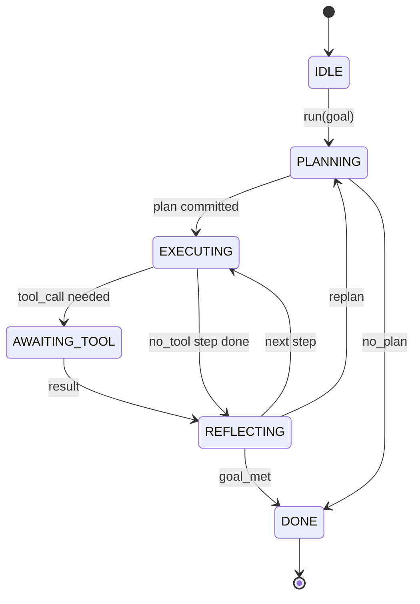

# एजेंट हर्नस लूप अनुबंध

> हर्नेस यही एजेंट है, मॉडल ही सहसंसादक है, आप किसी भी मॉडल के लूप कॉन्ट्रैक्ट में शामिल हो सकते हैं।

**Type:** Build
**Languages:** Python
**Prerequisites:** Phase 13 lessons 01-07, Phase 14 lesson 01
**Time:** ~90 minutes

## सीखने के लक्ष्य


```figure
cf-loop-contract
```
-  एजेंट हर्नस लूप  स्पष्ट संक्रमण के साथ निश्चितता राज्य मशीन के लिए विनियमित 
- 10 जीवन चक्र हुक विषयों को लागू करें, ऑपरेटर नीति, दूरबीन और गार्डरेल्स में शामिल हो सकते हैं
-  दो खींच बिंदुओं को परिभाषित करें, इन स्थानों पर नियंत्रण को वापस कॉल करने वाले को सौंपें, और नए इनपुट को पुनः प्राप्त करें
- 强制执行 per session budgets(turns、tool calls、wall-clock), जबकि在超限时不泄漏部分状态──
- 发发含十一种事件类型的类型类型类型类型类型类型类型类型类型类型类型类型类型类型类型类型类型类型类型类型类型类型类型类型类型类型类型类型类型类型类型类型类型类型类型类型类型类型类型类型类型类型类型类型类型类型类型类型类型类型类型类型类型类型类型类型类型类型类型类型类型类型类型类型类型类型类型类型类型类型类型类型类型类型类型类型类型类型类型类型类型类型类型类型类型类型类型类型类型类型类型类型类型类型类型类型类型类型类型类型类型类型类型类型类型类型类型类型类型类型类型类型类型类型类型类型类型类型类型类型类型类型类型类型类型类型类型类型类型类型类型类型类型类型类型类型类型类型类型类型类型类型类型类型类型类型类型类型类型类型类型类型类型类型类型类型类型类型类型类型类型类型类型类型类型类型类型类型类型类型类型类型类型类型类型类型类型类型类型类型类型类型类型类型类型类型类型类型类型类型类型类型类型类型类型类型类型类型类型类型类型类型类型类型类型类型类型类型类型类型类型类型类型类型类型类型类型类型类型类型类型类型类型类型类型类型类型类型类型类型类型类型类型类型类型类型类型类型类型类型类型类型类型类型类型类型类型类型类型类

## 框架

एक अमानवीय कोडिंग एजेंट चालीस रिंग का संचालन करता है यह चैट लूप नहीं है। यह एक स्टेट मशीन है, ऑपरेटर इसके नोड्स को रोक सकता है, इसके किनारों का भी ऑडिट कर सकता है। एक बार जब आप अनुबंध लिख लेते हैं, तो मॉडल, उपकरण या नीतियां बदलते हैं, तो यह फिर से निर्माण नहीं होता है, बल्कि एक पंजीकरण कॉल में बदल जाता है।

इस अनुबंध का निर्माण इस अनुबंध में किया गया है। हम छह राज्यों के नाम रखेंगे, दस हुक विषयों, दो पुल पॉइंट्स, एक कार्यक्रम प्रकार, साथ ही एक बजट लिफाफा।

## राज्य

लूप में छह राज्य हैं. पांच सक्रिय हैं. एक टर्मिनल है.



`IDLE`यह एकमात्र कानूनी प्रवेश बिंदु है।`DONE`एकमात्र वैध निर्यात है।`AWAITING_TOOL`केवल एक ही स्थिति में खींचने की स्थिति उत्पन्न होती है। अन्य सभी संक्रमण आंतरिक होते हैं।

यह स्थिति मशीन निश्चितता है. यह एक ही घटना लॉग, उपयोग को एक ही स्थिति में फिर से प्रवेश करेगा. यह प्रकृति आपको सत्रों को पुनः खेलने के लिए अनुमति देती है, और मॉडल को पुनः पुनः उपयोग करने की आवश्यकता नहीं है.

## हुक विषय

हुक एक ऑपरेटर है 接入循环的接口──harness 会触发十个话题── प्रत्येक विषय किसी भी संख्या में ग्राहकों को स्वीकार कर सकता है──Subscribers 按注册 顺序触发── एक ग्राहक उपयोगिता लोड को उत्परिवर्तन कर सकता है──उच्च कर सकता है ताकि पहले मोड़ पर abort कर सके, या फिर एक sentinel को वापस कर सकता है ताकि अगले कदम से कूद सके──

```text
before_plan         after_plan
before_tool_call    after_tool_call
before_step         after_step
on_error
on_pause
on_budget_exceeded
on_complete
```

इस आकार ने क्लाउड कोड का नक्शा बनाया, पाठ्यक्रम और ओपनकोड 2025 के मध्य तक सभी मॉडल को अपनाने की प्रवृत्ति में हैं।`rm -rf`                                                                                                                                                                                                                                                              `before_tool_call`◊ भेज OpenTelemetry span के हुक  डाल `after_step`                                                                                                                                                                                                                                                              `on_pause`

## खींचने के बिंदु

पहली बार मैं एक ही समय में`AWAITING_TOOL`, जब यह उपकरण परिणाम नहीं है तो हम आगे बढ़ना जारी नहीं रख सकते हैं.`on_pause`, जब बजट खत्म हो जाता है, या किसी हुक 明确 अनुरोध मानव समीक्षा 时──

खींच बिंदु नहीं है अपवाद. यह एक बार वापसी है.`resume(payload)`◊harness 会从停止的位置继续── यह पायथन जनरेटर के समान आकार है── खींचने बिंदु ऊपर का परिवहन आप द्वारा चुना गया है── यह TUI में है।`tools/call`                                                                                                                                                                                                                                                              

## घटना प्रवाह

लूप 会在合同中的特定位置将事件添加到输入的流. यह धारा केवल जोड़ है, ग्राहक किसी भी तरह से ऑफसेट रिप्ले से रिप्ले कर सकते हैंः

- `session.start` 调用 `run(goal)`时发出 एक बार
- `plan.draft` योजनाकार  返回草案 योजना 时发出
- `plan.commit` मसौदा सक्रिय योजना के लिए प्रस्तुत किया गया 后发发
- `step.start` प्रत्येक निष्पादन कदम 开始时发出
- `step.end` प्रत्येक निष्पादन कदम  समाप्ति समय में बाहर
- `tool.call` 需要工具的步骤将控制权交给调用者 发发出
- `tool.result` उपयोग उपकरण परिणाम 恢复时发出
- `tool.error` उपयोग त्रुटि 恢复时, या हुक रद्द कॉल 发发时
- `budget.warn`  बजट सीमा तक पहुंच 时发出
- `session.pause` लूप因 pause (बजट या हुक)                                                                                                                                                                                                                                                        
- `session.complete` लूप तक पहुँचने `DONE`时发出 एक बार

घटनाएँ 不复制 हुक उपयोगिता लोड── हुक अनिवार्य है ️मुटATE、abort)── घटनाएँ अवलोकनात्मक हैं ️ रिकॉर्ड、शिप)──把它们视为彼此正交──

## बजट की सीमा

एक सत्र 携带三个限制──转数、工具调用数、墙钟秒──每轮 会让转加一──每轮 会让轮加一──每轮 会让工具调用加一──每次状态过渡都会检查墙钟──一旦达到任意限,循环 会触发`on_budget_exceeded`, भेजने`budget.warn`, और फिर अगले खींचने बिंदु पर ऊपर संक्रमण करने के लिए`IDLE`,并附带预算超越的理由──

बजट नहीं है मार switch. यह एक बार की उपज है.

## 本课不做什么

यह मॉडल का उपयोग नहीं करेगा। यह वास्तविक उपकरण पंजीकृत नहीं करेगा। यह परिवहन को प्राप्त नहीं करेगा। ये अगले चार वर्ग हैं। यह एक अनुबंध स्थापित करेगा, ताकि अगले चार वर्ग इसे जोड़ सकें, बिना फिर से लिखने की आवश्यकता है।

`main.py`मध्य निर्धारक नियोजक एक प्रतिस्थापन है। यह एक हार्डकोड की तीन चरण योजना को लौटता है, जिसमें से दो चरणों के लिए उपकरण परिणाम की आवश्यकता होती है।

## 如何阅读代码

`HarnessLoop`यह मुख्य वर्ग है। यह राज्य है।`Budget`सीमाओं के साथ।`Event`                                                                                                                                                                                                                                                              `HookRegistry`यह डिस्पैच टेबल है`_transition`यह केवल राज्य के परिवर्तन के लिए एक ही प्रकार का कार्य है, इसलिए राज्य मशीन के अपरिवर्तित एक ही स्थान पर केंद्रित हैं।

ऊपर से नीचे तक पढ़ना`main.py`然后阅读 `code/tests/test_loop.py`परीक्षण 会固定 प्रत्येक संक्रमण 和 प्रत्येक हुक शूटिंग आदेश

## 继续深入

उत्पादन वातावरण में निर्माण के लिए सबसे कठिन हिस्सा राज्य मशीन नहीं है, बल्कि अनुबंध को लागू करने के लिए है। यह अनुबंध ऎसे ही है जो एक योजनाकार को गर्म लोड करने में सक्षम होना चाहिए। यह गलत JSON के उपकरण को वापस करने में सक्षम होना चाहिए। यह एक सत्र में 40 राउंड में हो सकता है।`before_tool_call`इस वर्ग में परीक्षणों को कवर करेगा इन विफलता मोडों को।

Next articleपुस्तक में उपकरण रजिस्ट्री जोड़ना होगा। अगला लेखपुस्तक में JSON-RPC परिवहन होगा। अगला लेखपुस्तक में लूप वास्तविक उपकरणों पर केंद्रित होगा।
