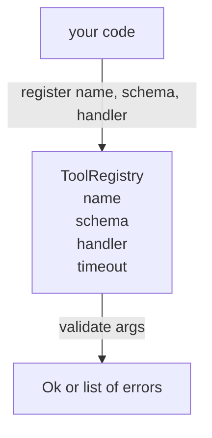

# 带 योजना सत्यापन के उपकरण रजिस्ट्री

> एजेंट 无法验证的工具,就是 एजेंट 无法调用的工具――先构建注册表和方案检查器,再构建工具――

**Type:** Build
**Languages:** Python
**Prerequisites:** Phase 13 lessons 01-07, Phase 14 lesson 01
**Time:** ~90 minutes

## सीखने के लक्ष्य


```figure
cf-registry-validate
```
-  एक प्रकार का रजिस्ट्री है, मैपिंग टूल नाम → स्कीमा → हैंडर, डिस्पैचर को केवल एक बार पूछताछ करने की आवश्यकता है, उसके बाद 
- 实现 JSON Schema 2020-12 का एक अंश, कवर百分之九十的工具 कॉल 实际使用的关键字──
- 返回精确的、形如 json-pointer के गलत पथ, मॉडल एक बार में वापस आकर स्वयं सुधार हो सकता है
- बिना स्पष्ट रूप से ओवरराइड के मामले में पुनः पंजीकरण से इनकार करना, क्योंकि चुपचाप कवर करना उत्पादन उपकरण कैटलॉगों के स्थानांतरण का कारण है।
- 保持验证器 纯净(无I/O、无时间、无全球), ताकि यह पुनःप्ले लॉग 上重新运行。

## रजिस्ट्री पहले उपकरण क्यों चाहिए

2026 के कोडिंग एजेंट के पास पंजीकृत उपकरण हैं, मॉडल की तुलना में 能放入单个文本窗口的还多── एक असामान्य हर्नस会注册两百个工具,并在任意一轮中暴露十到四十个── रजिस्ट्री ही इन प्रश्नों का एकमात्र तथ्य स्रोत हैः有哪些工具 存在、它们的参数是什么形、我应该调用哪个处理── एक बार इन तीनों उत्तरों को तय कर दिया गया, हर्नस के शेष भाग को अटकलें लगाकर रोक दिया जा सकता है──

हम भूल से बचना चाहते हैं, कि बिना योजनाओं के हैंडलर जारी करें, या बिना सत्यापन के योजनाएं जारी करें। दोनों बहुत आम हैं। दोनों ही निम्न स्तर को अनुमानित खेल में बदल देंगे।

## उपकरण रिकॉर्ड 长什么样

```text
ToolRecord
  name        : str          (unique, lowercase alphanumeric and underscore segments separated by dots, e.g., snake_case.segment.case)
  description : str          (one line, shown to the model)
  schema      : dict         (JSON Schema 2020-12 subset)
  handler     : Callable     (async or sync, returns Any)
  idempotent  : bool         (dispatcher uses this for retry decisions)
  timeout_ms  : int          (override per-tool dispatcher default)
```

स्कीमा वैलिडेटर है  एकमात्र जो संपर्कों को छूता है  हैंडलर इसके लिए अस्पष्ट है  हम जानबूझकर इसे दूसरे में विभाजित करते हैं  स्कीमा डेटा है  हैंडलर कोड है  इन्हें मिलाकर आपको वैलिडेशन लॉजिक  हैंडलर में डाल देंगे, और यह वही बग है जिसे हम रोकना चाहते हैं 

## JSON योजना 2020-12 子集

完整的2020-12 स्पेक्स 是一篇论文──我们需要八个关键字──

```text
type           string / number / integer / boolean / object / array / null
properties     map of property name -> schema
required       list of property names
enum           list of allowed primitive values
minLength      integer, applies to strings
maxLength      integer, applies to strings
pattern        ECMA-262-compatible regex, applies to strings
items          schema applied to every array element
```

यह पर्याप्त है उपकरण एपीआई को कवर करने के लिए 实际需要的内容──我们没有添加的关键词(oneOf, anyOf, allOf, $ref, सशर्त) उत्पादन योजनाओं में प्रभावी है, लेकिन सत्यापनकर्ता को एक चक्र के साथ पेड़ पैदल यात्री में बदल देगा── हम रजिस्ट्री का निर्माण करते हैं, न कि JSON योजना इंजन──

## Json पॉइंटर 错误路径

सत्यापन  असफल होने पर, सत्यापक  लौटने एक त्रुटि 列表── प्रत्येक त्रुटि 内部 के json-pointer path 内部 के लिए एक संकेत ले जाती है── पॉइंटर एक क्रम है, जो गुणों के नामों और सरणी सूचकांक 组成──

```text
{"a": {"b": [1, 2, "x"]}}
                    ^
                    /a/b/2
```

मॉडल 读取错误路径的能力强于读取句子的能力──如果 schema 要求 `args.user.email`, और मॉडल एक पूर्णांक में प्रवेश किया, त्रुटि होना चाहिए`/user/email`,并带有 `expected_type: string` मॉडल 会在下一次调用中修正它,不需要一轮自然语言说明──

## पंजीकरण और अधिलेखन

`register(name, schema, handler, **opts)`默认拒绝重复注册──调用方必须传进 `override=True`才能替换── यह ऑपरेशन लेवल की स्वास्थ्य आदत है── कोड库 के दो भाग एक ही उपकरण नाम पर चुपचाप पंजीकृत हैं, यह वह प्रकार है जो उत्पादन में एक सप्ताह तक नहीं निकलेगा──

रजिस्ट्री 暴露三个读取方法──`get(name)`返回 रिकॉर्ड या抛出异常──`validate(name, args)` वापस एक `Ok`या त्रुटि का एक समूह`names()`按注册顺序返回 उपकरण के नामों。

## वैधता क्या है, क्या नहीं है

यह एक बार फिर से योजना पेड़ के लिए है। यह एक शुद्ध कार्य है। यह हैडलरों का उपयोग नहीं करता है। यह प्रकार के मजबूर रूपांतरण नहीं करता है।`"42"`                                                                                                                                                                                                                                                              

यह सुरक्षा सीमा नहीं है। सत्यापन के बाद, बुरा इरादा हैंडलर अभी भी व्यवहार में नहीं है।

## आकार



## 如何阅读代码

`code/main.py` परिभाषित किया `ToolRegistry``ToolRecord``ValidationError`, तथा आठ वैधकर्ता कार्य── वैधकर्ता आधारित`schema["type"]`भेजने या इसे ले जाने के लिए`enum`处理) ◊ प्रत्येक प्रकार के सत्यापनकर्ता को ◊ लौटने के लिए空列表, ◊ लौटने के लिए `ValidationError`列表── शीर्ष स्तर के वॉकर 会拼接 त्रुटियां, और向下递归时前置路段──

`code/tests/test_registry.py`覆盖 पंजीकरण, ओवरराइड, सत्यापन सफलता,带 paths के सत्यापन विफलता, तथा इस समूह में प्रत्येक कीवर्ड

## 继续深入

इस अनुभाग के बाद, आप दो एक्सटेंशन चाहते हैंः स्थानीय परिभाषा ब्लॉक के लिए `$ref`संकल्प, तथा कठोर आकार के लिए`additionalProperties: false` दोनों बहुत छोटे हैं जैसे-जैसे टूल कैटलॉग  बढ़कर 50 से अधिक टूल हो गए, दोनों बहुत आम हैं हम उन्हें इस पाठ के बाहर ही रख देते हैं, ताकि एक बार में एक फ़ाइल पढ़ी जा सके

下一课(22) का निर्माण होगा JSON-RPC स्टूडियो परिवहन, इसे इस रजिस्ट्री को मॉडल क्लाइंट को उजागर करना होगा──再下一课(23) का निर्माण होगा दूसरा पैकेज एक साथ समय निकालने और पुनः प्रयासों के डिस्पैचर 后面──
