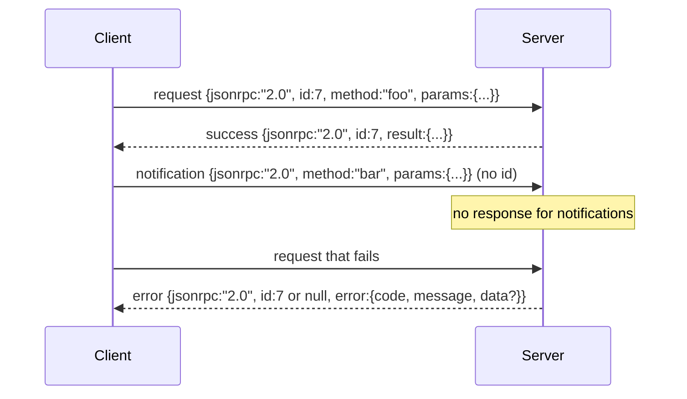

#  आधारित Newline-Delimited स्टूडियो के JSON-RPC 2.0

> मॉडल क्लाइंट और टूल सर्वर के बीच परिवहन स्टूडियो आधारित JSON-RPC है। इसे एक बार लिखें, आपको प्रत्येक स्तर के फ्रेमिंग को समझने में मदद मिलेगी।

**Type:** Build
**Languages:** Python
**Prerequisites:** Phase 13 lessons 01-07, Phase 14 lesson 01
**Time:** ~90 minutes

## सीखने के लक्ष्य


```figure
cf-jsonrpc-frames
```
- उपयोग के माध्यम से stdin 和 stdout 上的 नई लाइन-सीमित JSON फ्रेमिंग का JSON-RPC 2.0 通信
- 映射五个标准错误代码(-32700, -32600, -32601, -32602, -32603),并以正确语义暴露它们──
- 区分请求、响应、通知 和批发, बिना नए लिफाफे की कुंजी विकसित किए
- प्रत्येक पंक्ति एक विश्लेषण त्रुटि को संसाधित करती है, अपशिष्ट धारा के शेष भागों को संसाधित करती है।
- उपयोग io.BytesIO  एक स्वयं समाप्त होगा डेमो का निर्माण, कक्षाओं को बिना बच्चे की प्रक्रिया को जन्म देने की आवश्यकता 即可运行──

## क्यों JSON-RPC अभी भी lingua franca है

2026 में, एक कोडिंग एजेंट एकल सत्र में 12 टूल सर्वरों के साथ संवाद करेगा। प्रत्येक सर्वर एक स्वतंत्र प्रक्रिया या रिमोट एंडपॉइंट है। 2013 से वायर प्रारूप एक ही है। JSON-RPC 2.0 दो पृष्ठों का स्पेसिफिकेशन है। यह प्रतिस्थापन के कारण जीवित रह सकता है।

本课构建工作室变体──Newline-delimited JSON── प्रत्येक अनुरोध 是一行── प्रत्येक उत्तर 是一行──प्रवाहन सीमा 是 `\n`

## तार का आकार

 चार प्रकार के लिफाफे के आकार हैं दो प्रकार के ग्राहक द्वारा प्रक्षेपित  दो प्रकार के सर्वर द्वारा प्रक्षेपित 



सूचना 没有 `id` सर्वर ने जवाब नहीं दिया  यदि सर्वर ने सूचना को  प्रतिक्रिया दी है, तो ग्राहक को किसी कॉल साइट से कनेक्ट करने का कोई तरीका नहीं है  यह एक नियम है  फ्रेमिंग गणित  सरल रखें

बैच है अनुरोध या सूचनाओं की JSON सरणी──सर्वर  returns a responses array, क्रमशः arbitrary, प्रत्येक गैर-सूचना प्रविष्टि प्रति应 एक प्रतिक्रिया──यदि बैच में प्रत्येक प्रविष्टि हैं सूचना,सर्वर नहीं भेजता किसी भी सामग्री──

## 五个 त्रुटि कोड

```text
-32700  Parse error      JSON could not be parsed
-32600  Invalid Request  Envelope shape is wrong
-32601  Method not found
-32602  Invalid params
-32603  Internal error
```

-32000 से -32099 के बीच के कोड सर्वर-परिभाषित त्रुटियों को बनाए रखें। बाकी सभी कोड एप्लिकेशन-परिभाषित हैं।`data.exception`中放入 अपवाद वर्ग का नाम。

पार्स त्रुटि 有一条特殊规则── प्रतिक्रिया 中的 `id``null`, चूंकि अनुरोध  ने अभी तक पर्याप्त रूप से पहचान प्राप्त करने की डिग्री तक नहीं की है।

## न्यूलाइन फ्रेमिंग और BytesIO डेमो

परिवहन एक बार पढ़ लेना एक लाइन है जब तक यह शामिल नहीं है`\n`यदि कोई लाइन नहीं पढ़ सकती है, तो परिवहन एक बैंड में लिख जाएगा।`id: null`- - - - - - - - - - - - - - - - - - - - - - - - - - - - - - - - - - - - - - - - - - - - - - - - - - - - - - - - - - - - - - - - - - - - - - - - - - - - - - - - - - - - - - - - - - - - - - - - - - - - - - - - - - - - - - - - - - - - - - - - - - - - - - - - - - - - - - - - - - - - - - - - - - - - - - - - - - - - - - - - - - - - - - - - - - - - - - - - - - - - - - - - - - - - - - - - - - - - - - - - - - - - - - - - - - - - - - - - - - - - - - - - - - - - - - - - - - - - - - - - - - - - - - - - - - - - - - - - - - - - - - - - - - - - - - - - - - - - - - - - - - - - - - - - - - - - - - - - - - - - - - - - - - - - - - - - - - - - - - - - - - - - - - - - - - - - - - - - - - - - - - - - - - - - - - - - - - - - - - - - - - - - - - - - - - - - - - - - - - - - - - - - - - - - - - - - - - - - - - - - - - - - - - - - - - - - - - - - - - - - - - - - - - - - - - - - - - - - - - - - - - - - - - - - - - - - - - - - - - - - - - - - - - - - - - - - - - - - - - - - - - - - - - - - - - - - - - - - - - - - - - - - - - - - - -

इस कक्षा में, हम एक जोड़ी `io.BytesIO`包装成 stdin 和 stdout──server 读取 requests 直到 EOF,为每一个请求 写入回复,然后返回──client 再读回回复──没有过程 spawn──没有时间out──transport 行为与真实子进程管 完全相同,因为 Python 的`io`इंटरफ़ेस  प्रदान किया है समान `.readline()`和 `.write()`अनुबंध

## विधि भेजना

परिवहन नहीं जानता कि क्या तरीके हैं  मौजूद  यह काम कर दिया है  प्रदान किया जा सकता है `handler(method, params)`◊ हैंडलर  वापसी परिणाम या抛出异常── तीन अपवाद वर्ग 暴露 विशिष्ट कोड──

```text
MethodNotFound -> -32601
InvalidParams  -> -32602
Anything else  -> -32603 with exception name in data
```

परिवहन  कभी नहीं देखेंगे उपकरण रजिस्ट्री  रजिस्ट्री  स्थित है handler                                                                                                                                                                                                                                                                                                                                                                                                                                                                                                            

## अप अप अप प्रवाह  व्यवहार

```text
client writes              server reads             server writes
---------------            -----------              -------------
{...valid request...}      parses ok                {...response, id matches...}
{...broken json...         parse fails              {id:null, error: -32700}
{...valid request...}      parses ok                {...response, id matches...}
{...missing method...}     invalid envelope         {id:X, error: -32600}
```

एक पंक्ति टूट गया JSON नहीं होगा बंद लूप.`method`क्षेत्र 不会停止循环── हैंडलर अपवाद 不会停止循环──प्रवाहन 会持续读取直到EOF──

## सूचनाएं 和非对称 प्रवाह

सूचनाएँ  अग्नि-और-विस्मृति──शार्नेस उपयोग सूचनाएँ प्रगती की घटनाओं को प्रदर्शित करें、 रद्द करने के संकेत तथा लॉग लाइनें── सूचनाएँ  लंबे समय से चल रहे उपकरण को स्ट्रीम कर सकते हैं, बिना हर条都 रिंग-ट्रिप एक बार 

本课实现一个出发通知助手,`write_notification` सर्वर अनुरोध में  प्रगतिका भेजने के लिए इसका उपयोग करते हुए किया गया है  डेमो  इस पैटर्न को प्रदर्शित करता हैः एक अनुरोध  आ रहा है, हैंडर  दो प्रगति सूचनाएं भेज रहा है, फिर अंतिम प्रतिक्रिया में लिख रहा है 

## 如何阅读代码

`code/main.py` परिभाषित किया `StdioTransport`、पारस सहायक(`parse_request`)、तीन लेखकों के सहयोगियों`write_response``write_error``write_notification`), तथा डिस्पैचिंग लूप `serve`◊ त्रुटि कोड स्थिरता                                                                                                                                                                                                                                                                                                                                                                                                                                                                                                                        

`code/tests/test_transport.py`覆盖五个错误码、通知(不写回应)、批量(排列入,排列出, 跳过通知)、破碎 JSON(解析错误 后继续),以及处理器在调用中途写入通知的不对称流――

## 继续深入

इस परिवहन 足以支后续课程──生产运输 会添加三件事──一个能在转发后继续存在的相关性 id field(आपकी `id`已是这个, लेकिन मेष में आप भी एक बाहरी निशान आईडी की जरूरत है) ⋅ एक रद्द करने चैनल(类似 `$/cancelRequest`एक सूचना, एक इन-फ्लाइट कॉल की आईडी (ID) ‒ के साथ-साथ एक सामग्री-प्रकार वार्तालाप हाथ मिलाकर, एक ही सॉकेट को एक साथ JSON-RPC और स्ट्रीमेबल HTTP ‒ के साथ-साथ कहा जा सकता है। ये तार को नहीं बदलेंगे। वे केवल मेटाडेटा जोड़ेंगे।
