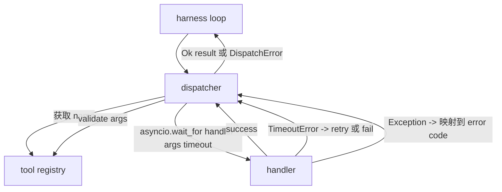
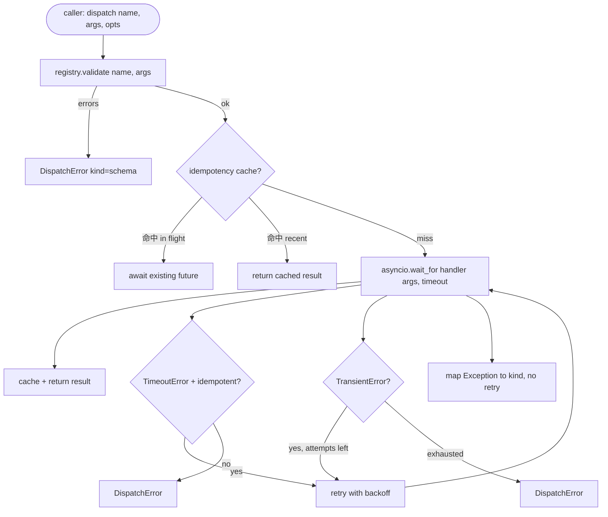

# फ़ंक्शन कॉल डिस्पेंसर

> डिस्पैचर एक योजना है जहां प्रत्येक प्रतिबद्धता खरीदी जा रही है।

**Type:** Build
**Languages:** Python
**Prerequisites:** Phase 13 lessons 01-07, Phase 14 lesson 01
**Time:** ~90 minutes

## सीखने के लक्ष्य
- उपयोग प्रति कॉल समय 包装 उपकरण हैंडल, इसे वापस टाइप त्रुटि, बजाय लूप 挂
- 应用带紧张和最大尝试次数的指数式 बैकऑफ पुनः प्रयास
- इम्पोटेन्सी कुंजी के आधार पर पुनः प्रयास करें, इस प्रकार धीमी से मूल कॉल 竞争的重试 不会运行两次──
-  संचालक अपवादों और परिवहन दोष 映射到圈 已理解的单一错误包
- समवर्ती सीमा के साथ समानांतर डिस्पैच, फैन-आउट के लिए बचें उपकरण कॉल के चार दशक


```figure
cf-dispatch-retry
```

## जहां डिस्पेंचर बैठता है

位于 harness loop(lection twenty) और tool registry(lection twenty-one)之间──transport(lection twenty-two)向循环 输入──loop 把 tool call 交给 dispatcher──dispatcher 调用 registry,运行 handler,并返回 result 或 JSON-RPC 形状的错误包──



डिस्पैचर ही एकमात्र जानता है टाइमर, रिट्रीट और इडम्पोटेन्सी के स्तर, लूप, रजिस्ट्री, रजिस्ट्री, रजिस्ट्री, रजिस्ट्री, रजिस्ट्री, रजिस्ट्री, रजिस्ट्री, रजिस्ट्री, रजिस्ट्री, रजिस्ट्री, रजिस्ट्री, रजिस्ट्री, रजिस्ट्री, रजिस्ट्री, रजिस्ट्री, रजिस्ट्री, रजिस्ट्री, रजिस्ट्री, रजिस्ट्री, रजिस्ट्री, रजिस्ट्री, रजिस्ट्री, रजिस्ट्री, रजिस्ट्री, रजिस्ट्री, रजिस्ट्री, रजिस्ट्री, रजिस्ट्री, रजिस्ट्री, रजिस्ट्री, रजिस्ट्री, रजिस्ट्री, रजिस्ट्री, रजिस्ट्री, रजिस्ट्री, रजिस्ट्री, रजिस्ट्री, रजिस्ट्री, रजिस्ट्री, रजिस्ट्री, रजिस्ट्री, रजिस्ट्री, रजिस्ट्री, रजिस्ट्री, रजिस्ट्री, रजिस्ट्री, रजिस्ट्री, रजिस्ट्री, रजिस्ट्री, रजिस्ट्री, रजिस्ट्री, रजिस्ट्री, रजिस्ट्री, रजिस्टरी, रजिस्टिंग, रजिस्टिंग, रजिस्टिंग, रजिस्टिंग, रजिस्टिंग, रजिस्टिंग, रजिस्टिंग, रजिस्टिंग, रजिस्टिंग, रजिस्टिंग, रजिस्टिंग, रजिस्टिंग, रजिस्टिंग, रजिस्टिंग, रजिस्टिंग, रजिस्टिंग, रजिस्टिंग, रजिस्टिंग, रजिस्टिंग, रजिस्टिंग, रजिस्टिंग, रजिस्टिंग, रजिस्टिंग, रजिस्टिंग, रजिस्टिंग, रजिस्टिंग, रजिस्टिंग, रजिस्टिंग, रजिस्टिंग, रजिस्टिंग, रजिस्टिंग, रजिस्टिंग, रजिस्टिंग, रजिस्टिंग, रजिस्टिंग, रजिस्टिंग, रजिस्टिंग, रजिस्टिंग, रजिस्टिंग, रजिस्टिंग।

## समय सीमा

प्रत्येक उपकरण में डिफ़ॉल्ट समय सीमा है। रजिस्ट्री रिकॉर्ड  ले लो `timeout_ms` जब हर्नस 传入 प्रति कॉल ओवरराइड 时, डिस्पैचर 会用它覆盖默认值──我们使用 `asyncio.wait_for`समय समाप्त हो गया , हैंडलर कार्य समाप्त हो जाएगा, डिस्पेंसर  वापसी `DispatchError(kind="timeout")`

 गैर-उत्कृष्ट उपकरण के लिए, समय समाप्ति 默认 नहीं retrievable त्रुटि `db.write`हो सकता है कि वह पहले ही प्रस्तुत हो चुका हो, हो सकता है कि वह नहीं हो।`idempotent`ध्वज──असहाय उपकरण 会再试──असहाय उपकरण 不会──

## एक्सपोनेंशियल बैकॉफ के साथ पुनः प्रयास

रिट्री पॉलिसी 最多三次尝试── बैककोफ है带 jitter के एक्सपोनेंशियल बैककोफ──

```text
attempt 1  -> delay 0
attempt 2  -> delay 0.1s * (1 + random[0..0.5])
attempt 3  -> delay 0.4s * (1 + random[0..0.5])
```

 केवल `timeout`和 `transient`त्रुटि पुनः प्रयास करेगा`schema`त्रुटि`not_found`या `internal`त्रुटि नहीं दोहराई जाएगी। योजना त्रुटियां निश्चित हैं।

रिट्री लूप  दिया गया बजट का पालन करेगा  यदि कॉल करने वाले का बजट  शेष उपकरण शून्य के लिए कॉल करता है, डिस्पैचर  पहली बार प्रयास में तेजी से विफल रहता है,并返回 `kind="budget_exceeded"`

## असमर्थता कुंजी का निर्णायक

जब मूल कॉल 仍在飞行 时触发重复试, एक वास्तविक उत्पादन बग है। पहली बार调用在四点九秒时挂起(刚好低于时间out)`payments.charge`, तुम दो बार पकड़ा है.

डिस्पेंचर  स्वीकार可选的 `idempotency_key` यदि एक कॉल पहुँचने पर एक ही कुंजी उड़ान में है, डिस्पैचर उस उड़ान में भविष्य का इंतजार करेगा, और उसके परिणाम को वापस करेगा

कुंजी है कॉल करने वाले की जिम्मेदारी.`f"{step_id}:{tool_name}:{hash(args)}"`❖ डिस्पैचर नहीं करेगा आविष्कार कुंजी, क्योंकि केवल तर्क से √√√√√√√√√√√√√√√√√√√√√√√√√√√√√√√√√√√√√√√√√√√√√√√√√√√√√√√√√√√√√√√√√√√√√√√√√√√√√√√√√√√√√√√√√√√√√√√√√√√√√√√√√√√√√√√√√√√√√√√√√√√√√√√√√√√√√√√√√√√√√√√√√√√√√√√√√√√√√√√√√√√√√√√√√√√√√√√√√√√√√√√√√√√√√√√√√√√√√√√√√√√√√√√√√√√√√√√√√√√√√√√√√√√√√√√√√√√√√√√√√√√√√√√√√√√√√√√√√√√√√√√√√√√√√√√√√√√√√√√√√√√√√√√√√√√√√√√√√√√√√√√√√√√√√√√√√√√√√√√√√√√√√√√√√√√√√√√√√√√√√√√√√√√√√√√√√√√√√√√√√√√√√√√√√√√√√√√√√√√√√√√√√√√√√√√√√√√√√√√√√√√√√√√√√√√√√√√√√√√√√√√√√√√√√√√√√√√√√√√√√√√√√√√√√√√√√√√√√√√√√√√√√√√√√√√√√√√√√√√√√√√√√√√√√√√√

## त्रुटि लिफाफा

失败的发送 返回单一形状──

```text
DispatchError
  kind        : "timeout" | "transient" | "schema" | "not_found" | "internal" | "budget_exceeded"
  message     : str
  attempts    : int
  jsonrpc_code: int   （-32601、-32602、-32603 之一）
```

हर्न लूप `kind`映射到下一个状态──`schema`和 `not_found`प्रवेश`on_error`नहीं है रिप्लेन करने के लिए.`timeout`和 `transient`प्रवेश`on_error`,可能重复,也可能不重复,取决于尝试.`budget_exceeded`触发 `on_budget_exceeded`

## फैन आउट पर मुद्रांकन सीमा

`gather(*calls)`会同时运行所有 coroutines──四十工具电话意味着四十开源或四十子工艺管──大多数后台都不喜欢一个客户端发起四十并行连接──

डिस्पैचर उपयोग सेमफ़ोर 包装 `gather`◊默认 समवर्ती सीमा 八── प्रत्येक कॉल 在发送之前获得语音,并在完成时发布──调用者 看到的是 `gather`形形的输出, लेकिन वास्तविक शेड्यूलिंग 有界的──

## एक कॉल के लिए प्रवाह



## कोड कैसे पढ़ें

`code/main.py` परिभाषित किया `Dispatcher``DispatchError`和 `TransientError`◊ डिस्पेंचर 在构造时接收注册`dispatch(name, args, ...)`                                                                                                                                                                                                                                                              `_run_with_retries` 内用 `asyncio.wait_for`इनलाइन  अनुप्रयोग`gather_bounded(calls)`运行多个发送――

`code/tests/test_dispatcher.py`覆盖 टाइमआउट 触发、transient 上的 रिट्री、स्कीम त्रुटि 上不再试、idempotency dedupe(दो साथ एक ही कुंजी के समवर्ती कॉल 折叠为一次处理器调用),以及 समवर्ती सीमा ((semaphore 生效) 

प्रयोग परीक्षण `asyncio.sleep(0)`और निर्धारक पर आधारित `Counter`वे दीवार घड़ी समय पर निर्भर नहीं, इसलिए वे एक मिनट में पूरा हो जाएगा।

## आगे बढ़ना

उत्पादन डिस्पैचरों को दो विस्तारों को जोड़ना होगा। पहला, प्रत्येक संक्रमण में व्यवस्थित लॉगिंग के लिए लूप के घटना प्रवाह को प्रदान किया गया है, लेकिन डिस्पैचर को भी उत्सर्जित करना चाहिए।`dispatch.attempt`和 `dispatch.retry`घटनाएँ)── दूसरा, सर्किट ब्रेक: एक खिड़की के अंदर N 次失败 के बाद हुआ, उपकरण  शीतलन अवधि में प्रवेश, डिस्पैच 会立即返回 `kind="circuit_open"`, प्रयास संचालक की बजाय. दोनों को इस डिस्पैचर पर जोड़ा जा सकता है, अनुबंध को बदलने के बिना.

पाठ 24 एक डिस्पेंसर को एक योजना-और-कार्यकारी एजेंट के साथ संलग्न करना, आपको चार भागों को एक साथ स्थानांतरित करना देखना है।
