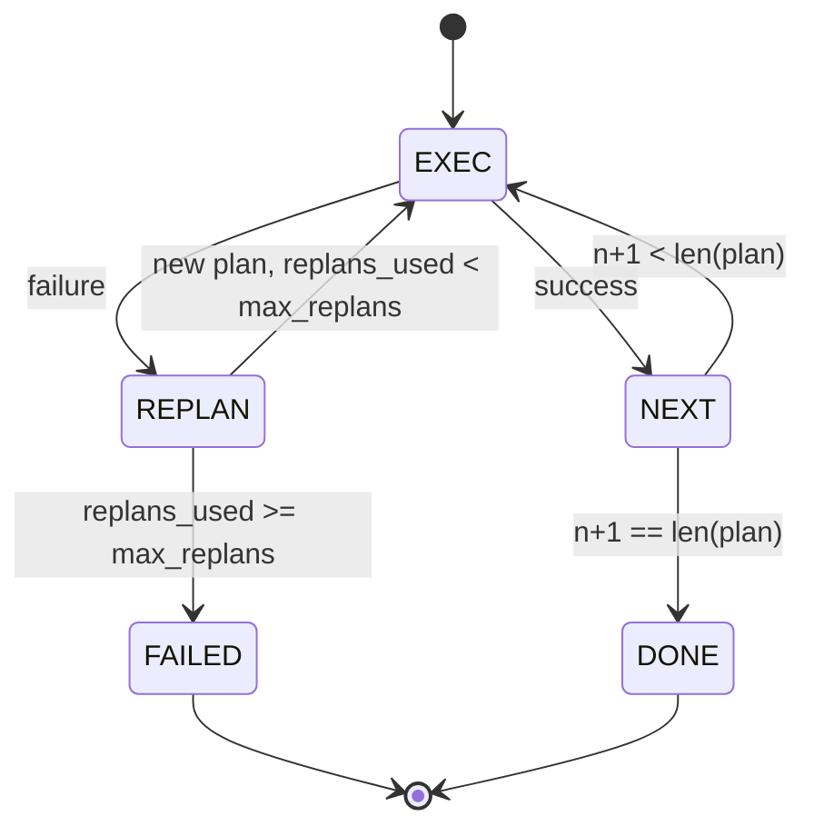

# नियोजन-कार्यकारी नियंत्रण प्रवाह

> 无法承受 विफलता का योजना 才是代理──先构建重新规划者──

**Type:** Build
**Languages:** Python
**Prerequisites:** Phase 13 lessons 01-07, Phase 14 lesson 01
**Time:** ~90 minutes

## सीखने के लक्ष्य


```figure
cg-plan-replan
```
- योजना को टाइप किए गए चरणों की क्रमबद्ध सूची के रूप में प्रदर्शित करना, ताकि निष्पादक प्रगति और परिणामों का अनुमान लगा सके।
- 顺序执行 steps,并将 विफल受控地 हस्तान्तरण 回规划者──
- वर्तमान कर्सर से पुनःप्रयोजन शुरू करें, और संदर्भ में पूर्व त्रुटि को ले जाएं, अगली योजना बनाएं और जानकारी प्राप्त करें।
- प्रत्येक संशोधन में योजनाएँ भिन्न होती हैं, चलो नीचे यात्रा ट्रैसर या UI 能 दिखाएँ योजनाएँ क्यों बदल जाएँ
- 强制执行两个预算:硬性阶段上限和硬性重复计划上限――

## योजना-और-कार्यकारी, बजाय सोच-श्रृंखला

सोच-श्रृंखला एजेंट टोकन जारी करेगा,并让循环 猜测 उपकरण कॉल 在哪里结束──计划-and-executing agent पहले एक संरचित योजना जारी करेगा, फिर प्रत्येक चरण को निष्पादित करेगा──计划是利用可内视的数据──执行是利用通过发送器 运行这些数据──

两个部分──一个规划者 产生计划──一个执行者 运行计划──真正意义是执行者 遇到失败时发生什么──三个选项:

```text
1. Abort         （返回 failed，暴露 error）
2. Skip          （将 step 标记为 failed，继续剩余部分）
3. Replan        （把 error 交给 planner，从 cursor 获取新 plan）
```

रिप्लेन                                                                                                                                                                                                                                                              

## चरण का आकार

```text
Step
  id              : int           （在一个 plan revision 内单调递增）
  tool_name       : str
  args            : dict
  expected_outcome: str           （planner 声明的 success condition）
  result          : Any | None
  error           : str | None
```

`expected_outcome`यह एक योजनाकार है और एक कदम से एक कदम से एक कदम से एक कदम से एक कदम से एक कदम से एक कदम से एक कदम से एक कदम से एक कदम से एक कदम से एक कदम से एक कदम से एक कदम से एक कदम से एक कदम से एक कदम से एक कदम से एक कदम से एक कदम से एक कदम से एक कदम से एक कदम से एक कदम से एक कदम से एक कदम से एक कदम से एक कदम से एक कदम से एक कदम से एक कदम से एक कदम से एक कदम से एक कदम से एक कदम से एक कदम से एक कदम से एक कदम से एक कदम से एक कदम से एक कदम से एक कदम से एक कदम से एक कदम से एक कदम से एक कदम से एक कदम से एक कदम से एक कदम के रूप में एक कदम से एक कदम से एक कदम के रूप में एक कदम से एक कदम से एक कदम के रूप में एक कदम से एक कदम से एक कदम के रूप में एक कदम से एक कदम से एक कदम से एक कदम के रूप में एक कदम से एक कदम से एक कदम के रूप में एक कदम से एक कदम से एक कदम से एक कदम के रूप में एक कदम से एक कदम से एक कदम के रूप में एक कदम से एक कदम के रूप में एक कदम से एक कदम के रूप में एक कदम के रूप में एक कदम से एक कदम के रूप में एक कदम के रूप में एक कदम के रूप में एक कदम के रूप में एक कदम के रूप में एक कदम के रूप में एक कदम के रूप में एक कदम के रूप में एक कदम के रूप में एक कदम के रूप में एक एक एक कदम के रूप में एक कदम के रूप में एक एक एक एक कदम के रूप में एक एक एक कदम के रूप में एक एक एक कदम के रूप में एक एक एक कदम के रूप में एक एक एक एक कदम के रूप में एक एक एक एक एक एक एक एक एक एक एक एक एक कदम के रूप में एक एक एक एक एक एक एक एक एक एक एक रूप में एक एक एक रूप में एक एक एक एक एक रूप में एक एक एक रूप में एक एक एक एक रूप में एक रूप में एक एक रूप में एक एक एक एक एक रूप में एक एक एक एक रूप में एक रूप में एक एक एक एक एक रूप में एक एक रूप में एक एक एक एक रूप में एक एक एक रूप में एक एक एक एक एक एक रूप में एक रूप में एक एक एक एक एक एक एक रूप में एक एक रूप में एक रूप में एक एक एक एक एक रूप में एक एक रूप में एक एक एक एक एक रूप में एक एक एक एक रूप में

## योजनाकार का आकार

```python
def planner(goal: str, history: list[Step], last_error: str | None) -> list[Step]:
    ...
```

एक शुद्ध कार्य.`goal`यह उपयोगकर्ता का लक्ष्य है`history`                                                                                                                                                                                                                                                              `last_error`पहली बार कॉल करने पर कोई नहीं, बाद में प्रत्येक कॉल करने पर नवीनतम विफलता संदेश है।

योजनाकार नहीं जानता निष्पादक नहीं जानता यह पुनः प्रयास नहीं करता यह समय सीमा नहीं जानता यह केवल योजना उत्पन्न करता है

## निष्पादक

निष्पादक एक छोटी सी राज्य मशीन है। प्रत्येक चरण में डिस्पैचर के माध्यम से 运行――परिणाम 有三种: सफलता、 विफलता-पुनर्विचार योग्य、 विफलता-मौतिक。पुनर्विचार योग्य विफलताएँ 会手返回 给规划者──致命 विफलताएँ(बजट से अधिक、पुनर्विचार योग्य `FAILED`सत्र परिणाम



## संशोधन 时的计划 diff

जब योजनाकार असफलता के बाद नई योजना पर लौटता है, निष्पादक एक जारी करेगा जिसमें तीन खंड होते हैं।`plan.diff`घटना

```text
removed: 旧 plan 中存在但新 plan 中不存在的 step ids 列表
added  : 新 plan 中存在但旧 plan 中不存在的 step ids 列表
revised: tool_name 或 args 已改变的 step ids 列表
```

ट्रैसर या यूआई इसे हटाए गए चरणों के स्ट्राइक-थ्रू, साथ ही साथ जोड़े गए चरणों के हाइलाइट में भी समझा जा सकता है।

##  दो कठिन बजट

`max_steps`सीमित करें पूरे सत्र में कुल चरण निष्पादन, जिसमें पुनर्गठन शामिल है 默认是十二──失败的尝试也计入── एक अंतिम चरण में असफल पांच चरण योजना 已经花了五次执行── यदि प्रत्येक पुनर्गठन में सभी चरणों को पुनः प्रयास किया गया है और तीन चरणों को नया किया गया है, जबकि पहली संशोधन के अंतिम चरण में फिर से विफलता हुई है, तो संख्या नौ है, दूसरी संशोधन भी चार बार की आवश्यकता हैः`step_budget`返回 असफल

`max_replans`限制第一次计划 之后规划者 被调用次数──默认是五──这是更重要的限制──一个连续五次回归同一个破碎的计划规划者,否则会一直循环,直到步骤预算 抓获它──限制重计划会让失败更快发生,原因也更清楚──

## 本课中的 निर्धारक नियोजक

इस पाठ में मॉडल का उपयोग नहीं किया गया है।`last_error`选择 योजना──

```text
last_error is None    -> emit 一个 four-step plan
last_error matches X  -> emit 一个绕过 X 的 three-step plan
last_error matches Y  -> emit 一个优雅放弃的 two-step plan
otherwise             -> return []（表示没有内容可 replan）
```

यह पर्याप्त है परीक्षण निष्पादक में प्रत्येक संक्रमण पथ ऊपर के व्यवहारः सफलता, पुनः योजना, एक बार पुनः योजना, दो बार पुनः योजना, और चरण-बजट समाप्ति

## परिणाम का आकार

```text
SessionResult
  status      : "completed" | "failed"
  reason      : str     ("goal_met" | "step_budget" | "replan_budget" | "no_plan")
  history     : list[Step]
  revisions   : list[PlanDiff]
  events      : list[Event]
```

पाठ बीस मध्य के हर्न लूप को सीधे पढ़ सकते हैं इसे पढ़िये। पाठ बीस तीन मध्य के डिस्पैचर को प्रत्येक चरण को निष्पादित करें। पाठ बीस एक मध्य के रजिस्ट्री को प्रत्येक चरण के तर्कों को मान्य करें। पाठ बीस दो मध्य के परिवहन को JSON-RPC के माध्यम से पूरा प्रवाह को उजागर करेगा।

## कोड कैसे पढ़ें

`code/main.py` परिभाषित किया `PlanExecuteAgent``Step``PlanDiff``SessionResult`और निर्धारक नियोजक---कार्यकारी है एकल `run(goal)`विधि, वापसी `SessionResult`◊ योजना भिन्न                                                                                                                                                                                                                                                                                                                                                                                                                                                                                                                          `(tool_name, args)`द्विगुण 计算。

`code/tests/test_agent.py`覆盖 रैखिक सफलता ∙ एक बार मध्य योजना विफलता  后重计划 ∙ वापसी `failed:replan_budget`∙ योजना-विभिन्न कार्यक्रम प्रारूप तथा चरण-वित्तीय परिष्करण

## आगे बढ़ना

连接到真实模型 后,你会需要两个扩展──第一,部分计划缓存:当一个计划的六个步骤 中前三个成功、后失败时,你不想重新运行前三个──执行者 已保留历史;planner 只需要读取它──第二,并行分支:当前执行者是严格序列的──发行独立分支`gather_step`नहीं `next_step`) के नियोजक के माध्यम से डिस्पैचर समवर्ती 运行两个工具调用──

 दोनों ही वास्तविक जटिलता में वृद्धि करेंगे                                                                                                                                                                                                                                                          
