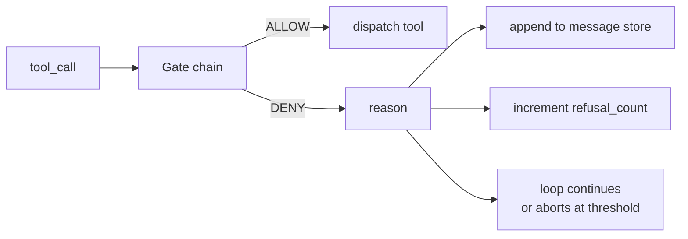
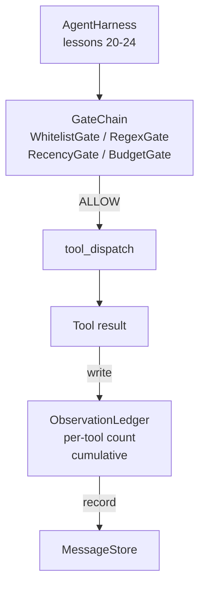

# कैपस्टोन 第 25 课: सत्यापन द्वार और अवलोकन बजट

> 没有验证层的代理利用,只是披露外套的愿望──本课会构建确定性门链,用来决定是否允许一次工具调用 触发、代理可以看到多少输出,以及当代理 已读取太多内容时循环 何时必须停止──这个链由小型、名字的门加上观察账本组成; ledger 会追踪已经显示给模型的每一个代币──

**Type:** Build
**Languages:** Python (stdlib)
**Prerequisites:** Phase 19 · 20-24（Track A1：agent loop、tool registry、message store、prompt builder、model router），Phase 14 · 33（instructions as constraints），Phase 14 · 36（scope contracts），Phase 14 · 38（verification gates）
**Time:** ~90 minutes

## सीखने के लक्ष्य

- निर्माण के साथ निश्चितता `evaluate(call)`方法 की `VerificationGate`प्रोटोकॉल
- बजट, हालिया, श्वेतसूची और रेगएक्स गेट को संकलित करना
- 按工具和转 建索引的 `ObservationLedger` प्रत्येक अवलोकन का पालन करना
- जब संचयी अवलोकन बजट से अधिक हो जाएगा, तो एक उपकरण कॉल को अस्वीकार कर देना।
- संरचनात्मक`GateDecision`रिकॉर्ड,供下游 अवलोकन

## 问题

जब एजेंट उपयोग करता है 模型 मुक्त रूप से उपकरण का उपयोग करने की अनुमति देता है  , वास्तविक उपयोग के पहले घंटे के भीतर तीन प्रकार की बग दिखाई देती है 

प्रथम श्रेणी है अनंत अवलोकन। एक 20 हजार लाइन रेपो पर एक 50 हजार टोकन का आउटपुट अगले दौर में डाल दिया जाएगा। मॉडल प्रति हजार बाइट केवल एक मैच देखता है, शेष संदर्भ पूर्ण रूप से बर्बाद हो गया है। टोकन खाता बहुत अधिक है, जबकि एजेंट पर प्रदर्शन में विपरीत परिवर्तन हुआ है।

दूसरा वर्ग पुरानी हालिया है। एक लंबे समय से चल रहे कार्य 50 बार टूल कॉल को इकट्ठा करेगा। मॉडल तीसरे दौर की पहली रीड_फ़ाइल को वास्तविक समय में रीड_फ़ाइल में डाल देगा।

तृतीय श्रेणी है विशेषाधिकार क्रैप--- एक अध्ययन कार्य से调用`web_search`开始,随后不知怎么就运行了 `shell`, चूंकि मॉडल ने एक उपकरण नाम बनाया है, और उपयोग 默认宽松──等有人读取痕迹 时,/tmp 里已经放了一个垃圾文件,并且一次卷 已经打到了私有API──

सत्यापन गेट है हर्नस में जिम्मेदार 不 के घटक── यह मॉडल नहीं है── यह न्यायाधीश नहीं है── यह है `(call, history, ledger)`                                                                                                                                                                                                                                                              

## 概念



गेट है जो भी है`evaluate(call, ctx) -> GateDecision`方法的对象──chain 是一个有序列表──评估 在第一次拒绝时短路──序列很重要:便宜的结构性门 会先于昂贵的代币计数门 运行──

本课提供四门门:

- `WhitelistGate` अनुमति देने वाले उपकरण के नाम एक स्पष्ट संग्रह हैं संग्रह के बाहर की कोई भी सामग्री अस्वीकार कर दी जाएगी यह सबसे सस्ती गेट है, सबसे पहले चलेगी
- `RegexGate` औजार तर्क 会与regex 匹配──适合拒绝包含 `rm -rf`का शेल कॉल, या आंतरिक आईपी का HTTP कॉल. यह केवल कॉल पेलोड पर निर्भर करता है.
- `RecencyGate`◊ मॉडल केवल हाल ही में N 轮 के अवलोकनों को देख सकता है ◊ पुराने अवलोकनों को छिपाया जाएगा ◊ इस गेट को इसके परिणामों को अस्वीकार कर देगा एक पहले से ही समाप्त अवलोकन विंडो के उपकरण कॉल का विस्तार करेगा ◊
- `BudgetGate`◊ पूरे सत्र में संचयी पढ़ने के टोकन एक ऊपरी सीमा है ◊ जब लेजर ◊ दिखाता है कि ऊपरी सीमा तक पहुंच गई है, तो बाद में प्रत्येक उपकरण कॉल को अस्वीकार कर दिया जाएगा ◊

अवलोकन लेजर 负责记账―― प्रत्येक बार सफल उपकरण कॉल 都会写入一行: उपकरण नाम、 बारी、 टोकन जारी、 संचयी。 लेजर  दो प्रश्नों का उत्तरः模型总共看到了多少,以及它看到了工具 X 的多少── बजट गेट 读取第一──每工具预算门是你的练习内容,它会读取第二个──


```figure
cg-gate-chain
```

## 架构



harness 会询链──链 要么点头,要么拒绝── यदि यह点头, उपकरण 会运行, ledger 会计数, परिणाम संदेश स्टोर में जोड़ा जाएगा── यदि यह नकारता है, तो मॉडल सिस्टम संदेश के रूप में अस्वीकार प्राप्त करेगा, फिर लूप निर्णय लेता है कि पुनः प्रयास करें या रोकें──

## तुम क्या बनाओगे

实现 एक `main.py`अतिरिक्त परीक्षणों

1. `Observation`和 `ToolCall`डेटाक्लास  परिभाषित तार आकारों。
2. `ObservationLedger` रिकॉर्ड `(turn, tool, tokens)`पंक्तियाँ,并回答 `cumulative()`和 `per_tool(name)`
3. `GateDecision`携带 `(allow, reason, gate_name)`
4. `VerificationGate`प्रोटोकॉल है। प्रत्येक गेट को पूरा किया गया है।`evaluate(call, ctx)`
5. `GateChain` एक क्रमबद्ध तालिका को पैक करें यह प्रत्येक गेट को बुलाएगा, पहले से इनकार कर देगा; यदि सभी गेट से गुजरते हैं, तो वापस जाने की अनुमति देगा
6. डेमो 运行一个很小的合成代理循环──三轮──第三轮触发预算门,循环 会报告一次干净的拒绝,并带有非零拒绝数──

टोकन काउंटर बहुत कड़ा है`len(text) // 4`हेरिस्टिक──本课重点是门管,而不是 टोकनराइज़र──生产环境中请替换为真正的 टोकनराइज़र──

## क्यों श्रृंखला  क्रम महत्वपूर्ण है

एक बार इनकार करने से एक बार अनुमति देने से अधिक सस्ता।`WhitelistGate`运行 $O(1)$हैश खोज`RegexGate`运行 $O(\text{pattern} \cdot \text{argv})$`RecencyGate`读取 संदेश स्टोर का एक छोटा सा स्लाइस。`BudgetGate`读取整个账本──你需要按成本升序排列它们,这样被拒绝的电话就能在执行昂贵的工作前短路──

आप भी ब्लास्ट रेंज पर ध्यान देना चाहिए 排序── श्वेतसूची सबसे मजबूत है的主张: यह उपकरण नहीं है अनुबंध में──रेगएक्स गेट 其次: यह तर्क नहीं है अनुबंध में── हाल ही में स्थित है 

## यह कैसे ट्रैक ए के शेष भाग के साथ संयोजन

 पिछले पाठ्यक्रम ने आपको लूप, टूल रजिस्ट्री, मैसेज स्टोर, प्रॉम्प्ट बिल्डर और मॉडल राउटर प्रदान किए हैं।                                                                                                                                                                                                                                               

## 运行方式

```bash
cd phases/19-capstone-projects/25-verification-gates-observation-budget
python3 code/main.py
python3 -m pytest code/tests/ -v
```

डेमो 会印印逐轮痕迹, जिनमें प्रत्येक गेट निर्णय शामिल है,并以零退出──टेस्ट 覆盖 ledger、 प्रत्येक स्वतंत्र गेट、链短路,以及端到端合成循环──
