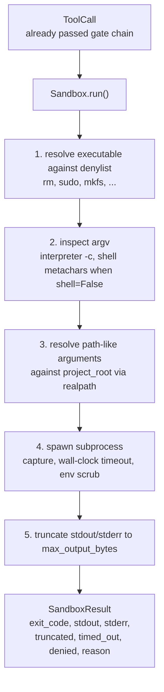
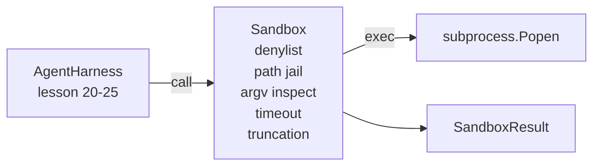

# कैपस्टोन 第 26 课:带 Denylist与 Path Jail का सैंडबॉक्स धावक

> सत्यापन गेट एक बार उपकरण कॉल तय करता है या नहीं चलना चाहिए। सैंडबॉक्स तय करता है कि यह चलाने पर क्या होगा। यह एक उपप्रक्रिया रनर प्रदान करता है, यह खतरनाक निष्पादित करने योग्य को अस्वीकार करेगा, खतरनाक आरजीवी आकारों को अस्वीकार करेगा, प्रत्येक फ़ाइल पथ को परियोजना रूट में सीमित करेगा, ओवरस्टॉप आउटपुट को काट देगा, और वॉल-क्लॉक टाइमआउट में भागने वाली प्रक्रियाओं को मार देगा। यह मॉडल और ऑपरेटिंग सिस्टम के बीच दो परतों में स्थित है।

**Type:** Build
**Languages:** Python (stdlib)
**Prerequisites:** Phase 19 · 25（verification gates and observation budget），Phase 14 · 33（instructions as constraints），Phase 14 · 38（verification gates）
**Time:** ~90 minutes

## सीखने के लक्ष्य

- 构建一个包装 `subprocess.run``Sandbox`कक्षा,带有时间out,捕捉和裁剪.
- 按名称通过 denylist、按结构通过 argv निरीक्षक 拒绝命令──
-  अस्वीकार किसी भी समाधान के लिए बयान परियोजना जड़  के बाहर पथ तर्क 
- में शेल मोड 关闭时拒绝 शेल मेटाक्यारेक्टरों。
- 返回结构化 `SandboxResult`,供下游观察性和 eval हर्न 摄取──

## 问题

能够 shell out का कोडिंग एजेंट एक बारी में अंदर अंदर बैकडोर स्थापित किया जा सकता है  बाहर निकलते चाबियाँ  खराब डेवलपर लैपटॉप, और क्लाउड बिल उत्पन्न किया जा सकता है  न्यूनतम रक्षा लागत यह है कि इसे खोल नहीं देता है  लागत दूसरी कम एक सटीक पैटर्न सूची पर एक बैठक है   के सैंडबॉक्स   

एजेंट के निशान 中反复出现三类失败──

प्रथम श्रेणी है खतरनाक निष्पादन योग्य। एक में सुधार पथ  समस्या पर सहन दबाव मॉडल `sudo``chmod -R 777``rm -rf``mkfs``dd` ये सब एजेंट रन में नहीं हैं                                                                                                                                                                                                                                                          

दूसरा प्रकार है argv ट्रिक्स. एक आरोपी को शेल का उपयोग नहीं कर सकता है, जो एक व्याख्याता द्वारा किया जाएगा।`python3 -c "import os; os.system('rm -rf /')"``bash -c '...'``node -e '...'``perl -e '...'`सैंडबॉक्स 需要知道,任何带有类似的 `-c`ध्वज के अनुवादक चल रहा है, वास्तव में केवल कुछ ही कदम के शेल कॉल है।

तीसरा वर्ग है पथ भागना।`./src/main.py`, लेकिन पढ़ा है .`../../etc/passwd`सैंडबॉक्स 会通过 `os.path.realpath`解析 प्रत्येक पथ तर्क,并断言其前सर्ग, इस प्रकार उन्हें जेल में सीमित करेगा

यह सैंडबॉक्स ऑपरेटिंग सिस्टम की सुरक्षा सीमा नहीं है। यह एक निश्चित हमलावर है जो कोड निष्पादन के साथ है। यह विकास समय की सुरक्षा है। यह सामान्य विफलता मोड को स्पष्ट बनाता है, और एजेंट को रोकता है क्योंकि यह केवल त्रुटि है और नुकसान पहुंचाता है।

## 概念



sandbox में चार अस्वीकार अक्ष हैंः नाम, अर्गव, पथ, संरचना। प्रत्येक अक्ष कॉल का शुद्ध कार्य है, इस समय कोई उप-प्रक्रिया नहीं है। केवल सभी अक्षों के बाद, उप-प्रक्रिया केवल उत्पन्न होती है।

`SandboxResult`आउटपुट कोड उपयोग惯例值:0 सफलता का प्रदर्शन करें,非零 विफलता का प्रदर्शन करें, इसके अलावा तीन सेंटीनेल कोड हैंः अस्वीकार (-100)、समय_आउट (-101) 和 संकुचित(आउटपुट कोड है वास्तविक मूल्य, साथ ही फ्लैग सेट करें)。


```figure
cg-path-jail
```

## 架构



denylist is executable basenames 的 frozenset──aliases(`/bin/rm``/usr/bin/rm`)都会解析到相同的基名──argv निरीक्षक 了解解释器形:任何 argv[0] 是解释器 且后续任一 arg 以 `-c`या `-e`开头的 argv 城市会被拒绝──当电话 没有显然请求 时,贝的元字符`;``|``&``>``<`、पैकटिक्स`$()`) इससे इनकार हो जाएगा।

रास्ता जेल सबसे सूक्ष्म भाग है। निर्माण में सैंडबॉक्स स्वीकार किया जाता है।`project_root`🏻 किसी भी तरह लग रहा है पथ का तर्क`/`या मौजूदा दस्तावेजों के अनुरूप) सब पारित होगा `os.path.realpath`归一化,然后与项目根的真路比较──如果解析后的目标不在根下,则拒绝──Symlink escape attempts(项目根中指向外部的 symlink) को वास्तविक पथ 阻止, बजाय 检查字面路径── के द्वारा जांच किया जाएगा।

## तुम क्या बनाओगे

实现是 `main.py`एक परीक्षण और।

1. `SandboxResult`dataclass:exit_code、stdout、stderr、truncated、timed_out、denied、reason、duration_ms。
2. `SandboxConfig`dataclass:project_root、max_output_bytes、timeout_seconds、denylist、interpreter_block。
3. `Sandbox`वर्गः`run(argv, *, shell=False, cwd=None)` लौटें `SandboxResult`
4. 内部 अस्वीकार सहायक:`_check_executable_denylist``_check_argv_interpreter``_check_shell_metachars``_check_path_jail`
5. आउटपुट ट्रंक,带清晰的 `truncated`ध्वज और कब्जा धारा मध्य के मार्कर लाइन
6. 底部デモ:一系列合法与反抗性电话―― प्रत्येक कॉल में परिणाम दिखाई देगा――

सैंडबॉक्स 默认使用 `subprocess.run`且 `shell=False``capture_output=True`△ दीवार घड़ी समय उपयोग `timeout`तर्क;`TimeoutExpired`时,सैंडबॉक्स会杀死过程组并合成一个沙盒结果

## यह असली रेत बॉक्स क्यों नहीं है

इस वर्ग का सैंडबॉक्स नामस्थानों, समूहों, अनुक्रमों, विज़ोर, फायरक्रैकर या किसी भी कर्नल स्तर के अलगाव का उपयोग नहीं करता है।

 उत्पादन एजेंटों के लिए, आपको इसके ऊपर ढकने की आवश्यकता हैः अनप privileged Docker container में चलना  microVM में चलना  ड्रॉप क्षमताएँ  प्रोजेक्ट रूट  केवल पढ़ने के लिए लटकाया जाएगा और  केवल पढ़ने-लेखन के लिए लटकाया जाएगा  मेमोरी के लिए  CPU  सेट अप सीमा  पर्यावरण  ज्ञात सुरक्षा के लिए व्हाइटलिस्ट  

## 运行方式

```bash
cd phases/19-capstone-projects/26-sandbox-runner-denylist
python3 code/main.py
python3 -m pytest code/tests/ -v
```

डेमो एक अस्थायी निर्देशिका बनाएँ, एक स्वच्छ फ़ाइल में डालें, फिर एक समूह कॉल चलाएँ।`denied=True`和 कारण का SandboxResult──Timeouts 会返回 `timed_out=True`संकुचन 会设置 `truncated=True`◊ डेमो 会印结果的 JSON तालिका,并以零退出──

## यह कैसे ट्रैक ए के शेष भाग के साथ संयोजन

第 25 课产出门链――第 26 课在门许可之后运行执行人――第 27 课的评估利用会将砂箱结果与每个任务的期望出门代码进行比较――第 28 课会围绕每次`Sandbox.run`调用发出一个 `gen_ai.tool.execution`◊ कक्षा 29  के अंत से अंत तक डेमो एक वास्तविक कोडिंग एजेंट को इन दोनों परतों में जोड़ देगा ◊
