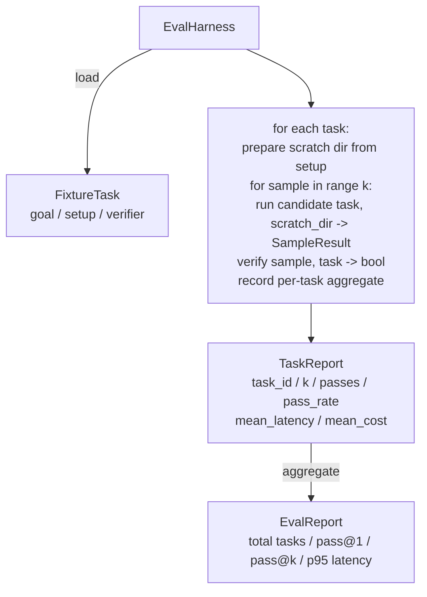

# कैपस्टोन पाठ 27: 带固定 कार्य का सम समकक्ष

> एक कोडिंग एजेंट का स्तर, इस बात पर निर्भर करता है कि आप इसके कार्ययोजना के सेट को मापने के लिए उपयोग करते हैं। यह एक मूल्यांकन हर्नस का निर्माण करेगाः यह एक निश्चित कार्य प्राप्त करता है। फाइल, उम्मीदवार एजेंट को इन कार्यों को व्यक्तिगत रूप से चलाने के लिए अनुमति देता है, निश्चितता सत्यापनकर्ता द्वारा मूल्यांकन पास या विफलता, और परिणामों को एक साथ एक साथ एक साथ एक साथ एक साथ एक साथ एक साथ एक साथ एक साथ एक साथ एक साथ एक साथ एक साथ एक साथ एक साथ एक साथ एक साथ एक साथ एक साथ एक साथ एक साथ एक साथ एक साथ एक साथ एक साथ एक साथ एक साथ एक साथ एक साथ एक साथ एक साथ एक साथ एक साथ एक साथ एक साथ एक साथ एक साथ एक साथ एक साथ एक साथ एक साथ एक साथ एक साथ एक साथ एक साथ एक साथ एक साथ एक साथ एक साथ एक साथ एक साथ एक साथ एक साथ एक साथ एक साथ एक साथ एक साथ एक साथ एक साथ एक साथ एक साथ एक साथ एक साथ एक साथ एक साथ एक साथ एक साथ एक साथ एक साथ एक साथ एक साथ एक साथ एक साथ एक साथ एक साथ एक साथ एक साथ एक साथ एक साथ एक साथ एक साथ एक साथ एक साथ एक साथ एक साथ एक साथ एक साथ एक साथ एक साथ एक साथ एक साथ एक साथ एक साथ एक साथ एक साथ एक साथ एक साथ एक साथ एक साथ एक साथ एक साथ एक साथ एक साथ एक साथ एक साथ एक साथ एक साथ एक साथ एक साथ एक साथ एक साथ एक साथ एक साथ एक साथ एक साथ एक साथ एक साथ एक साथ एक साथ एक साथ एक साथ एक साथ एक साथ एक साथ एक साथ एक साथ एक साथ एक साथ एक साथ एक साथ एक साथ एक साथ एक साथ एक साथ एक साथ एक साथ एक साथ एक साथ एक साथ एक साथ एक साथ एक साथ एक साथ एक साथ एक साथ एक साथ एक साथ एक साथ एक साथ एक साथ एक साथ एक साथ एक साथ एक साथ एक साथ एक साथ एक साथ एक साथ एक साथ एक साथ एक साथ एक साथ एक साथ एक साथ एक साथ एक साथ एक साथ एक साथ एक साथ एक साथ एक साथ एक साथ एक साथ एक साथ एक साथ एक साथ एक साथ एक साथ एक साथ एक साथ एक साथ एक साथ एक साथ एक साथ एक साथ एक साथ एक साथ एक साथ एक साथ एक साथ एक साथ एक साथ एक साथ एक साथ एक साथ एक साथ एक साथ एक साथ एक साथ एक साथ एक साथ एक साथ एक साथ एक साथ एक साथ एक साथ एक साथ एक साथ एक साथ एक साथ एक साथ एक

**Type:** Build
**Languages:** Python (stdlib)
**Prerequisites:** Phase 19 · 25 (verification gates), Phase 19 · 26 (sandbox runner), Phase 14 · 30 (eval-driven agent development), Phase 14 · 19 (SWE-bench and GAIA benchmarks)
**Time:** ~90 minutes

## सीखने के लक्ष्य

-  फिक्स्चर टास्क 定义为目标、设置 和验证器的三元组──
- प्रत्येक कार्य के लिए कई बार नमूना रन 打分,并计算 pass@1 和 pass@k。
- लेटेंसी और लागत को 95वें प्रतिशत के साथ औसत के रूप में मिलाकर
- 确定性 सत्यापनकर्ता (फाइल अंतर, निकास कोड, रेजेक्स मैच)
- 输出结构化 JSON रिपोर्ट,供回归跟踪脚本 摄取──

## समस्या

 बिना मूल्यांकन उपयोग के  निर्माण एजेंट बेंचमार्क,  तीन प्रकार की विफलता मोड से सामना करेंगे

प्रथम श्रेणी है अप्रत्याशित पास। एजेंट कहता है कि यह बग ठीक कर चुका है, मानव एक नज़र में अलग है, हम सेट को हरे रंग में चिह्नित करते हैं, तीन सप्ताह बाद रिग्रेशन टेस्ट  एक ही बग का पता चलता है। एजेंट का तर्क तर्क तर्कसंगत लगता है, लेकिन वास्तव में कुछ भी ठीक नहीं है।

दूसरा प्रकार है अनदेखा किया गया रिग्रेशन। शीघ्र टेम्पलेट का एक बार परिवर्तन, एजेंट को स्पष्ट कार्य पर 4% बढ़ाना, लेकिन शांत कार्य पर 14% घटाना।

तीसरा वर्ग है, प्रत्येक कार्य के लिए एक-एक करके 100 कार्य चलाने के लिए, और दूसरा केवल 95 कार्य के साथ, क्योंकि किसी ने 5 कार्य को फिर से नामित किया है।

हर्नस एक प्रक्रिया है जो इन असफलताओं को वास्तविकता में बदल देती है। यह प्रत्येक बार प्रत्येक फिक्स्चर को पुनः प्राप्त करने योग्य क्रम में चलती है, और एक सत्यापनकर्ता का उपयोग करती है, जो निश्चितता जांच के आधार पर सही या गलत लौटा देती है।

## अवधारणा

```mermaid
flowchart LR
  F1[fixtures/task_001/<br/>task.json + expected/] --> Harness
  F2[fixtures/task_002/<br/>...] --> Harness
  Harness[Harness<br/>for each task:<br/>setup / run agent k samples /<br/>verify each sample /<br/>record latency, cost]
  Harness --> Report[EvalReport<br/>pass@1 / pass@k<br/>mean ms / p95 ms<br/>mean cost]
```

`FixtureTask`एक छोटे से JSON फ़ाइल है, एक विकल्प के साथ जोड़ा गया है`expected/`目录──JSON 声明 `id``goal`(给代理的提示)`setup`块(要放入 खरोंच dir 的文件) तथा `verifier`块──verifier 块指定 harness के सत्यापनकर्ता रजिस्ट्री में से एक फ़ंक्शन,并提供其参数──

形态覆盖大多数有用任务──

पहला है`file_equals`◊ एजेंट  के काम के बाद, यह फ़ाइल को अपेक्षित सामग्री के साथ तुलना करेगा। यह इस तरह से सटीक तरीके से इस बग का काम ठीक कर सकता है।

दूसरा है`regex_match` यह फ़ंक्शन को पकड़ने में सक्षम होना चाहिए और X के कार्य को वापस करना चाहिए, जिनमें से कई स्वीकार्य समाधान हो सकते हैं

तीसरा है`shell_exit_zero`◊harness 运行一个 shell命令(通过课26的沙盒), केवल当命令以零 退出时才让任务通过──这能捕捉测试必须通过的任务──

हर कार्य को संचालित करेगा`k`अगला, पास@k है`1 - (1 - p)^k`, जिसमें p है अनुभव पास दर;harness भी रिपोर्ट कच्चे गिनती, सुविधाजनक आप भेदभाव का पता लगाते हैं।

```figure
pass-at-k
```

## वास्तुकला



उम्मीदवार एक बुलाया जा सकता हैः`Callable[[FixtureTask, str], SampleResult]`                                                                                                                                                                                                                                                              `tempfile.mkdtemp()`创建草图目录,并把其路径作为普通字符串传入──harness 不关心候选人 如何工作──候选人 可以是确定性的补丁申请人(对harness自测测试 很有用) 、真实LLM代理、fuzzer──契约是 SampleResult──

## आप क्या बना देंगे

`main.py`提供:

1. `FixtureTask`डेटा वर्ग
2. `SampleResult`dataclass:success_self_reported、latency_ms、cost_units、edits──
3. 带 `to_dict()``TaskReport``EvalReport`डेटाक्लासों
4. 映射到函数 的 `VerifierRegistry`◊内置 सत्यापनकर्ता:file_equals、regex_match、shell_exit_zero。
5. `EvalHarness`वर्ग── एक उम्मीदवार के साथ 运行一个任务目录──返回EvalReport──
6. 捆绑在 `tasks/`मध्य में पाँच फिक्स्चर कार्यः
   - `fizzbuzz`मध्य के एक-एक से बाहर
   - `factorial`中缺少 रिटर्न
   - त्रुटि संदेश 中的字体错误
   - 空 कार्य शरीर
   - लिंक्ड-लिस्ट पारगमन 中的 ऑफ-बाय-वन
7. एक निश्चितता संदर्भ उम्मीदवार`apply_known_fixes`),harness प्रयोग करें यह प्रदर्शन干净的 पास@1 = 1.0
8. डेमो 打印 EvalReport JSON और शून्य 退出──

फिक्स्चर कार्य 以 `tasks/`中中中中中中中中中中中中中中中中中中中中中中中中中中中中中中中中中中中中中中中中中中中中中中中中中中中中中中中中中中中中中中中中中中中中中中中中中中中中中中中中中中中中中中中中中中中中中中中中中中中中中中中中中中中中中中中中中中中中中中中中中中中中中中中中中中中中中中中中中中中中中中中中中中中中中中中中中中中中中中中中中中中中中中中中中中中中中中中中中中中中中中中中中中中中中中中中中中中中中中中中中中中中中中中中中中中中中中中中中中中中中中中中中中中中中中中中中中中中中中中中中中中中中中中中中中中中中中中中中中中中中中中中中中中中中中中中中中中中中中中中中中中中中中中中中中中中中中中中中中中中中中中中中中中中中中中中中中中中中中中中中中中中中中中中中中中中中中中中中中中中中中中中中中中中中中中中中中中中中中中中中中中中中中中中中中中中中中中中中中中中中中中中中中中中中中中中中中中中中中中中中中中中中中中中中中中中中中中中中中中中中中中中中中中中中中中中中中中中中中中中中中中中中中中中中中中中中中中中中中中中中中中中中中中中中中中中中中中中中中中中中中中中中中中中中中中中中中中中中中中中中中中中中中中中中中`tasks/<id>/buggy/`和 `tasks/<id>/expected/`中的源文件──harness 将 buggy 复制到零点 dir,把它交给候选人,并根据预期验证──

## क्यों पास@k का उपयोग करें, बस पास@1 नहीं

वास्तविक LLM एजेंटों का है随机的──pass@1 为 0.6 看看像失败──pass@5 为 0.95 表明 एजेंट 大多数时候能得到正确答案,但在早期样本上选错了──修复方式是样本采集和排名,而不总是更多的培训──pass@k 让这一点可见──

पास@के बैठक और पास@1 एक रिपोर्ट, क्योंकि पास@के बैठक वास्तविक विफलता को छिपाने के लिएः यदि मॉडल में केवल एक बार सही उत्तर मिलता है, तो आपको एक उपयोगी एजेंट नहीं मिलता है।

## यह कैसे ट्रैक ए के शेष भाग के साथ संयोजन

पाठ 25  आउट आउट गेट चेन  पाठ 26  आउट सैंडबॉक्स  किसी भी चीज़ के लिए हार्नेस `shell_exit_zero`सत्यापक प्रयोग सैंडबॉक्स──पढ़ना 28 会把每次 Harness run 包进 OTel trace──पढ़ना 29 针对其中一个捆绑固定 运行端到端演示,并断言参考候选人的 pass@1 = 1.0──

## 运行方式

```bash
cd phases/19-capstone-projects/27-eval-harness-fixture-tasks
python3 code/main.py
python3 -m pytest code/tests/ -v
```

डेमो 以 JSON 打印 EvalReport,包括pass@1、pass@5、मीडियन लेटेंसी 和逐任务 टूटना。exit code 为零──tests 覆盖 सत्यापनकर्ता फ़ंक्शन、pass@k math、fixture loading,以及 harness 针对捆绑参考候选人的 end-to-end 行为──
