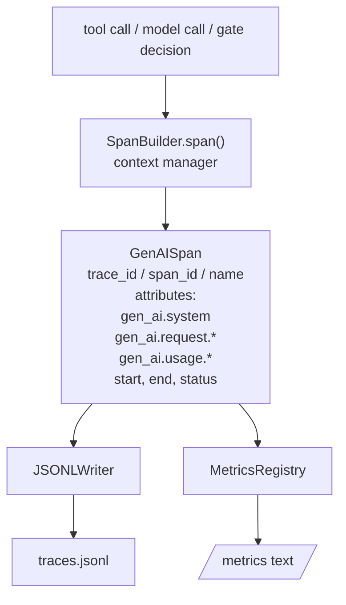
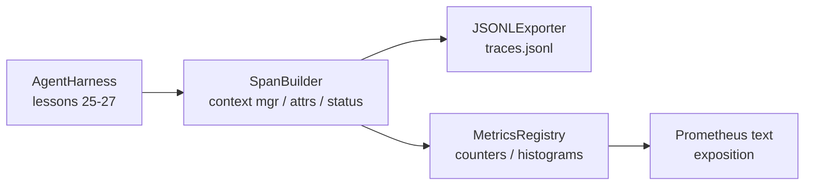

# कैपस्टोन पाठ 28: OTel GenAI स्पैन और Prometheus मेट्रिक्स का उपयोग करें

> 无可观察的代理利用是一个会花钱的黑盒──本课会手写一个跨度构造商,发发出符合OpenTelemetry GenAI的语义公约的记录,把它们写在JSON-Lines文件中,每行一个跨度,并以普罗梅蒂乌斯文本格式 暴露计和 histograms──整个实现都是Stdlib Python,并且可离线运行──

**Type:** Build
**Languages:** Python (stdlib)
**Prerequisites:** Phase 19 · 25 (verification gates), Phase 19 · 26 (sandbox), Phase 19 · 27 (eval harness), Phase 13 · 20 (OpenTelemetry GenAI), Phase 14 · 23 (OTel GenAI conventions)
**Time:** ~90 minutes

## सीखने के लक्ष्य

- 形态的跨度数据类── OpenTelemetry GenAI के अर्थिक सम्मेलनों के अनुरूप एक संरचना
- 实现 एक JSONL निर्यातक, प्रत्येक पंक्ति में एक स्वयं समाहित अवधि में लिखना
- 构建带标签 和 Prometheus पाठ प्रारूप प्रदर्शनी के काउंटर तथा हिस्टोग्राम
- उपयोग अवधि संदर्भ प्रबंधक 包装任意 कल करने योग्य, रिकॉर्ड अवधि、status 和 अपवादों
- 验证 उत्सर्जन अवधि 可通过 `json.loads`रोट्रप,并匹配 स्पेक्ट्रिक्स आकार

## समस्या

生产中的编码代理 每一轮都会产出三类文物:一次模型调用一次工具执行,以及一个验证门决策──没有结构化远程测量,这些都没有用──

प्रथम श्रेणी असफलता मॉडल एक गायब निशान है।周二 समस्याएं उत्पन्न हुईं, लेकिन एकमात्र रिकॉर्ड एक 500 लाइन चैट लॉग है। कोई रिकॉर्ड नहीं है कि किस उपकरण को चलाया गया है।

द्वितीय श्रेणी असफलता मॉडल एक अतुलनीय निशान है। हारनेस ने स्पैन लिखा है, लेकिन अपने स्वयं के एड-होक फ़ील्ड नामों का उपयोग किया है। ग्राफ़ाना, हनीकॉम, जैगर या स्थानीय सीएलआई सभी को पढ़ नहीं पाया है। टीम स्टैक में मौजूद किसी भी उपकरण को बर्बाद कर दिया गया है, क्योंकि स्पैन गैर-मानक है।

तृतीय श्रेणी असफलता मॉडल एक असंगठित मीट्रिक है। आप एक बार बहुत धीमी टूल कॉल को ट्रैक में देख सकते हैं, लेकिन पिछले एक घंटे में रीड_फ़ाइल कॉल की पी 95 लेटेंसी कितनी है?

OpenTelemetry GenAI सेमेटिक कन्वेंशन 正是为此而存在──它们定义了一小组标准属性,供各类LLM框架的跨度发射者共享──如果您的harness 写入这些属性,所有兼容 OTel的后端都能读取它们──

## अवधारणा



हर ऑपरेशन में एक span हो जाएगा। span  के पास एक निशान id है। पूरे एजेंट का इनाम है।`gen_ai.chat``gen_ai.tool.execution`)、GenAI सम्मेलनों के गुणों को अनुसरण करें、शुरू और समाप्ति समय, तथा स्थिति

GenAI सम्मेलनों ने इन विशेषता कुंजी को मानक बनाया हैः`gen_ai.system`(कौनसे प्रदाता, उदाहरण के लिए `anthropic``openai`)`gen_ai.request.model`(मॉडल आईडी)`gen_ai.request.max_tokens``gen_ai.usage.input_tokens``gen_ai.usage.output_tokens``gen_ai.response.model``gen_ai.response.id``gen_ai.operation.name`, तथा उपकरण विशिष्ट कुंजी `gen_ai.tool.name`和 `gen_ai.tool.call.id`

निर्यातक 写 JSONL──每行一个 JSON对象──这是下游工具 可以流、grep 和进口的最简单格式──真实OTel निर्यातक会使用OTLP gRPC;本课程的JSONL निर्यातक是离线等价,并且在每台工作站上都以零退出──

मेट्रिक्स और निशान नहीं हैं मौजूद. प्रत्येक उपकरण कॉल में एक काउंटर जोड़ दिया जाएगा.`tools_called_total{tool="read_file"}`◊histogram 记录观察到的延迟:`tool_latency_ms{tool="read_file"}`──两者都会序列化为普罗梅泰斯文本曝光格式,这是基于拉力的指标的事实标准──

## वास्तुकला



span बिल्डर एक छोटा वर्ग है,带有 `span(name, attrs)`विधि, लौटें एक संदर्भ प्रबंधक;; संदर्भ प्रबंधक में प्रवेश करते समय रिकॉर्ड प्रारंभ समय, बाहर निकलने के समय रिकॉर्ड समाप्त समय, यदि अपवाद छोड़ दिया गया है, तो उस अपवाद को जोड़ें,并把 अंतिम अवधि 推送给出口者──

मेट्रिक्स रजिस्ट्री है दो डिक्ट्स;; काउंटर है `{(name, frozen_labels): int}`❖ हिस्टोग्राम कच्चे नमूने बनाए रखेंगे, सूची में बनाए रखेंगे और प्रदर्शनी में  हिस्टोग्राम बाल्टों के लिए क्रमबद्ध करेंगे

## आप क्या बना देंगे

`main.py`提供:

1. `GenAISpan`dataclass:trace_id、span_id、parent_span_id、name、attributes、start_unix_nano、end_unix_nano、status、status_message、events。
2. 带 `span(name, attrs, parent=None)`संदर्भ प्रबंधक की `SpanBuilder`वर्ग
3. 带 `export(span)``JSONLExporter`वर्ग, अतिरिक्त写入一行──
4. `Counter`和 `Histogram`वर्गों तथा`MetricsRegistry`
5. 生成 पाठ प्रारूप आउटपुट 的 `prometheus_exposition(registry)`
6. 发出 span 并更新的指标 `wrap_tool_call(name)`सजावटकर्ता
7. डेमोः सिंथेटिक एक बार पूर्ण एजेंट का आह्वान करना (टूल स्पैन) ।

span id 和 trace id है 16-बाइट हेक्स स्ट्रिंग, द्वारा `os.urandom`生成── यह ओटीएल के W3C ट्रैस संदर्भ के अनुरूप है── निर्यातक 永不抛出;IO त्रुटियां 会被浮现, लेकिन हर्नस 会继续运行──

histogram has a group of fixed buckets(OTel for millisecond latency default value:5、10、25、50、100、250、500、1000、2500、5000、10000、+Inf) 👇

## क्यों हाथ से लिखने के बजाय उपयोग करें ओपनमेट्रिक-एसडीके

ओटेल पायथन एसडीके एक वास्तविक निर्भरता है। इसमें हजारों लाइनों के कोड हैं। ओटीएलपी निर्यातक के कई प्रक्रियाएं हैं, साथ ही साथ कक्षा बजट के रनटाइम लागत में भी बाढ़ आ जाएगी।

सम्मेलनों का समाधान करना निश्चित है। यह विषय 2030 तक जारी किया जाएगा क्योंकि ओटीएल GenAI विशेषता नामों को नष्ट नहीं करेगा; वे केवल नए नाम जोड़ेंगे।

## यह कैसे ट्रैक ए के शेष भाग के साथ संयोजन

पाठ 25  आउटपुट गेट चेन。 पाठ 26  आउटपुट सैंडबॉक्स。 पाठ 27  आउटपुट eval harness。 पाठ 28 让这三者都可观测。 पाठ 29 会把端到端的演示的每一步都包进跨度,最后印出Prometheus文献──

## 运行方式

```bash
cd phases/19-capstone-projects/28-observability-otel-traces
python3 code/main.py
python3 -m pytest code/tests/ -v
```

डेमो बैठक इस कक्षा में काम कर रहे थे में एक बाहर निकालना `traces.jsonl`(最后清理), फिर छापें तीन अवधि का नमूना, फिर छापें काउंटर और हिस्टोग्राम के प्रोमेथियस एक्सपोज़र。 परीक्षण 验证 अवधि 可回路序列化、कानोनिक GenAI विशेषताएं 存在、counter 正确递增, तथा हिस्टोग्राम एक्सपोज़र 包含 अपेक्षित बाल्टी गिनती──

```figure
trace-spans
```
