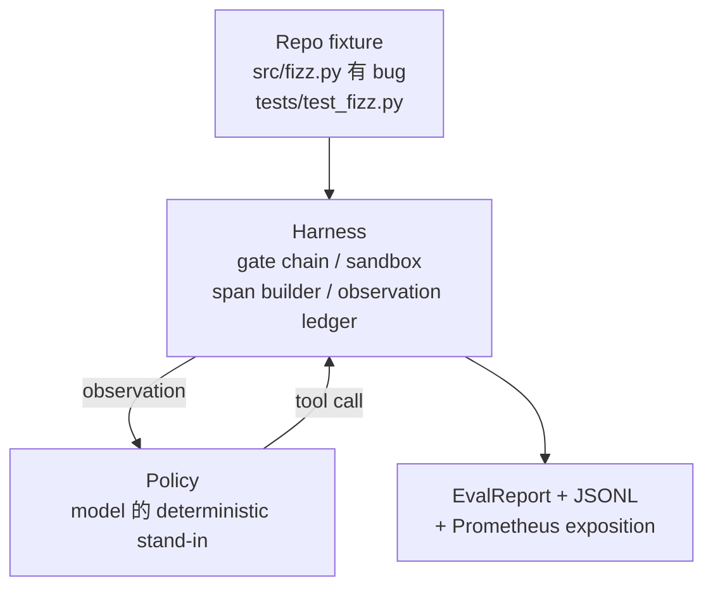
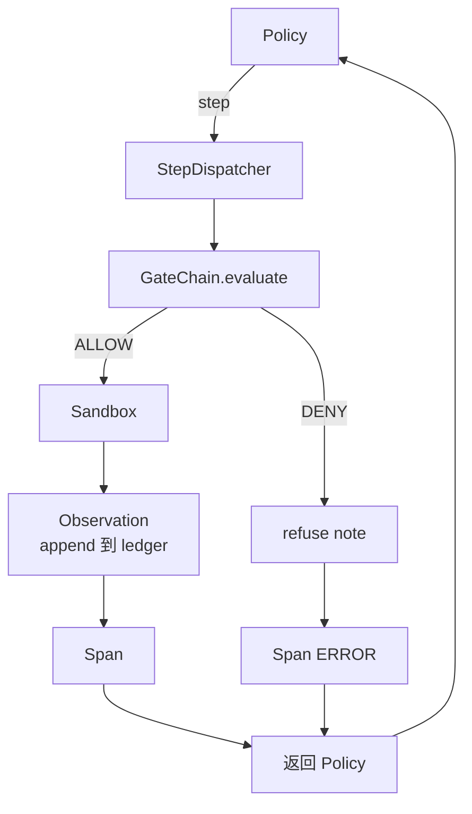

# कैपस्टोन  पाठ 29: Harness ऊपर के अंत तक कोडिंग एजेंट

> Track A के परिणामों──本课程把门链、沙盒、eval harness 和 OTel spans 串连成一个可工作的编码代理,用于修复一个多文件Python项目中真实的(小型固定 规模) बग── यह एजेंट निर्धारक नीति है, LLM नहीं है; यह प्रतिस्थापन करें ताकि पाठ्यक्रम को पुनः प्राप्त किया जा सके,并说明 harness 才始终是最关键的部分──合同 完全相同:真实模型可以插入政策──

**Type:** Build
**Languages:** Python (stdlib)
**Prerequisites:** Phase 19 · 25 (verification gates), Phase 19 · 26 (sandbox), Phase 19 · 27 (eval harness), Phase 19 · 28 (observability), Phase 14 · 38 (verification gates), Phase 14 · 41 (workbench for real repos), Phase 14 · 42 (agent workbench capstone)
**Time:** ~90 minutes

## सीखने के लक्ष्य

- गेट चेन, सैंडबॉक्स, ईवल हर्न और स्पैन बिल्डर को एक एकल एजेंट लूप के रूप में संकलित करना
- 实现一个使用读_文件、运行_测试 和 write_file 修复 固定 बग के निर्णायक नीति──
- एक बार-एक बार परिचालन में पूर्णव्यापी चरण बजट एवं अवलोकन टोकन बजट को लागू करना अनिवार्य करना
- पूर्ण परिचालन के लिए पूर्ण OTel GenAI निशान और Prometheus मापों का निष्पादन करें
- 验证 एजेंट  12 कदम से कम में समाधान फिक्स्चर, और कानूनी उपकरण  कोई गेट यात्राएं नहीं 

## समस्या

अधिकांश एजेंट डेमो अलग-अलग काम करते हैंः एकल एकल रेत बॉक्स, एकल मूल्यांकन हर्न, एकल स्पैन इमिटर।

गेट चेन  अनुमति दी, लेकिन सैंडबॉक्स चूंकि श्रृंखला  कोई अपेक्षित कारण नहीं है अस्वीकार किया गया  ईवल हार्नेस  रिकॉर्ड पास, लेकिन ओटीएल स्पैन  दिखाएँ गेट  अस्वीकार किया एजेंट  दावा किया इस्तेमाल किया उपकरण  Prometheus काउंटर इस एक बार बढ़ना चाहिए, लेकिन दो बार बढ़ गया 😇 अवलोकन बजट  पार हो गया है, लेकिन एजेंट  जारी है, क्योंकि बजट केवल श्रृंखला में ट्रैक, जबकि सैंडबॉक्स नहीं पता 😇

इस कोर्स में पूरे ट्रैक का इंटीग्रेशन टेस्ट है। एजेंट को क्रमशः चार चीजें पूरी करनी चाहिएः परियोजना को पढ़ लेना, परीक्षणों को चलाना, परीक्षण विफलता से, बग की पहचान करना, लिखने में सुधार करना, फिर परीक्षणों को फिर से चलाना, फिर रुकना। प्रत्येक ऑपरेशन गेट चेन के माध्यम से होता है। प्रत्येक टूल निष्पादन सैंडबॉक्स के माध्यम से होता है। प्रत्येक चरण में एक-दूसरे के बीच में होता है।

## अवधारणा



एजेंट की नीति एक राज्य की मशीन है।

`SURVEY`:agent 读取 परियोजना सूचीकरण──下一个状态是RUN_TESTS──

`RUN_TESTS`:एजेंट 运行 परीक्षण आदेश──यदि परीक्षण पास हो जाते हैं, तो स्टेट मशीन 以 सफलता 停止──否则下一个状态 是 INSPECT──

`INSPECT`:agent 读取失败的源文件──下一个状态是FIX──

`FIX`:agent 写入修正后的文件──下一个状态是 VERIFY──

`VERIFY`:एजेंट फिर से परीक्षण कमांड चलाएँ। यदि परीक्षण पास हो जाते हैं, तो सफलता को रोकें।

प्रत्येक राज्य एक उपकरण कॉल का जवाब देता है। प्रत्येक उपकरण कॉल गेट चेन से गुजरता है। यदि किसी उपकरण कॉल को अस्वीकार कर दिया जाता है, तो एजेंट को पता लगाने में रिपोर्ट अस्वीकार और रुक जाती है।

फिक्स्चर बग है`fizz.py`中的离散――一个的决定主义政策 通过regex 从测试失败消息 中检测出错误,并发发出修改后的文件――把政策 换成 LLM 不会改变利用合同――


```figure
cg-harness-weave
```

## वास्तुकला



इस कोर्स में स्वयं शामिल है. प्रत्येक पूर्व-पाठ आदिम शहर में है.`main.py`मध्य में न्यूनतम पैमाने पर पुनः प्राप्ति ([[गेट]], सैंडबॉक्स]], लेजर、स्पेन), इसलिए इस पाठ्यक्रम को भ्रातृ-बहनों में शामिल करने की आवश्यकता नहीं है, यह काम करने में सक्षम है।

## आप क्या बना देंगे

`main.py`提供:

1. नवीनतम हर्न आदिम, नाम और पाठ 25-28 समानः`GateChain``Sandbox``ObservationLedger``SpanBuilder``MetricsRegistry`
2. `CodingAgentPolicy`वर्गः समाहित पाँच राज्यों की राज्य मशीन
3. `Repo`सहायक: एक खरोंच डालने की तैयारी करें, जिसमें बंडल बग फिक्स्चर शामिल है
4. `AgentRun`वर्गः ड्राइविंग नीति, हर्नस डिस्पैच के माध्यम से,并返回 `AgentRunReport`
5. एक बंडल फिटिंग`fixture_repo/`), src/fizz.py、tests/test_fizz.py, तथा eval harness के लिए अपेक्षित/वृक्ष को शामिल किया गया है。
6. डेमोः端到端运行 नीति,印印逐步追踪,断言通过,并印印度

बंडल फिक्स्चर के साथ पाठ 27 के कार्य संरचना  आकार समानः एक बग फ़ाइल 和 एक परीक्षण फ़ाइल── परीक्षण विफलता संदेश  पर्याप्त जानकारी शामिल है, एक निर्धारात्मक नीति 能识别修正── असली LLM 会做同样的工作,只是更慢并拥有更广泛的回忆,但它不会改变利用的期望──

## नीति क्यों नहीं LLM

वास्तविक LLM  आवश्यक एपीआई कुंजी  नेटवर्क कॉल, तथा अमान्य स्टोकास्टिकता  हर्नेस 才是本课程关心的部分── इसके बजाय निर्धारात्मक नीति 能让课程在任何开发者笔记本电脑上运行,零外部依赖,并让测试套件 断言精确的步骤数──

इस कोर्स की नीति LLM एजेंटों के लिए है, जो कुछ भी करते हैं, नीति  पढ़ लेना, असफल परीक्षण देखना, पहचान लेना, फिर इसे ठीक करना 

## डेमो 会断言什么

端到端 डेमो में वापसी के समय फ़ैसला पाँच बातें, परीक्षण सूट भी प्रोग्रामिंग तरीके से फिर से फ़ैसला उन्हें करेगा

नीति में 12 कदम से कम में तय किया गया है।

अवलोकन बजट 从未超出──

合法工具 上触发了零次门拒绝──(代理 从未凭空发明一个被拒绝的工具名──)

प्रत्येक चरण में एक प्रतिरोध अवधि होती है।

प्रोमेथियस एक्सपोजीशन 包含一个 `tools_called_total{tool="read_file"}`प्रविष्टि 和 एक `tool_latency_ms`हिस्टोग्राम

## यह कैसे ट्रैक ए के शेष भाग के साथ संयोजन

本课程是集成──教学25 编写了门链──教学26 编写了沙盒──教学27 编写了 eval harness──教学28 编写了可观测性──教学29 证明它们作为一个系统可以工作──真实代理 harness 从这里扩展:把确定性政策 换成模型,把捆绑式固定 换成实复习任务,把 JSONL निर्यातक 换成 OTLP──

## 运行方式

```bash
cd phases/19-capstone-projects/29-end-to-end-coding-task-demo
python3 code/main.py
python3 -m pytest code/tests/ -v
```

डेमो 会印印 प्रति चरण ट्रैक、 अंतिम मूल्यांकन रिपोर्ट 和 Prometheus एक्सपोज़िशन──退出码为零──टेस्ट 覆盖政策状态转变、合成工具 कॉल 上的门拒绝、捆绑固定 上的端到端运行,以及阶段预算变化──
