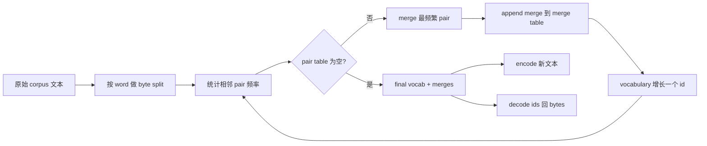
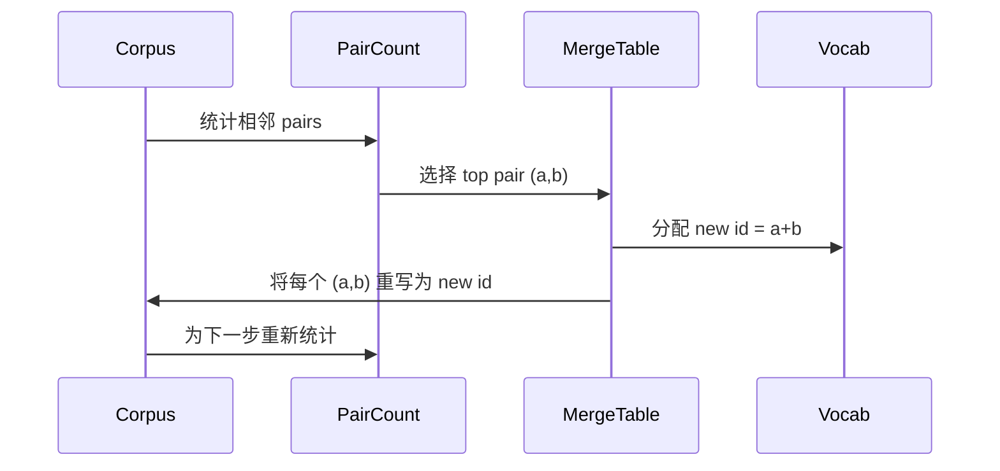

# शून्य से बिल्डिंग बीपीई टोकनराइज़र

> 字节进, 字节出, 字节再回到相同字节──构建每现代文本模型仍起步于此的Tokenizer──

**Type:** Build
**Languages:** Python
**Prerequisites:** Phase 04 lessons, Phase 07 transformer lessons
**Time:** ~90 minutes

## सीखने के लक्ष्य
- 通过反复 merge 最频繁的相邻符号对, from原始文字 corpus 训练 बाइट-पैर एन्कोडिंग शब्दावली。
- 实现确定性融合表,并将其应用到新文本上,生成子词 id 流──
- किसी भी UTF-8 इनपुट को ids में परिवर्तित करने और पुनर्प्राप्त करने के लिए, और जानकारी खोने के लिए नहीं।
- 保留并保护 विशेष टोकन(`<|endoftext|>``<|pad|>`), उन्हें प्रशिक्षण और डिकोडिंग के बाद स्थिर रहने दें।
- 推理为什么字节级字母是通用代码符号器的正确下限──


```figure
cap-bpe-merge
```

## फ्रेम

भाषा मॉडल 永远看不到文本── यह पूर्णांक देखता है──把字符串 映射为整数列并再映射回来的东西,就是Tokenizer── यह परत गलत है, प्रशिक्षण रन में प्रत्येक 损失 वक्र में गलत चीजों का माप किया गया है──

सामान्य पाठ मॉडल में प्रमुख उपशब्द Tokenizers परिवार है बाइट-पियर एन्कोडिंग。 विचार बहुत छोटा。 एक ज्ञात वर्णमाला से 开始── ढूंढना प्रशिक्षण निकाय में सबसे अधिक बार दिखाई देने वाले आसन्न प्रतीक जोड़े── इसे मिलाकर एक नया प्रतीक──重复, जब तक शब्दावली 目标大小── एन्कोडिंग नई पाठशाला के अनुसार उसी क्रम में दोहराएं उसी मिश्रण सूची──

हम बाइट-स्तर संस्करण का निर्माण करेंगे। वर्णमाला 256 कच्चे बाइट्स है, यूनीकोड कोड बिंदुओं के बजाय। यह विकल्प टोकनराइज़र को किसी भी यूटीएफ -8 इनपुट को संसाधित करने की अनुमति देता है, और अज्ञात टोकन में वापसी की आवश्यकता नहीं है।

## पाइपलाइन



प्रशिक्षण पक्ष 和 निष्कर्ष पक्ष 共享 merge तालिका── यह共享就是合同── यदि आप निष्कर्ष में 时改变 merge क्रम,就会解码出不同的 id 流──

## बाइट वर्णमाला

पूर्व 256 个 ids को 0x00 से 0xFF तक कच्चे बाइट्स में रखें। यह सुनिश्चित करता है कि प्रत्येक इनपुट स्ट्रिंग को किसी भी विलय से पहले शब्दावली में व्यक्त किया जा सकता है।

प्रीटोकनीज़र 会在训练 见体 之前,根据白空间和点击界限 进行分化──如果没有这个分化,BPE merge step 会很乐意学习跨越词界限的合并,词库 会被常见整句短语填满──有这个分化,会留在词内,结果也更能泛化──

## प्रशिक्षण लूप

प्रत्येक प्रशिक्षण चरण में, लूप तीन चीजें करता है। यह शरीर में प्रत्येक शब्द, वर्तमान प्रतीकों के प्रत्येक आसन्न जोड़े की आवृत्ति को आंकड़े करता है, और शब्द के अनुसार स्वयं के रूप में उत्पन्न होने की आवृत्ति को बढ़ाता है। यह सबसे अच्छा जोड़ा गिनती का चयन करता है। यह उस जोड़े के प्रत्येक उपस्थिति को एक नए प्रतीक के रूप में फिर से लिखता है, इसकी पहचान शब्दावली में अगले रिक्त स्थान में है।



प्रत्येक चरण की लागत और शरीर के रूप में प्रतीक अनुक्रम सूची व्यक्त करते समय बड़ा आकार प्रस्तुत करने योग्य संबंध। एक लाख शब्दों और एक हजार आईडी के लिए लक्षित शब्दावली के लिए, लूप कुछ ही सेकंड में पूरा होगा, क्योंकि प्रतीक अनुक्रम विलय के साथ घट जाएगा और छोटा होगा।

## ताजा पाठ को एन्कोडिंग

निष्कर्ष 不调用 merge counter──它按学习到的相同顺序应用 merge तालिका──对于一个新词,encoder从字节分开 开始──它扫描当前序列,寻找排名 最低的 merge(最早学习到且可应用的那个)──它执行该 merge──然后再扫描──当前序列 时,loop 结束──

 रैंक 排序 इस गुण कोडिंग निर्धारक बनाता है, और प्रशिक्षण के साथ एक ही इनपुट पर व्यवहार में मेल खाता है सबसे पहले सीखने तक के लिए एकीकरण  स्थित तालिका 顶部,并最先应用 यदि दो विलय एक ही स्थान पर लागू हो सकते हैं, तो निम्नतम में से एक जीत निकलता है

## विशेष टोकन

विशेष टोकन है बाइट स्ट्रीम 永远无法产生 ids──我们手动保留它们──本课程两个就足够──

- `<|endoftext|>` प्रैक्टिस के दौरान दस्तावेजों को अलग करना यह मॉडल को बताता हैःएक नया दस्तावेज़ यहाँ से शुरू करें, पहले के दस्तावेज़ के संदर्भ को बाहर न निकालें
- `<|pad|>` संक्षिप्त अनुक्रमों को भरें, बैच को आयताकार Tensor बना दें── मास्क खोना  प्रशिक्षण के दौरान इसे छिपाएं──

एन्कोडर  एक ध्वज स्वीकार करें, ताकि इनपुट में विशेष टोकन दिखाई दें── जब ध्वज 关闭时,字符串 `<|endoftext|>`和 `<|pad|>`会按拼写它们的字节来标记化──当旗开时,字符串会映射到其保留的ID,并且不会参与任何合并──

## यात्रा व वापसी की गारंटी

एन्कोडिंग 后再解码 必须精确返回输入字节──decoder 会顺序拼接每个 id 的字节扩展──由于每个 id 要么是原始字节,要么是两个以前已知 id 的连锁,复发式扩展 总会终止于原始字节──decoding 随后返回这些字节 拼出的 UTF-8字符串──

इस कोर्स का टेस्ट सूट एक अदृश्य वाक्य में होगा, जिसमें एक वाक्य यूनिकोड इमोजी के साथ-साथ एक वाक्य जिसमें शाब्दिक वाक्य होगा।`<|endoftext|>`टोकन का वाक्य 上检查这个属性──

## यह सबक क्या नहीं करता

यह एक छोटे से सफेद स्थान और विरामचिह्न विभाजन है। यह एक छोटे से प्रशिक्षण पाठ्यक्रम में उचित विलय का उत्पादन करने के लिए पर्याप्त है, और पाठ्यक्रम श्रृंखला के बाद के भाग के साथ अनुबंध को बनाए रखने के लिए पर्याप्त है।

यह जोड़ी काउंटर को समानांतर नहीं करेगा। पाइथन में कई हज़ार शब्दों के कॉर्पस का लूप बनाने का काम एक सेकंड से भी कम समय में पूरा होगा।

## कोड कैसे पढ़ें

`main.py`定义四个物体──`BPETokenizer`शब्द संग्रह  विलय तालिका तथा विशेष टोकन तालिका`train`यह प्रशिक्षण लूप है`encode`यह निष्कर्ष पथ है।`decode`यह बाइट संश्लेषण है। नीचे डेमो को एक छोटे से टोकन बनाने वाले को प्रशिक्षित करने के लिए एक छोटा सा टोकन बनाने वाला है।`code/tests/test_bpe.py`मध्य परीक्षणों ने रोटरी-ट्रिप संपत्ति तय की, विशेष टोकन आरक्षण और विलय आदेशों को।

运行 demo──然后把 демо 中的目标词汇大小从300 改成600,观察长度的编码长度的延长 如何下降──那条曲线就是BPE压缩曲线──
