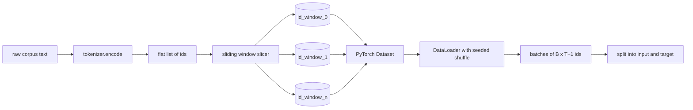
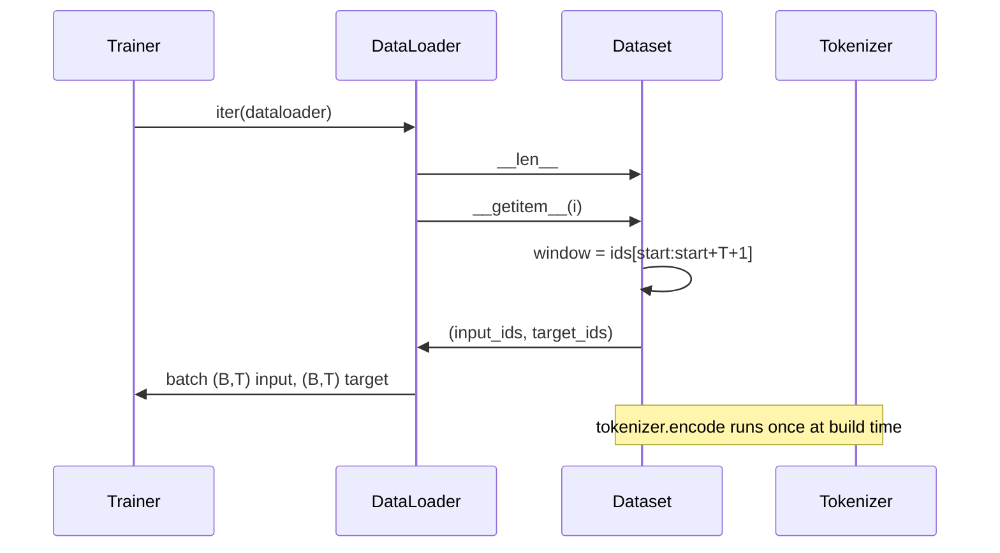

# Sliding Window का टोकनकृत डेटासेट

> एक पूर्व प्रशिक्षण संचालन, एक टोकन आईडी से ग्रेडिएंट के फ़ंक्शन तक है।

**Type:** Build
**Languages:** Python
**Prerequisites:** Phase 04 lessons, Phase 07 transformer lessons, 本 phase 的 Lesson 30
**Time:** ~90 分钟

## सीखने के लक्ष्य


```figure
cap-sliding-window
```
- 通过只调用一次Tokenizer,把原始 corpus 转换为 टोकन आईडी 流──
- उपयोग करने योग्य संरचनात्मक ओवरले चरण, id 流切成固定长度 विंडो
- पॉईटॉर्च डेटासेट का निर्माण, अगले टोकन भविष्यवाणी के लिए  वापसी इनपुट और लक्ष्य टेंसरों
- उपयोग DataLoader 包装 डेटासेट,并使用按时代 设定种子的确定性混动──
- 推理 कदम 冗余 और वैध डेटासेट आकार 之间的权衡──

## 框架

एक बार पूर्व प्रशिक्षण संचालन प्रति बार पढ़ने एक बैच टोकन आईडी,并更新模型── प्रत्येक बैच का आकार प्रशिक्षण अनुबंध द्वारा तय── हेतु कारण भाषा मॉडल, बैच 持有`(B, T)`इनपुट आईडी 和 `(B, T)`लक्ष्य आईडी, जिनमें से लक्ष्य है इनपुट 左移一位──data pipeline के काम, यह है कि इस अनुबंध को उत्पन्न करने के लिए, आवश्यकतानुसार, निर्धारणीय और पुनः प्राप्ति योग्य है, संभवतः कई जीबी के भीतर।

本课会构建这条管线――上一课的Tokenizer 会将文本转换为一个长长的平 ids 列表――滑动窗户会把这个列表切成训练示例――自定义数据集 会把示例 暴露为 tensors――DataLoader会把它们组成批量,并使用已知种子 进行混动――

## 形状 अनुबंध

कारणात्मक LM 消费形状为 `(B, T)``B`है बैच आकार,`T` संदर्भ लंबाई `t`लक्ष्य की स्थिति है`t+1`इसका मतलब है प्रत्येक प्रशिक्षण उदाहरण  कवर `T+1`个原始 ids──window step 控制相邻 उदाहरण 之间有多少重叠──



स्लिज़र  कभी भी शरीर की सीमाओं को पार नहीं करेगा  यदि अंतिम खिड़की  पर्याप्त आईडी  नहीं  भरें `T+1`个位置,Slicer会抛弃它.`<|pad|>`填充尾部 भी एक प्रभावी विकल्प है, लेकिन यह लापता मास्क 变复杂――本课选择丢弃――

## स्लाइडिंग विंडो का उपयोग क्यों करें

预训练 corpus 流―― यदि मॉडल केवल एक से अधिक नहीं खिड़की को देखता है, प्रत्येक प्रशिक्षण उदाहरण इसे एक ही सिखाएगा `T`个边界――调整步骤 会移动这些边界,让模型 看到更多的预测-下一个标注任务――

कदम `T`                                                                                                                                                                                                                                                              `T // 2`                                                                                                                                                                                                                                                              `1` अधिकतम भारोत्तोलन उत्पन्न होगा,  डेटासेट  बढ़ाएगा `T`倍──代价是每时代 需要更多的计算──收益是边界多样性更高──大多数预训运行使用等于背景长度的步骤,因为体积已经远大于模型 在一个时代内能跑完的规模,所以边界多样性论点更弱──

## डेटासेट वर्ग

पायटॉर्च डेटासेट में दो आवश्यक तरीके हैं।`__len__`返回 उदाहरण 数量──`__getitem__`इस प्रकार एक टेन्सर के रूप में एक उदाहरण पर लौटें। हमारे डेटासेट में संकलित होने के बाद आईडी प्रवाह और कदमों का एक उदाहरण है। इसके लिए सूचकांक करने के दौरान, तुरंत गणना विंडो का प्रारंभ बिंदु होगा, इसलिए चाहे कितनी भी चरणों का उत्पादन हो, स्मृति लागत आईडी प्रवाह का एक प्रति है।



एक-एक-बदला  होता है `__getitem__`内部──डेटासेट 返回 `(input, target)`, उनमें से `input = window[:-1]`,`target = window[1:]` दोनों ही PyTorch लंबे tensors हैं प्रशिक्षण लूप उन्हें जमीन सत्य के रूप में मानेंगे

## निर्धारक मिश्रण

उपयोग `shuffle=True`के DataLoader से PyTorch यादृच्छिक जनरेटर 读取──通过传入一个按时代 设定种子的显式 `torch.Generator`, प्रत्येक बार पुनः आरंभ करते समय सभी को एक ही मिक्स प्राप्त होता है। जब आप दो केवल एक ही हाइपरपरमैटर के संचालन की तुलना करना चाहते हैं, तो यह विशेषता महत्वपूर्ण है।

本课的种子合同 很简单――`epoch_seed = base_seed + epoch_index`◊ आधार बीज 在构建时传入――epoch index द्वारा प्रशिक्षक द्वारा प्रत्येक युग में 顶部递增―― उपयोग करें एक ही आधार बीज 重新运行,总会在每个时代中看到相同顺序――

## बैच नमूना

PyTorch का डिफ़ॉल्ट नमूनाकरण होगा बिना किसी छूट के 随机选取索引── यह ठीक है पूर्व प्रशिक्षण की आवश्यकता है── छोटे डेटासेट के लिए ठीक से संरेखण करते समय, अनुबंध भी एक ही है──DataLoader 通过调用 `B`अगला `__getitem__`नहीं स्टैक फल फल फल फल फल फल फल फल फल फल फल फल फल फल फल फल फल फल फल फल फल फल फल फल फल फल फल फल फल फल फल फल फल फल फल फल फल फल फल फल फल फल फल फल फल फल फल फल फल फल फल फल फल फल फल फल फल फल फल फल फल फल फल फल फल फल फल फल फल फल फल फल फल फल फल फल फल फल फल फल फल फल फल फल फल फल फल फल फल फल फल फल फल फल फल फल फल फल फल फल फल फल फल फल फल फल फल फल फल फल फल फल फल फल फल फल फल फल फल फल फल फल फल फल फल फल फल फल फल फल फल फल फल फल फल फल फल फल फल फल फल फल फल फल फल फल फल फल फल फल फल फल फल फल फल फल फल फल फल फल फल फल फल फल फल फल फल फल फल फल फल फल फल फल फल फल फल फल फल फल फल फल फल फल फल फल फल फल फल फल फल फल फल फल फल फल फल फल फल फल फल फल फल फल फल फल फल फल फल फल फल फल फल फल फल फल फल फल फल फल फल फल फल फल फल फल फल फल फल फल फल फल फल फल फल फल फल फल फल फल फल

इस वर्ग को सरल बनाने के लिए`num_workers=0` उत्पादन में, श्रमिकों का संगम`__getitem__`कॉल करते हैं, लेकिन एक ही डेटासेट एपीआई के साथ काम करने वाले लोगों का समर्थन कर सकते हैं।

## 计算 उदाहरण

对于长度为 `N` 流  संदर्भ लंबाई `T`和 कदम `S`,उदाहरण संख्या है `max(0, 1 + (N - (T + 1)) // S)`本课把这个计算暴露为数据集上的静态方法,这样教练可以不过代代就计算每时代的总步骤──

## 本课不做什么

यह डिस्क स्ट्रीमिंग से नहीं आता है। कॉर्पस में पूरी तरह से कोडित होता है, और एक एकल टेंसर के रूप में संग्रहीत होता है।

यह कई दस्तावेजों को संसाधित नहीं करता है। कॉर्पस को एक निरंतर आईडी प्रवाह के रूप में देखा जाता है।`<|endoftext|>`आईडी को अगले दस्तावेज़ सीमा को कोडित करने के लिए।

## 如何阅读代码

`main.py`定義了两个类和一个助手──`SlidingWindowDataset`यह है पाइटॉर्च डेटासेट`make_dataloader` लौटें एक अच्छी तरह से कॉन्फ़िगर डेटा लोडर,并带有种子发电机──`_encode_corpus_to_ids`एक बार एक टोकन बनाने वाला कॉल है। एक बार एक टोकन बनाने वाला कॉन्ट्रैक्ट बनाने वाला एक छोटा टोकन बनाने वाला एक छोटा टोकन बनाने वाला एक छोटा टोकन बनाने वाला एक छोटा टोकन बनाने वाला एक छोटा टोकन बनाने वाला एक छोटा टोकन बनाने वाला एक छोटा टोकन बनाने वाला एक छोटा टोकन बनाने वाला एक छोटा टोकन बनाने वाला एक छोटा टोकन बनाने वाला एक छोटा टोकन बनाने वाला एक छोटा टोकन बनाने वाला एक छोटा टोकन बनाने वाला एक छोटा टोकन बनाने वाला एक छोटा टोकन बनाने वाला एक छोटा टोकन बनाने वाला एक छोटा टोकन बनाने वाला एक छोटा टोकन बनाने वाला एक छोटा टोकन बनाने वाला एक छोटा टोकन बनाने वाला एक छोटा टोकन बनाने वाला एक छोटा टोकन बनाने वाला एक छोटा टोकन बनाने वाला एक छोटा टोकन बनाने वाला एक छोटा टोकन बनाने वाला एक छोटा टोकन बनाने वाला एक छोटा सा टोकन बनाने वाला एक छोटा सा टोकन बनाने वाला एक छोटा सा टोकन बनाने वाला एक छोटा सा टोकन बनाने वाला एक छोटा सा सेट बनाने वाला एक छोटा सा सेट बनाने वाला एक छोटा सा सेट है।`code/tests/test_dataset.py`मध्य परीक्षणों ने खिड़की गिनती सूत्र तय किया एक-एक-परिवर्तन 属性 निर्धारक मिश्रण और चरण-बदलाव 

运行示范――然后把背景长度从16 改为32 ,观察每时代的例子 数量如何下降――这个数字就是你的每时代步骤预算――
