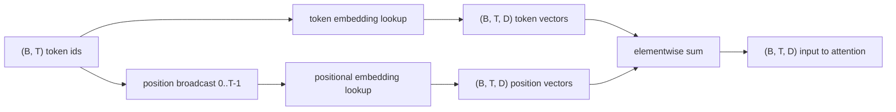
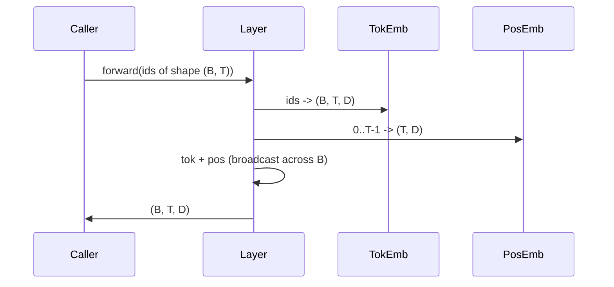

# टोकन और स्थिति सम्मिलित

> आईडीएस एक पूर्णांक है। मॉडल को वेक्टर की आवश्यकता है।

**Type:** Build
**Languages:** Python
**Prerequisites:** Phase 04 lessons, Phase 07 transformer lessons, 本 phase 的 Lessons 30 和 31
**Time:** ~90 分钟

## सीखने के लक्ष्य


```figure
cc-embedding-lookup
```
- 构建一个代号嵌入式搜索表,把词汇IDs 映射到密集向量──
-  एक स्थिति के अनुसार सूची का सीखा गया स्थिति-एम्बेडिंग खोज तालिका बनाना
- ् ् ् ् ् ् ् ् ् ् ् ् ् ् ् ् ् ् ् ् ् ् ् ् ् ् ् ् ् ् ् ् ् ् ् ् ् ् ् ् ् ् ् ् ् ् ् ् ् ् ् ् ् ् ् ् ् ् ् ् ् ् ् ् ् ् ् ् ् ् ् ् ् ् ् ् ् ् ् ् ् ् ् ् ् ् ् ् ् ् ् ् ् ् ् ् ् ् ् ् ् ् ् ् ् ् ् ् ् ् ् ् ् ् ् ् ् ् ् ् ् ् ् ् ् ् ् ् ् ् ् ् ् ् ् ् ् ् ् ् ् ् ् ् ् ् ् ् ् ् ् ् ् ् ् ् ् ् ् ् ् ् ् ् ् ् ् ् ् ् ् ् ् ् ् ् ् ् ् ् ् ् ् ् ् ् ् ् ् ् ् ् ् ् ् ् ् ् ् ् ् ् ् ् ् ् ् ् ् ् ् ् ् ् ् ् ् ् ् ् ् ् ् ् ् ् ् ् ् ् ् ् ् ् ् ् ् ् ् ् ् ् ् ् ् ् ् ् ् ् ् ् ् ् ्
- टोकन और स्थिति सम्मिलित करना 组合成 ट्रांसफार्मर ब्लॉक का एकल इनपुट
- तुलना में सीखा गया और सिनोसाइडल एम्बेडेड में लंबाई सामान्यीकरण और पैरामीटर गिनती ऊपर के अंतर

## 框架

मॉडल के साथ टोकन आईडी के साथ पहली बार संपर्क, टोकन-एम्बेडेड मैट्रिक्स में पंक्ति खोजें किया जाता है। इस मैट्रिक्स प्रत्येक शब्दावली आईडी एक पंक्ति है, प्रत्येक मॉडल आयाम एक पंक्ति है।

टोकन आईडीज 本身无序──模型 需要第二个信号,告诉它位置一 不同于位置十七── इस संकेत के दो मुख्य विकल्प हैं सीखी गई स्थिति सम्मिलित करना (第二张搜索表,每位置一行) और निश्चित संधिगत स्थिति सम्मिलित करना (Fixed sinusoidal positioning embedding) 一个没有参数的数学公式)──选择会带来后果──学习表是参数,并且受到模型的最大背景长度的限制 训练时的最大背景长度── संधिगत तालिका 理论上没有参数,公式可以扩展到任何位置,但本课的`SinusoidalPositionalEmbedding` `max_context_length`预计算一张固定 टेबल, इसका `forward`इस सीमा से अधिक समय में वृद्धि होगी; इसलिए यहां दो मॉड्यूल अधिकतम संदर्भ लंबाई को निष्पादित करने के लिए मजबूर होंगे। तालिका पर्याप्त रूप से बड़ी हो सकती है, लेकिन प्रशिक्षण की लंबाई से अधिक समय में, मॉडल अभी भी प्रदर्शन कर सकता है।

इस वर्ग में दोनों का निर्माण किया जाएगा, और उन्हें टोकन एम्बेडिंग के साथ संकलित किया जाएगा।

## 形状 अनुबंध

सम्मिलित चरण का इनपुट है आकार के लिए`(B, T)`                                                                                                                                                                                                                                                              `(B, T, D)`के टेन्सर, उनमें से `D` मॉडल आयाम प्रत्येक बैच तत्व में एक ही संदर्भ लंबाई `T` प्रत्येक स्थिति में समान वेक्टर आयाम होते हैं `D`



组合方式是总和,不是连锁――总会让 `D`नेटवर्क में स्थिर रहने के लिए, मॉडल को प्रत्येक विशेषता के आधार पर परिभाषित किया जाता है जो प्रत्येक स्तर में से किस स्थान का अर्थ या स्थान है।

## टोकन एम्बेडिंग मैट्रिक्स

प्रतीक एम्बेडिंग एक आकार है`(V, D)`के पैरामीटर टेन्सर, उनमें से `V` शब्दकोश आकार`nn.Embedding(V, D)`暴露它──init 时条目 从一个小高西亚 中抽取,对于变压器尺度模型,传统上意味为零,标准偏差约为`0.02` सटीकता  इतना महत्वपूर्ण नहीं है, महत्वपूर्ण यह है कि यह विभिन्न संचालनों के बीच संगत रहे

आगे की ओर गुजरना एक बार सूचकांक ऑपरेशन है।`(B, T)`int64 आईडी 映射为 `(B, T, D)`फ़्लोट्स── बैकवर्ड पास  केवल ग्रेडिएंट 累积到前进 पास में छूने वाली पंक्तियों  दो कभी नहीं दिखाई देती हैं बैच के बीच की पंक्तियों  इस चरण में  प्राप्त करने के लिए  ग्रेडिएंट 

एक सूक्ष्म विवरण―― टोकन एम्बेडिंग 和 मॉडल 末端 के आउटपुट प्रोजेक्शन 经常共享重量重量绑定)  ऐसा होने पर, प्रत्येक बार पीछे की ओर से गुजरना 输出 पक्ष 触碰 एम्बेडिंग के प्रत्येक पंक्ति                                                                                                                                                                                                                                 

## सीखा गया स्थितिगत सम्मिलन

सीखा स्थितिगत एम्बेडिंग है दूसरा `nn.Embedding`, आकार के लिए`(max_context_length, D)`✿Lookup 由 स्थिति आईडी `0, 1, 2, ..., T-1`作为关键――前进通过 会把这个位置 矢量发射到批量维度 上――

सीखा तालिका के दोष है, यदि मॉडल केवल स्थिति तक प्रशिक्षित `T-1`, यह स्थिति का पता नहीं लगा सकता है ।`T`那一行不存在── इस प्रकार के कार्यक्रम का उपयोग करके केवल डेकोडर मॉडल का उत्पादन किया जाएगा अधिकतम संदर्भ लंबाई  into architecture,并拒绝处理更长输入──

## सिनोसॉइडल पोजिशनिंग एम्बेडिंग

सिनोसाइडल स्थितिगत एम्बेडिंग है स्थिति से वेक्टर के फ़ंक्शन तक`p`和 विशेषता `i` उत्पन्न करनाः

```python
angle = p / (10000 ** (2 * (i // 2) / D))
emb[p, 2k]     = sin(angle)
emb[p, 2k + 1] = cos(angle)
```

इस फ़ंक्शन में कोई पैरामीटर नहीं हैं। प्रत्येक स्थिति में एक ही वेक्टर है। तरंग दैर्ध्य में भिन्न आयाम होते हैं।

द्वारा एक साथ चयन `sin`和 `cos` प्राप्त करने की प्रकृति है, स्थिति `p + k`处的 वेक्टर `p`处 भेक्टर के线性函数── यह ध्यान परत  प्रदान करता है  एक सरल मार्ग के सीखने के सापेक्ष-स्थिति ऑफसेट── मॉडल  की आवश्यकता नहीं है एक अलग पैरामीटर  करने के लिए  करने के लिए  पीछे देखने के लिए  पांच टोकन──

इस वर्ग में निर्माण के समय पूर्ण सिनोसाइडल तालिका की गणना एक बार होगी, और आगे                                                                                                                                                                                                                                                    

## 组合

इनपुट पाइपलाइन 按顺序做三件事──读取 टोकन आईडी──查找 टोकन वेक्टर──加上位置 वेक्टर──返回总量──



संक्षेप चरण 中的 प्रसारण 会沿批量 आयाम 复制 `(T, D)`स्थिति टेंसर──पायटॉर्च स्वचालित रूप से संसाधित होगा, क्योंकि स्थिति टेंसर में अनस्प्रेश 后形为`(1, T, D)`

## तुलनात्मक विश्लेषण

इस वर्ग में दो प्रकार के इनपुट हैं, और दो प्रकार के डायग्नोस्टिक्स हैं।

पहला है पैरामीटर गिनती;; सीखा वेरिएंट 会在 टोकन एम्बेडिंग 之上增加 `max_context_length * D`个 पैरामीटर──सिनसॉइडल वेरिएंट 增加零个──

दूसरा है आसन्न स्थितियों के एम्बेडमेंट्स के बीच कॉसिन समानताएँ। सिनोसाइडल वेरिएंट में क्षीणता होती है, क्योंकि फ़ंक्शन निरंतर होती है। शुरुआत में, सीखे गए वेरिएंट में निकटता के साथ समानता होती है, क्योंकि पंक्तियां स्वतंत्र रूप से खींची जाती हैं। प्रशिक्षण के बाद, सीखे गए वेरिएंट में आमतौर पर समान क्षीण संरचनाएं विकसित होती हैं, लेकिन यह डेटा से इस तरह की संरचना को ढूंढना चाहिए।

## 本课不做什么

यह घूर्णन स्थिति एन्कोडिंग (RoPE) या AliBi नहीं बनाता है। वे ट्रांसफार्मर के उत्पादन में आधुनिक चयन हैं। वे सभी इस में एम्बेडेड के साथ अनुपालन करते हैं।`(B, T, D)`वेक्टरों का उपयोग ध्यान-प्रक्षेपण चरण में किया जाता है, लेकिन इनपुट के बजाय।

यह प्रशिक्षण नहीं होगा एम्बेडिंग करना होगा प्रशिक्षण खोना होगा, खोना होगा, मॉडल आउटपुट की आवश्यकता होगी, मॉडल आउटपुट को ध्यान देना होगा, और LM सिर होगा।

## 如何阅读代码

`main.py`定义了三个模块──`TokenEmbedding`包装 `nn.Embedding(V, D)``LearnedPositionalEmbedding`包装 `nn.Embedding(L, D)``SinusoidalPositionalEmbedding`预计算 तालिका,并把它暴露为缓冲.`EmbeddingComposer`इसे टोकन एम्बेडिंग और स्थितिगत एम्बेडिंग  बंधा एक साथ रखना.`code/tests/test_embeddings.py`मध्य परीक्षणों में आकार, प्रसारण व्यवहार, पैरामीटर की संख्या और सिनोसाइडल सूत्र तय किए गए हैं।

运行 डेमो──然后把模型 आयाम `D`64 से 32 तक, सिनोसाइडल तरंग दैर्ध्य बैंडों का परिवर्तन कैसे होता है, इसका अवलोकन करें।
