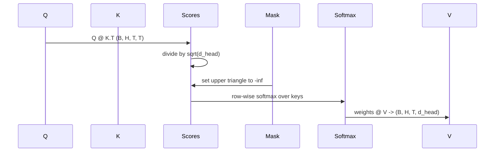

# बहु-उपदेही आत्म-ध्यान

> एक लाइनर प्रोजेक्शन, तीन प्रकार के दृश्य, एक मुखौटा, एक मुखौटा।

**Type:** Build
**Languages:** Python
**Prerequisites:** Phase 04 lessons, Phase 07 transformer lessons, Lessons 30 through 32 of this phase
**Time:** ~90 minutes

## सीखने के लक्ष्य
- √ √ √ √ √ √ √ √ √ √ √ √ √ √ √ √ √ √ √ √ √ √ √ √ √ √ √ √ √ √ √ √ √ √ √ √ √ √ √ √ √ √ √ √ √ √ √ √ √ √ √ √ √ √ √ √ √ √ √ √ √ √ √ √ √ √ √ √ √ √ √ √ √ √ √ √ √ √ √ √ √ √ √ √ √ √ √ √ √ √ √ √ √ √ √ √ √ √ √ √ √ √ √ √ √ √ √ √ √ √ √ √ √ √ √ √ √ √ √ √ √ √ √ √ √ √ √ √ √ √ √ √ √ √ √ √ √ √ √ √ √ √ √ √ √ √ √ √ √ √ √ √ √ √ √ √ √ √ √ √ √ √ √ √ √ √ √ √ √ √ √ √ √ √ √ √ √ √ √ √ √ √ √ √ √ √ √ √ √ √ √ √ √ √ √ √ √ √ √ √ √ √ √ √ √ √ √ √ √ √ √ √ √ √ √ √ √ √ √ √ √ √ √ √ √ √ √ √ √ √ √ √ √ √ √ √ √ √ √ √ √ √ √ √ √ √ √ √ √ √ √ √ √ √ √
- प्रयोग सही का归一化和dtype 处理计算 स्केल डॉट-प्रोडक्ट ध्यान
-  कारणात्मक मुखौटा लगाकर किसी स्थान पर भविष्य की स्थिति पर ध्यान देने से रोकें
- 检查固定输入下 प्रत्येक सिर का ध्यान वजन,并推理 प्रत्येक सिर 关注的内容──
- खेलौना कार्य में एक छोटे से ध्यान ब्लॉक को प्रशिक्षित करें, हानि को देखें  प्रत्येक सिर के साथ  विशेषकरण और नीचे।


```figure
cap-multihead-attention
```

## फ्रेम

ध्यान एक प्रकार का कार्य है, यह एक टोकन के प्रतिनिधित्व को एक ही क्रम में अन्य टोकन से जानकारी प्राप्त करने में सक्षम बनाता है।

उच्च प्रभावकारिता प्राप्त करने का तरीका एक लाइनर लेयर का उपयोग करना है।`D`投影到 `3 * D`, फिर तीन दृश्यों में विभाजित, और फिर H 个头, प्रत्येक आकार के लिए पुनः आकार`D // H`◊बहुत ∞मलमलतम व ∞अधिक ∞आकार ∞मात्रा tensor 操作 操作 操作  निष्पादन के रूप में, इसलिए प्रत्येक सिर त्वरक पर एक साथ चल सकता है ∞

इस वर्ग में यह ब्लॉक बनाया जाएगा। यह भी कारणों का मुखौटा जोड़ देगा, ताकि एक ही कोड को केवल डिकोडर-भाषा मॉडल के रूप में इस्तेमाल किया जा सके।

## आकार अनुबंध

输入是 `(B, T, D)`                                                                                                                                                                                                                                                              `(B, T, D)`✿ मास्क ✿`(T, T)`, या इसे प्रसारित किया जा सकता है. ब्लॉक के अंदर, मध्य टेंसर का आकार है`(B, H, T, d_head)`, उनमें से `d_head = D // H`约束条件是 `D % H == 0`

```mermaid
flowchart LR
    A["(B, T, D) 输入"] --> B[Linear D -> 3D]
    B --> C["拆分为 Q, K, V"]
    C --> D["reshape 为 (B, H, T, d_head)"]
    D --> E["scores = Q @ K.T / sqrt(d_head)"]
    E --> F[应用 causal mask]
    F --> G[对 keys 做 softmax]
    G --> H["context = weights @ V"]
    H --> I["reshape 为 (B, T, D)"]
    I --> J[输出 Linear D -> D]
    J --> K["(B, T, D) 输出"]
```



两个线性层(QKV प्रोजेक्शन和输出 प्रोजेक्शन) ब्लॉक के बीच एकमात्र参数── मुखौटा、softmax、matmuls 和 रीफॉर्म में कोई参数 नही──

## QKV विभाजन

朴实实现会有三个独立线性层,分别用于Q、K和V──高效实现只有一个层,输出 `3 * D`个特征并分分结果──二在数学上等价,因为三分乘以 `(D, D)` वजन के मैट्रिक्स गुणन, ठीक एक बार गुणा करने के बराबर है जो उन्हें संचित से बन जाता है `(3D, D)`权重的矩阵乘法──

उच्च प्रभावशाली संस्करण अधिक तेज़ है, क्योंकि त्वरक केवल एक बार मैटमुल को शुरू करता है, न कि तीन बार। यह भी आसान है, क्योंकि तीन-विन मैट्रिक्स  एक ही पैरामीटर टेंसर में स्थित है, एक साथ शुरू किया जा सकता है।

## सिर को फिर से आकार देना

                                                                                                                                                                                                                                                              `(B, T, D)`                                                                                                                                                                                                                                                              `(B, T, H, d_head)`, पुनः प्रत्यारोपित करने के लिए`(B, H, T, d_head)`◊head 维度现在位于批量旁边, इसलिए PyTorch 会把每头注意视为跨 `B * H`个独立实例的批量操作――

`d_head`维度保持在最后, इसलिए स्कोर matmul `Q @ K.transpose(-2, -1)`इस आयाम पर संकुचन होगा।`(B, H, T, T)`के प्रति सिर ध्यान स्कोर

## स्केलिंग

स्कोर में होगा softmax पूर्व-विभाजन`sqrt(d_head)`यदि यह पैमाने नहीं है, तो उत्पाद के साथ होगा `d_head`                                                                                                                                                                                                                                                              `sqrt(d_head)`विभिन्न सिर आकारों में अंक के अंतर को बनाए रखने के लिए नीचे की ओर बढ़ें।

## कारणात्मक मुखौटा

डिसीडर-केवल भाषा मॉडल 在预测下一个 टोकन 时只能依赖过去──mask 会强制这一点──具体而言,在软max 之前,`(T, T)`अंक मैट्रिक्स कोने के ऊपर की प्रत्येक पंक्ति को नकारात्मक शून्य के रूप में प्रतिस्थापित किया जाएगा।



हम निर्माण के दौरान मास्क को बफर के लिए पंजीकृत करते हैं, इसलिए यह एक ही डिवाइस पर होगा और मॉडल के साथ स्थित है, और ग्रेडिएंट ग्राफ का हिस्सा नहीं है।`(T, T)`区域──

## आउटपुट प्रोजेक्शन

 प्राप्त प्रति सिर संदर्भ वेक्टर `(B, H, T, d_head)`后, हम ट्रांसपोज़ 回 `(B, T, H, d_head)`, रीफॉर्म करने के लिए `(B, T, D)`, और अंतिम आवेदन किया ।`(D, D)`线性投影── आउटपुट प्रोजेक्शन 让模型可以混合各个头――没有它,H个头只能通过后层重组,块会受到人为限制──

## ध्यान वजन निरीक्षण

इस वर्ग में आगे पास ऊपर एक खुलासा किया गया है`return_weights=True`ध्वज, सेट करने के बाद, ब्लॉक होगा आउटपुट के बगल में वापस आकार के लिए`(B, H, T, T)`प्रति सिर ध्यान वजन ः डेमो में एक हीटमैप पर मुद्रित किया जाएगा, ताकि आप कारण त्रिकोण  संरचना और प्रत्येक स्थान के ध्यान बिंदु देख सकें।

प्रशिक्षण के अच्छे मॉडल में, विभिन्न सिर विभिन्न मोडों को सीखेंगे। कुछ सिर निकटवर्ती पहले एक टोकन पर ध्यान देंगे। कुछ सिर क्रम के उद्घाटन पर ध्यान देंगे। कुछ सिर ध्यान लगभग समान रूप से विखरेगा। यह निरीक्षण हुक व्याख्यात्मक कार्य के प्रवेश द्वार को पूरा करने के लिए है।

## प्रशिक्षण डेमो

`main.py`部下的演示会把注意区块 接到一个很小的LM头,并重复任务 上训练整个模型──输入中的每一行都是一个随机 id,在整个上下文中复制──目标是右移一个人的输入,所以模型必须学会下一个代币与前一个代币相似──损失是交叉 Entropy──使用H=4、D=32、T=12 和大小为64的词汇时,Loss会在CPU上 经过三个时代后从随机水平约`log(64) ~ 4.16`) से बहुत कम तक घटता है`1.0`

डेमो का उद्देश्य एक उपयोगी मॉडल को प्रशिक्षित करना नहीं है। इसका उद्देश्य यह सुनिश्चित करना है कि ग्रेडिएंट ब्लॉक के प्रत्येक भाग को पार कर सकता है, और प्रत्येक सिर एक स्पष्ट प्रश्न के उत्तर में कुछ सीख सकता है।

## यह सबक क्या नहीं करता

यह फ़ीड-फॉरवर्ड ब्लॉक नहीं जोड़ता है। वास्तविक मॉडल में ट्रांसफार्मर परत ध्यान है। इसके बाद दो परत MLP, और प्रत्येक भाग के आसपास शेष कनेक्शन और परत मानदंडों के साथ है।

यह घूर्णन या AliBi स्थिति एन्कोडिंग को प्राप्त नहीं करेगा। यह एक ही ब्लॉक के QKV प्रक्षेपण चरणों में लागू होता है, लेकिन ये स्वतंत्र शिक्षण इकाइयां हैं।

यह K और V tensor के आकार अनुबंध को बदलता है, लेकिन Q को नहीं बदलता है। यह inference के अंतर्गत आता है।

## कोड कैसे पढ़ें

`main.py` परिभाषित किया `MultiHeadSelfAttention`△ इस वर्ग में △ दो लाइनर लेयर और एक रजिस्टर्ड मास्क बफर शामिल है── फॉरवर्ड पास 会依次执行投影、 रीशॉप、स्कोर、 मास्क、softmax、 रीशॉप,并再次投影──底部的デモ 构建一个小模型, Token 和位置嵌入以及 LM सिर 包装注意,在复制任务上训练三个时代,并打印损失曲线 和 प्रति-头注意热图──`code/tests/test_attention.py`मध्य परीक्षण ने आकार अनुबंध, कारणत्व गुण, सॉफ्टमैक्स गुण, हेड-स्प्लिट गुण और ग्रेडिएंट प्रवाह को तय किया।

运行 डेमो──然后把 `n_heads`4 से बढ़कर 8 तक रखो`d_model=32`, इसलिए `d_head=4`), ताप मानचित्र 如何变化──
