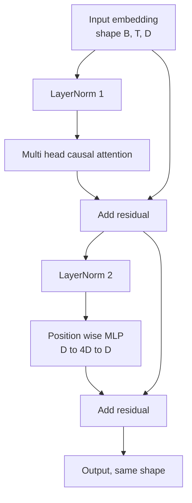
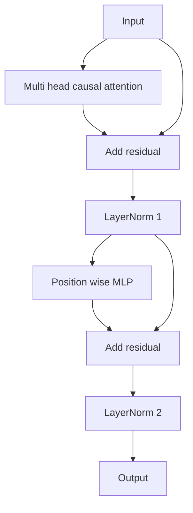

# से शून्य को प्राप्त करें ट्रांसफार्मर ब्लॉक

> एक ब्लॉक प्रत्येक आधुनिक डेकोडर LLM की मूलभूत इकाई है। एक ब्लॉक है। एक ब्लॉक है। एक ब्लॉक है। एक ब्लॉक है। एक ब्लॉक है। एक ब्लॉक है। एक ब्लॉक है। एक ब्लॉक है। एक ब्लॉक है। एक ब्लॉक है। एक ब्लॉक है। एक ब्लॉक है। एक ब्लॉक है। एक ब्लॉक है। एक ब्लॉक है। एक ब्लॉक है। एक ब्लॉक है। एक ब्लॉक है। एक ब्लॉक है। एक ब्लॉक है। एक ब्लॉक है। एक ब्लॉक है। एक ब्लॉक है। एक ब्लॉक है। एक ब्लॉक है। एक ब्लॉक है। एक ब्लॉक है। एक ब्लॉक है। एक ब्लॉक है। एक ब्लॉक है। एक ब्लॉक है। एक ब्लॉक है। एक ब्लॉक है। एक ब्लॉक है। एक ब्लॉक है। एक ब्लॉक है। एक ब्लॉक है। एक ब्लॉक है। एक ब्लॉक है। एक ब्लॉक है। एक ब्लॉक है। एक ब्लॉक है। एक ब्लॉक है। एक ब्लॉक है। एक ब्लॉक है। एक ब्लॉक है। एक ब्लॉक है। एक ब्लॉक है। एक ब्लॉक है। एक ब्लॉक है। एक ब्लॉक है। एक ब्लॉक है। एक ब्लॉक है। एक ब्लॉक है। एक ब्लॉक है। एक ब्लॉक है। एक ब्लॉक है। एक ब्लॉक है। एक ब्लॉक है। एक ब्लॉक है। एक ब्लॉक है। एक ब्लॉक है। एक ब्लॉक है। एक कक्षा है। एक कक्षा है। एक कक्षा है। एक कक्षा है। एक कक्षा है। एक कक्षा है। एक कक्षा है। एक कक्षा है। एक कक्षा है। एक कक्षा है। एक कक्षा है। एक कक्षा है।

**Type:** Build
**Languages:** Python
**Prerequisites:** Phase 19 lessons 30 to 33 (tokenizer, embeddings, attention math, batched data loader)
**Time:** ~90 minutes

## सीखने के लक्ष्य

- चार गति घटकों से PyTorch में ट्रांसफार्मर ब्लॉक का निर्माण:LayerNorm, मल्टी हेड कारण संबंधी ध्यान, अवशिष्ट कनेक्शन, स्थिति के अनुसार MLP,
- LayerNorms को दो प्रकार के कॉन्फ़िगरेशन में रखा जाएगा, और समझाया जाएगा कि इनमें से एक को गर्म करने की आवश्यकता नहीं है और यह भी स्थिर प्रशिक्षण कर सकता है।
- में मल्टी हेड ध्यान में सापेक्ष कारणों के लिए मास्किंग, टोकन बनाने `i`नहीं देख सकते टोकन `j > i`
- 12 परतों के ढेर के बीच दो चर के बीच ग्रेडिएंट प्रवाह, नहीं पर निर्भर करता है
- 1.24 बिलियन पैरामीटर GPT 时, इस ब्लॉक को 作为直接可替换单元复用

## समस्या

परिवर्तनकर्ता एक ब्लॉक को दोहराता है। यदि यह ब्लॉक एक बार गलत हो गया है, तो दोहराता है। 12 बार, आपको प्राप्त मॉडल या तो पहले युग में है, या फिर एक तरह से हैक करने की आवश्यकता है।

एक बार स्पष्ट हो जाने पर, सुधार यंत्र है। यह ब्लॉक  दो शेष पथ और दो सामान्यीकरण पद हैं।

## अवधारणा

प्रत्येक डिकोडर केवल ट्रांसफार्मर ब्लॉक एक समारोह है, यह आकार प्राप्त करता है`(batch, sequence, embedding)`并返回相同形的 tensor──内部由两个子层组成 完成工作──



यह पूर्व-एलएन 变体──LayerNorm  अवशिष्ट शाखा 内部,在子层 之前── अवशिष्ट कनेक्शन 会将未归一化的信号向前传递──

पोस्ट-एलएन 变体会把 LayerNorm 移到残留添加 之后──



完全相同的形式── प्रशिक्षण व्यवहार नहीं एक समान── पोस्ट-एलएन 时, उपयोग के साथ शेष पथ के साथ विपरीत दिशा में प्रवाह के ग्रेडिएंट 必须穿越 LayerNorm──在十二层深度和学习率`3e-4`नीचे, यह ग्रेडिएंट 会缩小得足够快,以至于需要升温时间表──Pre-LN 让残路保持未归化,因此 ग्रेडिएंट 能干净地传播到嵌入层──正因如此,GPT-2 之后发布的配置都使用Pre-LN──

### बहु-मुख्य ध्यान

ध्यान उपपरत को तीन प्रकार के प्रकार से इनपुट में इकट्ठा किया जाएगा प्रश्न, कुंजी, मूल्य tensors में`(B, T, D)`पुनर्विकल्पित करने के लिए`(B, H, T, D/H)`, उनमें से `H`                                                                                                                                                                                                                                                              `softmax(Q K^T / sqrt(d_k))`, ऊपर तीन कोण मास्क को नकारात्मकता के लिए, सॉफ्टमैक्स के माध्यम से लागू मास्क, फिर गुणा `V` सिर                                                                                                                                                                                                                                                              `(B, T, D)`टेन्सर,并再次投影── मुखौटा ही मॉडल को परिणामपूर्ण बनाने का एकमात्र हिस्सा है── भूलना मुखौटा ही एक धोखा देने वाले मॉडल को प्रशिक्षित करने का है──

### एमएलपी

स्थिति बुद्धिमान MLP 会把同一个两层网络独立应用到每个代币──隐藏宽是嵌入宽的四倍,激活是 GELU,并且在第二线性 后接中落──MLP 内部没有代币 互交流──所有代币混合都发生在注意中──

### शेष कनेक्शन दो चीजें करते हैं

它们让跨深度的渐进路变为加法形式,从而保持渐进规范的尺度通过十二层――它们也让每个区块学习运行中表示的加性更新,而不是完全替换―― ये दोनों प्रभाव ब्लॉक 能够扩展的原因――


```figure
cc-transformer-block
```

## इसे बनाओ

`code/main.py`实现了:

- `class LayerNorm`,带可学习的规模 和 shift、偏见 eps,并应用到每个 टोकन वेक्टर──
- `class MultiHeadAttention`,带 `num_heads``head_dim = d_model // num_heads`、फ्यूज्ड क्यूकेवी प्रोजेक्शन、 रजिस्टर का कारण मास्क、अवशिष्ट ध्यान और अवशिष्ट छोड़ देना。
- `class FeedForward`, दो लाइनर स्तरों को शामिल किया गया है, GELU सक्रियण और ड्रॉपआउट
- `class TransformerBlock`,带 `pre_ln`ध्वज, दो चरों के बीच विनिमय के लिए प्रयोग किया जाता है।
- एक डेमो, 6 परत पूर्व-एलएन स्टैक और 6 परत पोस्ट-एलएन स्टैक का निर्माण, उसी प्रविष्टि का उपयोग करके,并打印 (a) आउटपुट आकार,(ब) एक बार पीछे की ओर पारित 后 एम्बेडिंग 处的 ग्रेडिएंट मानदंड。

运行它:

```bash
python3 code/main.py
```

输出: दो स्टैक के आकार की जांच, तथा并排 के ग्रेडिएंट मानदंडों── समान सीखने की दर में नीचे, पूर्व-एलएन स्टैक के एम्बेडिंग ग्रेडिएंट की तुलना में पोस्ट-एलएन स्टैक बड़ा एक संख्यात्मक स्तर है, यह पूर्व-एलएन 无需热化也能训练的实证信号──

## स्टैक

- `torch`टेन्सर गणित, ऑटोग्रेड और उपयोग`nn.Module`प्लंबरिंग
-                `transformers`, पूर्व प्रशिक्षित वजन का उपयोग नहीं करते हैं.

## जंगली में उत्पादन के पैटर्न

तीन प्रकार के तरीके पाठ्यपुस्तकों के ब्लॉक को वितरित करने योग्य वस्तु में बदल देंगे।

**Fused QKV projection.**तीन स्वतंत्र लाइनर स्तरीय में तीन बार कर्नेल लॉन्च और तीन बार मैटमल्स का उपयोग किया जाता है।`3 * d_model`                                                                                                                                                                                                                                                              

**Registered causal mask buffer.**मास्क केवल अधिकतम अवतरण लंबाई पर निर्भर करता है।`register_buffer`एक बार विभाजित, प्रत्येक बार आगे जाने के लिए सक्रिय विंडो से बाहर कट, और प्रत्येक बार विनियमन वितरण से कूद गया।

**Dropout in two places, not three.**ड्रॉपअप 应该位于注意软max 之后 (ध्यान के लिए ध्यान देने की कमी), तथा MLP के दूसरे रैखिक 之后 (रजिस्ट्रियल ड्रॉपअप) 后 (रजिस्ट्रियल ड्रॉपअप) 后 (रजिस्ट्रियल 本身上做 dropup) 后 (रजिस्ट्रियल 本身上做 ड्रॉपअप会破坏让格里迪ент在深度上传播的添加性── कुछ प्रारंभिक कार्यान्वयन इस गलती को चुका चुके हैं,并为脆弱的训练付出代价──

## इसका प्रयोग करें

- इस वर्ग में ब्लॉक को सीधे पाठ 35 में सम्मिलित किया जा सकता है।
- pre-LN 变体是每个现代 ओपन वेट्स LLM 使用的形式──post-LN 变体是 2017年原始注意 论文使用的形式──了解二者就足以阅读你会遇到的任何解码架构──
- GELU को SiLU में बदलें, आपको LLaMA 系列 सक्रियण मिलता है.

## व्यायाम

1. 给 ब्लॉक 中 प्रत्येक रैखिक 添加 `bias=False`आधुनिक ओपन वेट LLM  जारी करते समय रैखिक परतें  न带偏见── माप 12 परतों में  768 dim 模型中能节省多少参数──
2. RMSNorm 替换 `nn.LayerNorm`,并验证 आउटपुट आकार 不变──
3. 添加一旗,返回第一头的注意重量,作为 `(B, T, T)`tensor──चित्रण上三角, पुष्टि सॉफ्टमैक्स 后它为零──
4. एक मानसिक जांच का निर्माण, इसे`(2, 16, 384)`tensor में `H=6`नीचे दो चरों में भेजा गया,并断言在权重初始化相同且 dropup 设为零时,前进输出 不同(例如 `not torch.allclose`)。

## प्रमुख शर्तें

| Term | What people say | What it actually means |
|------|-----------------|------------------------|
| Pre-LN | "Pre norm" | LayerNorm 位于 residual branch 内部，在每个 sublayer 之前；residual 携带未归一化的 signal |
| Post-LN | "Post norm" | LayerNorm 位于 residual add 之后；这是 2017 年论文发布的形式，并且需要 warmup |
| Causal mask | "Triangle mask" | Attention logits 的上三角被设为负无穷，因此当 j 大于 i 时，Token i 不能读取 Token j |
| Fused QKV | "Combined projection" | 一个宽度为 3D 的 linear，而不是三个宽度为 D 的 linears；一个 kernel，一次 matmul |
| Residual stream | "Skip connection" | 自上而下流过每个 block 的未归一化 tensor；也是每个 block 添加到的对象 |

## आगे पढ़ना

- चरण 7 पाठ 02 ((स्वयं ध्यान को खरोंच से), इस ब्लॉक को समझें ️️️️️️️️️️️️️️️️️️️️️️️️️️️️️️️️️️️️️️️️️️️️️️️️️️️️️️️️️️️️️️️️️️️️️️️️️️️️️️️️️️️️️️️️️️️️️️️️️️️️️️️️️️️️️️️️️️️️️️️️️️️️️️️️️️️️️️️️️️️️️️️️️️️️️️️️️️️️️️️️️️️️️️️️️️️️️️️️️️️️️️️️️️️️️️️️️️️️️️️️️️️️️️️️️️️️️️️️️️️️️️️️️️️️️️️️️️️️️️️️️️️️️️️️️️️️️️️️️️️️️️️️️️️️️️️️️️️️️️️️️️️️️️️️️️️️️️️️️️️️️️️️️️️️️️️️️️️️️️️️️️️️️️️️️️️️️️️️️️️️️️️️️️️️️️️️️️️️️️️️️️️️️️️️️️️️️️️️️️️️️️️️️️️️️️️️️️️️️️️️️️️️️️️️️️️️️️️️️️️️️️️️️️️️️️️️️️️️️️️️️️️️️️️️️️️️️️️️️️️️️️️️️️️️️️️️️️️️️️️️️️️️️️️️️
- चरण 7 पाठ 05(पूर्ण ट्रांसफार्मर), जानें उसी अस्थि के एन्कोडर डिकोडर  संस्करण。
- चरण 10 पाठ 04 ((प्रशिक्षण पूर्व मिनी जीपीटी), इस ब्लॉक को समझने के लिए प्रशिक्षण प्रक्रिया में शामिल होना चाहिए
- चरण 19 पाठ 35 ((इस ट्रैक), इस तरह के 12 ब्लॉक को एक जीपीटी मॉडल में इकट्ठा करेगा
