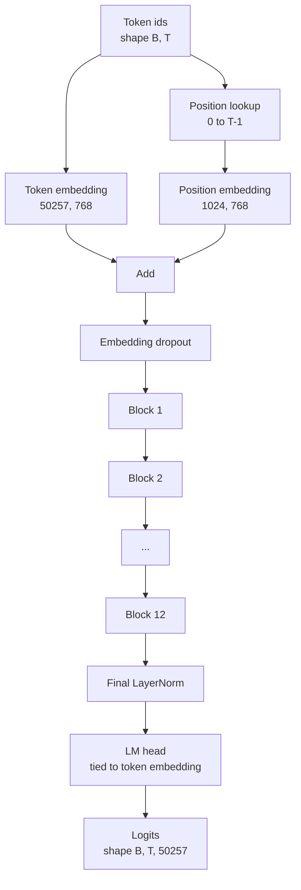
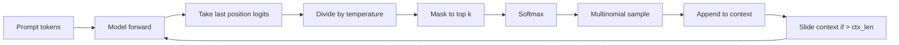

# जीपीटी 模型组装

> 十二个块 堆叠,一个代币嵌入,一个学习得到的位置嵌入,一个最终 LayerNorm,以及一个权重绑定的语言模型头──这是一个完整的1.24亿参数 GPT模型──本课将这些组件组装成一个可运行的类,统计参数以确认模型匹配参考的124M 形状,并使用多个组件样本、温度和顶-k 生成文本──

**Type:** Build
**Languages:** Python
**Prerequisites:** Phase 19 lessons 30 到 34
**Time:** ~90 分钟

## सीखने के लक्ष्य

- 将课时34 中的变压器块 组装成完整 GPT 模型:Token Embedding、Position Embedding、N 个块、最终 LayerNorm、भाषा मॉडल हेड。
- 复现 1.24 अरब सेमेण्टर配置:वोकैब 50257 背景 1024 嵌入 768 十二个头十二层──
- भाषा मॉडल प्रमुख को टोकन एम्बेडिंग के लिए बाध्य करने का अधिकार है, और यह समझाता है कि यह इस पैमाने पर लगभग 38 मिलियन पैरामीटर को बचा सकता है।
- प्रयोग बहुपद नमूनाकरण, तापमान स्केलिंग, और शीर्ष-के ट्रंक्शन, त्वरित से 生成文本,并用滑窗 保持 संदर्भ लंबाई
- 对照 124M 目标 माप पैरामीटर गिनती 和 आगे पास 成本。

## समस्या

ट्रांसफार्मर ब्लॉक 单独存在时什么也做不了──你需要把代号 id 转换成向量,混入位置信息,让它们穿过堆,再投投射回词汇逻辑──错过这四步中的任何一步,模型要么无法前进,要么位置信息漂移,要么无法说话──

模型的形状也很重要──参考 GPT-2 छोटा 在上面的精确配置下是1.24亿参数──这些数字不神秘──Vocab 50257 乘以嵌入 768 是代币表──Position 1024 乘以 768 是位置表──十二个块,每块约700万参数,总数 8400 万──最终头 通过重量绑定 复用代币表──把这些部分相加,你就得到1.24亿──构建的模型如果参数不匹配与参考,通常说明你把某处连错了──

## अवधारणा



टोकन आईडी  टोकन वेक्टरों में बदल जाते हैं।  स्थिति आईडी  स्थिति वेक्टरों में बदल जाती हैं।                                                                                                                                                                                                                                                

### वजन बान्धना

टोकन एम्बेडिंग का आकार है `(vocab, d_model)`◊भाषा मॉडल प्रमुख 需要从 `d_model`投影回 `vocab`△ वे एक दूसरे के लिए स्थानांतरित होते हैं, △ वे दो बंधाए जाते हैं, जिसका अर्थ है कि दो बार एक ही पैरामीटर टेंसर का उपयोग करना, दो बार उपयोग करना।

### स्थिति एम्बेडिंग है सीखने प्राप्त करने के, नहीं sinusidal

GPT-2 उपयोग सीखने प्राप्त की स्थिति एम्बेडिंग---स्थिति तालिका एक आकार के लिए है`(1024, 768)`मॉडल में प्रत्येक बार आगे  स्थिति 0 से T-1 तक खोजें,并把搜索结果加到 टोकन एम्बेडिंग上── यह सबसे सरल स्थिति方案 है, जो कि RoPE、ALiBi、T5 सापेक्ष पूर्वाग्रह है, यह भी 124M 参考模型 उपयोग का एक विकल्प है

### पीढ़ीः तापमान, शीर्ष-के, बहुपद

पीढ़ी ही स्व-निर्णायक है। प्रत्येक चरण में, मॉडल सभी प्रत्येक स्थान पर पूर्ण शब्दावली ऊपर के लॉजिट्स को वापस लौटेंगे। आप केवल अंतिम स्थान लेते हैं, तापमान को छोड़कर, शीर्ष के लॉजिट्स के बाहर सभी लॉजिट्स को हटा दें।



तीनों प्रकार के व्यवहारों के प्रति प्रतिक्रिया देना। तापमान 接近零会退化成贪── तापमान एक समय के लिए अनुकूल मॉडल का प्राकृतिक वितरण है।


```figure
cc-gpt-assembly
```

## इसे बनाओ

`code/main.py`实现:

- `class GPTConfig`डेटा क्लास, 124M के साथ`vocab_size=50257``context_length=1024``d_model=768``num_heads=12``num_layers=12``mlp_expansion=4``dropout=0.1``use_bias=True``weight_tying=True`
- `class GPTModel`, समाहित टोकन एम्बेडिंग, स्थिति एम्बेडिंग, एम्बेडिंग ड्रॉपआउट, १२ `TransformerBlock`、 अंतिम LayerNorm, साथ ही साथ पर झंडा 打开时绑定到代币嵌入的 `lm_head`
- `count_parameters`सहायक, लौटाएं एकमात्र पैरामीटर गिनती (इसलिए आंकड़े सही ढंग से वजन बान्धने का काम करते हैं)
- `generate`कार्य, तापमान निष्पादन, शीर्ष-क, बहुपद, स्लाइडिंग विंडो संदर्भ
- एक डेमो, निर्माण मॉडल, प्रिंट पैरामीटर गिनती और संदर्भ 124M के लिए, फिर स्थिर संकेत से उत्पन्न एक लघु क्रम, पाइपलाइन को प्रदर्शित करने के लिए 端到端可运行──

运行它:

```bash
python3 code/main.py
```

输出: पैरामीटर गिनती के साथ 124M  संदर्भ मूल्य के लिए 照照、 से तय शीघ्र 生成 के टोकन आईडी, तथा 打开时 LM हेड 和 टोकन एम्बेडिंग साझा भंडारण की पुष्टि जानकारी

为了让演示保持快速,脚本还会端到端运行一个小组合(`d_model=64``num_layers=2`),并 इनलाइन 打印生成的符号序列──124M कॉन्फिग 会被构建,但只执行参数计和一次前进传递──

## स्टैक

- `torch`टेन्सर गणित, ऑटोग्रेड और मॉड्यूल प्लंपिंग के लिए उपयोग किया जाता है
- `code/main.py`पाठ 34 में एक ही ब्लॉक पैटर्न को पुनः प्राप्ति में स्थान दिया गया है।

## जंगली में उत्पादन के पैटर्न

तीनों मोड एक मॉडल को केवल चलाने या वास्तव में वितरित करने के लिए निर्धारित करते हैं।

**把 residual projections 初始化得小一些。**ध्यान के आउटपुट प्रक्षेपण 和 MLP के दूसरे रैखिक शहर सीधे अवशिष्ट जोड़ में प्रवेश करेंगे── यदि अन्य रैखिक समान मानक विचलन के साथ प्रयोग किया जाता है तो उन्हें आरंभिक रूप से शुरू कर दिया जाएगा, अवशिष्ट धारा गहराई के साथ बढ़ेगी,并把最终 LayerNorm 推进过热区间── इन दोनों प्रक्षेपणों के लिए, std 按`1 / sqrt(2 * num_layers)`缩放; अवशिष्ट प्रवाह १२ स्तरीय में उचित सीमा बनाए रख सकता है।

**缓存 position id tensor，不要重复计算。** `torch.arange(T)`                                                                                                                                                                                                                                                              `__init__`मध्य अधिकतम संदर्भ के अनुसार विभाजित एक बार, प्रत्येक बार调用时 slice 前 T 个 प्रविष्टियाँ,跳过分配器 往返──

**在 parameter 层面 tie weights，而不只是 copy。** सेटिंग `lm_head.weight = token_embedding.weight`会共享 Tensor;copy 不会──Optimizer 需要更新一个参数,自动化图也需要一次积累──如果你复制,头 会从嵌入 漂走,权重绑定就没有任何收益──

## इसका प्रयोग करें

- इस वर्ग के मॉडल वर्ग का आकार अगले वर्ग के मॉडल आकार के समान है।
- LLaMA परिवार को प्राप्त करने में सक्षम होने के लिए, स्थिति एम्बेडिंग को RoPE के लिए प्रतिस्थापित करना, बिना ब्लॉक या सिर के परिवर्तन की आवश्यकता नहीं है।
- GELU को SiLU में बदलकर LayerNorm को RMSNorm में बदलकर LLaMA परिवार के शेष परिवर्तनों को प्राप्त करने में सक्षम होगा।
- पीढ़ी फ़ंक्शन किसी भी लॉजिट के लिए उपयोग किया जा सकता है Source, not limited to this model── आप पाठ 37 में पूर्व प्रशिक्षित GPT-2 फ़ाइल से लॉजिट खींच सकते हैं,并复用同一个世代循环──

## व्यायाम

1. 解除 LM head 与 Token Embedding 的绑定并重新统计参数──验证差值为50257 乘以768 = 3800万──
2.                                                                                                                                                                                                                                                               
3. 添加 `greedy=True`ध्वज, नमूनों से कूदने, न कि चयनित तर्क अधिकतम, पुष्टिकरण क्रम में कई बार परिचालन में निर्धारक है।
4. 添加 `repetition_penalty`旋,在 softmax 之前,  शीघ्र या उत्पन्न इतिहास में किसी भी टोकन के लॉजिट को एक स्थिर संख्या को छोड़कर  उपयोग कर 固定 प्रॉम्प्ट  दिखाएँ                                                                                                                                                                                                                                                                                                                                                                                                                                                                                   
5. `top_k`旁边添加 `top_p`(अणु) नमूनाकरण── दो पंक्तियों की जांच से पुष्टि टोकन को बनाए रखने की संभावना 之和超过 `top_p`

## प्रमुख शर्तें

| Term | What people say | What it actually means |
|------|-----------------|------------------------|
| Weight tying | “Tied embeddings” | LM head 和 Token Embedding 共享同一个 parameter tensor；节省 vocab times d_model 参数，并匹配 GPT-2 参考模型 |
| Position embedding | “Learned positions” | 一个单独的 table，形状为 (context length, d_model)，加到 token vectors 上；端到端学习得到 |
| Sliding window context | “Context cap” | 当 prompt 加生成 tokens 超过 context length 时，丢弃最旧的 tokens，让 active window 能放下 |
| Top-k sampling | “K truncation” | 保留值最高的 K 个 logits，把其余 logits mask 成 negative infinity，并在剩余项上 softmax |
| Temperature | “Sampling temperature” | 在 softmax 前用 T 除以 logits；T 小于 1 会变尖锐，T 等于 1 保持自然 distribution，T 大于 1 会变平坦 |

## आगे पढ़ना

- चरण 19 पाठ 34, इस मॉडल के ढेर के ब्लॉक को जानें
- चरण 19 पाठ 36, क्रॉस एंट्रॉपी हानि का उपयोग करके प्रशिक्षण लूप को समझें
- चरण 19 पाठ 37, जानें कैसे इस सटीक वास्तुकला में प्री-प्रशिक्षित GPT-2 वजन को जोड़ें
- चरण 7 पाठ 07 ((जीपीटी कारण भाषा मॉडलिंग), अगले टोकन भविष्यवाणी का ज्ञान प्राप्त करें
- चरण 10 पाठ 04 ((प्रारंभिक प्रशिक्षण मिनी जीपीटी), उसी वास्तुकला को समझने 上的原始训练过程──
