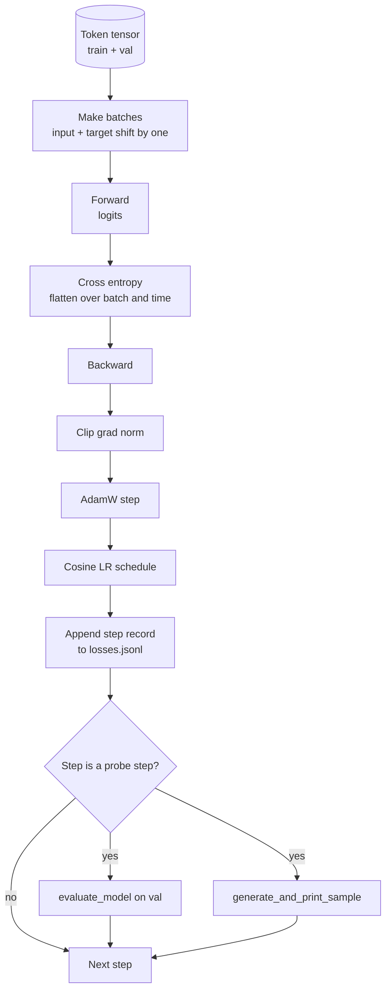

# प्रशिक्षण चक्र एवं मूल्यांकन

> ️️️️️️️️️️️️️️️️️️️️️️️️️️️️️️️️️️️️️️️️️️️️️️️️️️️️️️️️️️️️️️️️️️️️️️️️️️️️️️️️️️️️️️️️️️️️️️️️️️️️️️️️️️️️️️️️️️️️️️️️️️️️️️️️️️️️️️️️️️️️️️️️️️️️️️️️️️️️️️️️️️️️️️️️️️️️️️️️️️️️️️️️️️️️️️️️️️️️️️️️️️️️️️️️️️️️️️️️️️️️️️️️️️️️️️️️️️️️️️️️️️️️️️️️️️️️️️️️️️️️️️️️️️️️️️️️️️️️️️️️️️️️️️️️️️️️️️️️️️️️️️️️️️️️️️️️️️️️️️️️️️️️️️️️️️️️️️️️️️️️️️️️️️️️️️️️️️️️️️️️️️️️️️️️️️️️️️️️️️️️️️️️️️️️️️️️️️️️️️️️️️️️️️️️️️️️️️️️️️️️️️️️️️️️️️️️️️️️️️️️️️️️️️️️️️️️️️️️️️️️️️️️️️️️️️️️️️️️️️️️️️️️️️️️️️️️️️️️️️️️️️️️️️️️`calc_loss_batch`सहायक  में रखा डेटा ऊपर `evaluate_model`एक बार में हर कदम पर गुजरना`generate_and_print_sample`定性 जांच, साथ ही बाद में चित्रित किए जाने वाले JSONL हानि लॉग  एक ही ढांचा आप बाद में बनाएंगे हर डिकोडर LLM को प्रशिक्षित कर सकते हैं

**Type:** Build
**Languages:** Python
**Prerequisites:** Phase 19 lessons 30 到 35
**Time:** ~90 分钟

## सीखने के लक्ष्य

-                                                                                                                                                                                                                                                                                                                                                                                                                                                                                                                              
-  configure AdamW, make weight decay 应用于 वजन टेन्सर, न कि LayerNorm या bias टेन्सर हेतु 应用于
- 实现带线性变暖和宇宙衰退的学习率时间表,并读取 LR 随时间的变化──
- उपयोग `evaluate_model`                                                                                                                                                                                                                                                              
- प्रत्येक चरण में`generate_and_print_sample`एक निश्चितता नमूना बनाने के लिए, ताकि हानि वक्र में दिखाए जाने से पहले विचलन को पकड़ सकें
- प्रत्येक चरण हानि को JSONL में स्थायी करने के लिए पुनः लोड करने के लिए, चित्र, और प्रशिक्षण लॉग को डिलीवर करने योग्य के रूप में वितरित करने के लिए।

## समस्या

एक केवल मुद्रित हानि और कुछ भी नहीं किया प्रशिक्षण स्क्रिप्ट 会在三方面失败── यह आपको नहीं बता सकता कि क्या हानि है क्योंकि सही कारण नीचे है(मॉडल केवल प्रशिक्षण सेट पर ओवरफिट हो सकता है, और कभी भी वास्तव में सीखना नहीं)── यह आपको नहीं बता सकता कि क्या विचलन शुरू हो रहा है(लॉस हो सकता है एक कदम बाद फिर से शुरू हो सकता है, या हो सकता है एक कदम बाद में टूट जाता है)── यह आपको नहीं बता सकता कि मॉडल ने क्या सीखा है(लॉस एक स्केलर है; उत्पन्न नमूना एक पाठ है)── जब तक लूप माप नहीं करता है, अन्यथा ये तीनों विफलताएं छिपी होंगी।

इस वर्ग में लूप प्रयोग तीन प्रकार के उपायों से मापें── प्रत्येक चरण प्रशिक्षण बैच में ऊपर का नुकसान── प्रत्येक K 步骤 में बाहर रखा बैच ऊपर का नुकसान── प्रत्येक K 步骤 से स्थिर प्रम्प्ट उत्पन्न एक निरंतरता── प्रशिक्षण लॉग JSONL में 落, इसलिए कलाकृतियाँ यही इस लूप का प्रमाण है──

## अवधारणा



 दो अलग-अलग स्पष्ट भाग है हानि संरेखण और एडम विघटन विभाजन

### हानि संरेखण

模型在每个位置预测下一个代币── यदि इनपुट बैच टोकन हैं `[t0, t1, t2, t3]`, तो लक्ष्य बैच  ज़रूरी है `[t1, t2, t3, t4]`✿ पार एंट्रॉपी समतल आकार में `(batch * seq, vocab)`上计算,并对照平面目标 `(batch * seq,)` भूल जाते हैं, हम मॉडल को स्वयं का अनुमान लगाने के लिए प्रशिक्षित करते हैं; यह शून्य हानि तक प्राप्त करता है, लेकिन कुछ भी उपयोगी नहीं सीखता है

### एडमडब्ल्यू क्षय विभाजन

वजन घटाने वजन टेन्सर को नियमित करेगा, लेकिन सामान्यीकरण पैमाने या पूर्वाग्रहों को नियमित नहीं करेगा।

### वार्मअप प्लस कोसिन शेड्यूल

वार्मअप बैठक में कुछ सौ चरणों में सीखने की दर को शून्य रैंप से लक्ष्य मूल्य तक बढ़ाएगा, ताकि ऑप्टिमाइज़र राज्य में समय भरने का समय हो।

### मूल्यांकन किया गया

`evaluate_model` 会从验证分分 运行固定数量的批发,累积损失,除以批发数,然后返回──没有 Gradient──没有 dropup──在同种和同分下,这个数字可跨运行复现──把保持损失与训练损失并排报告,就是你发现过的方法──

### प्रारंभिक संकेत के रूप में गुणात्मक नमूनाकरण

एक प्रशिक्षण हानि नीचे अच्छी तरह से गिर गया है, लेकिन उत्पन्न नमूने सभी एक ही टोकन के मॉडल खराब हैं। एक हानि वक्र लगता है सपाट, लेकिन उत्पन्न नमूने  धीरे-धीरे बन जाता है एक सरीसृप्त एकल शब्द के मॉडल सीख रहे हैं।


```figure
cap-training-loop
```

## इसे बनाओ

`code/main.py`实现:

- `make_batches(token_ids, batch_size, context_length)`, एक लंबे टोकन टेंसर स्लाइस 成 इनपुट और लक्ष्य जोड़े होगा
- `calc_loss_batch(model, inputs, targets)`, आगे निष्पादित करें, सपाट,并 लौटें स्केलर क्रॉस एंट्रॉपी
- `evaluate_model(model, val_loader, max_batches)`, में कोई ग्रेड नीचे 代 निश्चित संख्या सत्यापन बैच,并返回 औसत हानि
- `generate_and_print_sample(model, prompt, max_new_tokens)`, में फिक्स्ड प्रॉम्प्ट 上运行 पाठ 35 के पीढ़ी फ़ंक्शन 并印结果──
- `build_param_groups(model, weight_decay)`,生成两组 AdamW पैरामीटर सूची
- `cosine_with_warmup(step, warmup_steps, total_steps, max_lr, min_lr)`, लौटने के लिए निर्धारित कदम का LR──
- `train(...)`,运行循环,持久化 `outputs/losses.jsonl`,并每 `eval_every`चरण 打印 eval loss 和 sample──
- एक डेमो, सिंथेटिक डेटा में ऊपर प्रशिक्षण छोटे मॉडल, कम मात्रा में कदम, JSONL लॉग में लिखें, और जांच बिंदुओं में प्रिंट मूल्यांकन हानि और नमूना। यह डेमो CPU ऊपर से दूर से एक मिनट के लिए पूरा किया जा सकता है।

运行它:

```bash
python3 code/main.py
```

输出: प्रत्येक चरण हानि 行、 प्रत्येक जांच चरण का मूल्यांकन हानि、 प्रत्येक जांच चरण का उत्पन्न नमूना, तथा अंतिम `outputs/losses.jsonl`, आप उपयोग कर सकते हैं .`json.loads`按行加载它──

## स्टैक

- `torch`ऑटोग्रेड, ऑप्टिमाइज़र और मॉड्यूल के लिए उपयोग किया जाता है
- `main.py`                                                                                                                                                                                                                                                                                                                                                                                                                                                                                                                             `GPTModel`和 समर्थित मॉड्यूल

## जंगली में उत्पादन के पैटर्न

तीन तरीके हैं जो पाठ्यपुस्तक लूप को एक ऐसी चीज़ में बदल देंगे जो रात भर चल सकती है।

**Gradient norm clipping 不可协商。**एक खराब बैच (असामान्य डेटा, आरआर स्पाइक, संख्यात्मक सीमा स्थिति) उत्पन्न होगा विशाल ग्रेडिएंट, नष्ट हो जाएगा कुछ घंटे प्रशिक्षण परिणामों।`backward`之后,`step`之前调用 `torch.nn.utils.clip_grad_norm_(params, max_norm=1.0)`,可让优化器 保持在安全范围内──剪值是一个自由参数;1是大多数设置下都能住的默认值──

**可恢复的 JSONL logging，而不是 pickled state。**् ् ् ् ् ् ् ् ् ् ् ् ् ् ् ् ् ् ् ् ् ् ् ् ् ् ् ् ् ् ् ् ् ् ् ् ् ् ् ् ् ् ् ् ् ् ् ् ् ् ् ् ् ् ् ् ् ् ् ् ् ् ् ् ् ् ् ् ् ् ् ् ् ् ् ् ् ् ् ् ् ् ् ् ् ् ् ् ् ् ् ् ् ् ् ् ् ् ् ् ् ् ् ् ् ् ् ् ् ् ् ् ् ् ् ् ् ् ् ् ् ् ् ् ् ् ् ् ् ् ् ् ् ् ् ् ् ् ् ् ् ् ् ् ् ् ् ् ् ् ् ् ् ् ् ् ् ् ् ् ् ् ् ् ् ् ् ् ् ् ् ् ् ् ् ् ् ् ् ् ् ् ् ् ् ् ् ् ् ् ् ् ् ् ् ् ् ् ् ् ् ् ् ् ् ् ् ् ् ् ् ् ् ् ् ् ् ् ् ् ् ् ् ् ् ् ् ् ् ् ् ् ् ् ् ् ् ् ् ् ् ् ् ् ् ् ् ् ् ् ् ् ् ् ्`{"step": int, "train_loss": float, "lr": float}`JSONL में लिखने के लिए उपयोग करने योग्य हैः किसी भी दुर्घटना में कोई भी पठनीय वस्तु छोड़ दी जाएगी, आप इसे पकड़ सकते हैं, आप तीस पंक्तियों के पायथन चित्रों का उपयोग कर सकते हैं, या फिर प्रशिक्षण को पुनर्प्राप्त करने के लिए अंतिम चरण को पढ़ सकते हैं।

**Eval batches 来自固定 slice。**सत्यापन टोकन को स्क्रिप्ट में  प्रारंभ करते समय आंशिक रूप से आंशिक रूप से आंशिक रूप से आंशिक रूप से आंशिक रूप से आंशिक रूप से आंशिक रूप से आंशिक रूप से आंशिक रूप से आंशिक रूप से आंशिक रूप से आंशिक रूप से आंशिक रूप से आंशिक रूप से आंशिक रूप से आंशिक रूप से आंशिक रूप से आंशिक रूप से आंशिक रूप से आंशिक रूप से आंशिक रूप से आंशिक रूप से आंशिक रूप से आंशिक रूप से आंशिक रूप से आंशिक रूप से आंशिक रूप से आंशिक रूप से आंशिक रूप से आंशिक रूप से आंशिक रूप से आंशिक रूप से आंशिक रूप से आंशिक रूप से आंशिक रूप से आंशिक रूप से आंशिक रूप से आंशिक रूप से आंशिक रूप से आंशिक रूप से आंशिक रूप से आंशिक रूप से आंशिक रूप से आंशिक रूप से आंशिक रूप से आंशिक रूप से आंशिक रूप से आंशिक रूप से आंशिक रूप से आंशिक रूप से आंशिक रूप से आंशिक रूप से आंशिक रूप से आंशिक रूप से आंशिक रूप से आंशिक रूप से आंशिक रूप से आंशिक रूप से आंशिक रूप से आंशिक रूप से आंशिक रूप से आंशिक रूप से आंशिक रूप से आंशिक रूप से आंशिक रूप से आंशिक रूप से आंशिक रूप से आंशिक रूप से आंशिक रूप से आंशिक रूप से आंशिक रूप से आंशिक रूप से आंशिक रूप से आंशिक रूप से आंशिक रूप से आंशिक रूप से आंशिक रूप से आंशिक रूप से आंशिक रूप से आंशिक रूप से आंशिक रूप से आंशिक रूप से आंशिक रूप से आंशिक रूप से आंशिक रूप से आंशिक रूप से आंशिक रूप से आंशिक रूप से आंशिक रूप से आंशिक रूप से आंशिक रूप से आंशिक रूप से आंशिक रूप से आंशिक रूप से आंशिक रूप से आंशिक रूप से आंशिक रूप से आंशिक रूप से आंशिक रूप से आंशिक रूप से आंशिक रूप से आंशिक रूप से आंशिक रूप से आंशिक रूप से आंशिक रूप से आंशिक रूप से आंशिक रूप से आंशिक रूप से आंशिक रूप से आंशिक रूप से आंशिक रूप से आंशिक रूप से आंशिक रूप से आंशिक रूप से आंशिक रूप से आंशिक रूप से आंशिक रूप से आंशिक रूप से आंशिक रूप से आंशिक रूप से आंशिक रूप से आंशिक रूप से आंशिक रूप से आंशिक रूप से आ

## इसका प्रयोग करें

- इस वर्ग में लूप वास्तविक डेटा पर प्रशिक्षण 124M 模型 के skeleton के समान है `datasets`风格的 लोडर,loop 就能不变地运行──
- JSONL लॉग प्रशिक्षण रन को सबूत के लिए डिलीवर करने योग्य बनाता है।
- 定性 नमूना जांच 定性 नमूना जांच 定性 नमूना जांच 定性 नमूना जांच 定性 नमूना जांच  अपरिवर्तनीय 底检查──

## व्यायाम

1. 添加 `weight_decay_groups()`इकाई परीक्षण, पुष्टिकरण पैमाने और पूर्वाग्रह मापदंड 落入 कोई क्षय समूह नहीं, जबकि रैखिक 和 एम्बेडिंग वजन 落入 क्षय समूह
2. एक छोटे से ग्रंथ फ़ाइल में बाइट्स के साथ कृत्रिम यादृच्छिक टोकन के लिए, प्रयोग करें, प्रयोग करें।
3. के लिए cosine अनुसूची 添加一个 `min_lr`तल, मूल्य `max_lr`10% की,并重新绘图──
4. JSONL लॉग को छोड़कर, प्रत्येक `eval_every`कदम 保存 एक चेकपॉइंट──添加 `resume_from`ध्वज पुनः लोड मॉडल राज्य 和 अनुकूलक राज्य
5. 旁边记录每步吞吐量 (प्रति सेकंड टोकन),并确认它保持在稳定区间──

## प्रमुख शर्तें

| Term | What people say | What it actually means |
|------|-----------------|------------------------|
| Loss alignment | “Shift by one” | Input tokens 位于 positions 0..T-1，target tokens 位于 positions 1..T；cross entropy 在 flattened shapes 上计算 |
| Decay split | “Two groups” | AdamW 接收带 weight decay 的 matrix shaped tensors，以及不带 decay 的 scale 或 bias tensors |
| Warmup | “Ramp” | learning rate 在固定步数内从零爬升到目标值，让 Optimizer state 可以填充 |
| Eval batches | “Held out batches” | validation token tensor 的一个固定 slice，在 script 启动时 slice 一次，并在每个 probe 中相同使用 |
| Qualitative probe | “Sample print” | 每 K steps 从固定 prompt 打印一次短 generation，用于捕捉单靠 loss 会隐藏的 failure modes |

## आगे पढ़ना

- चरण 19 पाठ 35, इस लूप को जानें 驱动的模型──
- चरण 19 पाठ 37, जानें कैसे एक ही मॉडल में पूर्व-प्रशिक्षित वजन को लोड करने के लिए
- चरण 10 पाठ 04 ((प्रारंभिक प्रशिक्षण मिनी जीपीटी), वास्तविक डेटा पर प्रक्रिया को समझें
- चरण 10 पाठ 10 ((मूल्यांकन), क्रॉस एंट्रॉपी हानि को समझने के अलावा 更广的 eval surface──
