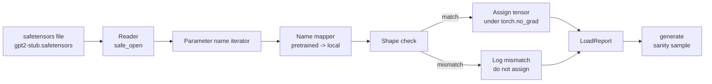

# 加载 पूर्व-प्रशिक्षित वजन

> शून्य प्रशिक्षण से 124 मिलियन पैरामीटर मॉडल बजट निर्णय है; लोड एक सार्वजनिक चेकपॉइंट 则是日常操作──本课会将安全感器文件中预训练的GPT-2 शैली वजन को लोड करें, पाठ 35 के समान वास्तुकला में, चरण-दर-चरण व्याख्या पैरामीटर नाम मानचित्रण,并通过智能生成一个延续来证明载成功──无网络、无第三方 लोडर、无不透明魔法──

**Type:** Build
**Languages:** Python
**Prerequisites:** Phase 19 lessons 30 to 36
**Time:** ~90 minutes

## सीखने के लक्ष्य

- उपयोग `safetensors`पायथन लाइब्रेरी 读取 सेफेटेंसर फ़ाइल,并检查 Tensor नाम 和 आकारों。
- प्रत्येक पूर्व प्रशिक्षित पैरामीटर नाम 映射到课 35 GPT मॉडल 内部的一个参数──
- 处理 प्रकाशित GPT-2 वजन और इस ट्रैक मॉडल  के बीच अलग दो सेट नामकरण约定:`wte/wpe/h.N.attn.c_attn/c_proj`和 `mlp.c_fc/c_proj`,对应本地命名的`tok_embed/pos_embed/blocks.N.attn.qkv/out_proj`和 `mlp.fc1/fc2`
- किसी भी भार असाइनमेंट से पहले, जांच ने आकार के असंगतता को अस्वीकार कर दिया, स्पष्ट त्रुटि को स्पष्ट कर दिया।
- उपयोग लोड वजन 生成一个短续,并确认 टोकन लोड वितरण से, बजाय यादृच्छिक आरंभिक वितरण से प्राप्त करते हैं

## समस्या

प्रकाशित वजन आपके वास्तुकला के लिए नहीं हैं 打包的── वे मूल रूप से उपयोग किए जाने वाले नाम हैं── प्रशिक्षित फ़ाइल के लिए आकार है `(2304, 768)``transformer.h.0.attn.c_attn.weight`; आपका मॉडल 期望形 为 `(2304, 768)``blocks.0.attn.qkv.weight`(यह एक ही मैट्रिक्स है, बस लेआउट सम्मेलन अलग है), या अपने मॉडल का उपयोग करें ।`nn.Linear`, यह एक ही पैरामीटर के रूप में स्थानांतरित किया जाएगा भंडारण मैट्रिक्स,, तीन अलग अलग अलग रूपों के साथ दिखाई देगा, नाम, आकार, बाइट लेआउट), लोडर  को समायोजित करना होगा और यह तीनों को 

 अंधेरी कॉपी करने वाला लोडर सही टेन्सर  गलत स्थान पर डाल देगा, एक उत्पन्न हुआ हुआ हुआ वाकया乱语 का मॉडल प्राप्त करेगा।`LoadReport`सभा汇总 hits,misses तथा आकार असंगतता,让你能读懂发生了什么──

## अवधारणा



नाम मैपर 只是 एक स्ट्रिंग से स्ट्रिंग के लिए फ़ंक्शन ∙ आकार जाँच ∙ एक यदि ∙ असाइनमेंट 发生在 `torch.no_grad()`内部, इसलिए autograd 不会跟踪加载过程──Report 会保存每个名称的结果──

### जीपीटी-2 नामकरण सम्मेलन

प्रकाशित GPT-2 वजन 使用如下名称:

| Pretrained name | Shape | Meaning |
|-----------------|-------|---------|
| `wte.weight` | (50257, 768) | Token Embedding |
| `wpe.weight` | (1024, 768) | Position Embedding |
| `h.N.ln_1.weight` | (768,) | block N 的 LayerNorm 1 scale |
| `h.N.ln_1.bias` | (768,) | block N 的 LayerNorm 1 shift |
| `h.N.attn.c_attn.weight` | (768, 2304) | 融合 QKV linear weight |
| `h.N.attn.c_attn.bias` | (2304,) | 融合 QKV linear bias |
| `h.N.attn.c_proj.weight` | (768, 768) | Attention output projection |
| `h.N.attn.c_proj.bias` | (768,) | Attention output projection bias |
| `h.N.ln_2.weight` | (768,) | LayerNorm 2 scale |
| `h.N.ln_2.bias` | (768,) | LayerNorm 2 shift |
| `h.N.mlp.c_fc.weight` | (768, 3072) | MLP fc1 weight |
| `h.N.mlp.c_fc.bias` | (3072,) | MLP fc1 bias |
| `h.N.mlp.c_proj.weight` | (3072, 768) | MLP fc2 weight |
| `h.N.mlp.c_proj.bias` | (768,) | MLP fc2 bias |
| `ln_f.weight` | (768,) | Final LayerNorm scale |
| `ln_f.bias` | (768,) | Final LayerNorm shift |

दो अप्रत्याशित बिंदुओं को पहले से निपटने की आवश्यकता है।`c_attn``c_proj``c_fc`इन रैखिक के मैट्रिक्स  भंडारण विधि, के लिए तुलना `nn.Linear.weight`期望方式是转置的── लोडर 会在分配时转置──LM सिर 完全不在文件中;模型依赖与 `wte`                                                                                                                                                                                                                                                              `wte`落位, सिर पर 落位, सिर पर 落位, सिर पर 落位, सिर पर 落位, सिर पर 落位, सिर पर 落位, सिर पर 落位, सिर पर 落位, सिर पर 落位, सिर पर 落位, सिर पर 落位, सिर पर 落位, सिर पर 落位, सिर पर 落位, सिर पर 落位, सिर पर 落位, सिर पर 落位, सिर पर 落位, सिर पर 落位, सिर पर 落位, सिर पर 落位, सिर पर 落位, सिर पर 落位, सिर पर 落位, सिर पर 落位, सिर पर 落位, सिर पर 落位, सिर पर 落位, सिर पर 落位, सिर पर 落位, सिर पर 落位, सिर पर 落位, सिर पर 落位, सिर पर 落位, सिर पर 落位, सिर पर 落位, सिर पर 落位, सिर पर 落位, सिर पर 落位, सिर पर 落位, सिर पर 落位, सिर पर 落

### स्थानीय नामकरण सम्मेलन

本轨道的模型 使用描述性名称:

| Local name | Meaning |
|------------|---------|
| `tok_embed.weight` | Token Embedding |
| `pos_embed.weight` | Position Embedding |
| `blocks.N.ln1.scale` | block N 的 LayerNorm 1 scale |
| `blocks.N.ln1.shift` | LayerNorm 1 shift |
| `blocks.N.attn.qkv.weight` | 融合 QKV |
| `blocks.N.attn.qkv.bias` | 融合 QKV bias |
| `blocks.N.attn.out_proj.weight` | Attention output projection |
| `blocks.N.attn.out_proj.bias` | Output projection bias |
| `blocks.N.ln2.scale` | LayerNorm 2 scale |
| `blocks.N.ln2.shift` | LayerNorm 2 shift |
| `blocks.N.mlp.fc1.weight` | MLP fc1 |
| `blocks.N.mlp.fc1.bias` | MLP fc1 bias |
| `blocks.N.mlp.fc2.weight` | MLP fc2 |
| `blocks.N.mlp.fc2.bias` | MLP fc2 bias |
| `final_ln.scale` | Final LayerNorm scale |
| `final_ln.shift` | Final LayerNorm shift |

मानचित्रण एक निश्चित कार्य है। यह इसे एक निर्देशांक के रूप में प्रस्तुत करता है।

### स्टब फिटिंग

वास्तविक GPT-2 वजन लगभग 0.5 GB。 डेमो उन्हें डाउनलोड नहीं करेगा; यह पहली बार चलने पर एक छोटे सेफेटेंसर फिक्स्चर उत्पन्न करेगा, पूरी तरह से समान GPT-2 नामकरण सम्मेलन को अपनाएगा, और 12 ब्लॉक मॉडल、d_model 192 के बजाय 768 के आकारों के लिए उपयुक्त होगा। यह फिक्स्चर  उचित संरचना है, लोडर के अंदर प्रत्येक कोड पथ को触发 कर सकती है।


```figure
cc-weight-remap
```

## इसे बनाओ

`code/main.py`实现:

- एक पाठ 35 `GPTModel`️️️️️️️️️️️️️️️️️️️️️️️️️️️️️️️️️️️️️️️️️️️️️️️️️️️️️️️️️️️️️️️️️️️️️️️️️️️️️️️️️️️️️️️️️️️️️️️️️️️️️️️️️️️️️️️️️️️️️️️️️️️️️️️️️️️️️️️️️️️️️️️️️️️️️️️️️️️️️️️️️️️️️️️️️️️️️️️️️️️️️️️️️️️️️️️️️️️️️️️️️️️️️️️️️️️️️️️️️️️️️️️️️️️️️️️️️️️️️️️️️️️️️️️️️️️️️️️️️️️️️️️️️️️️️️️️️️️️️️️️️️️️️️️️️️️️️️️️️️️️️️️️️️️️️️️️️️️️️️️️️️️️️️️️️️️️️️️️️️️️️️️️️️️️️️️️️️️️️️️️️️️️️️️️️️️️️️️️️️️️️️️️️️️️️️️️️️️️️️️️️️️️️️️️️️️️️️️️️️️️️️️️️️️️️️️️️️️️️️️️️️️️️️️️️️️️️️️️️️️️️️️️️️️️️️️️️️️️️️️️️️️️️️️️️️️️️️️️️️️️️️️️️️️️
- `make_pretrained_to_local(num_layers)`,展开每层条目──
- `load_safetensors(model, path)`,代名,映射名,检查形,转置 conv1d शैली के वजन, और`torch.no_grad()`नीचे कार्य-- वापसी `LoadReport`
- `make_stub_safetensors(path, cfg)`, एक सटीक पूर्व प्रशिक्षित नामकरण सम्मेलन के अनुकूलन के साथ एक फिक्स्ड फ़ाइल उत्पन्न करना
- एक डेमो: प्रथम运行时创建 `outputs/gpt2-stub.safetensors`, एक नया मॉडल बनाएं, यादृच्छिक शुरुआत को पकड़ें 生成 एक निरंतरता, लोड स्टब, पुनः एक और निरंतरता को पकड़ें, मुद्रण करें,并验证两者不同( load确实改变了模型) 

运行:

```bash
python3 code/main.py
```

आउटपुटःफिक्स्चर पथ  नाम  लोड लॉग`LoadReport`सारांश भारण पूर्व का निरंतरण भारण पश्चात् का निरंतरण, तथा फिक्स्चर में जानबूझकर डाले गए एक ही खराब टेंसर  आकार के असंगतता का कारण बनता है, जिससे विफलता पथ को कवर किया जा सकता है──

## स्टैक

- `safetensors`डिस्क प्रारूप पर उपयोग किया जाता है और स्ट्रीमिंग रीडर
- `torch`मॉडल और असाइनमेंट मैथ्स पर प्रयोग किया गया
-                `transformers`,不使用 `huggingface_hub`, नेटवर्क कॉल नहीं करते हैं.

## जंगली में उत्पादन के पैटर्न

तीन पैटर्न ️ लोडर ️ बनावट वजन ️ जब आप के सामने ️ बनावट ️ बनावट ️ बनावट ️ बनावट ️ बनावट ️ बनावट ️ बनावट ️ बनावट ️ बनावट ️ बनावट ️ बनावट ️ बनावट ️ बनावट ️ बनावट ️ बनावट ️ बनावट ️ बनावट ️ बनावट ️ बनावट ️ बनावट ️ बनावट ️ बनावट ️ बनावट ️ बनावट ️ बनावट ️ बनावट ️ बनावट ️ बनावट ️ बनावट ️ बनावट ️ बनावट ️ बनावट ️ बनावट ️ बनावट ️ बनावट ️ बनावट ️ बनावट ️ बनावट ️

**始终在任何 assignment 前验证 file。**打开文件,列出每一个子名称 及其dtype 和形,运行完整映射和形检查,只有在成功后才开始分配──半加载模型是静默失败机器──

**每次 assignment 都记录 source name 和 destination name。**जब कुछ गलत लगता है, तो लॉग आपको बताएगा कि कौन सा टेंसर 落到哪里; वैकल्पिक है हेक्सडंप्स पढ़ना.`LoadReport`डेटाक्लास 会跟踪 `loaded``missing``unexpected`和 `shape_mismatch`सूची, और अंतिम मुद्रण सारांश

**LM head 是 weight tying alias，不是单独 copy。**                                                                                                                                                                                                                                                                                                                                                                                                                                                                                                                             `tok_embed`后设置 `model.lm_head.weight = model.tok_embed.weight`                                                                                                                                                                                                                                                              `lm_head.weight`पैरामीटर 会破坏绑定,并让 पैरामीटर गिनती 翻倍──

## इसका प्रयोग करें

- लोडर  किसी भी उपयोग के लिए उपयुक्त पूर्व प्रशिक्षित नामकरण सम्मेलन के सेफेटेंसर्स फ़ाइल──真实GPT-2 फ़ाइलें(छोटे / मध्यम / बड़े / xl)
- एक बार नाम मानचित्र अपडेट होने पर, समान पैटर्न LLaMA、Mistral、Qwen वजनों में विस्तारित किया जा सकता है──आकार जांच और रिपोर्ट 保持不变──
- भार के बाद मानसिकता पीढ़ी एक त्वरित गेट हैः यदि पोस्ट लोड नमूने पूर्व लोड नमूने की तरह दिखते हैं, तो स्पष्ट करें भार कोई मॉडल नहीं बदलता है, इसका मतलब है मैपिंग 静默漏掉了每个 tensor──

## व्यायाम

1. लोडर 添加 `dtype`तर्क, असाइनमेंट में  प्रत्येक टेन्सर लक्ष्य dtype में फेंक दिया जाएगा`bfloat16``float16``float32`)。 पुष्टि `float32`मॉडल को नीचे गिराया जा सकता है`bfloat16`और यह अभी भी उत्पन्न किया जा सकता है
2. 添加 `expected_layers`तर्क, अस्वीकार कर लोड `h.N`सूचकांक और मॉडल `num_layers`असंगत चेकपॉइंट
3. लाड करने वाला 接入 पाठ 35 पीढ़ी फ़ंक्शन,并生成 दो并排 नमूनेः एक यादृच्छिक init से, एक लोड किए गए फिक्स्चर से
4. 添加出口路径:pre-trained naming convention का उपयोग करें 将当前模型状态 写入一个新的安全感器文件── दौर यात्रा लोडर 并确认报告 中形状不一致 为零──
5. 扩展 `NAME_MAP`以处理 LLaMA naming convention(无偏见、RMSNorm、fused qkv layout), और आप उत्पन्न स्टब LLaMA फिक्स्चर 上重新运行 लोडर。

## प्रमुख शर्तें

| Term | What people say | What it actually means |
|------|-----------------|------------------------|
| Name map | "Key remapping" | 从 pretrained tensor names 到 local parameter names 的 function；通常是一个 literal dict，每个 layer index 一个 entry，并在 loop 中展开 |
| Shape mismatch | "Bad shape" | Pretrained tensor 存在于 mapped name 下，但其 dimensions 与 local parameter 不一致；loader 会拒绝 assignment 并记录这对 name |
| Transpose-on-load | "Conv1d layout" | Published GPT-2 将 Attention 和 MLP projections 存储为 nn.Linear 期望形式的转置；loader 会在 assignment 时转置 |
| Weight tying alias | "Shared LM head" | 设置 model.lm_head.weight = model.tok_embed.weight，让 head 和 Embedding 共享 storage；正因为如此，head 不在 file 中 |
| Load report | "Coverage summary" | 一个小型 dataclass，跟踪 loaded、missing、unexpected 和 shape_mismatch lists；打印它可以判断加载是否成功 |

## आगे पढ़ना

- चरण 19 पाठ 35: भार प्राप्त करने की वास्तुकला
- चरण 19 पाठ 36: उत्पन्न समान आकार के चेकपॉइंट का प्रशिक्षण लूप
- चरण 10 पाठ 11 ((क्वांटिकेशन):स्मृति 紧张时如何处理负载重量──
- चरण 10 पाठ 13 (पूर्ण LLM पाइपलाइन का निर्माण):लोड और निष्कर्ष 周边的完整生命周期──
