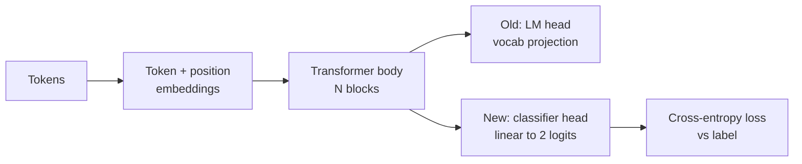
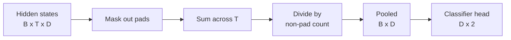
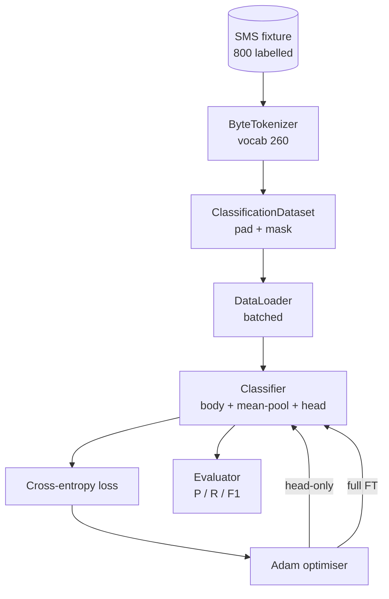

# कैपस्टोन पाठ 38: हेड स्वैप के माध्यम से  वर्गीकरण करने योग्य सूट

> ट्रैक बी का पहला कैपस्टोन。प्रशिक्षित भाषा मॉडल एकपर एक स्व-विचार ब्लॉक है,末端 है टोकन-पूर्वानुमान सिर。 जब आप स्पैम बनाम हैम 时, हेड गलत है, लेकिन शरीर 基本是对的。本课会拆除头,把一个二级线性层 接到集成表示上,并用两种方式训练类别:最终层只和全细调――Eval उपयोग करके होल्ड-out विभाजन上的精度、recall 和 F1。你会学到每种策略带来什么、代价是什么──

**Type:** Build
**Languages:** Python (torch, numpy)
**Prerequisites:** Phase 19 lessons 30-37 (NLP LLM track: tokenizer, embedding table, attention block, transformer body, pre-training loop, checkpointing, generation, perplexity)
**Time:** ~90 minutes

## सीखने के लक्ष्य

- 不重新初始化体的情况下,把语言-model head 替换为分类头──
- 实现两种训练模式:
- संरचना टोकनराइज़र-जागरूक डेटा पाइपलाइन, जिम्मेदार पैडिंग, मास्क पैडिंग,并对注意输出做pooling──
- कच्चे लॉग से  गणना सटीकता  स्मरण  F1 和 भ्रम मैट्रिक्स 
- परिमाण गणना शिक्षण समय तथा मुख्य कक्ष  के बीच व्यापार-बदला

## समस्या

आप सामान्य corpus में पहले से प्रशिक्षित हैं  एक छोटा ट्रांसफार्मर  आउटपुट हेड  अंतिम छिपे हुए राज्य  को 1000 टोकन शब्दावली  तक इकट्ठा करेगा  अब आपके पास 800 条 हैं जो स्पैम या हैम के लिए चिह्नित हैं, एक द्विआधारी वर्गीकरण बनाने की उम्मीद करते हैं  यहाँ तीन विकल्प हैं

错误选择是基于800 个例子从零训练一个新类别器――训练模型的体体已编码了有用结构:शब्द पहचान、位置、简单的共发――丢失它就是浪费构建它时消耗的计算――

两个正确选择是头交换 后结体,以及头交换 后让身体可训练―― सिर-केवल प्रशिक्षण 快速,记忆 几乎免费,在这么少的数据上也不太容易过适应――पूर्ण ठीक-调节 更慢,在小数据上可能过适应,但当下游域 偏离预训体时可以达到更高的精度──

इस वर्ग में एक ही समय में निर्माण किया जाएगा, आप एक ही समय में ऊपर तुलना कर सकते हैं

## अवधारणा



मॉडल एक समारोह हैः`f_theta(tokens) -> hidden_states`हेड एक फ़ंक्शन हैः`g_phi(hidden) -> logits`                                                                                                                                                                                                                                                              `theta`और प्रतिस्थापन`g_phi` शरीर के पैरामीटर महंगे भाग हैं सिर सिर्फ एक रैखिक परत है

दो समूह प्रशिक्षित पैरामीटर  महत्वपूर्णः

- `theta`(शरीर): प्रत्येक ध्यान ब्लॉक के बीच में लाखों वजन हैं
- `phi`(सिर):`hidden_dim * num_classes`वजन एक पूर्वाग्रह जोड़ना

में सिर-केवल प्रशिक्षण में, आप लक्षित `phi`计算梯度,并让 `theta`के ग्रेडिएंट 为零──PyTorch 允许你通过在体参数上设置 `requires_grad=False`यह करने के लिए यह सब करना है।

पूर्ण सूक्ष्म-ट्यूनिंग में, आप ग्रेडिएंट को पूरे स्टैक के माध्यम से लौटने की अनुमति देते हैं। शरीर के वजन को अनुकूल वर्गीकरण उद्देश्य के लिए स्थानांतरित किया जाता है।

## एकजुटता का प्रश्न

वर्गीकरणकर्ता  प्रत्येक अनुक्रम को एक वेक्टर की आवश्यकता होती है, प्रत्येक टोकन को एक वेक्टर के बजाय।

- **Mean pool**: ध्यान मास्क के अनुसार, क्रम के ऊपर छिपे हुए राज्यों के लिए औसत
- **CLS pool**: पूर्वस्थापना एक विशेष टोकन, केवल इसका उपयोग आउटपुट।
- **Last-token pool**: अंतिम गैर-पैडिंग टोकन का उपयोग करना।

इस वर्ग में स्पष्ट ध्यान-मास्क वजन के साथ उपयोग किया जाता है। यह सबसे सरल है, विभिन्न अनुक्रम लंबाई में ऊपर देने के लिए स्थिर संकेत, और न ही पूर्व प्रशिक्षण CLS टोकन की आवश्यकता है।



## आंकड़े

八百条短信,400条垃圾邮件和400条腿,都会在 `code/main.py`मध्य निर्धारक 生成── जनरेटर का उपयोग फिक्स्ड बीज, टेम्पलेट्स का चयन और स्लॉट फिलर का प्रतिस्थापन, 5 से 25 टोकन के बीच संदेशों की लंबाई का आउटपुट── वास्तविक डेटासेट इस फिक्स्ड 没有的噪音── फिक्स्ड का फोकस पुनरुत्पादन है──

按 80/20 विभाजन:640 ट्रेन,160 परीक्षण。 स्प्लिट्स 使用 स्तरीकृत, इसलिए परीक्षण सेट 保持 50/50 संतुलन── एक संतुलन 已知 held-out सेट 能让精度 和回忆 被当作可信数字 解读──

## माप

द्विआधारी वर्गीकरण 中 वर्ग 1 है सकारात्मक वर्ग(स्पैम)。计数如下:

- `TP`:预测为垃圾邮件,实际是垃圾邮件
- `FP`:预测为垃圾邮件,实际是
- `FN`:预测为,实际是垃圾邮件──
- `TN`:预测为,实际是──

तीन प्रमुख माप:

- `precision = TP / (TP + FP)` स्पैम के रूप में चिह्नित संदेशों में, स्पैम का वास्तविक अनुपात कितना है?
- `recall = TP / (TP + FN)` वास्तविक स्पैम में, मॉडल के लिए चिन्हित होने का अनुपात कितना है?
- `F1 = 2 * P * R / (P + R)`二者的 सामंजस्यपूर्ण अर्थ

भ्रमित मैट्रिक्स 会把四个计数打印为2x2格子――Demo 会把两个训练模式的结果都写到 stdout――


```figure
cap-classifier-head-swap
```

## वास्तुकला



शरीर एक बहुत ही छोटा ट्रांसफार्मर हैः वोकैब 260、 छिपा 64、4 हेड、2 ब्लॉक、 अधिकतम अनुक्रम 32── यह पर्याप्त छोटा है, यह सीपीयू पर 90 सेकंड में दो प्रकार के रीजम्स को कन्वर्जन तक प्रशिक्षित कर सकता है──本课中 यह पूर्व प्रशिक्षित नहीं है;相反,`pretrain_quick`सहायक एक ही समय में एक ही समय में एक ही समय में एक ही समय में एक ही समय में एक ही समय में एक ही समय में एक ही समय में एक ही समय में एक ही समय में एक ही समय में एक ही समय में एक ही समय में एक ही समय में एक ही समय में एक ही समय में एक ही समय में एक ही समय में एक ही समय में एक ही समय में एक ही समय में एक ही समय में एक ही समय में एक ही समय में एक ही समय में एक ही समय में एक ही समय में एक ही समय में एक ही समय में एक ही समय में एक ही समय में एक ही समय में एक ही समय में एक ही समय में एक ही समय में एक ही समय में एक ही समय में एक ही समय में एक ही समय में एक ही समय में एक ही समय में एक ही समय में एक ही समय में एक ही समय में एक ही समय में एक ही समय में एक ही समय में एक ही समय में एक ही समय में एक ही समय में एक ही समय में एक ही समय में एक ही समय में एक ही समय में एक ही समय में एक ही समय में एक ही एक ही समय में एक ही समय में एक ही समय में एक ही एक ही समय में एक ही समय में एक ही एक ही समय में एक ही समय में एक ही एक समय में एक ही एक समय में एक समय में एक समय में एक ही एक समय में एक समय में एक समय में एक ही एक समय में एक समय में एक समय में एक समय में एक समय में एक समय में एक समय में एक समय में एक समय में एक समय में एक समय में एक समय में एक समय में एक समय में एक समय में एक समय में एक समय में एक समय में एक समय में एक समय में एक समय में एक समय में एक समय में एक समय में एक समय में एक समय में एक समय में एक समय में एक समय में एक समय में एक समय में एक समय में एक समय में एक समय में एक समय में एक समय में एक समय में एक समय में एक समय में एक समय में एक समय में एक समय में एक समय में एक समय में एक समय में एक समय में एक समय में एक समय में एक समय में एक समय में एक समय में एक समय में एक समय में एक समय में एक समय में एक समय में एक समय में एक समय में एक समय में एक समय में एक समय में एक समय में एक समय में एक समय में एक समय में एक समय में एक समय में एक समय में एक समय में एक समय में एक समय में एक समय में एक समय में एक समय में

## आप क्या बना देंगे

कार्यान्वयन है एक `main.py`एक परीक्षण मॉड्यूल`code/tests/test_main.py`)。

1. `ByteTokenizer`:把字节 映射到 ids,并保留一个pad id──
2. `Block`: एक带 मल्टी-हेड ध्यान 和 फ़ीड-फॉरवर्ड लेयर का ट्रांसफार्मर ब्लॉक──पूर्व-नियमित──
3. `LMBody`: टोकन + स्थिति एम्बेडमेंट्स 加上一叠块──返回隐藏状态──
4. `MeanPool`: अनुक्रम अक्ष के साथ करना मास्क-वजनित औसत
5. `Classifier`:body、pool、linear head──body in different regimes में एक ही उदाहरण है──
6. `freeze_body`和 `unfreeze_body`: शरीर मापदंडों को बदलना ऊपर `requires_grad`
7. `train_classifier`: एक साझा लूप── प्राप्त मॉडल 和 एक के लिए वर्तमान प्रशिक्षित पैरामीटर समूह 配置的优化器──
8. `evaluate`:运行 परीक्षण सेट 并返回 `Metrics(precision, recall, f1, confusion)`
9. `run_demo`पहले, पहले, पहले, पहले, पहले, फिर, फिर, फिर, फिर, फिर, फिर, फिर, फिर, फिर, फिर, फिर, फिर, फिर, फिर, फिर, फिर, फिर, फिर, फिर, फिर, फिर, फिर, फिर, फिर, फिर, फिर, फिर, फिर, फिर, फिर, फिर, फिर, फिर, फिर, फिर, फिर, फिर, फिर, फिर, फिर, फिर, फिर, फिर, फिर, फिर, फिर, फिर, फिर, फिर, फिर, फिर, फिर, फिर, फिर, फिर, फिर, फिर, फिर, फिर, फिर, फिर, फिर, फिर, फिर, फिर, फिर, फिर, फिर, फिर, फिर, फिर, फिर, फिर, फिर, फिर, फिर, फिर, फिर, फिर, फिर, फिर, फिर, फिर, फिर, फिर, फिर, फिर, फिर, फिर, फिर, फिर, फिर, फिर, फिर, फिर, फिर, और, फिर, फिर, फिर, फिर, फिर, फिर, और, फिर, फिर, फिर, और फिर, फिर, फिर, फिर, और, फिर, फिर, और फिर, फिर, फिर, और, फिर, और, फिर, फिर, और, फिर, और, फिर, और, फिर, और, फिर, और, फिर, और, फिर, और, और, फिर, और, फिर, और, और, और, फिर, और, और, और, और, और, और, और, और, और, और, और, और, और, और, और, और, और, और, और, और, और, और, और, और, और, और, और, और, और, और, और, और, और, और, और, और, और, और, और, और, और, और, और, और, और, और, और, और, और, और, और, और, और, और, और, और, और, और, और, और, और, और, और, और, और, और, और, और, और, और, और, और, और, और, और, और, और, और, और, और, और, और, और, और, और, और, और, और, और, और, और, और, और, और, और, और, और, और, और, और, और, और, और, और, और, और,

## तुलना क्यों महत्वपूर्ण है

सिर-केवल शासन आमतौर पर अधिक तेज़,并以更平滑的方式 कम फिट होते हैं। इस फिचर्ड में, सिर-केवल प्रशिक्षण में, बीस युगों के बाद, आप आमतौर पर सटीकता देखेंगे 接近 0.9  स्मरण करना 接近 0.85 😇 पूर्ण ठीक-ठीक लगभग धीमी तीन गुना, अंतिम परिणाम कुछ बिंदुओं के भीतर ऊपर और नीचे उतार-चढ़ाव होगा, यादृच्छिक बीज पर निर्भर करता है।

इस वर्ग में कोई विजेता नहीं है। यह आपको संख्याओं और लागत को समझने में मदद करता है। इस वर्ग में 800 उदाहरण और छोटे शरीर हैं, केवल सिर सही विकल्प है। इस वर्ग में 80,000 उदाहरण और बड़े शरीर हैं, पूर्ण ठीक-ठीक करने में मदद करने के लिए।`train_classifier`कार्य 处理两种情况, एकत्र 只是一次电话――

## लक्ष्य निर्धारित करें

- 添加第三种制度,只解凍最后一个块──这有时被称为部分细调──它比全FT 成本更低,比头头只学得更多──
- 添加学习率调度器──对头 用科西因时间表,并对身体 用更小的常率,是常见的生产设置──
- उपयोग किया गया ध्यान पूल  बदलना mean pooling: एक带 एक सीखा गया क्वेरी का एक छोटा ध्यान परत── लंबी अनुक्रमों में ऊपर यह आमतौर पर औसत पूल से बेहतर है──

कार्यान्वयन  तुम्हें हुक दिया गया है  परीक्षा  अनुबंध तय किया गया है  संख्याओं  तुम आगे बढ़ो 
