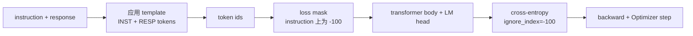
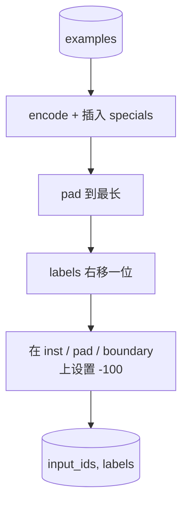
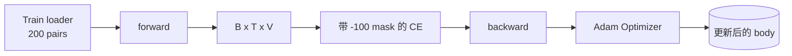

# Capstone 课程 39: पर्यवेक्षित ठीक-ठीक से ट्यूनिंग के माध्यम से  निर्देश ट्यूनिंग करें

> पूर्व प्रशिक्षित आधार मॉडल एक क्रम को जारी रख सकता है, लेकिन एक निर्देश का पालन नहीं कर सकता है। पर्यवेक्षित ठीक-ट्यूनिंग इस बिंदु का न्यूनतम परिवर्तन हैः मॉडल के लिए निर्देशों और अपेक्षाओं के माध्यम से प्रतिक्रिया 配对组成 के उदाहरण,并训练主体来预测 प्रतिक्रिया टोकन।`ignore_index=-100`屏蔽 निर्देश टोकन, में 200 个 निर्देश-प्रतिक्रिया जोड़े 上训练,并使用精确匹配在持久分分上评估

**Type:** Build
**Languages:** Python (torch, numpy)
**Prerequisites:** Phase 19 lessons 30-37 (NLP LLM track: tokenizer, embedding table, attention block, transformer body, pre-training loop, checkpointing, generation, perplexity)
**Time:** ~90 minutes

## सीखने के लक्ष्य

- एक स्पष्ट सीमा टोकन के साथ एक एकल कारण अनुक्रम में संरेखित करने के लिए निर्देश-उत्तर डेटा को स्वरूपित किया जाएगा।
- ् एक संकलित फ़ंक्शन का निर्माण करें, सूचना टोकन को रोकें, क्रॉस-एंट्रोपी को केवल प्रतिक्रिया टोकन का गणना करें
- SFT उद्देश्य में नीचे एक छोटे से ट्रांसफार्मर शरीर को प्रशिक्षित करें,并观察 eval metric के परिवर्तनों को देखें
- 实现 लोभी 和 तापमान-सैंपल पीढ़ी,并遵守 प्रतिक्रिया-शुरू सीमा──
- √ उत्पन्न पूर्णता √ गणना-असन्न सटीक-मिलान

## समस्या

अगला टोकन भविष्यवाणी का उपयोग करें प्रशिक्षण के आधार मॉडल पता नहीं है कि क्या है निर्देशों को प्रदान करें`"What is the capital of France?"`, यह इस समस्या को जारी रखेगा, या एक नया वाक्य बना देगा। मॉडल भाषाई क्षमता है, लेकिन कोई प्रारूप अनुबंध नहीं है।

एसएफटी अनुबंध एक स्ट्रिंग टेम्पलेट है। प्रत्येक प्रशिक्षण उदाहरण तीन क्षेत्रों से युक्त एक एकल श्रृंखला में बदल जाएगाः

```text
<INST> What is the capital of France? <RESP> The capital of France is Paris.
```

सीमा टोकन प्रशिक्षण में विशेष टोकन को बनाए रखने के लिए हैं।`<RESP>` इसके बाद सब कुछ प्रतिक्रिया है, और प्रतिक्रिया  केवल  मूल्यांकन का हिस्सा है आधार मॉडल का अगला टोकन उद्देश्य  अभी भी लागू है; यह केवल प्रत्येक उदाहरण में इस तरह के रूप में भाषा पर प्रशिक्षण है

लेकिन यहाँ एक फंदा है। यदि आप पूरे क्रम को सामान्य क्रॉस-एंट्रोपी हानि के लिए देखते हैं, तो आप भी प्रशिक्षण मॉडल में हैं।

## अवधारणा



`ignore_index``torch.nn.functional.cross_entropy`का एक फ़ंक्शन── किसी भी लक्ष्य स्थिति आदि `ignore_index`शहर योगदान शून्य हानि 和 शून्य ग्रेडिएंट──पायटॉर्च के बीच के प्रथाओं में यह है `-100`कोलाट फ़ंक्शन के लिए प्रत्येक उदाहरण में दो टेन्सर का निर्माण करेंः`input_ids`(पूर्ण परिचर्चा) और `labels`(`input_ids`के副本, जिसमें निर्देश पदों को कवर किया गया है`-100`)。

模型在前进传递 期间看整个序列;注意可以参加到指示――输掉只计算响应代币――这正是你想要的:指示上的条件,预测响应――

## आंकड़े

`main.py`मध्य निश्चितता ने दो सौ निर्देश-उत्तर जोड़े उत्पन्न किए।

- वास्तविक एकल शॉट ((X 的首都)
- अंकगणित
- सूची निकासी
- एक वाक्य का सारांश
- कोड(प्रिंट, क्रमबद्ध)
- परिभाषा

प्रत्येक कार्य में एक टेम्पलेट निर्देश और एक निर्धारात्मक प्रतिक्रिया है। यह एक सरल डिजाइन रखना है। सटीक-मैच बहुत कमजोर है, जबकि इस वर्ग में एक फिक्स्चर का उपयोग किया जाता है, जिसमें सही उत्तर एक विशिष्ट字符串 है।

160 ट्रेनों में विभाजित 40 परीक्षणों का सेट है, जो सभी छह प्रकार के कार्यों को कवर करता है, इसलिए प्रति श्रेणी सटीक मैचों की रिपोर्ट की जा सकती है।

## टोकनकरण और पैडिंग

टोकनराइज़र बाइट स्तर है, और इसमें तीन विशेष विशेषताएं हैंः

- `INST_ID = 256`:标记 निर्देश क्षेत्र 的开始──
- `RESP_ID = 257`: संकेत निर्देश और प्रतिक्रिया के बीच की सीमा
- `PAD_ID = 258`: चर-लंबाई वाले बैचों के पैडिंग हेतु प्रयोग किया जाता है

序列是 `[INST] inst_bytes [RESP] resp_bytes [PAD]*`◊कोलाट फ़ंक्शनः

1. टोकन प्रत्येक उदाहरण
2. बैच के भीतर प्रत्येक उदाहरण पैड को उस बैच में सबसे लंबी क्रम की लंबाई तक ले जाना
3. निर्माण `labels`= 右移一位的 `input_ids`(सर्भाविक एलएम लक्ष्य) और:
   - 将 निर्देश क्षेत्र 替换为 `-100`
   - 将 पैडिंग क्षेत्र 替换为 `-100`
   - `RESP_ID`सीमा स्थिति 本身替换为 `-100`(你不训练模型预测 बॉर्डर टोकन; यह预测后续内容)



शिफ्ट है मानक कारण चालः`input_ids``i`预测 स्थिति `i+1`, इसलिए `labels[i] = input_ids[i+1]`(इनपुट 丢弃最终位置, लक्ष्य 丢弃第一位置)  मास्क 后应用 后应用,以落在正确位置上

## प्रशिक्षण



लूप है मानक PyTorch SFT लूप。आदम,लर्निंग रेट  3e-4 से 1e-3, इस फिक्स्ड में 上訓練十到二十時代,不使用スケジュール──模型足够小( छिपा 96、2 ब्लॉक、最大长度64),可以在两分内内在CPU上訓練到收──

प्रत्येक पांच युग, लूप में आयोजित सेट में आयोजित किया जाता है ऊपर चलाने एक बहुत छोटा मूल्यांकन पास और प्रिंट सटीक-मिलान देखें।

## पीढ़ी

eval 时,模型获得 निर्देश पूर्वावलोकन `[INST] inst_bytes [RESP]`,并生成 टोकन, जब तकः

- 序列 तक पहुँचना `max_len`, या
- 模型触发一个特殊停止 heurist:连续两个句子结束的字节(`.``!``?`)。

इस वर्ग में लोभी विकोडिंग की सुविधा है,并附带一个可选温度样本.

## सटीक मैच मूल्यांकन

सटीक-मिलना सबसे कठोर पाठ मीट्रिक है। पूर्वानुमान के उत्तर स्ट्रिंग को सामान्यीकृत किया जाएगा (कम अक्षरों, पट्टी सफेद स्थान, ढहने वाले दोहरे स्थान), और समान सामान्यीकृत संदर्भ प्रतिक्रिया के साथ तुलना करें। प्रत्येक उदाहरण के लिए मीट्रिक या तो 1, या 0 है।

वास्तविक एसएफटी पाइपलाइनों को टोकन-स्तर F1 ((पाठ 41) और जज मॉडल के साथ जोड़ा गया है  पूरक सटीक-मिलान── सटीक-मिलान  अभी भी उपयोगी है, क्योंकि इसमें कोई भेदभाव नहीं है; यदि यह 0.7 दिखाता है, तो यह दर्शाता है कि 70 प्रतिशत परीक्षण निर्देश 字符 प्रति गोल्ड प्रतिक्रिया उत्पन्न करते हैं──


```figure
cc-sft-loss-mask
```

## आप क्या बना देंगे

实现由一个 `main.py`加 परीक्षण 组成──

1. `InstructionTokenizer`:带 आरक्षित विशेषताओं का बाइट-स्तर एन्कोडर──编码 निर्देश पूर्वावलोकन अथवा पूर्ण जोड़ी──
2. `make_dataset`: फिक्स्ड बीज का उपयोग 生成覆盖六种任务类型 के 200 जोड़े
3. `SFTDataset`: प्रत्येक उदाहरण के लिए वापसी `(input_ids, labels)`और तैयार है मास्क को।
4. `sft_collate`: गतिशील पैडिंग, बैच टेंसर का निर्माण, इनस्ट्रक्शन व पैड पोजीशन 上 सेट `-100`
5. `TinyGPT`:ट्रांसफार्मर बॉडी 加 बंधा या अन बंधा LM सिर
6. `train_sft`:SFT लूप,带 per-epoch eval hooks──
7. `generate`: पूर्वावचन से  कारणात्मक डिकोड, लालच या नमूना,并带停止 heuristic
8. `exact_match`:सामान्य स्ट्रिंग तुलना, वापसी `[0, 1]`內浮
9. `run_demo`: निर्माण डेटा, प्रशिक्षण बीस युग, मूल्यांकन, प्रति श्रेणी विभाजन,并成功时以零 退出──

## मास्क क्यों मायने रखता है

没有面具 时,Loss 会把指示令牌当作目标──模型会学习预测指示── यह एक अलग उद्देश्य है,并将从两方面产生更差的模型──首先, मॉडल क्षमता को उपयोगकर्ता总会提供的 इनपुटों को पुनर्निर्माण के लिए बर्बाद किया जाता है──第二, अधिकांश बैचों में निर्देश टोकन संख्या प्रतिक्रिया टोकन से अधिक है, इसलिए प्रतिक्रिया हानि में ग्रेडिएंट 总和中占比较小; अनुकूलक में आपके वास्तविक चिंता के हिस्से पर प्रभावी सीखने की दर अपेक्षा अपेक्षा कम है──面具不是波兰; यह उद्देश्य है──

## लक्ष्य निर्धारित करें

- 添加学习速度升温, फिर उपयोग कॉसिन गिरावट──SFT से LR से अधिक संवेदनशील प्री-प्रशिक्षण──
- 添加 प्रति टोकन हानि लॉगिंग,并绘制训练过程中的 हानि वक्र──注意早期时代 由模板 टोकन(`<RESP>`、सामान्य पूर्वावधान) 主导,后期 epochs 由真实答案代币 主导。
- मूल्यांकन  बढ़ाकर BLEU-1 या chrF  सटीक-मैच  कम आंकड़े जो समान अर्थ परिवर्तन उत्पन्न करते हैं लेकिन उत्तर समान मॉडल 
- 添加带有多转格式的聊天模板, और समाहित अनुवर्ती के फिक्स्चर 上训练──

实现会给你格式合约、面具和循环── मूल मॉडल से निर्देश अनुयायी के उद्देश्य 变化,就是一个拼接函数──
