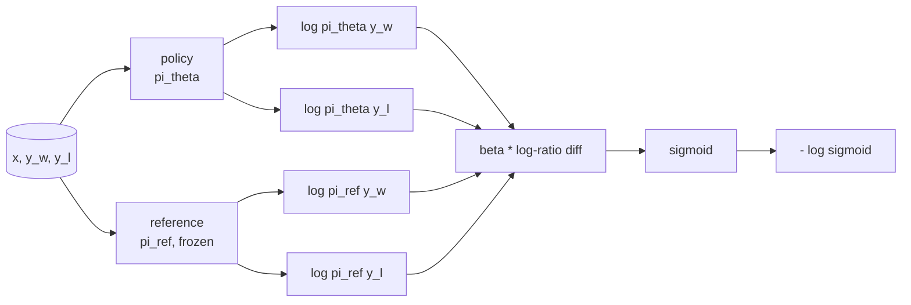
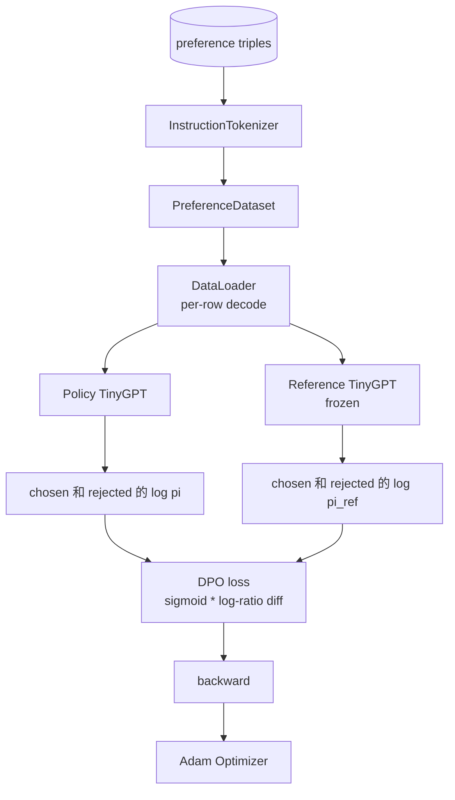

# Capstone  पाठ 40: शून्य से प्रत्यक्ष वरीयता अनुकूलन को प्राप्त करना

> रिवार्ड मॉडल 和 पीपीओ है क्लासिक आरएलएचएफ स्टैक。 डीपीओ इस स्टैक को एक पर्यवेक्षित हानि में संपीड़ित करेगा, सीधे प्राथमिकता जोड़े के साथ 拟合政策。本课会从奖励差异身份推导 DPO हानि,提供可工作的参考模型加政策模型,计算每代币日志-सम्भावनाएं, और एक द्वारा चुना गया और अस्वीकृत पूर्णता 组成的偏好固定上训练小变压器──测试固定损失数学和渐进方向,让你知道与文件实现 一致

**Type:** Build
**Languages:** Python (torch, numpy)
**Prerequisites:** Phase 19 lessons 30-37 (NLP LLM track: tokenizer, embedding table, attention block, transformer body, pre-training loop, checkpointing, generation, perplexity)
**Time:** ~90 minutes

## सीखने के लक्ष्य

-  DPO हानि 推导                                                                                                                                                                                                                                                           
- निर्माण संदर्भ मॉडल + नीति मॉडल जोड़ी, जिसमें से संदर्भ जमे हुए नीति प्रशिक्षित हो सके
- में दो मॉडल नीचे क्रम स्तर लॉग-संभाव्यताओं की गणना,并 मुखौटा शीघ्र टोकनों
- `(prompt, chosen, rejected)`तीन बार ऊपर प्रशिक्षण नीति,并观察 चयनित लॉग-प्रोब तुलना में अस्वीकार किया ऊपर चढ़े
- प्रयोग परीक्षण 固定 Loss math、Gradient sign 和 संदर्भ अपरिवर्तनीयता का व्यवहार

## समस्या

आपके पास एक एसएफटी मॉडल है। यह निर्देशों का पालन करेगा, लेकिन आउटपुट अस्थिर है; कुछ पूर्णताएं 清晰, कुछ冗长 या त्रुटि हैं। आपके पास एक छोटा सा प्राथमिकता जोड़ी डेटासेट भी है। एक ही प्रॉम्प्ट के लिए, मानव एक पूर्णता 标为 चुनेगा, दूसरा 标为 अस्वीकार किया जाएगा।

经典 RLHF 答案是两阶段管道――先用偏好――训练奖励模型――再用 PPO 根据奖励 优化政策―― यह संभव है, लेकिन लागत बहुत उच्च हैःPPO 期间内存中有两个模型,需要 KL控制让政策 接近参考,且当奖励模型 脆弱时会出现奖励黑客――

डीपीओ एक पर्यवेक्षित हानि का उपयोग करता है                                                                                                                                                                                                                                                                                                                                                                                                                                                                                                                  

## अवधारणा

ब्रैडली-टेरी मॉडल से शुरू करें`x`और दो पूर्णता `y_w`(चयनित)`y_l`(अस्वीकृत), मानव偏好 `y_w`की संभावना है

```math
P(y_w > y_l \mid x) = \sigma\big( r(x, y_w) - r(x, y_l) \big)
```

उनमें से `r`RHF पूर्वनिर्धारित प्राथमिकता 拟合 `r`, फिर प्रशिक्षण नीति `pi`, KL एंकर के साथ अधिकतम `r`:

```math
\max_{\pi} \; \mathbb{E}_{x, y \sim \pi} \big[ r(x, y) \big] - \beta \, \mathrm{KL}(\pi \,\|\, \pi_{\text{ref}})
```

डीपीओ  अनुशंसा  यह ध्यान देने के लिए कि, इस उद्देश्य के तहत, अनुकूल नीति `pi*`इस्तेमाल किया जा सकता है `r`写成 बंद रूप मेंः

```math
\pi^*(y \mid x) = \frac{1}{Z(x)} \, \pi_{\text{ref}}(y \mid x) \exp\!\left( \frac{r(x, y)}{\beta} \right)
```

`r`重新整理:

```math
r(x, y) = \beta \big( \log \pi^*(y \mid x) - \log \pi_{\text{ref}}(y \mid x) \big) + \beta \log Z(x)
```

`log Z(x)`项对 `y_w`和 `y_l`समान रूप से यह निर्भर करता है`x`, बजाय `y`), इसलिए गणना में प्राथमिकता अंतर 时会抵消:

```math
\begin{aligned}
r(x, y_w) - r(x, y_l) = \beta \big( &\log \pi_\theta(y_w \mid x) - \log \pi_{\text{ref}}(y_w \mid x) \\
&- \log \pi_\theta(y_l \mid x) + \log \pi_{\text{ref}}(y_l \mid x) \big)
\end{aligned}
```

代入 ब्रैडली-टेरी सिग्मोइड,并对偏好对取负记录概率:

```math
\begin{aligned}
L_{\text{DPO}}(\theta) = -\mathbb{E}_{(x, y_w, y_l)} \Big[
  \log \sigma\big( \beta \big( &\log \pi_\theta(y_w \mid x) - \log \pi_{\text{ref}}(y_w \mid x) \\
  &- \log \pi_\theta(y_l \mid x) + \log \pi_{\text{ref}}(y_l \mid x) \big) \big)
\Big]
\end{aligned}
```

यह एक हानि है। यह प्रत्येक उदाहरण पर एक संकेत मात्रा पर सिग्मोइड है, इस संकेत मात्रा को चार लॉग-संभाव्यताओं से गणना की जाती है।



## गिरने का संकेत

किसी भी प्रशिक्षण के संचालन से पहले एक उपयोगी मानसिक जांच होती है।`log pi_theta(y_w | x)`求 ग्रेडिएंट:

```math
\frac{\partial L_{\text{DPO}}}{\partial \log \pi_\theta(y_w \mid x)} = -\beta \big(1 - \sigma(z)\big)
```

उनमें से `z`यह सब के लिए है।`z`                                                                                                                                                                                                                                                              `log pi_theta(y_l | x)`                                                                                                                                                                                                                                                              

## आंकड़े

इस वर्ग में 12 प्राथमिकताएं हैं।`(prompt, chosen, rejected)`◊ चयनित समापन 短且精确── अस्वीकार 冗长、偏题或错误── ये जोड़े 覆盖与课39 相同的任务族 पूंजी、算术、列表), इसलिए एसएफटी आधार 开始的政策会有一个合理起点──

फिक्स्चर को बहुत ही छोटा डिज़ाइन किया गया है। उत्पादन में डीपीओ हजारों जोड़े का उपयोग करेगा; इसका मुख्य बिंदु है कि लॉस मैथ्स और लूप  सक्षम हो सकता है छोटे डेटासेट में अपेरेंड टू एंड रन करें, और चयनित-बिरुद्ध-प्रति-प्रति-प्रति-प्रबंधित लॉग-प्रोब अंतर होगा स्पष्ट रूप से बढ़े।

## संदर्भ अपरिवर्तनीयता

डीपीओ को पूरा करने के लिए संदर्भ मॉडल को ध्यान से संसाधित करना होगा।

- संदर्भ मापदंड  कभी ग्रैडिएंट्स प्राप्त नहीं करेंगे 
- संदर्भ लॉग-संभाव्यताएँ युगों के बीच कभी नहीं बदलती हैं।
- नीति से तुलना तुलना के समान वजन 开始──(उत्तम `theta`(इसे संदर्भ के साथ-साथ सीखा गया अद्यतन;将政策初始化为参考的副本是明确的开始──)

 निम्नलिखित तरीकों से इन गुणों को अनिवार्य करनाः

- आगे की उत्तीर्णियाँ 期间用 `torch.no_grad()`包裹引用──
- प्रत्येक संदर्भ पैरामीटर के लिए  सेटिंग `requires_grad=False`
-                                                                                                                                                                                                                                                                                                                                                                                                                                                                                                                              `policy.load_state_dict(reference.state_dict())`构建政策──


```figure
cap-dpo-preference
```

## वास्तुकला



模型与教训39 中使用的TinyGPT 相同的(केवल-डेकोडर、कारण、बाइट टोकनराइज़र) ⋅ संदर्भ 和 नीति 共享架构; प्रशिक्षण के दौरान नीति के वजन संदर्भ 发生漂移, जबकि संदर्भ 保持固定──

## आप क्या बना देंगे

实现由一个 `main.py`加 परीक्षण 组成──

1. `InstructionTokenizer`带`INST`和 `RESP`विशेष का बाइट टोकनराइज़र──आकार与课39 相同──
2. `TinyGPT`. . . . . . . . . . . . . . . . . . . . . . . . . . . . . . . . . . . . . . . . . . . . . . . . . . . . . . . . . . . . . . . . . . . . . . . . . . . . . . . . . . . . . . . . . . . . . . . . . . . . . . . . . . . . . . . . . . . . . . . . . . . . . . . . . . . . . . . . . . . . . . . . . . . . . . . . . . . . . . . . . . . . . . . . . . . . . . . . . . . . . . . . . . . . . . . . . . . . . . . . . . . . . . . . . . . . . . . . . . . . . . . . . . . . . . . . . . . . . . . . . . . . . . . . . . . . . . . . . . . . . . . . . . . . . . . . . . . . . . . . . . . . . . . . . . . . . . . . . . . . . . . . . . . . . . . . . . . . . . . . . . . . . . . . . . . . . . . . . . . . . . . . . . . . . . . . . . . . . . . . . . . . . . . . . . . . . . . . . . . . . . . . . . . . . . . . . . . . . . . . . . . . . . . . . . . . . . . . . . . . . . . . . . . . . . . . . . . . . . . . . . . . . . . . . . . . . . . . . . . . . . . . . . . . . . . . . . . . . . . . . . . . . . . . . . . . . . . . . . . . . . . . . . . . . .
3. `make_preferences`: वापसी12 `(prompt, chosen, rejected)`तीन गुना
4. `sequence_log_prob`:给定模型、prompt prefix 和 पूरा, वापसी पूरा 上 अगले टोकन लॉग-संभाव्यताओं का योग和(不包含 शीघ्र-स्थिति योगदान)。
5. `dpo_loss`:接收四个日志-सम्भाव्यताओं 和 `beta`, प्रति उदाहरण हानि tensor और लॉगिंग के लिए उपयोग के लिए अप्रत्यक्ष इनाम डेल्टा लौटें
6. `train_dpo`: प्रति युग लूप, में नीति 和 संदर्भ 下计算 चुना गया तथा अस्वीकार लॉग-प्रोब्स, अनुप्रयोग हानि,并执行 आदम कदम
7. `evaluate_margins`:在任意时刻返回政策 下 औसत चयनित- अस्वीकार लॉग-संभाव्यता मार्जिन
8. `run_demo`: एक छोटे से वार्मिंग प्रीट्रेन से निर्माण संदर्भ 和 नीति, प्रतिकृति वजन, प्रशिक्षण三十步, प्रति चरण मुद्रण हानि 和 मार्जिन,并成功时至零 退出──

## डीपीओ का काम क्यों होता है

ब्रैडली-टेरी प्राथमिकता मॉडल में नीचे, डीपीओ RLHF के बराबर है, केवल अंतर पुरस्कार के पैरामीटरकरण में`r(x, y) = beta * (log pi(y|x) - log pi_ref(y|x))`पसंद से पहचान सकते हैं, सबसे ज्यादा एक बारे में `x`के फ़ंक्शन, जबकि यह भिन्नता मूल्य में抵消── बंद-रूप नीति 让你跳过显式奖励模型──KL प्रतिबंध 结构性施加的:`pi`तुलना `pi_ref`किसी भी विकृतियों से लॉग-रेशियो में बदलाव होता है, और सिग्मोइड बैठक में, इसलिए नीति में बहुत दूर से चलने के लिए गीले ग्रेडिएंट।

## लक्ष्य निर्धारित करें

- लॉग-प्रोबेबिलिटी योग  जोड़ लंबाई सामान्यीकरण: अपूर्ण लंबाई से अलग ⋅ लंबाई पूर्वाग्रह एक ज्ञात डीपीओ विफलता मोड है, मॉडल छोटी पूर्णताओं को प्राथमिकता देगा, क्योंकि उनकी लॉग-प्रोबेबिलिटीएं पूर्ण मूल्य पर अधिक हैं ⋅
- 添加 Loss के आईपीओ संस्करण: उपयोग `(z - 1)^2`替代sigmoid + log──比较它在固定上的融合──
- 添加一个标签-smoothing पैरामीटर,在硬选择-拒绝标签和均 0.5 之间插值──
- प्रयोग करें 风格)

实现会给你损失、参考不变和训练循环──数学是本课的核心──代码 让数学具体化──
