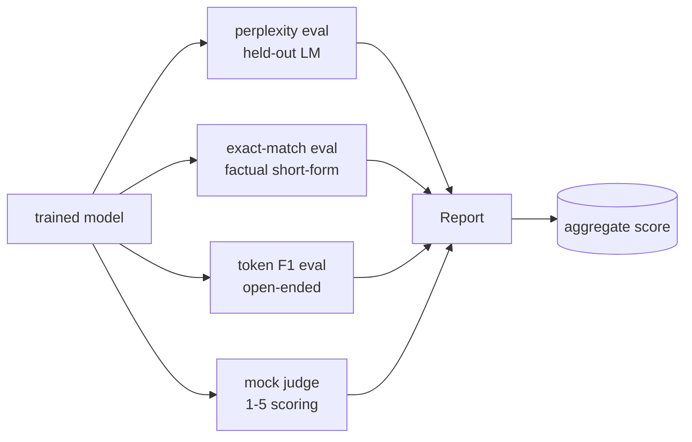
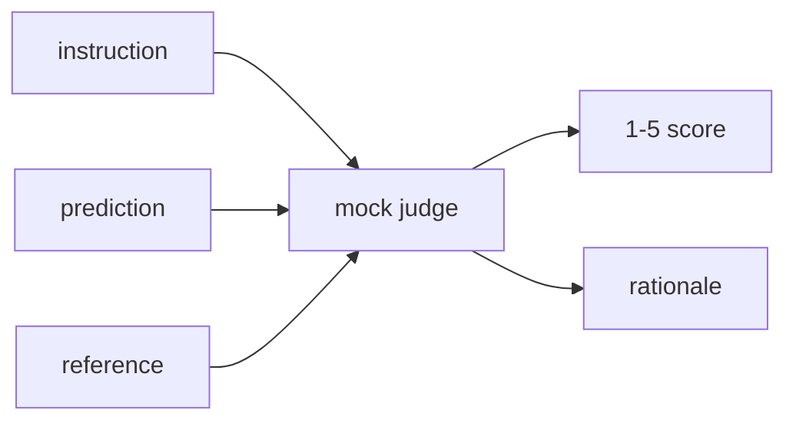
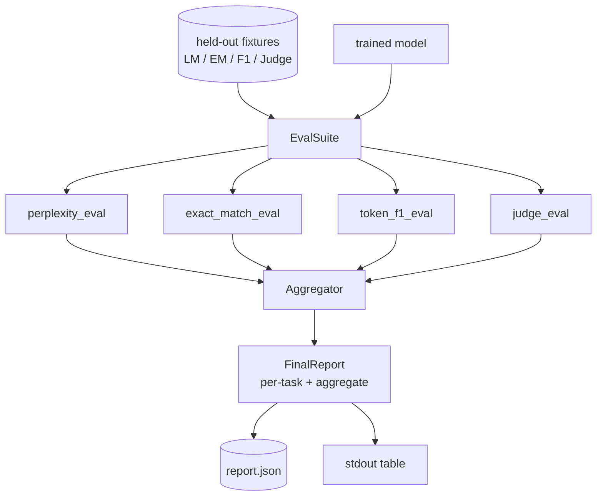

# कैपस्टोन पाठ 41: 完整 मूल्यांकन पाइपलाइन

> प्रशिक्षण एक हानि वक्रों का उपयोग कर सकते हैं  निगरानी का हिस्सा है। मूल्यांकन एक एकीकृत मूल्यांकन पाइपलाइन का निर्माण करेगाः यह एक अच्छी भाषा मॉडल को स्वीकार करता है, जिस पर चार अलग-अलग मूल्यांकन चलेंगे, परिणामों को एक साथ एक कार्य विभाजन रिपोर्ट के लिए एकत्रित करेगा, और एक स्थानीय मजाक LLM-जैसे-जिज प्रदान करेगा, ताकि पूरे लूप को भी चल सके।

**Type:** Build
**Languages:** Python (torch, numpy)
**Prerequisites:** Phase 19 lessons 30-37 (NLP LLM track: tokenizer, embedding table, attention block, transformer body, pre-training loop, checkpointing, generation, perplexity)
**Time:** ~90 minutes

## सीखने के लक्ष्य

- ️️️️️️️️️️️️️️️️️️️️️️️️️️️️️️️️️️️️️️️️️️️️️️️️️️️️️️️️️️️️️️️️️️️️️️️️️️️️️️️️️️️️️️️️️️️️️️️️️️️️️️️️️️️️️️️️️️️️️️️️️️️️️️️️️️️️️️️️️️️️️️️️️️️️️️️️️️️️️️️️️️️️️️️️️️️️️️️️️️️️️️️️️️️️️️️️️️️️️️️️️️️️️️️️️️️️️️️️️️️️️️️️️️️️️️️️️️️️️️️️️️️️️️️️️️️️️️️️️️️️️️️️️️️️️️️️️️️️️️️️️️️️️️️️️️️️️️️️️️️️️️️️️️️️️️️️️️️️️️️️️️️️️️️️️️️️️️️️️️️️️️️️️️️️️️️️️️️️️️️️️️️️️️️️️️️️️️️️️️️️️️️️️️️️️️️️️️️️️️️️️️️️️️️️️️️️️️️️️️️️️️️️️️️️️️️️️️️️️️️️️️️️️️️️️️️️️️️️️️️️️️️️️️️️️️️️️️️️️️️️️️️️️️️️️️️️️️️️️️️️️️️️️️️️
- में短事实提示上运行 सटीक मैच मूल्यांकन
- 通过正常化 计算预测与参考 字符串之间的 टोकन-स्तरीय F1──
-  एक स्थानीय नकली LLM-जैसे-न्यायाधीश का निर्माण, 1-5 分制给模型 आउटपुट 打分──
- चार प्रकार के मूल्यांकन को एक साथ एक एकल अधिभार रिपोर्ट में सामिल करना

## समस्या

单一指标 永远无法描述一个语言模型――语言分布的适应程度对语言分布的解释模型的困惑性,但不说明它是否能回答问题――精确匹配的解释模型是否产生的黄金字符串,但会惩罚正确的改写―― टोकन F1 会宽容的句子,但可能被错误内容中的词汇重叠 欺骗――LLM-as-judge 能捕捉定性维度,但成本高且随机性――

आप वास्तव में चाहते हैं पाइपलाइन एक ही समय में इन चार क्षमताओं है। प्रत्येक मूल्यांकन  कवर अन्य मूल्यांकन  चूक एक आयाम। प्रत्येक मूल्यांकन  चल रहा है इस मीट्रिक  डिजाइन के लिए अलग-अलग रखा डेटा 集上―― अंतिम रिपोर्ट 并排 प्रदर्शित करने के लिए प्रत्येक कार्य के अंक और संकलित, समीक्षक एक नज़र देखने के लिए मॉडल है कि क्या व्यापार-बंदियों कर रहे हैं।

यह सबक एक फाइल के बीच में होगा।

## अवधारणा



प्रत्येक मूल्यांकन एक से एक है`(model, dataset) -> EvalResult`फ़ंक्शनों के परिणामों में मेट्रिक मान शामिल हैं, उदाहरण प्रति विवरण के लिए उपयोग किए जाते हैं, साथ ही समग्र के लिए उपयोग किए जाते हैं।

## उलझन, सही ढंग से गिना

उलझन है`exp(mean negative log-likelihood per token)`                                                                                                                                                                                                                                                              

- अर्थ मुश्किल है वास्तविक टोकन पदों पर आधारित है, बैच * अनुक्रम पर नहीं।
- मॉडल 预测下一个 टोकन,所以位置 `i`预测位置 `i+1`                                                                                                                                                                                                                                                              

                                                                                                                                                                                                                                                                                                                                                                                                                                                                                                                             `-log p(token)`总和与 टोकन गिनती,最后再相除── यह औसत प्रति बैच जटिलताओं से अधिक संख्यात्मक सुरक्षा है, जो कि लघु अनुक्रमों के वजन का कम आकलन करते हैं, और यह पाठ्यपुस्तक की परिभाषा के अनुरूप है──

## सामान्यीकरण के साथ सटीक मेल

Harness 会在比较前 सामान्यीकरण पूर्वानुमान तथा संदर्भः

- 转为 लघु अक्षरों में
- सबसे पहले सफेद स्थान को हटाने के लिए
- आंतरिक निरंतर सफेद स्थान को एक स्थान में ढालेंगे
- यदि दोनों पक्ष केवल अंक के कारण अलग हैं, तो समाप्त हो जाता है`.``!``?`)。

सामान्यीकरण 让精确匹配 在实践中有用──模型说 `"Paris"``"Paris."`यह भी सही है; कहना `"  paris  "`यह भी है के लिए। यह मेट्रिक अभी भी सामान्यीकरण की आवश्यकता है।

## टोकन F1, सही रास्ते पर

टोकन F1 बैग-ऑफ-टोकन पर आधारित है  गणना की सटीकता और याद करने के सामंजस्यपूर्ण अर्थ── चरणः

1. सामान्यीकरण पूर्वानुमान 和 संदर्भ((से सटीक-मिलान 相同规则)
2. 列表 (White Space Tokenation) 
3. 统计 बहुसेट चौराहे──
4. सटीकता = `intersection_count / len(pred_tokens)`❖ याद करना = `intersection_count / len(ref_tokens)`◊ F1 = सामंजस्य औसत

यदि भविष्यवाणी व संदर्भ 都为空, F1 为 1(शून्य मैच) ⋅ यदि केवल एक पक्ष为空, F1 为 0── यह मॉडल SQuAD मूल्यांकन संदर्भ के अनुरूप है, तो यह परिच्छेदनों में स्थिर संख्या उत्पन्न कर सकता है──

## स्थानीय नकली LLM-जैसे-जजज

असली न्यायाधीश एपीआई के पीछे सीमा मॉडल है। इस वर्ग में न्यायाधीश है।`{1, 2, 3, 4, 5}`एक अंक और एक पंक्ति तर्क।

- यदि सामान्य भविष्यवाणी सामान्य संदर्भ के समान हो, तो 5
- यदि पूर्वानुमान और संदर्भ के बीच टोकन F1 कम से कम 0.8 है, तो 4 है।
- यदि F1 टोकन  स्थित `[0.5, 0.8)`, तो 3 के लिए
- यदि F1 टोकन  स्थित `[0.2, 0.5)`, तो 2 के लिए
- 其他情况为 1──

यह वास्तविक न्यायाधीश नहीं है, लेकिन इसमें सही इंटरफ़ेस है। इसके बाद केवल एक फ़ंक्शन को बदलने की आवश्यकता है जो वास्तविक मॉडल में शामिल हो सकता है।



## संश्लेषण

समग्र सामान्य मूल्यांकन स्कोर का वजन किया गया औसत है। प्रत्येक मूल्यांकन अपने आप को रिपोर्ट करता है।`[0, 1]`मध्य संख्याः

- उलझन: सामान्य होना`1 / (1 + log(perplexity))`मिस्कता 为 1 映射到 1,असीमता 映射到0──
- सही मैच: पहले से ही है`[0, 1]`मध्य में
- टोकन F1: पहले से ही है`[0, 1]`मध्य में
- न्यायाधीश: 5 से अलग

वजन को कॉन्फ़िगर किया जा सकता है। यह 0.2 की जटिलता है। 0.3 सटीक मैच है। 0.3 टोकन F1 है। 0.2 का निर्णयकर्ता है। वजन का चयन एक उत्पाद निर्णय है।


```figure
cg-eval-quadrant
```

## वास्तुकला



`EvalSuite`एक बहुत ही कम ऑर्केस्ट्रेटर है. प्रत्येक स्वतंत्र मूल्यांकन एक मुक्त कार्य है, प्राप्त करने के लिए.`(model, tokenizer, dataset, config)`और वापस नहीं आया`EvalResult``Aggregator`收集结果并生成最终报告──demo 会打印表格,并写入一个JSON副本,供下游CI摄入──

## आप क्या बना देंगे

实现 एक `main.py`अतिरिक्त परीक्षणों

1. `TinyGPT`:lections 38-40 中使用的同一个解码式架构,内置在本课中以便独立运行──
2. `InstructionTokenizer`:带 INST / RESP / PAD विशेषताओं का बाइट टोकनराइज़र。
3. चार फिक्स्चर:LM corpus,EM सेट,F1 सेट,आध्यायकर्ता सेट, प्रत्येक समूह,परिणामात्मक
4. `perplexity_eval`: वापसी में उलझन मान और प्रति टोकन हानि हिस्टोग्राम शामिल है `EvalResult`
5. `exact_match_eval`: प्रति उदाहरण रिकॉर्डों में औसत EM 和 वापसी
6. `token_f1_eval`: प्रति उदाहरण रिकॉर्ड F1 和 औसत टोकन वापसी
7. `mock_judge`和 `judge_eval`: प्रति उदाहरण स्कोर के साथ तर्क, तथा इस सेट के ऊपर औसत स्कोर
8. `Aggregator.normalise`:प्रति-वार्षिक सामान्यीकरण नियम
9. `Aggregator.aggregate`: वजन औसत 和组装后的报告──
10. `run_demo`: अल्पकालिक प्रशिक्षण एक छोटा मॉडल,运行全部四种 eval, मुद्रण रिपोर्ट तालिका 并写入 JSON, सफलता时以零 退出──

## रिपोर्ट पढ़ना

रिपोर्ट में तीन स्तरों के लिए सबसे ऊपरी स्तर एक समग्र स्कोर है। नीचे चार प्रति-उपमान संख्याएं हैं। फिर नीचे एक उदाहरण के लिए विश्लेषण के लिए उपयोग किया जाता है।

JSON डंप प्रयोग स्थिर कुंजी, आइए CI डैशबोर्ड को पार संस्करण ट्रेंड लाइनों को आकर्षित कर सकता है──बहुत-मुद्रित तालिका 面向训练运行后着终端 的人类──

## लक्ष्य निर्धारित करें

- 添加校准评估:model के softmax संभावनाएँ क्या इसकी सटीकता से मेल खाती हैं?
- 添加强度 eval:给每一个例子 标注扰乱(type、paraphrase、distractor),并报告每类扰乱的度量下降──
- HTTP कॉल के बाद वास्तविक मॉडल का उपयोग करें फ़ॉक्स जज को बदलने के लिए फ़ंक्शन हस्ताक्षर 不变──
- 添加 प्रति टास्क वजन सीखना: 不使用固定 वजन, बल्कि मॉडल के आधार पर 上的目标偏好顺序 拟合重量──

इस प्रकार यह चार प्रकार के मूल्यांकन एग्रीगेटर और रिपोर्ट प्रदान करता है। वास्तविक मूल्यांकन पाइपलाइनें इस पर अधिक आयामों को जोड़ती हैं।
