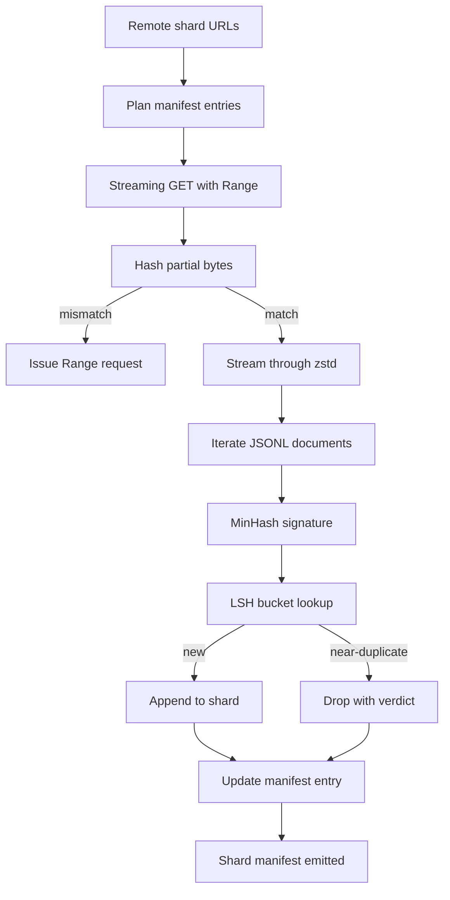

# बड़ा कॉर्पस डाउनलोडर

> 训练语言模型 早在第一次前进通过 之前就开始了──corpus 必须落到磁盘上,完成解压缩,除复制,并且可地址;在网络 4% 处断掉之前,再录故事就已经要设计好──本课会构建一个流媒体下载器:它拉取压缩的片段,使用Zstandard 边下边解压缩,通过 MinHash加本地敏感哈希为近似复制生成指纹,并写的片段,让管道的其余部分可以信任──

**Type:** Build
**Languages:** Python
**Prerequisites:** Phase 19 lessons 30-37
**Time:** ~90 minutes

## सीखने के लक्ष्य

- उपयोग `urllib`रिमोट शार्ड स्ट्रीम,并用 `zstandard`डिसीम्प्रेस, पूरी फ़ाइल बफर को स्मृति में से बचाने के लिए
- 针对 सत्यापित बाइट्स ऑफसेट 发起 HTTP `Range`अनुरोधों को पुनः आरंभ करने के लिए आंशिक डाउनलोडों को जारी रखना
- प्रत्येक दस्तावेज़ के लिए MinHash हस्ताक्षर का निर्माण करें, LSH के साथ विभाजित बैरल का उपयोग करें, जिससे निकट-डूप्लिकेट टकराव हो सके।
- 输出包含内容哈希、बाइट आकार、 दस्तावेज़ संख्या 和 dedup फैसले के टुकड़े प्रपत्र

## समस्या

पहली बार 200 जीबी कॉर्पस में प्रशिक्षण के दौरान, नेटवर्क में 41 प्रतिशत टूट गया, स्क्रिप्ट से`urllib`अपवाद 退出──第二次它在百分百78处断掉──到了百分百99,你已经重写了循环三次──你从第一分钟起就必须设计应对的两个失败点是部分下载简历和重复文件删除──两者都有成熟方案;两者也经常被跳过,因为管道一开始只是一个长出问题单行.`requests.get`कॉल करें

Resume is a HTTP 问题──server 必须支持 `Range`,क्लाइंट आवश्यक है कि डिस्क पर रिकॉर्ड के आधार पर सत्यापित ऑफसेट का पालन करें, जबकि सत्यापित ऑफसेट आवश्यक है कि प्रक्रिया की मृत्यु के बाद बनाए रखा जाए।

डिडप्लिकेशन एक हस्ताक्षर है  समस्या  सटीक-हश डिडप्लिकेट लगभग डुप्लिकेट खो जाएगा: एक ही विकिपीडिया लेख  तीन अलग-अलग बॉयलर प्लेट पैरों के साथ प्रकट, एक ही कोड फ़ाइल  अलग लाइसेंस हेडर के साथ, एक ही ब्लॉग पोस्ट के प्रत्येक लिंक  ट्रैकिंग पैरामीटर  MinHash + LSH  कर सकते हैं उप-रेखीय लागत  कब्जा इन स्थितियों  लागत  प्रत्येक दस्तावेज़ एक हस्ताक्षर, साथ ही प्रत्येक हस्ताक्षर एक बार बाल्टी खोज 

## अवधारणा



### `urllib`

मानक पुस्तकालय `urllib.request.urlopen`返回 फ़ाइल-जैसे वस्तु──将它包在 `zstandard.ZstdDecompressor().stream_reader`मध्य,बाइट्स नेटवर्क से 流经解压缩机, फिर से दस्तावेज़ पुनरावर्तक में प्रवेश करते हैं, पूरी तरह से स्मृति में संपीड़ित टुकड़ा या संपीड़ित टुकड़ा को सामग्री बनाने की आवश्यकता नहीं है। एकमात्र स्मृति लागत लाइन बफर है।

###  के साथ फिर से शुरू करें`Range`

डाउनलोड करने वाला प्रत्येक टुकड़ा के लिए 写两个文件:`.partial.json`चेकपॉइंट`verified_bytes``expected_size``sha256_prefix`(आधारित `verified_bytes`बाइट्स  गणना) और स्रोत URL── प्रारंभ करते समय, डाउनलोडर 读取 चेकपॉइंट, ऑन-डिस्क बाइट्स पर आधारित 重新计算 `sha256_prefix`, और केवल पुनः गणना में हैश 匹配时才恢复── यदि हैश 错误, आंशिक会被丢弃, डाउनलोड शून्य बाइट से重新开始── चूंकि सत्यापित बाइट्स की जांच की जाती है, न कि परिकल्पना की जाती है, इसलिए चुपके भ्रष्टाचार संभव नहीं है।

### मिनाश प्लस एलएसएच

MinHash ने दो सेटों के जैकार्ड समानता का अनुमान लगाने के लिए एक निश्चित स्थान का उपयोग किया।`k`个最小哈希值, प्रत्येक एक स्वतंत्र हैश फ़ंक्शन से 个最小哈希值,两个 जैकार्ड समानता 为 `s`दस्तावेजों के हस्ताक्षर के किसी भी एकल घटक पर सहमति की संभावना है`s`

 तब LSH 将 `k`个 घटक 分为 `b`个乐队, प्रत्येक乐队有 `r`पंक्तियाँ, उनमें से `k = b * r`◊ दो दस्तावेजों में कम से कम एक बैंड में टक्कर की संभावना है `1 - (1 - s^r)^b`, यह आप के लिए होगा ।`(b, r)`调优的 `s`值附近形成尖门──典型 corpus dedup के लिए `s = 0.8`,LSH अनुसंधान साहित्य के साथ`k = 128``b = 32``r = 4` इस बिंदु पर पहुँचना

### अनुबंध के रूप में टुकड़ा प्रपत्र

डाउनलोडर  एकमात्र टिकाऊ आउटपुट है manifest.manifest 按 shard 保存 URL、decompressed byte count、document count、dedup 后的独特 दस्तावेज़ count,以及 अंतिम shard file के sha256── डाउनस्ट्रीम टोकनकरण 读取 manifest, न कि निर्देशिका सूचीकरण── यदि कोई शार्ट 缺失或其 sha256 错误,manifest 会告诉下一阶段拒绝启动──manifest data 已下载与 data 已下载和可验证 之间决定性边界──


```figure
cap-corpus-downloader
```

## इसे बनाओ

`code/main.py`实现:

- `ShardPlanner`- 读取 shard URL 列表并生成 नियोजित घोषणा पत्र प्रविष्टियाँ。
- `StreamingDownloader`- 打开带 वैकल्पिक `Range``urllib`धारा, लिखें अस्थायी फ़ाइल, में प्रत्येक टुकड़ा  अद्यतन `.partial.json`चेकपॉइंट, और फिर से शुरू करें 时验证 sha256 पूर्वावलोकन
- `ZstdDocIterator`- फ़ाइल की तरह धारा 包在 `zstandard.ZstdDecompressor`मध्य,并逐行 yield एक दस्तावेज──
- `MinHasher`- उपयोग फिक्स्ड हैश बीज परिवार के लिए स्ट्रिंग उत्पादन `k`- घटक हस्ताक्षर
- `LSHIndex`- ् ् ् ् ् ् ् ् ् ् ् ् ् ् ् ् ् ् ् ् ् ् ् ् ् ् ् ् ् ् ् ् ् ् ् ् ् ् ् ् ् ् ् ् ् ् ् ् ् ् ् ् ् ् ् ् ् ् ् ् ् ् ् ् ् ् ् ् ् ् ् ् ् ् ् ् ् ् ् ् ् ् ् ् ् ् ् ् ् ् ् ् ् ् ् ् ् ् ् ् ् ् ् ् ् ् ् ् ् ् ् ् ् ् ् ् ् ् ् ् ् ् ् ् ् ् ् ् ् ् ् ् ् ् ् ् ् ् ् ् ् ् ् ् ् ् ् ् ् ् ् ् ् ् ् ् ् ् ् ् ् ् ् ् ् ् ् ् ् ् ् ् ् ् ् ् ् ् ् ् ् ् ् ् ् ् ् ् ् ् ् ् ् ् ् ् ् ् ् ् ् ् ् ् ् ् ् ् ् ् ् ् ् ् ् ् ् ् ् ् ् ् ् ् ् ् ् ् ् ् ् ् ् ् ् ् ् ् ् ् ् ् ् ् ् ् ् ् ् ् ् ् ् ् 
- `Dedup`- 组合 हैशर 和 सूचकांक, प्रत्येक दस्तावेज़ 标记为 `keep`या `near_duplicate`,并附附相应碎片 id──
- `ManifestWriter`-  प्रति शेयर आंकड़े एकत्र करें और लिखें `manifest.json`

文件底部的演示会在磁盘上构建一个小型合成体,使用 `zstandard` इसे संपीड़ित, के माध्यम से `file://`URL डाउनलोड, निष्पादन डुप्लिकेट,并印表──

运行它:

```bash
python3 code/main.py
```

स्क्रिप्ट 以 शून्य 退出并印印 मुखौटा सारांश

## उत्पादन के पैटर्न

चार पैटर्न वास्तविक शरीरों में विस्तारित हो सकते हैं।

**Checkpoint before write.** `.partial.json`必須在字節 添加到碎片 之前完成 `fsync`△否则电源损失 会颠倒顺序:disk上,checkpoint中没有它们,下一次再起 认为验证字节比实际更少,翻译后音字节会损坏文件──先检查点,再写――这与写前日志是同样的学科──

**Sharded LSH index.**200 जीबी के पैमाने पर, पूरे कॉर्पस के एकल LSH सूचकांक को कवर करें 放不进 RAM── पहले बैंड हैश 分区 LSH सूचकांक के अनुसार, विभाजन डिस्क पर मौजूद होंगे, और केवल नए हस्ताक्षर का पता लगाएंगे विभाजन 落入 होगा── लागत प्रत्येक दस्तावेज़ एक अतिरिक्त डिस्क रीड है; लाभ LSH सूचकांक ️ हार्ड मेमोरी छत है──

**Tombstone, not delete.**डबली छोड़ दिया गया है, फैसले के लिए किया जाएगा।`near_duplicate`और उनके टकराव के दस्तावेज का शार्ड आईडी  रिकॉर्ड में मैनिफेस्ट में ∙ हटाए जाने से उन्हें ठेकेदार के साथ लिंक खो जाएगा ∙ टंबस्टोनिंग ऑडिट ट्रेल को बनाए रखेगा, और नीचे की ओर जाने के बाद सीमा का निर्णय बदल सकता है ∙

**Per-shard sha256 in the manifest, plus a manifest sha256.**manifest 自身 भी सामग्री हैश प्राप्त करेगा। डाउनस्ट्रीम चरणों में 会在信任 प्रति-शेड प्रविष्टियाँ 之前验证 manifest hash── कोई यह तंत्र नहीं है, manifest 就是 मौन हमला सतह:能编辑单个文件的攻击者可以破坏整个管道──

## इसका प्रयोग करें

उत्पादन के पैटर्नः

- **Resume on every CI run.**CI runners  ephemeral  डाउनलोडर  अनिवार्य रूप से हर बार चलाने  सभी ताजा डिस्क, और कैश या रिमोट से पुनर्प्राप्त `--cache-dir`यह प्रथम श्रेणी का ध्वज है।
- **Dedup before tokenization.**टोकनाइज़ेशन  बहुत महंगी है। एक ही दस्तावेज़ में ऊपर दो बार चल रहा है, ताकि एक ही हानि वक्र  भुगतान दो गुना लागत।
- **Manifest as merge gate.**प्रशिक्षण रन से पिन किए गए commit से 读取 manifest sha256。 नए डेटासेट संस्करण 需要新的 manifest commit──code और data  के बीच की कड़ी है git, न कि mouthpucket相传──

## इसे भेजें

`outputs/skill-corpus-downloader.md`वास्तविक परियोजना में वर्णन करें कि कौन से URL  डाउनलोड करने वाले को प्रदान करें  चेकपॉइंट निर्देशिका  कैसे व्यवस्था                                                                                                                                                                                                                                                                                                                                                                                                                                                                                                    `(k, b, r)`तीन, तथा प्रकट में संस्करण नियंत्रण में स्थान.

## व्यायाम

1. 添加 `--shingle-width`flag,并测量 dedup verdict 在 चौड़ाई 3、5、9 下如何变化──为选择的默认值辩护──
2. 通过嗅探魔法字节,在 zstd 旁边添加 gzip 支持── डाउनलोडर 不应要求调用者 指定代码──
3. 添加 `--resume-only`मोडः यदि चेकपॉइंट तक नहीं मिलता है, तो नया डाउनलोड शुरू करने से इनकार करें।
4. LSH सूचकांक को शेल्फ या स्क्लाईट फ़ाइल में स्थानांतरित करना, मेमोरी में वैरिएंट के साथ पारगमन का अंतर को मापना
5. प्रारंभ करते समय मैनिफेस्ट Sha256 चेक करें`manifest.lock`中的表格哈希 不一致,डाउनलोडर 应故障关闭──

## प्रमुख शर्तें

| Term | What people say | What it actually means |
|------|-----------------|------------------------|
| Shard | “一个 file” | corpus 的一个自包含 slice，拥有自己的 sha256，并作为 resume 和 dedup 的单位 |
| MinHash signature | “Fingerprint” | 一个 set 的 `k`-component sketch，其中每个 component 是该 set 上一个 independent hash 的最小值 |
| LSH band | “Bucket” | 一组 `r` 个 signature components，用作 collision detection 的单个 bucket key |
| Verified bytes | “Resume offset” | disk 上 sha256 prefix 与 checkpoint 匹配的 bytes；唯一安全的 resume offset |
| Manifest | “The index” | downloader 产出的单一 durable record，包含 content hashes |

## आगे पढ़ना

- [RFC 7233](https://datatracker.ietf.org/doc/html/rfc7233)- HTTP रेंज अनुरोध, यानी रिज़्यूमे प्रोटोकॉल
- [Zstandard format specification](https://datatracker.ietf.org/doc/html/rfc8478)- 让 प्रवाह विघटन सुरक्षित फ्रेम प्रारूप
- [MinHash](https://en.wikipedia.org/wiki/MinHash)- 本课使用的 हस्ताक्षर परिवार
- [Locality-sensitive hashing](https://en.wikipedia.org/wiki/Locality-sensitive_hashing)- कटौती की सीमा 背后的 बैंडिंग योजना
- चरण 19 · 43 - डाउनलोडर  आपूर्ति की HDF5 टोकन corpus
- चरण 19 · 44 - में corpus ऊपर प्रशिक्षण के कॉसीन कार्यक्रम
- चरण 19 · 45 - 消耗该时间表的 AMP लूप
